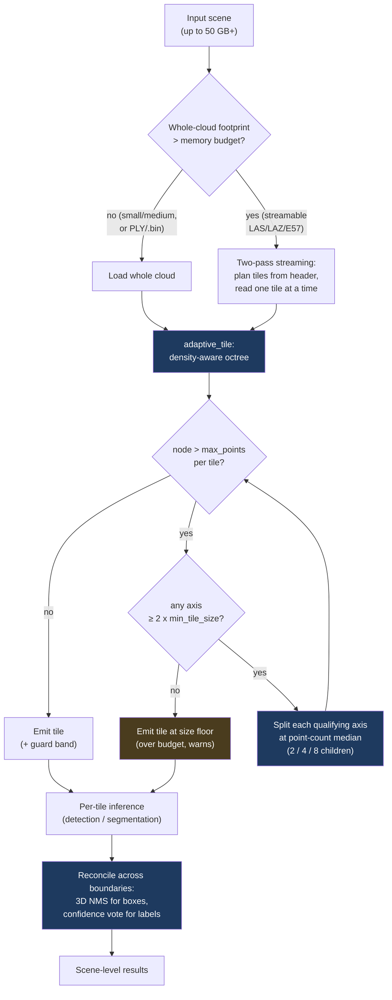

# Blog Post 2: Deep Dive — 3D Object Detection Pipeline Architecture

> **Sample code.** The code that accompanies this post is sample code for non-production
> usage. You should work with your security and legal teams to meet your organizational
> security, regulatory and compliance requirements before deployment.

<!-- AI-DLC will draft this; team reviews and refines -->

## Target: 2500-3500 words (technical audience)

## Outline

### The Challenge of Large-Scale Point Clouds
A single room scan is around 150,000 points. A construction site or a kilometre of
aerial LiDAR is tens of billions. Detection models expect a bounded input, tens of
thousands of points per forward pass, and no GPU holds a 50 GB scene at once. The
scene has to be cut into tiles, each tile run on its own, and the results stitched
back together without losing or double-counting anything at the seams.

### Adaptive Tiling Strategy

This is the central technical contribution of the pipeline, so it is worth
explaining as a technique rather than asserting as a feature. Detecting objects in a
50 GB scene comes down to getting three things right: how you cut the scene into
tiles, how much memory that costs, and how you stitch the per-tile results back
together. The pipeline handles all three automatically through adaptive tiling built
on a density-aware, axis-qualified octree.

#### The algorithm at a glance



#### 1. The split criterion — a density-aware, axis-qualified octree

Tiling is a recursive subdivision. A node splits when it holds more than the
per-tile point budget (`max_points_per_tile`, default 100,000, a point count rather
than a voxel count; there is no fixed grid).

The "axis-qualified" part is what makes it efficient on real data. A strict octree
cuts all three axes at every level, producing eight children each time. That is the
right move for a cubic, uniformly dense indoor room, but it is wasteful for the flat
or elongated scenes that outdoor LiDAR almost always produces: a scene 500 metres
wide but only a few metres tall does not benefit from being sliced vertically, and
doing so spends tiles, memory, and boundary cleanup on empty air. So the pipeline
splits only the axes still large enough to be worth splitting (extent at least
`2 x min_tile_size_m`). A cubic scene splits eight ways like a normal octree; a flat
scene degrades cleanly to a quadtree, roughly halving the tile count at that level.
Each tile is one inference call, so fewer tiles means less compute, less overlap
duplication, and fewer seams for the merge step to reconcile.

This is where the "density-aware" part comes in. Each cut is placed at the
**point-count median** along the axis, not the geometric midpoint. Because the
median follows where the points actually are, a dense cluster pulls the split plane
toward itself, and the cut lands in the sparse gap between clusters rather than
through the middle of one. Two things fall out of that. First, an object is less
likely to be sliced across a tile boundary, which means less duplicate work for the
merge step to undo later. Second, tiles end up holding roughly balanced *point
counts* rather than balanced *volume*: a dense corner of the scene subdivides more
finely than an empty one, so no single tile is left carrying a disproportionate
share of the points. The plane is clamped to
`[lo + min_tile_size_m, hi - min_tile_size_m]` so both children still clear the
minimum tile size.

Density-aware placement holds on the streaming path too. Streaming never loads the
whole cloud, so it cannot take a median over per-point coordinates. Instead, a cheap
first pass builds a coarse occupancy grid (a 3D histogram of point counts), and the
planner places each split at the occupancy-weighted median: the plane where roughly
half the region's points fall on each side, read straight from the histogram. It is
the same idea as the whole-load median, computed from counts rather than coordinates,
so a dense cluster in a streamed scene gets cut through rather than stranded in an
oversized tile. One irreducible limit remains: a cluster denser than the per-tile
budget within a single minimum-size tile cannot be subdivided below the floor, so such
a tile is emitted over budget with a warning rather than silently dropping points.

A candid note on scale, because it is easy to overclaim here. This design keeps
**peak memory** bounded regardless of scene size — that part is measured and holds.
Throughput was the harder problem. The first streaming implementation extracted each
tile with a per-tile scan over the point stream, so Pass 2 cost grew with tile count:
on a 300 M-point synthetic scene (A10G, stub backend) an occupancy-median plan of 71
tiles took **8 h 16 m**, dominated by that per-tile routing cost, not by inference. The
fix routes points through a precomputed cell→leaf map so each point is tested only
against the handful of candidate tiles its occupancy cell overlaps, instead of every
tile. On the same 300 M scene, same 71-tile plan, the run dropped to **39 m 41 s** —
about a **12x** speedup — with peak memory essentially flat (1.61 GB → 1.86 GB, far
under the 16 GB budget). That is a measured result on ~300 M points, not an
extrapolation.

A cluster denser than the per-tile point cap still forces an over-budget tile at the
size floor (167 such tiles in the 300 M scene), which the routing change does not
address — that is a planner limit, not an I/O one.

We then ran the full 50 GB tier, and it draws a clear line between the two claims. On a
genuine 49.92 GB scene (7.6 billion points), **peak memory held at about 2.9 GB with no
swap** — far under the 16 GB budget, even though the scene planned into ~10,000
over-budget tiles including one of 13.6 million points. So bounded memory *is* measured
at 50 GB, not just extrapolated: the memory claim holds at the real target size.
Throughput does **not**. That same run was CPU-bound and did not finish in 24 hours on
the stub backend, because the streaming path re-reads a file region per tile and ~10,000
tiles overwhelms even the ~12x routing speedup. The cell→leaf routing removed the
per-point cost; it did not change the per-tile re-read model, and at 50 GB that model is
the wall.

(The 2.9 GB peak above was read from a live process sample rather than a completed run's
final tally, since that run was stopped before finishing — but at 2.9 GB against a 16 GB
budget the margin makes the distinction immaterial.)

So we built the piece that removes the re-reads: each point is routed **once** into an
on-disk extract for the tile that owns it, and a tile is then rebuilt from its own
extract plus the overlapping neighbours it needs. The source file is walked once. Every
point carries its original row index, so a tile assembled from several extracts can be
put back into file order — which matters because voxel downsampling keeps the first
point per voxel, so order changes results.

With that in place the 50 GB tier finishes: **6 h 42 m, peak 4.25 GB**, under the
16 GB budget, against the 24 hours it previously failed to complete in.

Two caveats we would rather state than have a reader discover. These figures come from
single runs on one engineer's benchmark machine, not from CI, and the raw `time -v`
output should be published alongside them before anyone leans on them. And 50 GB is the
first benchmark tier, not the 500 GB design target — that number is still an
architectural claim, not a measured one.

There is exactly one case where a tile exceeds the budget: a region already at the
`min_tile_size_m` floor that is still too dense to cut further. Splitting harder is
impossible and capping the contents would silently drop real points, so the tile is
emitted intact and the overrun is surfaced in an aggregated warning — an honest
failure rather than a hidden one.

#### 2. Overlap — the guard band

If tiles simply partitioned space, an object on a boundary would be cut in two and
likely detected as nothing. So tiles **overlap**. The recursion tracks two sets of
points per node: the points strictly *inside* the tile region (which drive the split
decision and the budget), and the points inside the region *expanded by
`overlap_margin_m`*, default 2 m (the **guard band**, which becomes the tile's
contents). Neighbouring tiles share their overlap zone, so any object smaller than
the guard band is seen *whole* by at least one tile.

```
     tile A (core + right margin)      tile B (left margin + core)
   +---------------+.......+        +.......+---------------+
   |               | shared |        | shared |              |
   |       o ----------- object on the A|B boundary -------- |
   |               |  band  |        |  band  |              |
   +---------------+.......+        +.......+---------------+
        seen whole by BOTH tiles  ->  duplicate boxes  ->  3D NMS dedups
```

The cost is duplicate detections in the overlap — removed in step 4.

#### 3. Enforcing the memory budget

Tiling is pointless if you must load the whole scene to do it. The budget
(`memory_budget_gb`, default 16 GB) is enforced two ways. First, the per-tile cap is
**derived from the budget** — lowered, never raised, to whatever point count keeps
one tile's inference working set inside the budget. Second, a scene whose modelled
whole-load peak exceeds the budget is **streamed, never fully loaded**: pass one
reads only the file header for bounds and plans the tile extents; pass two reads
only the points inside each planned tile's guard-band extent, infers, and releases
the tile before the next. Peak memory is bounded by one tile, not the scene.

The routing decision that chooses streaming is calibrated against a *measured* peak:
`adaptive_tile` peaks at ~8.9x the raw cloud footprint at 2 m overlap (mostly
legitimately-retained overlapping tiles). An earlier naive 2x allowance let a 16 GB
budget whole-load an 8 GB scene that actually peaks near 29 GB — so the routing
factor is now 9.0, from measurement, not a guess.

Threading the guard-band candidate set down the tree keeps planning efficient: a
child's expanded region is always inside its parent's, so each level narrows the
previous level's points rather than rescanning the whole cloud — O(N x depth), where
depth is a handful, not O(N x tiles), where tiles run to hundreds of thousands.

#### 4. Reconciling across boundaries

**Duplicate boxes — global 3D NMS.** All per-tile detections are pooled and a single
non-maximum-suppression pass runs over the pool, per class, using 3D IoU above a
threshold *or* a centre-distance fallback for near-duplicates across a seam. Running
globally means a duplicate is removed regardless of which tile produced it.

**Per-point labels — confidence arbitration.** Segmentation has no NMS; each point
carries a global index, and a point in an overlap zone keeps the *highest-confidence*
label across the tiles that saw it. Overlap never double-counts a point. (This
reconciliation runs on the whole-load path, which holds a globally-indexed cloud; in
streaming mode — a scene too large to hold — segmentation is deliberately disabled
rather than silently wrong, and detection remains fully supported.)

#### Proving the scale claim

The technique above bounds memory *by construction* and is covered by unit tests.
What turns that into *proven at scale* is one end-to-end run per tier, measured with
`/usr/bin/time -v`:

| Scene | Format | Points | Budget | Peak RSS | Within budget? | Tiles | Detections (pre/post-NMS) |
|-------|--------|--------|--------|----------|----------------|-------|---------------------------|
| Room | PLY | ~0.15 M | 16 GB | _pending_ | (whole-load) | | |
| Floor | LAS | ~5 M | 16 GB | _pending_ | | | |
| Site | LAZ | 49.92 GB / 7.6 B | 16 GB | **4.25 GB** | yes | ~10,000 | not recorded |

Wall time for the large row: **6 h 42 m** (50 GB synthetic, stub backend).

<!-- BLOG-BLOCKER (narrowed): the large row is now measured, so the scale claim is
     no longer blocked. Do NOT revert it to _pending_. Still required before publishing:
       1. The Room and Floor rows — the small tiers were never formally measured.
       2. Detection counts (pre/post-NMS); none were recorded for any row.
       3. Raw `/usr/bin/time -v` output for the large row, committed under
          docs/benchmarks/. It is a single run on one engineer's bench box rather
          than CI, and should not be cited externally until those logs are in-repo.
     Procedure for the missing rows: docs/runbooks/validate-octree-tiling.md (part 2)
     + scripts/measure_tiling_memory.py. -->
<!-- TODO: publication-quality version of the mermaid algorithm diagram above -->

### Model Architecture Choices
<!-- TODO: FCAF3D vs VoteNet vs CenterPoint — when to use which -->
<!-- TODO: Indoor vs outdoor model selection logic -->
<!-- TODO: The domain gap problem and why fine-tuning matters -->

### Coordinate Frame Handling
<!-- TODO: Why different scanners produce different orientations -->
<!-- TODO: The 15+ supported frames (Livox, Leica, ROS, etc.) -->
<!-- TODO: Auto-alignment via PCA -->

### Event-Driven Processing on EKS
<!-- TODO: Upload → SQS → Worker architecture -->
<!-- TODO: Why queue-based over synchronous API -->
<!-- TODO: Scale-from-zero GPU nodes (cost optimization) -->

### Progressive 3D Visualization (LOD)
<!-- TODO: The browser memory problem with large point clouds -->
<!-- TODO: Octree tile generation for the viewer -->
<!-- TODO: Overview + detail on zoom approach -->

### Fine-Tuning Workflow
<!-- TODO: Transfer learning from pre-trained weights -->
<!-- TODO: Unified annotation format -->
<!-- TODO: mAP evaluation and A/B comparison -->

### Security & Resiliency Patterns
<!-- TODO: IRSA, network policies, DLQ, graceful shutdown -->

### Conclusion & Next Steps
<!-- TODO: What we learned, how to extend, how to contribute -->
