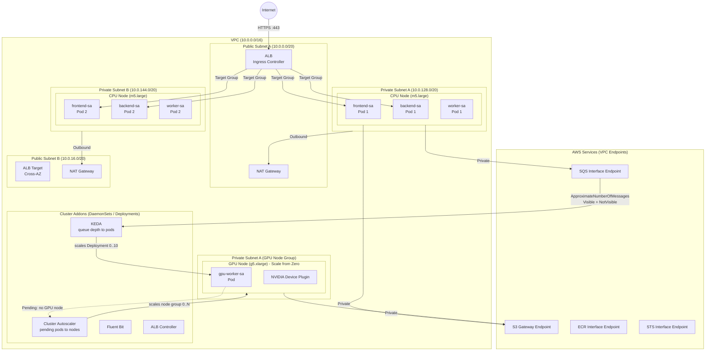

# EKS Cluster Topology

Network layout showing VPC, subnets, node groups, and pod placement.

## Node Groups

| Node Group | Instance Type | Min | Max | Purpose |
|-----------|--------------|-----|-----|---------|
| cpu-workers | m5.large | 2 | 6 | API, Frontend, Worker (stub) |
| gpu-inference | g5.xlarge | 0 | 4 | mmdet3d inference, fine-tuning |

## Service Accounts (IRSA)

| Service Account | Role | Permissions |
|----------------|------|-------------|
| backend-sa | backend-role | S3 put `uploads/*` (signs presigned uploads), S3 read `results/*` and `tiles/*`, SQS send, DynamoDB, KMS |
| worker-sa | worker-role | S3 read `uploads/*`, S3 put `results/*` and `tiles/*`, SQS consume, DynamoDB, KMS |
| frontend-sa | none | Static nginx; makes no AWS calls |
| training-sa | training-role | S3 RW (input + models), KMS |
| keda-operator (ns `keda`) | keda-operator role | `sqs:GetQueueAttributes` on the job queue only |

## Scaling Control Loop

Two tiers, because neither alone is sufficient — Cluster Autoscaler reacts only to
Pending pods, and nothing else creates pods from queue backlog.

| Tier | Controller | Signal | Range | Timing |
|------|-----------|--------|-------|--------|
| Queue to pods | KEDA `aws-sqs-queue` | `ApproximateNumberOfMessages` visible + in flight | 0 – 10 replicas | 30 s poll, 300 s cooldown, +3 pods/min |
| Pods to nodes | Cluster Autoscaler | Pending pods requesting `nvidia.com/gpu` | 0 – `max_size` per GPU pool | 5 m provision timeout, 5 m scale-down-unneeded |

`scaleOnInFlight: true` is required: a detection job holds its message in flight for
minutes while the visible count sits at 0, so counting only visible messages would
scale the last worker away mid-job.
