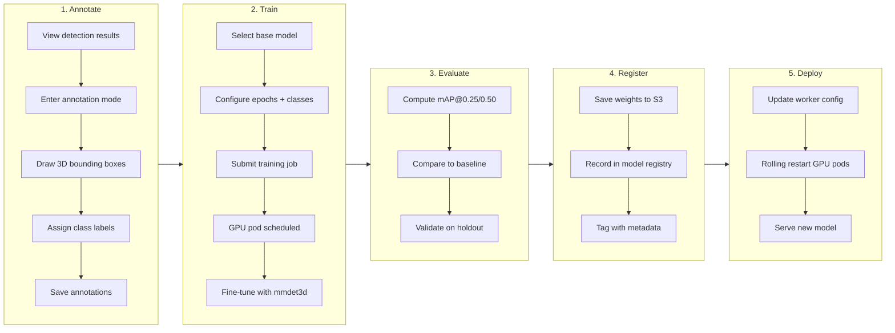

# Fine-Tuning Workflow

Process flow from annotation through model training to deployment.



## Supported Base Models

| Model | Architecture | Best For | Dataset |
|-------|-------------|----------|---------|
| votenet_scannet | VoteNet | Indoor scenes (doors, furniture) | ScanNet |
| fcaf3d_scannet | FCAF3D | Indoor scenes (dense) | ScanNet |
| pointpillars_kitti | PointPillars | Outdoor (vehicles, barriers) | KITTI/nuScenes |

## Training Data Format

```json
{
  "scene_id": "office-scan-001",
  "point_cloud_path": "s3://<your-input-bucket>/uploads/scan.bin",
  "num_annotations": 5,
  "annotations": [
    {
      "center_xyz": [1.2, 3.4, 0.8],
      "size_wlh": [0.9, 2.1, 2.0],
      "heading": 0.45,
      "class_name": "door"
    }
  ]
}
```

