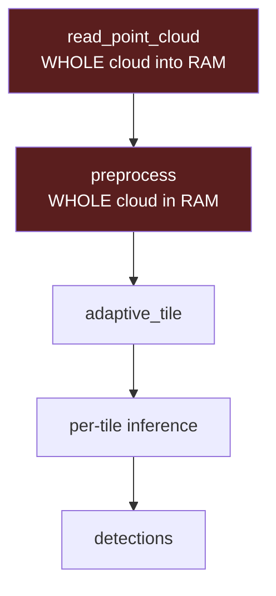
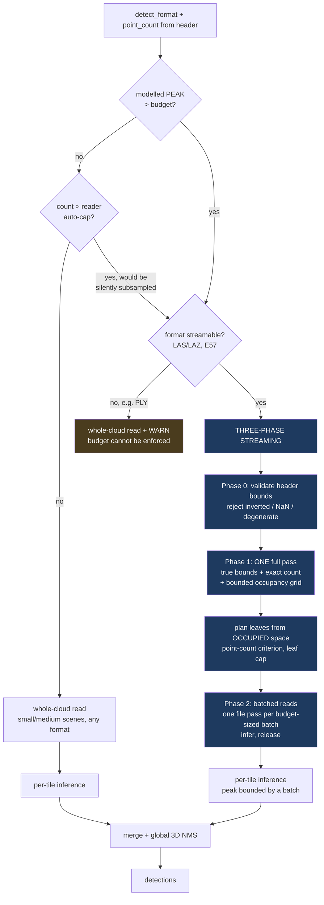

# Memory Budget Enforcement (NFR-1.1 / NFR-1.2) — Design & Intent

**Status: IMPLEMENTED, BENCHMARK PENDING.** This document describes the mechanism for
enforcing the configurable memory budget (default 16 GB) so the pipeline can process very
large scenes without OOM. It marks clearly what is **built**, what is **bounded but
unproven**, and what is **not covered**, so the blog can describe the design honestly and
the claim is only stated as *proven* once the on-hardware benchmark is green.

**Requirements this satisfies:**
- **NFR-1.1** (Must): Peak memory usage stays within a configurable budget (default 16 GB).
- **NFR-1.2** (Must): Process 500 GB+ datasets without crash or OOM.

**On the two figures.** Earlier revisions of this document used "50 GB" and "500 GB"
interchangeably, which made the headline ambiguous. They are not the same claim:

- **500 GB** is the NFR-1.2 requirement and the ceiling the design targets.
- **50 GB** is the first benchmark tier — the largest scene we can realistically stage
  and measure — and is what any "proven" statement will initially rest on.

Use 500 GB when describing the *design target* and 50 GB when describing *what has been
measured*. Do not use them as synonyms.

---

## The problem (behavior before this work)



Peak memory is set by the **whole scene**, so a 50 GB cloud needs ~50 GB+ of RAM
regardless of `memory_budget_gb`. The budget field exists but nothing reads it. A 500 GB
dataset OOMs. NFR-1.1 and NFR-1.2 are therefore **not met** without the work below.

---

## The architecture

Two mechanisms. They do **not** contribute equally — see the note under Mechanism 1.



### Mechanism 1 — budget-derived tile sizing (format-agnostic)

`max_points_per_tile` is reconciled against a budget-derived cap, so a tile's working set
(points + channels + model activation headroom) fits the budget:

```
bytes_per_point = 8*3 (xyz f64)
               + 1*3 (rgb u8, if present)
               + 4   (intensity f32, if present)
               + 4*3 (normals f32, if present)
budget_derived  = floor( (memory_budget_gb * 1e9 * TILE_SAFETY_FRACTION)
                         / (bytes_per_point * WORKING_SET_FACTOR) )
effective       = min(configured_max_points_per_tile, budget_derived)
```

- `TILE_SAFETY_FRACTION` (0.5): room for the model, framework, and Python overhead.
- `WORKING_SET_FACTOR` (4.0): inference materialises intermediate tensors several times
  the raw point bytes. **This value is not measured.** The benchmark that would calibrate
  it has not been run. Earlier revisions of this document and of `memory.py` stated it was
  "tuned empirically against the benchmark"; that was not true and has been removed.

**Be clear about what this mechanism achieves: at realistic settings, nothing.** At shipped
defaults (`max_points_per_tile=100_000`, `memory_budget_gb=16.0`) the derived cap is
83,333,333 — roughly 833x the configured value — so `min()` returns the configured one and
the derived cap changes no behaviour. It only starts to bind once the budget falls below
about **19.2 MB**.

That is arithmetically correct rather than broken: one 100,000-point tile is ~3 MB raw, so
no 16 GB budget needs to shrink it. But it means **Mechanism 1 alone does not enforce
NFR-1.1 at any configuration an operator would use.** Mechanism 2 is what bounds peak
memory on a large scene. `test_derived_cap_binding_threshold_is_pinned` pins the crossover
so this stays visible instead of being assumed.

### Mechanism 2 — streaming ingest (LAS/LAZ, E57)

Three phases, in `streaming.py`:

- **Phase 0 — validate.** Header bounds are untrusted input: `plan_tile_extents`
  partitions exactly the box it is given and the readers only ever read inside it, so a bad
  header does not fail, it silently changes the answer. Inverted, NaN, and degenerate
  bounds are rejected outright.
- **Phase 1 — one full pass.** Walk the file once for the **true** data bounds, an exact
  point count, and a coarse occupancy grid (capped at `MAX_OCCUPANCY_CELLS`). Planning then
  follows *occupied* space, subdivides on *point count*, and caps total leaves at
  `MAX_PLANNED_TILES`. A header that under-reports its extent is detected here — planning
  covers the union of header and data bounds, with a warning.
- **Phase 2 — batched reads.** Group leaves into batches whose combined expected point
  count fits the budget, then walk the file once **per batch**, binning each chunk into the
  leaves it intersects. Peak is bounded by a batch; total I/O by the budget.

#### The cost model, stated properly

Total I/O is `(1 + number_of_batches) x file_size`, where
`number_of_batches ≈ ceil(total_points / budget_points)`.

This is **not** `O(N)`. Re-reading is unavoidable for data that cannot be held at once;
what matters is that the multiplier is set by the budget rather than by how finely the
scene happens to subdivide. Reading per leaf instead — the earlier implementation — made
total I/O `leaf_count x file_size`, which for 131,072 leaves over a 50 GB file is on the
order of 6.5 exabytes.

### Format support (honest scoping for the blog)

| Format | Streamable | Path |
|--------|-----------|------|
| LAS / LAZ | ✅ | `laspy.open()` chunked iterator |
| E57 | ✅ | `pye57` capacity buffers, one reader per scan |
| PLY | ❌ | `trimesh.load()` is whole-file; whole-load + **warning** |
| KITTI / nuScenes `.bin` | N/A | single sweeps (~100–400k pts), always fit |

**Blog implication:** the budget headline is scoped to **LAS/LAZ and E57**, the formats
large sites actually ship in. PLY is whole-load and now warns that the budget does not
apply to it. State this explicitly rather than implying every format streams.

---

## Implementation phases

| Phase | Scope | Enforces budget? | Status |
|-------|-------|------------------|--------|
| Octree tiling | density-aware axis-qualified octree; sequential per-tile inference | Bounds per-tile point count | **DONE** |
| 1 | Budget-derived `max_points_per_tile` (Mechanism 1) via `memory.py`, wired into `adaptive_tile` | Only below a ~19.2 MB budget — see above | **DONE, but inert at realistic settings** |
| 2 | Streaming ingest for LAS/LAZ + E57 (Mechanism 2) via `streaming.py`, routed in `pipeline.py` | Bounds peak to the flush buffer + byte-capped read cache + one tile; I/O to a single walk of the file (store-once on-disk extracts, MR 27 — the earlier `(1 + batches) x file` re-read model is gone) | **DONE — benchmarked at 50 GB (6 h 42 m, 4.25 GB)** |

**Both are implemented and unit-tested** (`tests/test_memory_budget.py`, including real
synthetic-LAS region reads, raw-header-patch trust-boundary tests, and `tracemalloc`
peak assertions). Note what the test suite does and does not establish: **no test here
runs on a 50 GB scene or on real hardware**, so the suite proves the mechanism, not the
scale. The scale claim rests on the separate on-hardware benchmark, which has now been
run — a 50 GB synthetic scene, completing within the 16 GB budget (see
`PHASE1_COMPLETION.md`, "Memory NFRs"). That is a single run on one engineer's bench
box whose raw `time -v` log is not yet committed, which is tracked as a publication
blocker in `docs/blogs/02-deep-dive.md`.

### Known limitations (complete list)

Earlier revisions listed only the first three. The blog relies on this list being
exhaustive, so the rest are stated here rather than discovered in review.

- **Segmentation is not produced in streaming mode.** Scene-wide per-point label
  arbitration needs a resident, globally-indexed point array — exactly what streaming
  avoids holding. Detection (the scale claim) is fully supported; a `RuntimeWarning` is
  emitted during ingest planning, *before* inference starts, telling the user to raise the
  budget or crop.
- **Streaming split placement is density-aware (occupancy-weighted median).** The
  occupancy grid drives both the *criterion* (where to stop, which regions are empty) and
  the *placement*: each split is put at the occupancy-weighted median plane — where ~half
  the region's points fall on each side, computed from the histogram, not per-point
  coordinates — so it cuts through dense clusters instead of bisecting empty volume. It
  falls back to the geometric midpoint only on the geometry-only path (no occupancy grid).
  Prior versions used the midpoint here, which stranded dense clusters in oversized tiles;
  see `docs/task-tracker.md` for the benchmark that surfaced it.
- **PLY / KITTI `.bin` are not streamable** and always use the whole-cloud path, with a
  warning that the budget does not apply.
- **`max_points_per_tile` cannot be honoured below `min_tile_size_m`.** A dense region
  smaller than `2 x min_tile_size_m` cannot be cut finer, so it is emitted over budget —
  the same stop condition the in-memory tiler uses. Measured: 121,017 points in one tile
  against a 40,000 cap. This is surfaced as a `RuntimeWarning` naming the offending region
  and `min_tile_size_m`, not silently exceeded.
- **`preprocessing.max_points` is rejected, not honoured, in streaming mode.** It caps a
  whole-cloud read; streaming never holds the whole cloud, so it has nowhere to apply and
  was previously ignored without notice.
- **`coord_frame="auto"` is rejected in streaming mode.** `_auto_align` estimates the frame
  from whatever points it is given, which in streaming mode is one tile at a time — so
  every tile would land in its own frame and global NMS would compare incompatible boxes.
- **Tile extents for rotated frames are a conservative superset.** Extents are planned in
  file space and mapped to the output frame on the way out. For the axis-permutation frames
  this is exact; for true rotations (`livox`, `leica`, `z-rot*`) the axis-aligned hull of
  the rotated box is slightly larger than the tight bound.
- **Total I/O is not `O(N)`.** See the cost model above.

---

## Acceptance — the benchmark that proves the claim (run on GPU box)

The claim is **not** considered proven until this is green on real hardware (the agent
cannot run it — no data, no 50 GB scene, no mmdet3d). Fill from a real run:

| Scene | Format | Points | `memory_budget_gb` | Peak RSS | Within budget? | Tiles | Wall time | Detections (pre/post-NMS) |
|-------|--------|--------|--------------------|----------|----------------|-------|-----------|---------------------------|
| Room | PLY | ~0.15 M | 16 | | (whole-load OK) | | | |
| Floor | LAS | ~5 M | 16 | | | | | |
| Site (measured tier) | LAZ | 50 GB | 16 | | **must be ≤ 16 GB** | | | |
| Site stress (NFR-1.2) | LAZ | 500 GB | 16 | | **must not OOM** | | | |

Measure peak RSS with `/usr/bin/time -v` (Max resident set size) or `resource.getrusage`.
The **"Within budget?"** column on the 50 GB row is the pass/fail for NFR-1.1; the 500 GB
row not OOMing is NFR-1.2. Until both are green, the blog states budget enforcement as
*implemented and bounded by construction*, not *proven by measurement*.

### Also calibrate `WORKING_SET_FACTOR` from this run

It is a placeholder, and this benchmark is the only thing that can set it. Peak RSS on
its own does not give it to you: the factor is *inference working set as a multiple of
the raw bytes of one tile*, so it has to be measured around the inference call, not
across the whole process.

Derive it per tile, then take the maximum:

```
WORKING_SET_FACTOR  =  (peak bytes during inference on a tile  -  bytes resident before it)
                       ---------------------------------------------------------------------
                                     tile_point_count * bytes_per_point(...)
```

`bytes_per_point` is exported from `pointcloud_detect.memory` and depends on which
channels are enabled, so read it from there rather than assuming 24. On GPU, the term
that matters is device memory, not RSS: use `torch.cuda.max_memory_allocated()` with
`torch.cuda.reset_peak_memory_stats()` before each tile. On CPU, `tracemalloc` peak
around the call is the closest equivalent -- the same instrument
`scripts/measure_tiling_memory.py` already uses for the tiling figures.

Report the **maximum** across tiles, not the mean: the constant exists to bound the
worst tile, and an average would under-set it.

**Before spending time on this, know that it currently changes nothing.** The factor
feeds only the budget-derived per-tile cap, and at a 16 GB budget that cap is
83,333,333 points against a configured 100,000 -- so `min()` returns the configured
value. The factor would have to exceed **3,333** before it altered a single emitted
tile, and it ships at 4.0. `test_working_set_factor_is_inert_at_its_shipped_value`
pins that threshold, so if a change to `TILE_SAFETY_FRACTION` or `bytes_per_point` ever
moves the factor into a binding regime, that test fails and this note needs revisiting.
Calibrating it is worth doing for honesty and for the day the cap does bind; it is not
a live correctness risk.
