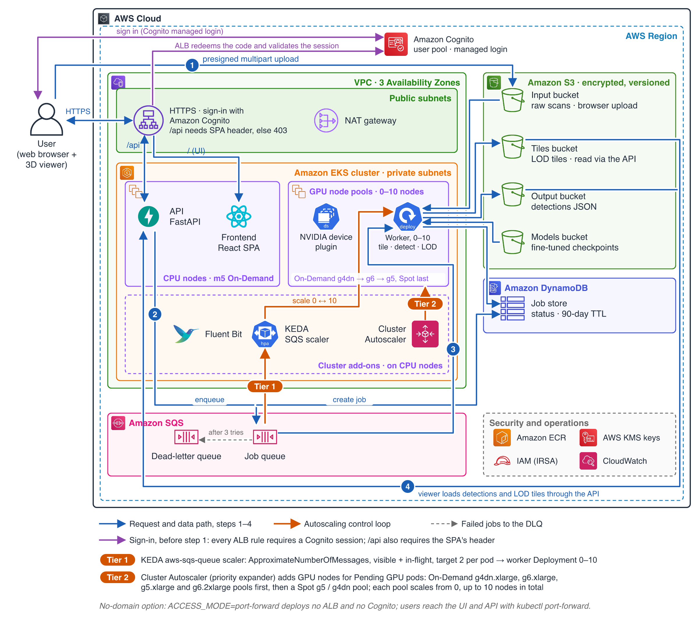
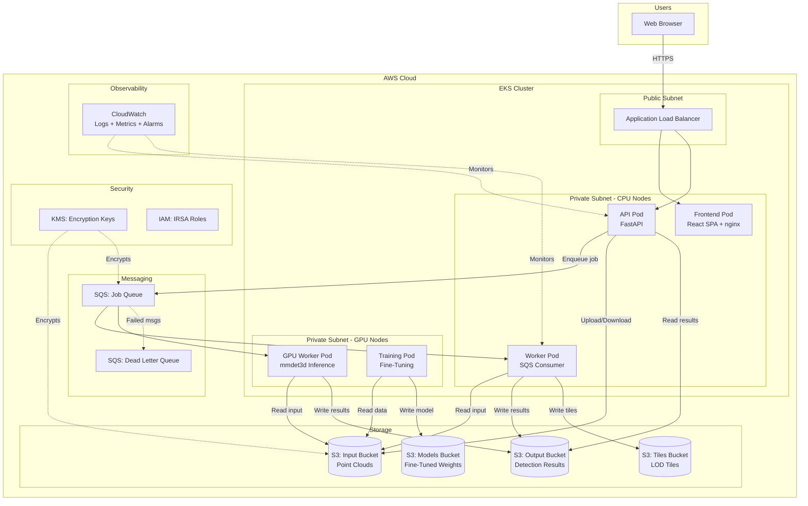

# Solution Architecture

High-level view of the Point Cloud Object Detection system on AWS.

> **Publication version:** [`exports/architecture-v2.png`](exports/architecture-v2.png)
> (source: [`src/architecture_v2.py`](src/architecture_v2.py)) is the full version,
> and [`exports/architecture-v2-blog.png`](exports/architecture-v2-blog.png) is its
> 800px cut used as the blog's Figure 1. Both add what this Mermaid view predates: the
> DynamoDB job store, the KEDA and Cluster Autoscaler scaling loop, the NVIDIA device
> plugin, and the numbered request path. Prefer them for anything published.

