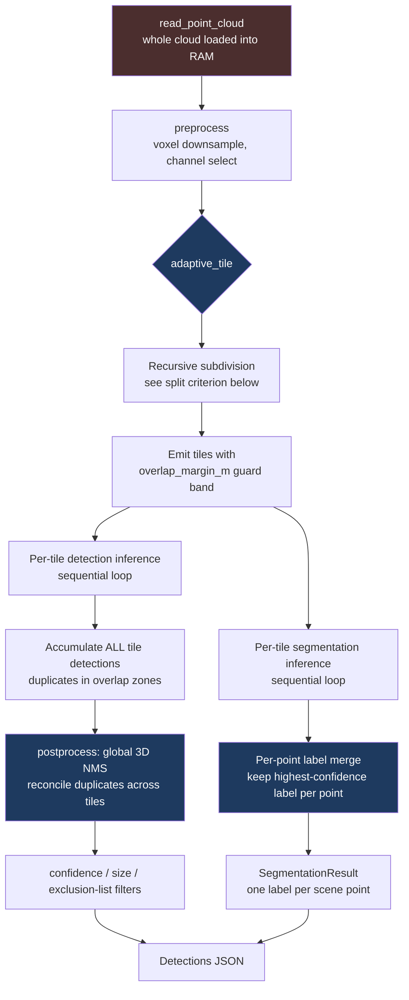
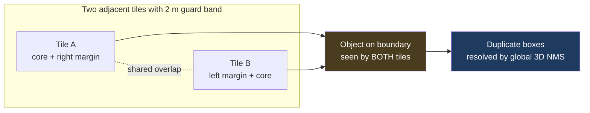

# Adaptive Tiling & Cross-Boundary Reconciliation

This document defines the tiling technique behind the scale claim and — critically —
marks which parts are **implemented** versus which are **claimed but not yet enforced**
in the current code. It is written to close the review gap: "the central technical
contribution is currently a claim rather than an explained technique."

> Source of truth: `src/pointcloud_detect/tiling.py`, `postprocessing.py`,
> `pipeline.py`, `config.py` (verified against the code, not the README prose).

---

## Implementation status at a glance

| Claim | Status | Where |
|-------|--------|-------|
| Recursive spatial subdivision into tiles | **Implemented** | `tiling.py::_subdivide` |
| Per-tile point cap (`max_points_per_tile`, default 100k) | **Implemented** | `tiling.py::_subdivide` |
| Overlap / guard band (`overlap_margin_m`, default 2.0 m) | **Implemented** | `tiling.py::_emit_tile` |
| Cross-tile duplicate box suppression (3D IoU + center distance) | **Implemented** | `postprocessing.py::nms_3d` |
| Per-point label reconciliation across overlaps (confidence arbitration) | **Implemented** | `pipeline.py` seg loop |
| Octree subdivision (axis-qualified) | **Implemented** — splits every axis ≥ 2·`min_tile_size_m`, so cubic indoor scenes split 8-way and thin outdoor scenes degrade to quadtree-like XY splits (no wasted Z octants) | `tiling.py::_subdivide`, `_octant_bounds` |
| "Density-aware" splitting | **Implemented** — each split plane is placed at the point-count **median** of the node's own points (not the geometric midpoint), clamped so both children stay at or above `min_tile_size_m`. The standalone `compute_density_grid` helper is available to callers for planning but does **not** feed split placement | `tiling.py::adaptive_tile`, `_density_median_split` |
| "16 GB configurable memory budget" | **Enforced in code, not yet proven on hardware.** `memory_budget_gb` drives a budget-derived per-tile cap, routing between whole-load and streaming ingest, and the streaming path itself — it is no longer an unreferenced field. Peak memory is bounded by construction and by `tracemalloc` unit tests, but has never been measured on a large scene, so NFR-1.1/1.2 are implemented rather than verified. See `docs/diagrams/memory-budget-enforcement.md` | `memory.py`, `streaming.py`, `pipeline.py`, `tiling.py` |

**Bottom line for the reviewer:** the subdivision (octree), density-aware split
placement, and cross-boundary reconciliation are all now real and verified by unit tests
(`test_pipeline.py::TestTiling`, `TestDensityGrid`). The one remaining gap is the
**memory budget**: peak memory is still bounded by the whole scene, not by
`memory_budget_gb`. That is tracked separately as a Must-NFR fix.

---

## End-to-end flow



---

## Split criterion (as implemented)

Subdivision is a recursive, **density-aware, axis-qualified octree**. At each node,
every axis still large enough to split is cut simultaneously (so a node yields 2, 4, or
8 children depending on how many axes qualify), and each cut is placed at the
point-count median:

```
subdivide(region, indices):
    # Stop condition 1 — tile is within the point budget
    if len(indices) <= max_points_per_tile:          # default 100_000
        emit_tile(region, indices)
        return

    # Which axes are still worth splitting? An axis qualifies only if both halves
    # would remain >= min_tile_size_m, i.e. its extent >= 2 * min_tile_size_m.
    extent     = region.max - region.min
    splittable = extent >= min_tile_size_m * 2       # default min_tile_size_m = 5.0 m

    # Stop condition 2 — no axis can be split further; emit as-is (may be over
    # budget) rather than recursing forever on a dense sub-min-size region.
    if not any(splittable):
        emit_tile(region, indices)
        return

    # Density-aware split plane per qualifying axis: the point-count MEDIAN, which
    # falls in the sparse gap between clusters far more often than the midpoint,
    # so a cut is less likely to bisect a dense object. Clamped to
    # [lo + min_tile_size_m, hi - min_tile_size_m] so both children honour the same
    # minimum the guard above assumes; falls back to the midpoint outside that
    # window (including when the median degenerates onto a boundary).
    splits = { axis: density_median(points[:, axis], region)  for axis in splittable }

    # Children = Cartesian product of {low, high} over each split axis (2^k boxes).
    # Non-split axes span the full parent extent. 1 axis -> 2 kids (kd/quadtree-like),
    # 2 -> 4, 3 -> 8 (true octree). Half-open interval assignment (<= plane low,
    # > plane high) puts each point in exactly one child.
    for (child_region, child_indices) in octants(region, indices, splits):
        subdivide(child_region, child_indices)
```

Key points:
- **Axis-qualified octree:** all axes ≥ `2 x min_tile_size_m` are split at once.
  Cubic indoor volumes split 8-way; thin outdoor scenes (large XY, short Z) split only
  X/Y, so no tiles are wasted on empty top/bottom Z octants. A strict 8-way octree would
  waste half its children every level on ground-plane-dominated data — this avoids that.
- **Density-aware placement:** each cut is at the point-count **median** on that axis
  (`_density_median_split`), not the geometric midpoint, so splits fall between clusters
  rather than through them. The median is **clamped** to
  `[lo + min_tile_size_m, hi - min_tile_size_m]`, so the axis-qualification guard and
  the split placement agree. Without the clamp a median hugging a bound produces a
  child a fraction of `min_tile_size_m` wide. An out-of-window median is clamped to
  the nearest legal plane rather than replaced by the midpoint, so the cut stays as
  close to the true median as the minimum size allows. The split statistic comes from
  the node's own points; `compute_density_grid()` is a standalone helper for callers
  and does **not** feed split placement.
- **Termination:** a region stops splitting when it is under `max_points_per_tile`
  **or** when no axis is ≥ `2 x min_tile_size_m`. A dense region below the minimum size
  is emitted **over budget** rather than split indefinitely — capping its contents
  would drop points instead. `adaptive_tile` raises one aggregated `RuntimeWarning`
  naming how many tiles are affected, the worst point count and region extent, and the
  knobs that change it, because each of those tiles is an inference call carrying more
  points than the budget was sized for. Total output is bounded by `max_tiles`, which
  raises rather than silently multiplying inference cost — each tile is one inference
  call. It defaults to `None` (no ceiling): picking a real default needs the
  on-hardware benchmark, since a value low enough to catch a pathological scene would
  also reject the NFR-1.2 target, so operators opt in per workload until then.
- **Input validation:** non-finite coordinates (NaN/inf) are rejected at
  `adaptive_tile` entry. NaN would otherwise propagate through the median, make every
  plane comparison false, and emit tiles holding zero points — reporting success while
  dropping the whole cloud.
- **Cap is in points, not voxels.**

---

## Guard band / overlap (as implemented)

When a leaf region is emitted, the tile holds **all points within the region expanded by
`overlap_margin_m` (default 2.0 m) on every face** — not just the points strictly inside
the region:

```
subdivide(region, indices, candidates):
    # indices    = points strictly inside region        -> budget + recursion
    # candidates = points inside region +/- margin      -> tile contents
    for child in octants(region):
        child_indices    = indices    within child
        child_candidates = candidates within child +/- margin   # narrows, never rescans
        subdivide(child, child_indices, child_candidates)

emit_tile(region, candidates):
    tile.point_indices = candidates within [region.min - margin, region.max + margin]
```

The candidate set is threaded down the recursion rather than re-derived per tile. This is
sound because a child's expanded region is always contained in its parent's
(`child_min >= parent_min` implies `child_min - margin >= parent_min - margin`), so each
level can narrow the previous level's set. Selecting each tile's points from the whole
cloud instead is `O(N x tiles)`; narrowing is `O(N x depth)`, and depth is a handful where
tile counts run to hundreds of thousands, so the saving grows with the tile count. (No
benchmark of the selection step is recorded here, so no speed-up figure is given.)

So neighbouring tiles **share** the points in their overlap zone. An object straddling a
boundary is seen whole by at least one tile (as long as it is smaller than the guard
band), which is what makes cross-boundary detection possible. The cost is duplicate
detections in the overlap, which the next stage removes.



---

## Reconciling duplicate boxes (as implemented)

All per-tile detections are pooled, then a single global 3D NMS runs over the pool
(`postprocessing.py::nms_3d`). Suppression is **per-class** and uses two criteria:

```
nms_3d(dets, iou_threshold):        # default nms_iou_threshold = 0.3
    sort dets by confidence desc
    keep = []
    for det in dets:
        for kept in keep:
            if det.label != kept.label: continue
            # (1) IoU overlap on axis-aligned boxes
            if iou_3d_aabb(det, kept) > iou_threshold: suppress; break
            # (2) center-distance fallback
            if dist(det.center, kept.center) < max(kept.size): suppress; break
        if not suppressed: keep.append(det)
    return keep
```

- **IoU** is computed on the **AABB** (axis-aligned) derived from each oriented box, not
  the true oriented-box IoU — a conservative approximation.
- The **center-distance fallback** catches near-duplicates that barely overlap (e.g. two
  slightly offset boxes for the same object across a seam) where AABB IoU alone would
  miss them.
- Because NMS is global over the merged pool, duplicates from the overlap zone are
  resolved regardless of which tile produced them.

---

## Reconciling per-point labels (as implemented)

Segmentation is reconciled differently from detection — there is **no NMS**. Each point
carries a global index (`tile.point_indices`); a point in an overlap zone is labelled by
multiple tiles. The pipeline keeps the **highest-confidence** label per point:

```
scene_labels      = full(num_points, -1)
scene_confidences = zeros(num_points)
for tile in tiles:
    tile_labels, class_names, tile_conf = seg_backend.segment(tile)
    for i, idx in enumerate(tile.point_indices):
        if scene_labels[idx] == -1 or tile_conf[i] > scene_confidences[idx]:
            scene_labels[idx]      = tile_labels[i]     # winner-takes-point
            scene_confidences[idx] = tile_conf[i]
scene_labels = where(scene_labels == -1, 0, scene_labels)   # unlabelled → class 0
```

This is clean: overlap does not double-count points, and the more confident tile wins a
contested point.

---

## The memory-budget gap (what the claim needs before it is credible)

The claim "handles 50 GB+ sites within a 16 GB budget" is **not currently supported by
the code path**:

1. `read_point_cloud()` loads the whole file (subject only to `max_points`), and
   `preprocess()` runs on the full cloud **before** tiling. Peak memory therefore scales
   with total scene size, not with `memory_budget_gb`.
2. `memory_budget_gb` (default 16.0) is defined in `TilingConfig` but **never read**.
3. Tiles are processed in a sequential Python loop and all detections are accumulated in
   memory; there is no streaming/spill-to-disk of tiles or results.

To make the scale claim true, one of these is needed (smallest to largest change):
- **Chunked reading + tile-at-a-time inference** so only one tile (plus its guard band)
  is resident at once, bounding peak memory by the largest tile, not the scene.
- **Enforce `max_points_per_tile` from `memory_budget_gb`** (derive the cap from
  bytes-per-point x channels) instead of a hard-coded default.
- **Feed `compute_density_grid` into split planning** so dense regions are capped
  before materialising oversized index arrays. The helper exists and is unit-tested,
  but split placement currently uses the median of each node's own points instead —
  the same statistic at finer resolution. The grid allocates
  `prod(ceil(extent / resolution))` cells, which a single outlier coordinate can size
  for the whole scene; `MAX_DENSITY_GRID_CELLS` now caps this at 64M cells (512 MB at
  int64) and rejects non-finite coordinates, so wiring it in no longer risks an
  unbounded allocation.
- **Reduce retained tile memory.** Peak is now dominated by the tiles themselves, not
  by working memory — see the measured decomposition below. The two levers are
  `overlap_margin_m` (retained points scale with it) and the dtype of
  `Tile.point_indices`, which is int64 and accounts for a third of what is retained.

---

## Measured memory decomposition

Peak is not one number, and treating it as one led to a runbook check that would have
failed a correctly-working tiler. On a 260k-point clustered scene
(`max_points_per_tile=5000`, `min_tile_size_m=1.0`, tracemalloc, ratios against the
6.24 MB input cloud):

| `overlap_margin_m` | retained tile xyz | retained `point_indices` | working memory | peak |
|---|---|---|---|---|
| 2.0 | 4.98x | 1.66x | 2.28x | 8.92x |
| 0.0 | 1.00x | 0.33x | 1.83x | 3.16x |

Reproduce with `PYTHONPATH=src python scripts/measure_tiling_memory.py --label mine`.
The same script captures a per-tile content signature and `--compare BEFORE AFTER`
diffs two runs, so a change to the tiler can be shown to leave the tiling identical.

Two independent effects, often conflated:

1. **Retained output** (6.64x at the default margin) is the guard band doing its job.
   With `overlap_margin_m=2.0` against 1 m minimum tiles, a point can legitimately
   belong to several neighbouring tiles. Reducing it means reducing the margin, and
   that trades away cross-boundary detection.
2. **Working memory** (2.28x) is transient allocation during subdivision. Candidate
   narrowing plus avoiding the root's full-cloud copy took this from 3.36x to 2.28x.

The earlier "within ~2x the budget" guidance conflated the two and was not reproducible;
`max_points_per_tile` bounds a node's *own* points, never the emitted tile's.

---

## Benchmark to make the claim credible (proposed, not yet run)

A single end-to-end row per scale tier turns the claim from prose into evidence. Suggested
table to fill from a real run (`processing_time_seconds` and `tile_count` are already
emitted on `PipelineResult`; peak RSS needs a memory probe):

| Scene | Points | Tiles | Peak RSS | Wall time | Detections (pre/post-NMS) | Device |
|-------|--------|-------|----------|-----------|---------------------------|--------|
| Single room (ScanNet scene) | ~0.15 M | | | | | |
| Building floor (S3DIS area) | ~5 M | | | | | |
| Site scan (target 50 GB+) | ~1–2 B | | | | | |

The **pre/post-NMS** column is what demonstrates cross-boundary reconciliation is doing
work (duplicates removed in overlap zones). **Peak RSS vs. the 16 GB budget** is the
column that proves — or disproves — the memory claim.
