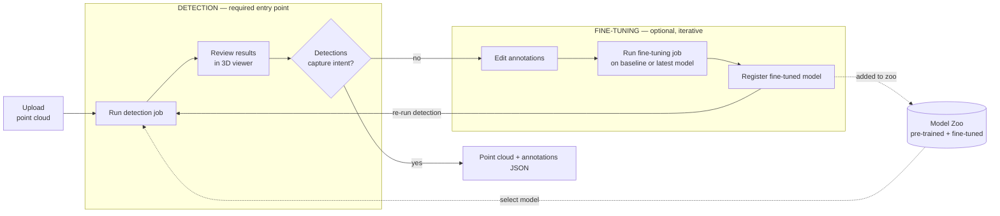

# User Workflow

End-to-end user journey from point cloud upload through detection to optional
fine-tuning. Detection is the required entry point for every workflow, including
the case where a user starts with no fine-tuned model of their own.

Training starts from one of three points: random initialization (from scratch, the
default), the latest model of your own, so successive rounds build on the previous
result, or a pre-trained baseline from the model zoo. The pre-trained baselines were
trained on non-commercially licensed data, so they are unavailable unless the
deployment opts in with `ALLOW_NONCOMMERCIAL_WEIGHTS=1` (README, "Pretrained weights
and licensing").



## Why detection is the entry point

A detection job is what produces the initial set of 3D bounding boxes. Those
boxes are the starting material a user edits to build a fine-tuning dataset —
so a workflow normally runs detection first with an available model, then corrects
the output. With the pre-trained baselines disabled and no model of your own yet,
train the first one outside the UI (README, "Commercially clean model") and run
detection with it from the CLI (`pointcloud-detect detect --weights`).

## What a detection job does

| Step | Detail |
|------|--------|
| 1 | Point cloud uploaded to the input bucket (SSE-KMS encrypted) |
| 2 | Job enqueued on SQS with `job_id`, `s3_key`, and model config |
| 3 | Worker pod runs `mmdet3d` inference with the selected model |
| 4 | Detections written to the output bucket as `detections.json` |
| 5 | Level-of-detail tiles written to the tiles bucket for progressive viewer loading |
| 6 | Job status patched to `complete`; viewer renders cloud plus boxes |

See [data-flow.md](data-flow.md) for the full sequence including retry and DLQ behavior.

## Downstream payload

What leaves the system for downstream consumption is the point cloud paired with
its annotation JSON. Each annotation carries an oriented 3D box:

```json
{
  "scene_id": "office-scan-001",
  "point_cloud_path": "s3://amzn-s3-demo-bucket/uploads/scan.bin",
  "num_annotations": 5,
  "annotations": [
    {
      "center_xyz": [1.2, 3.4, 0.8],
      "size_wlh": [0.9, 2.1, 2.0],
      "heading": 0.45,
      "class_name": "door"
    }
  ]
}
```

This is the same schema consumed by the fine-tuning job, so a reviewed detection
result can be fed straight back in as training data.

## Model zoo and lineage

The zoo lists four pre-trained models (selectable only when opted in, and the
architectures training builds on either way) plus every fine-tuned model produced in
the environment. Each fine-tuned entry records `base_model` and `training_job_id`,
which gives the audit trail from a shipped model back to the detection job and
annotations that produced it, and makes rollback to an earlier model a selection
change rather than a retraining run.

| Model | Architecture | Domain | Classes |
|-------|-------------|--------|---------|
| `fcaf3d_scannet` | FCAF3D | Indoor / ScanNet | 18 |
| `votenet_scannet` | VoteNet | Indoor / ScanNet | 18 |
| `centerpoint_nuscenes` | CenterPoint | Outdoor / nuScenes | 10 |
| `pointpillars_kitti` | PointPillars | Outdoor / KITTI | 3 |

## Not yet in scope

Bulk fine-tuning across many point clouds for error correction is a planned
capability, not part of the workflow above. The current loop operates on a single
point cloud at a time.
