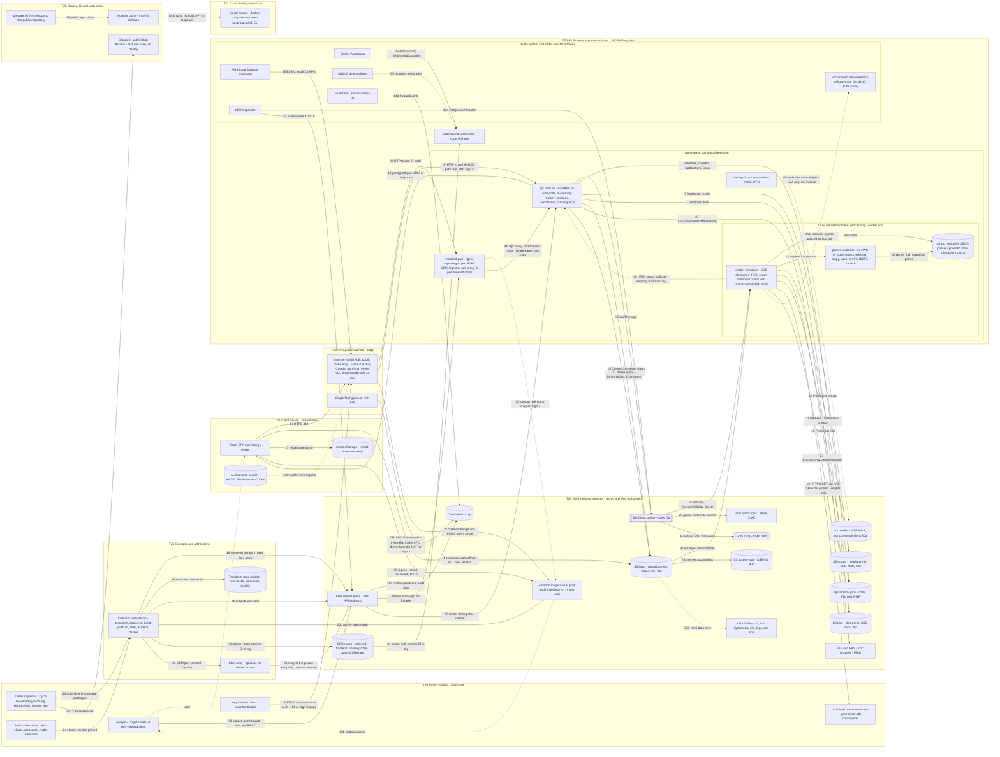

# Threat Model: Point Cloud Object Detection on Amazon EKS

| | |
|---|---|
| **Analysed revision** | `2bba4c9` (code and configuration), then updated seven times: sign-in moved from a shared API token to the load balancer ([0.5](#05-update-sign-in-at-the-load-balancer)), a hardening pass closed or accepted every open High ([0.6](#06-update-the-hardening-pass)), a dependency and base-image pass cleared the advisories published since and the base-image residuals ([0.7](#07-update-the-dependency-and-base-image-pass)), a torch 2.13 pass cleared what pip-audit, OSV and the content-security scan found ([0.8](#08-update-the-torch-213-pass)), a content-security pass fixed, rather than triaged, the scanner findings recorded as false positives ([0.9](#09-update-the-content-security-pass)), per-user access fixed T31 ([0.10](#010-update-per-user-access)), and a run on a live ALB tested it ([0.11](#011-update-per-user-access-on-a-live-alb)). For every update, the code and configuration analysed are those of the commit that contains this version of the document. Pre-mitigation baseline: `1f35c30` on `main`. Between the baseline and `2bba4c9`, 44 files change (+1515 / −94). |
| **Status** | Draft for the pre-publication security review. Every entry was checked by three independent reviewers, and the ratings are their medians ([0.3](#03-how-the-threats-were-found)); the analysis was checked by all of the sample's maintainers. The updates in [0.5](#05-update-sign-in-at-the-load-balancer), [0.6](#06-update-the-hardening-pass), [0.7](#07-update-the-dependency-and-base-image-pass), [0.8](#08-update-the-torch-213-pass), [0.9](#09-update-the-content-security-pass), [0.10](#010-update-per-user-access) and [0.11](#011-update-per-user-access-on-a-live-alb) were made by the author alone, so the ratings they add or change have not had that check, and each says so; 0.10 also had an automated security review (an AI agent, not a person). Deployed to a sandbox cluster in both access modes, port-forward and public, with the stub image, and in public mode again with per-user access ([0.11](#011-update-per-user-access-on-a-live-alb)); the GPU image has not run on a cluster. Not validated by exploitation, and not penetration tested. See [Known gaps](#45-known-gaps-and-unknowns). |
| **Owner** | The sample's maintainers, listed in [`CONTRIBUTORS.md`](../../CONTRIBUTORS.md). They keep this document current with the code, re-reviewing it when a trigger in [4.7](#47-re-review-triggers) fires, and own the risk acceptances in [3.3](#33-risk-acceptances), where they are the sample owner. |
| **Sign-off** | Not yet signed off. The pre-publication security review approves the sample, this document with it, and records the approval and the approver in that review, not here. [Appendix D](#d-document-history-and-sign-off) lists every version: what changed, who made it, who reviewed it and its sign-off. |
| **Structure** | Adam Shostack's Four Question Framework. OWASP analysis against six lists, led by the OWASP Top 10:2025, comes first, then STRIDE, both inside Q2. |
| **Supersedes** | The earlier STRIDE-only version of this document. Every threat ID (T5, T11–T36) and mitigation ID (M11–M22) keeps its meaning. New threats start at T37 and new mitigations at M23. The gaps in the series are deliberate. T1–T10 were the IDs of an earlier infrastructure threat model that was never published. Only T5 is carried here, because the data-path companion restates it. T1–T4 and T6–T10 are not carried and are not mapped one by one; the companion's reconciliation table records where that model's claims stand. The update in [0.5](#05-update-sign-in-at-the-load-balancer) adds T69–T72. T68 is not used, so that each new threat keeps the mitigation of the same number: M68 is already an additional control for T12. |
| **Companion** | [`../THREAT_MODEL_DATA_PATH.md`](../THREAT_MODEL_DATA_PATH.md), the original record of T11–T22 with evidence at `8672e58`. Its body is kept unchanged as the original record; only its status note now points here. |
| **Diagram** | The Mermaid data-flow diagram in [1.10](#110-data-flow-diagram) is the diagram of record. It shows the trust boundaries and the numbered flows of [1.5](#15-data-flows). |

Citations are `path:line` relative to the repository root in the commit that contains this version of the document, unless they name another revision (`origin/main`, `git show <rev>:`). Its code and configuration are those of that commit, which includes the update and the citation check itself (`scripts/check_citations.py`, `tests/test_check_citations.py`). The citations were written at `2bba4c9` and re-pointed for each update ([0.5](#05-update-sign-in-at-the-load-balancer), [0.6](#06-update-the-hardening-pass)). Where evidence lives outside the repository (a third-party library, a rendered upstream chart or a local probe), the entry says so and names the version.

## Contents

0. [Scope and method](#0-scope-and-method), including the [sign-in update](#05-update-sign-in-at-the-load-balancer), the [hardening pass](#06-update-the-hardening-pass), the [dependency and base-image pass](#07-update-the-dependency-and-base-image-pass) the [torch 2.13 pass](#08-update-the-torch-213-pass), the [content-security pass](#09-update-the-content-security-pass), the [per-user access update](#010-update-per-user-access) and [its run on a live ALB](#011-update-per-user-access-on-a-live-alb)
1. [Q1. What are we working on?](#q1-what-are-we-working-on)
2. [Q2. What can go wrong?](#q2-what-can-go-wrong)
   - [2.1 Attacker frames](#21-attacker-frames)
   - [2.2 OWASP analysis](#22-owasp-analysis)
   - [2.3 STRIDE analysis](#23-stride-analysis), which includes the [threat register](#232-threat-register) and the [threat details](#233-threat-details)
3. [Q3. What are we going to do about it?](#q3-what-are-we-going-to-do-about-it)
   - [3.1 Mitigation register](#31-mitigation-register)
   - [3.2 Prioritised plan for open items](#32-prioritised-plan-for-open-items)
   - [3.3 Risk acceptances](#33-risk-acceptances)
   - [3.4 Operator decisions this model depends on](#34-operator-decisions-this-model-depends-on)
4. [Q4. Did we do a good job?](#q4-did-we-do-a-good-job)
5. [Appendix](#appendix): [traceability](#a-traceability-matrix), [glossary](#b-glossary), [references](#c-references), [document history and sign-off](#d-document-history-and-sign-off)

## 0. Scope and method

### 0.1 Scope

**Covered.** The solution as this repository ships it:

- the Terraform in `infrastructure/`, including the state bucket and the optional bastion;
- the `backend`, `frontend` and `training` Helm charts, and `infrastructure/scripts/`;
- both CI configurations (GitLab CI and GitHub Actions);
- the FastAPI API, the SQS worker and its format parsers, the inference backends and checkpoint loading;
- the React frontend, the fine-tuning paths, the model registry and the DynamoDB job store;
- the cluster add-ons: AWS Load Balancer Controller, Cluster Autoscaler, NVIDIA device plugin, Fluent Bit and KEDA;
- the local modes (docker-compose, `local_backend`, CLI and single-host EC2), at lower depth;
- the publication tooling, which turns this repository into the public sample.

**Not covered.**

- How AWS implements its managed services, and the certificate, DNS and identity providers an adopter brings.
- The security of end-user browsers and devices.
- The internals of third-party libraries (laspy, lazrs, libE57/Xerces-C, trimesh, numpy, torch, mmcv, mmdet3d). They are modelled as native code handling untrusted input. Known weaknesses are recorded where public sources show them.
- Everything under `.kiro/`, except as a shipped artefact (T64). Narrative documentation, except where cited.
- The offline conversion and visualisation scripts (`scripts/setup-sustechpoints.sh`, `scripts/convert-*.py`, `scripts/visualize*.py`).
- Git history before publication, except through the export tooling (T64).
- Licensing of datasets and pretrained weights. It is listed as an operator decision in [3.4](#34-operator-decisions-this-model-depends-on), not modelled as a threat.
- Validation of any control in a live account.

### 0.2 The four questions

| Question | Section | What it produces |
|---|---|---|
| Q1. What are we working on? | [Q1](#q1-what-are-we-working-on) | Components, data stores, flows with the authentication on each, trust boundaries, classified assets, actors, entry points, deployment modes, assumptions, and a data-flow diagram |
| Q2. What can go wrong? | [Q2](#q2-what-can-go-wrong) | Nine attacker frames. Then an OWASP analysis against six lists, with every item of every list accounted for. Then a STRIDE-per-element matrix, a threat register sorted by severity, and one entry per threat |
| Q3. What are we going to do about it? | [Q3](#q3-what-are-we-going-to-do-about-it) | A mitigation register with status and residual risk, a prioritised plan (with design options for T11), explicit risk acceptances, and the operator decisions the model relies on |
| Q4. Did we do a good job? | [Q4](#q4-did-we-do-a-good-job) | Tests per implemented control, scanner results, a cross-check against independent analyses, review statistics, known gaps, a review checklist, and re-review triggers |

The OWASP lists used are:

- OWASP Top 10:2025, the current edition, which supersedes the 2021 edition. It folds server-side request forgery into A01, and adds A03 Software Supply Chain Failures and A10 Mishandling of Exceptional Conditions, both of which apply here
- OWASP API Security Top 10 (2023)
- OWASP Kubernetes Top 10 (2025)
- OWASP Top 10 CI/CD Security Risks
- OWASP Machine Learning Security Top 10 (2023 draft)
- OWASP Docker Top 10

STRIDE is applied per DFD element, following Shostack's applicability chart. External entities are checked for S and R. Data flows and data stores are checked for T, I and D, plus R for log stores. Processes are checked for all six.

### 0.3 How the threats were found

**Nine attacker frames.** Each frame was run independently against the code and configuration at `2bba4c9` and then grounded in external sources: vendor documentation, OSV, NVD, upstream source code and research papers. No frame read an earlier threat model before it had generated its own threats. Existing IDs were mapped only as the last step. The frames are summarised in [2.1](#21-attacker-frames):

1. internet attacker
2. token holder abusing access
3. malicious file and ML supply chain
4. Kubernetes and cloud lateral movement
5. CI/CD and public release
6. privacy regulator
7. availability adversary
8. browser-side attacker
9. adopter misconfiguration

Several frames ran local, read-only probes. They used the FastAPI test client against the real app, `helm template` on the charts and on the pinned upstream add-on charts, and a Chromium harness on loopback serving the built frontend. No AWS resource was created or called.

**Tool-driven analyses.** Seven analyses ran alongside the frames. Several of the tools are internal to the authors' organisation, so they are described here by what they do:

| # | Analysis | What it produced |
|---|---|---|
| 1 | An internal STRIDE threat-modelling tool, driven phase by phase: business context, architecture, actors, trust boundaries, assets and flows, threats, mitigations, code validation, residual risk | 38 threats and 42 mitigations, each tied to repository evidence |
| 2 | An internal architecture-diagram security scanner (31 components, 8 trust regions, 35 flows) | Two scans. The open items were triaged by hand into real findings, partial findings and scanner artefacts |
| 3 | An internal content-security scanner for public sample code: an AI rubric plus a policy baseline of Checkov, Semgrep and Bandit | 44 findings across 178 scanned files, a code, infrastructure and CI subset of the 309 tracked files (scope in [4.2](#42-scanner-results)) |
| 4 | Public scanners: trivy (`config` on Terraform, Dockerfiles and rendered Helm output; `fs` for vulnerabilities and secrets), gitleaks over the full git history, and actionlint | See [4.2](#42-scanner-results) |
| 5 | An agent based on STPA (System-Theoretic Process Analysis). It builds a control structure, finds unsafe control actions and loss scenarios, and converts them to threats | 38 threats and 57 mitigations |
| 6 | A review against a catalogue of 27 AWS security anti-patterns, plus two newer catalogue entries | 13 of the 27 apply |
| 7 | A mapping of the design to internal security governance: the rules for public sample content, and secure-coding and infrastructure baselines | 19 threat items derived from control gaps |

**Brainstorm.** The frames and the tool-driven analyses produced 314 raw threats. The orchestration that ran them counts 15 sources. Its per-source counts were not kept, so this document does not explain the difference between 15 and the sixteen analyses listed above.

**Consolidation, by hand.** An automated consolidation stage was meant to cluster the raw threats and hand the clusters on. It did not complete: it returned no clusters (raw 314 → canonical 0; see [4.4](#44-review-statistics)). The register was therefore consolidated by hand. The raw threats were clustered by root cause and mapped to existing IDs where the root cause matched. The result is 58 entries: the 27 existing IDs and 31 new ones (T37–T67). The author gave each entry a first-draft rating.

**Verification, per entry.** Each of the 58 entries was then checked by three independent reviewers, each with a different lens:

- **Evidence**: do the cited `path:line` locations say what the entry claims, and did the entry miss a control?
- **Reachability**: who can reach the weakness on the shipped defaults, and what must already be true?
- **Control status**: is the mitigation in place on this branch, is it tested, and is it sound and proportionate?

Each reviewer judged whether the entry was accurate, gave its status, and rated likelihood and impact from 1 to 5 with a rationale. The reviewers worked from the repository, official documentation, static inspection of the locked third-party packages (laspy 2.7.0, the pye57 0.4.19 wheel, trimesh 4.12.2) and local renders of the pinned upstream charts. They executed nothing against a live system, ran no exploit and called no AWS resource. They read a later revision whose code and configuration are identical to `2bba4c9`; the commits after it change only documentation.

The outcome:

- 58 of 58 entries were verified, and none is unverified.
- All 174 reviews judged their entry accurate, so no entry was rejected.
- Likelihood and impact in this document are the medians of the three reviews, with one exception. The reviewers rated T38's two paths separately, so a median across them mixes two different threats; T38 is rated on its worse path instead (see its entry). Where the reviewers disagreed, the entry shows the range, for example "L 3 (range 2–4)". That applies to 23 entries.
- The reviews changed the first-draft rating of 24 entries.
- All three reviewers disagreed with the documented status of 3 entries (T19, T20, T46), so those statuses changed.

The reviewers also listed precision corrections. Those that change a rating or status, or that the new ratings depend on, are folded into the entries; the rest are not. Every change of rating is listed in [4.4](#44-review-statistics). Where an independent tool analysis rated the same threat, its rating is still quoted in the entry as a cross-check.

### 0.4 How threats are rated

Likelihood (L) and impact (I) are rated separately, each from 1 to 5.

| | Likelihood (L) | Impact (I) |
|---|---|---|
| **1** | Rare: needs prior compromise of a privileged identity (operator, cluster admin, AWS account) | Negligible: noise, small cost, cosmetic |
| **2** | Unlikely: needs a holder or insider plus a non-default configuration, or a specialised capability (a novel parser exploit, compromise of a mainstream upstream source) | Minor: one job's results or availability; disclosure of low-sensitivity metadata; degraded observability |
| **3** | Possible: any holder on the shipped defaults with known techniques, or a plausible adopter mistake | Moderate: a service-wide outage or a bounded cost spike; tampering across jobs; disclosure of job metadata or derived data; loss of forensic evidence |
| **4** | Likely: an unauthenticated internet client on the shipped defaults, or triggered by a documented operator procedure | Major: disclosure or tampering of customer scans at scale; code execution in a credentialed workload; removal of an account-wide security control; cluster-level privilege |
| **5** | Almost certain: happens on the shipped defaults with no attacker at all (a defect), or trivially by anyone | Severe: account or cluster-admin compromise, or code execution plus credential theft that exposes every customer's data |

**Severity** is L × I, banded only as the last step:

| Severity | L × I |
|---|---|
| Critical | ≥ 20 |
| High | 12–19 |
| Medium | 6–11 |
| Low | ≤ 5 |

Where a mitigation on this revision changed a rating, the register shows both values, for example `5→1`. The first value is the baseline (`1f35c30`) and the second is this revision. Residual risk is the second value. The reviewers rated only this revision, so baseline values are still the author's. The arrow is used only for baseline→current. Where the reviewers' current impact differs from the author's first draft, the draft value is shown in brackets, for example `5 (draft 4)`. That difference is a re-rating, not a change in the system.

**Rating disclosure.** A single number can hide how it was made, so four things are stated plainly here:

- **Normaliser.** There is none. The scores are relative within this model only. They are not CVSS scores and not comparable to another system's threat model or to the tools' own severities. For example, the diagram scanner labels every threat it raises High, and the content scanner's severities come from its baseline's own calibration.
- **Axes.** L and I are kept separate throughout and are shown in every table, so a reader can disagree with one axis without re-deriving the other. Multiplying them, and the band edges, are choices; they are applied only at the end.
- **Author.** The anchors, the equal-weight product and the band edges were chosen by the authors of this document and can be reviewed and changed. Each L and I is the median of three independent reviews ([0.3](#03-how-the-threats-were-found)), except T38, which is rated on its worse path; a range is given where the reviewers disagreed.
- **Reviewers' rubric.** The reviewers rated on a 1–5 scale of the same shape, but its top anchors are broader than the ones above. Its likelihood 5 is "reachable by the stated actor at default settings", and its impact 5 includes loss of customer data or credentials and silently wrong results. The medians are the ratings of record, so some sit away from where the anchors above would put them, in either direction. The table below lists every such entry, and each of those entries says so in its rating. Entries that are not listed were read as matching the anchors for the actor in the register.

**Ratings that depart from the anchors.** The last column recomputes the severity with the anchor value on the departing axis and the median on the other. Seven entries could change band on the anchors: T11, T24, T34, T56, T58 and T64, and T54 depending on how its unconfirmed step is scored. The register keeps the medians.

| Entry | Axis | Median | Where the anchors put it | Severity: median, then on the anchors |
|---|---|---|---|---|
| T11 | L | 3 | 2: a novel parser exploit. The median is one step up because the bundled Xerces-C is inside the affected range of a public use-after-free (T54) | 15 High; 10 Medium |
| T13 | L and I | L 3, I 3 | L 5: a defect on the defaults, with no attacker. I 2: one job's results | 9 Medium; 10 Medium |
| T16 | I | 5 | 4: disclosure of customer scans at scale | 5 Low; 4 Low |
| T17 | L | 1 | 2: a holder plus a non-default setting (the memory store) | 2 Low; 4 Low |
| T19 | I | 4 | 3: tampering across jobs | 8 Medium; 6 Medium |
| T20 | I | 5 | 4: the path carries scans and a credential out, but the code execution and the theft are T11's | 10 Medium; 8 Medium |
| T21 | I | 5 | 4: theft of the role's credentials without code execution, which discloses customer scans at scale | 5 Low; 4 Low |
| T24 | L | 1 | 2: compromise of a mainstream upstream source (a chart repository re-publishing a pinned version) | 5 Low; 10 Medium |
| T34 | L | 4 | 3: any holder on the shipped defaults | 12 High; 9 Medium |
| T44 | L | 5 | 4: an unauthenticated internet client on the defaults. **Superseded by the update:** now L 3, on the anchors, because the actor is a signed-in user | 15 High; 12 High. After the update: 9 Medium |
| T52 | L | 2 | 3: a holder on the defaults with a published technique. The anchors do not discount for the victim's click | 6 Medium; 9 Medium |
| T53 | L | 4 | 5: a defect on the defaults | 8 Medium; 10 Medium |
| T54 | I | 4 | 5 for the E57 half's end state (credential exfiltration), with the unconfirmed step lowering L instead | 12 High; 10 Medium at L 2, 15 High at L 3 |
| T56 | L | 2 | 3: as T52 | 4 Low; 6 Medium |
| T58 | L and I | L 4, I 1 | L 3: a holder on the defaults. I 2: low-sensitivity metadata | 4 Low; 6 Medium |
| T60 | L | 4 | 5: happens on the defaults with no attacker | 12 High; 15 High |
| T64 | L | 2 | 4: triggered by a documented procedure (the one-command export) | 6 Medium; 12 High |
| T66 | L | 4 | 5: a defect on the defaults (the out-of-memory case) | 8 Medium; 10 Medium |

### 0.5 Update: sign-in at the load balancer

This document was first written at `2bba4c9`. It was then updated for one change: the shared API token was removed, and who can reach the application became a property of the deployment, chosen with `ACCESS_MODE`. The update is described at the commit that contains this version of the document; an earlier draft of it described `16f76ca`, before the review below.

- **Public mode, the default.** The internet-facing ALB runs the `authenticate-cognito` action on every rule of its HTTPS listener, against an invite-only Amazon Cognito user pool that Terraform creates. `/api` answers 401 without a session and 403 without the `X-PCD-Client` header. The application contains no authentication code, and the sample stores no credential of its own: the one secret, the Cognito app client's, is generated by Cognito and kept in Terraform state (A7).
- **Port-forward mode.** No load balancer. Users and scripts reach the frontend and api Services through `kubectl port-forward`, authorised by their IAM identity, an EKS access entry and a namespaced Role that allows port-forwarding and nothing else.
- **In both modes**, scripts use the port-forward path. There are no machine credentials.

How the update was made:

- **By the author alone.** The three-reviewer check in [0.3](#03-how-the-threats-were-found) was not repeated. Every rating the update adds or changes is the author's and is marked: in the register as `x (was y)`, where y is the reviewers' median before the update, and in the entry. The anchors, the product and the bands in [0.4](#04-how-threats-are-rated) are unchanged.
- **Re-rated:** T44, T49 and T61. **Status changed:** T31 (per-user sign-in is in place; tenant isolation is not), and after the review T38, T49 and T69. **Rewritten with their ratings kept:** T5, T16, T17, T35, T38, T45, T46, T56, T57, T58, T62, T64 and T67, and the components, stores, flows, boundaries, entry points and diagram in Q1. **New:** T69 (cross-site requests on the session cookie), T70 (personal data in Cognito), T71 (IngressGroup membership) and T72 (password-only sign-in). **M31 is implemented.**
- **Reviewed, and fixed in the same update.** A review of the first draft found gaps in the change itself. They are fixed here, and the entries describe the fixed state:
  - Public mode refuses an ingress class other than `alb`, which would serve the Ingresses with no sign-in (T16, T61).
  - The frontend pods have a NetworkPolicy. In port-forward mode their nginx relayed `/api` for any pod in the cluster (T49, now partially fixed).
  - `deploy.sh` removes the pre-sign-in Ingress of the token version before it pushes any image, so the new API is never behind the old, unauthenticated ALB (T16).
  - The Load Balancer Controller gets its IRSA role, Region and VPC (T38, now partially fixed).
  - The API serves only its own host names, which closes DNS rebinding on the api tunnel, and FastAPI ≥ 0.132 is required, with its strict Content-Type rule set explicitly (T69, now fixed and re-rated Low).
  - Service write in the namespace is named as a way round sign-in, and `deploy.sh` stops if a Service could take it (T71).
  - Security-group annotations are refused on the Ingresses (T61); nginx accepts the ALB's largest session cookie (C04).
  - Sign out is described as ending the session in one browser and revoking no token (T31, T35, DS17), and the logout landing page's place behind sign-in is recorded as a departure from the ELB guide (flow 38, [4.5](#45-known-gaps-and-unknowns)).
- **Citations.** Every citation now points at the update's revision. `scripts/check_citations.py` moved the ones whose cited lines were unchanged but had shifted, listed the ones whose lines had been edited, and those were re-cited by hand. It also checks that every citation resolves ([4.4](#44-review-statistics)).
- **Not deployed.** Like the rest of this document, the update was checked by rendering, validation and local tests only. [4.5](#45-known-gaps-and-unknowns) lists the load balancer and Cognito behaviours that need a live deploy to confirm.

### 0.6 Update: the hardening pass

After the sign-in update, a hardening pass worked through the plan in [3.2](#32-prioritised-plan-for-open-items) and the findings of the scanners that the pre-publication review of public sample code requires ([4.2](#42-scanner-results)). The goal was: no scanner reports a High or Critical that is not a documented false positive, every open High is fixed or accepted in writing, and the CI-equivalent checks pass. The baseline for this update is `8da6839`.

How it was made:

- **In six work packages on disjoint paths**, merged in this order: Terraform, the Helm charts, the build and CI supply chain, the deploy scripts, the API and frontend, and the worker and its parsers. This document and the adopter docs were updated last, from each package's report and the merged tree. Two integration fixes followed the merges: the parser spool on the shared scratch volume is now created by whichever container starts first (without it, sidecar mode could not start), and the Helm hardening tests now run in both CIs' helm jobs.
- **By the author alone**, like 0.5. Every rating the pass changes is marked in the register as `x (was y)`, where y is the value before this pass, and in the entry. The anchors, the product and the bands in [0.4](#04-how-threats-are-rated) are unchanged.
- **Fixed:** T12, T29, T30, T32, T34, T35, T37, T38, T41, T42, T44, T48, T49, T51, T54, T56, T59, T61 and T63. M62 is implemented.
- **Partially fixed:** T11 (on EKS the parsers run in a credential-free sidecar container; the local modes still parse in-process), T19, T33, T40, T43, T45, T50, T52, T53, T57, T58, T60, T62, T64, T66, T67 and T70.
- **Accepted in writing,** with the owner shown as "sample owner" and a review date ([3.3](#33-risk-acceptances)): T31's tenant isolation, T21, T36, T46 and T65, and T52's residual in the GPU image. No entry is left at "acceptance proposed".
- **Deferred, with reasons** ([3.2](#32-prioritised-plan-for-open-items)): T46's ALB-to-pod TLS, the rest of T20, T28's checkpoint hashes, T13, T14, the log-group half of T40, T45's ALB access logs and audit log, T47, T55, T71's admission objects, image signing (T50), Session Manager logging preferences, and ScoutSuite, which needs a live deployment.
- **Result.** One High remains, T31, and it is accepted. T11, T34, T37, T38, T54 and T60 left High. There are no Criticals.
- **Citations.** `scripts/check_citations.py --remap-from 8da6839` moved the citations whose lines had only shifted. For the ones whose cited lines were edited, a diff-based mapping proposed a new range, and every entry whose status changed was re-cited from the merged tree by hand ([4.4](#44-review-statistics)).
- **Not deployed.** Like the rest of this document, the pass was checked by rendering, validation, mocked `terraform test`, local tests, container runs and scanners, never against a live account ([4.5](#45-known-gaps-and-unknowns)).

### 0.7 Update: the dependency and base-image pass

After the hardening pass, advisories published since its sweep turned the CI's `trivy fs` gate red, and three pinned base images had picked up fixable Highs. This pass cleared both and went further: it removed the base-image residuals that the hardening pass had accepted under T52, moved the GPU image to torch 2.6, and closed T28, so that no image carries a High or Critical. The baseline for this update is `d95d9db`.

What changed:

- **Dependencies.** In `uv.lock`, pillow 13.0.0, certifi 2026.10.23, filelock 4.2.4 and setuptools 84.2.1, past 6 Critical and 24 High advisories (`uv.lock:65`, `:446`, `:1385`, `:1931-1932`); in the frontend, follow-redirects 1.16.2 and `npm audit fix` for the dev tooling (`frontend/package-lock.json:3201`). `THIRD-PARTY-LICENSES` follows them; filelock 4 is MIT, not Unlicense.
- **The backend and the compose emulator** moved from `python:3.12-slim`, whose Debian 13 packages carried 44 Highs with no fix released, to `amazonlinux:2023-minimal`, which carries none. Python 3.12 and the GL libraries come from its own repository (`Dockerfile:12-22`, `tools/local-aws/Dockerfile:6-10`).
- **The frontend** moved to the current `nginx-unprivileged` and `node:22-alpine` digests. Its build stage installs npm 12.2.1 (`frontend/Dockerfile:19-22`): the npm bundled in every current node image carries Highs in its own dependencies, and 12.2.1's bundle has none. The shipped image is nginx and scans clean.
- **The GPU image** is now two stages. It compiles on the CUDA devel image and ships on the CUDA runtime image (`Dockerfile.gpu:211`), without the toolchain and the kernel headers (`linux-libc-dev` alone carried 534 kernel advisories with no fix), and takes the Ubuntu security updates the base predates (`:207-216`). It runs torch 2.6.0, the first release past CVE-2025-32434 that still ships CUDA 11.8 wheels, with mmcv 2.1.0 compiled from source against it, since OpenMMLab publishes no wheel for that pair, and MinkowskiEngine rebuilt (`:20-42`, `:110-171`). Python 3.11.16 comes from uv instead of the deadsnakes PPA (`:71-76`), so no OS Python package and no third-party apt source is left. setuptools 81.0.0 is the runtime version: mmengine still needs `pkg_resources`, which 81.0.0 is the last release to ship. pip and wheel, and the interpreter's own pip, setuptools and ensurepip wheels, are removed after the build, and with them the vendored copies of certifi, urllib3, msgpack and `pkg_resources` that scanners flag; pillow, filelock and urllib3, which the torch install had replaced with older copies from `download.pytorch.org`, are re-pinned to the lockfile's versions (`:173-195`).
- **Checkpoints (T28).** Every pretrained checkpoint URL has a pinned SHA-256, and a download or cached file that does not match is deleted and refused (`src/pointcloud_detect/backends/checkpoints.py:37-76`, `:153-195`). Both backends and the trainer's base checkpoint load through it (`src/pointcloud_detect/backends/mmdet3d.py:309-316`, `:460-467`, `src/pointcloud_detect/training/mmdet3d_trainer.py:61-84`, `:335-343`). Every `torch.load` is forced weights-only, mmengine's included (`Dockerfile.gpu:257`, `src/pointcloud_detect/backends/checkpoints.py:198-207`): all seven pretrained checkpoints load that way with nothing allowlisted, and the trainer registers a weights-only export instead of mmengine's training checkpoint, which needs `getattr` to unpickle (`src/pointcloud_detect/training/mmdet3d_trainer.py:477-492`).
- **The host install** (`README.md`, `docs/EC2_SETUP.md`, `scripts/setup-ec2.sh:133-167`) follows the image: torch 2.6.0, mmcv compiled against the host's CUDA toolkit, and Python from uv. The script's last check imported a function that no longer existed, so it had always failed; it now imports the backend.
- **LocalStack**, with 253 High or Critical in its own bundled code and 408 in its newest 3.x tag, is replaced by moto, built from `tools/local-aws` with its dependencies locked and a read-only root filesystem. The input bucket's local CORS now exposes `ETag`, as the deployed bucket does, so browser multipart uploads work locally.
- **Presentation.** The README introduces the repository as sample code for the blog posts, both blog drafts carry the non-production disclaimer, and `CONTRIBUTORS.md` credits the authors. The export's leak check allows exactly those three full names, in that one file.

How it was checked:

- **Locally, with Finch.** The backend and emulator images, built for amd64, and a compose stack on them that took PLY and LAS uploads through presigned multipart upload, SQS and the worker to completed jobs.
- **On GPU instances.** Two, in a sandbox account, managed through Systems Manager with no inbound rules, each terminated afterwards. A g4dn.xlarge (NVIDIA T4) built the two-stage image on torch 2.1.2 and ran its smoke tests, detections and scans. A g4dn.2xlarge then built the torch 2.6 image and the cpu image on top of it, and ran: an mmcv CUDA op, a MinkowskiEngine CUDA sparse convolution and the checkpoint loader; FCAF3D indoor and CenterPoint outdoor detection, each with PointNet++ segmentation, to completion (indoor in 15 s, against 722 s on torch 2.1); in the real image, a tampered cached checkpoint refetched and verified, and a malicious checkpoint refused with `UnpicklingError`, its payload not run, even with an explicit `weights_only=False`; trivy on both images; and `scripts/setup-ec2.sh` on its own host, with the CUDA 12.8 toolkit, followed by a detection from the environment it built. These are the first builds and scans of the GPU image for this review. No stack was deployed.
- **The re-sweep** of every scanner in [4.2](#42-scanner-results), on the export of `15bbf66`, and the GitLab pipeline, which passes.

The outcome:

- **Result.** No High or Critical remains in the lockfiles, in any scanner this repository runs, or in any image: the backend, emulator, frontend, GPU and cpu images all scan at 0, with 0 secrets. (By trivy's count; pip-audit and OSV, added in [0.8](#08-update-the-torch-213-pass), found Highs it did not.) T28 is fixed, at 5 Low (was 10 Medium; author), and T52's acceptance is withdrawn, since nothing it covered remains.
- **Found, not fixed.** The cpu image's mmcv patch (`scripts/patch_mmcv_cpu.py`) has no CPU fallback for 3D NMS or sparse convolution, so FCAF3D and CenterPoint fail on CPU nodes, whatever `Dockerfile.cpu`'s header says. It predates this pass and is a functional gap, not a security one.
- **By the author alone,** like 0.5 and 0.6.

### 0.8 Update: the torch 2.13 pass

The pre-publication sweep of `2a169e4` added two scanners to the set in [4.2](#42-scanner-results): pip-audit and OSV-Scanner over the GPU image's own pip pins and over each built image's package list. They found what trivy had not:

- **torch 2.6.0 in the GPU image** carried 24 advisories. One is CVE-2026-24747 (CVSS 8.8): memory corruption in the weights-only unpickler, exploitable with a crafted `.pth`, fixed in torch 2.10.0. That is the bypass T28's 0.7 rating said running code from a checkpoint would need. Seven more score 7.5 to 7.8, in code paths the sample does not use (`torch.compile`, Inductor, the `.pt2` loader). trivy's database has none of the High ones, so 0.7's "0 in every image" held by trivy's count only.
- **The backend and emulator images** carried python3.12's ensurepip wheel, pip 23.2.1, at up to CVSS 8.0. Nothing used it.

The content-security scan, run on the same export, flagged three further points:
- **The KITTI download helper** read a third-party bucket with no integrity check.
- **`scripts/visualize_3d.py`** wrote labels into HTML without escaping them.
- **The docs** made seven performance and cost claims with no stated source.

The re-sweep of `6eec1f1`, after those fixes, raised two more Highs and three more Mediums from the same scanner:
- **S3 bucket names** were in the shared global namespace, so anyone who learned a name could register it first, or again after the stack deleted it (T62).
- **`scripts/visualize_seg.py`** wrote class names into HTML without escaping them, as `visualize_3d.py` had.
- **Three documents** gave figures without a source: the larger cost tiers, the frontend bundle sizes, and the deep-dive blog's benchmark section.

This pass fixes all of them except the deep-dive blog, which is open with the author ([4.4](#44-review-statistics)), and the 0.7 result is corrected below. The baseline for this update is `2a169e4`.

What changed:

- **The GPU image** moves to torch 2.13.0 and torchvision 0.28.0, the versions `uv.lock` already pins for the `ml` extra, on the CUDA 12.6.3 devel and runtime bases (`Dockerfile.gpu`). PyTorch ships no CUDA 11.8 build after 2.7. pip-audit and OSV report no advisory against torch 2.13.0. The source builds needed four changes:
  - **mmcv 2.1.0** is fetched as its sdist and checked against PyPI's SHA-256 before it is built, and its C++ standard is raised to the C++20 torch 2.13's headers need.
  - **MinkowskiEngine**, at the same commit, gets four Thrust includes CUDA 12 no longer brings in, and CUB's NVTX ranges turned off for its build (they clash with the NVTX copy it bundles). Its CUDA files compile as C++17, and one `shared_ptr` assignment is rewritten, which nvcc otherwise rejects as ambiguous with CUDA 12's libcu++.
  - **MinkowskiEngine's install** is now a wheel installed without dependencies. `setup.py install` had run easy_install, which downloaded an unpinned setuptools from PyPI at build time and left it in the image as an egg.
  - **ninja** is added for the build only, so that `MAX_JOBS` takes effect, and uninstalled with the other build tools.
- **The host install** (`scripts/setup-ec2.sh`, `README.md`, `docs/EC2_SETUP.md`) follows: torch 2.13.0 for the host's CUDA 12 toolkit (cu126, or cu129 for a 12.9 toolkit), and the same mmcv build. A CUDA 11 host is refused with guidance, since torch 2.13 has no CUDA 11 build.
- **The backend and the compose emulator** move to the current `amazonlinux:2023-minimal` digest, which includes the ca-certificates fix for CVE-2026-114406 (High, published 2026-10-21). Both images remove python3.12's ensurepip wheel (`Dockerfile`, `tools/local-aws/Dockerfile`).
- **KITTI (T42).** The helper no longer downloads from the bucket behind KITTI's site, which also skipped KITTI's registration. The user downloads the archives after signing in, and each is checked against a pinned SHA-256 before it is extracted; one that does not match is refused (`src/pointcloud_detect/data/download.py`, `tests/test_data_parse.py`).
- **The 3D and segmentation reports.** `scripts/visualize_3d.py` and `scripts/visualize_seg.py` HTML-escape labels and the file name in their reports, and escape `<` in the JSON they embed in a script, so a label cannot close the script element.
- **S3 bucket names (T62).** Every bucket is created in the account's regional namespace: `bucket_namespace = "account-regional"` and a name ending `-<account>-<region>-an`, which S3 refuses to create for any other account, before or after the stack deletes it (`infrastructure/modules/s3/main.tf:1-12`). `bootstrap-state.sh` creates the state bucket there too when its name ends that way (`infrastructure/scripts/bootstrap-state.sh:52-61`, `:129-137`). The argument needs AWS provider 6.37 or later, so the stack moves from 5.100.0 to 6.71.0. None of 6.0's removals touch the configuration, and `aws_region`'s deprecated `name` became `region`. The access-logs bucket is renamed `<prefix>-logs-…` so the default names fit 63 characters in every Region. The plan refuses `me-south-1` and `me-central-1`, which do not offer the namespace. The rename replaces an existing stack's buckets; the runbook's upgrade step gives the backup, empty, apply and restore commands.
- **Terraform state encryption (T62, A7).** The sandbox check below found that the state bucket's SSE-KMS key never reached the state itself: with `encrypt = true` and no `kms_key_id`, the S3 backend asks for SSE-S3 on every write, which overrides the bucket's default. So the Cognito secret in state was SSE-S3, and a customer managed key passed to `bootstrap-state.sh` controlled nothing. `deploy.sh` and `destroy.sh` now read the bucket's default key and pass it as `kms_key_id`, adding `-reconfigure` when the saved backend names the same bucket, key and Region, so an existing directory re-initialises in place (`infrastructure/scripts/lib/state-backend.sh:21-52`; tests `tests/test_deploy_scripts.py:970-1030`). The runbook and the state guide pass the same arguments.
- **Claims.** The tiling speed-up, the CPU-to-GPU ratio, the blog outline's accuracy figure, two "best" claims and the cost table were removed, qualified, or labelled as an illustrative estimate. The Medium and Large cost tiers now point to the AWS Pricing Calculator, and the frontend bundle sizes are the ones `npm run build` reports.

How it was checked:

- **On a GPU instance.** One, in the sandbox account, managed through Systems Manager with no inbound rules, terminated afterwards. On a g4dn.4xlarge, later restarted as a g4dn.8xlarge when the sandbox's nightly stop and a capacity shortage intervened, both NVIDIA T4:
  - **The image:** it built, and its smoke test ran mmcv's CUDA ops and a MinkowskiEngine sparse convolution.
  - **Checkpoints:** a tampered cached checkpoint was refetched and verified, and a malicious checkpoint was refused with `UnpicklingError`, its payload not run, even with an explicit `weights_only=False`.
  - **Detection:** FCAF3D indoor and CenterPoint outdoor, each with PointNet++ segmentation, ran to completion.
  - **The cpu image** built on it and imported its stack.
  - **Scans:** trivy on both images; pip-audit and OSV over the GPU image's full package list.
  - **The host install:** `scripts/setup-ec2.sh` ran on the AMI's CUDA 12.9 toolkit, followed by a detection from the environment it built.
- **Locally, with Finch:** the backend and emulator images, built for amd64, scanned with trivy and OSV, and run.
- **The re-sweep** of every scanner in [4.2](#42-scanner-results), on the export of `6eec1f1`. It included the content-security scan, and IAM Access Analyzer on every policy document the modules render.
- **The fixes after the re-sweep:** `terraform test` in every module on provider 6.71.0, including the namespace, the name length in a 14-character Region and the refused Regions (`infrastructure/modules/s3/tests/s3.tftest.hcl`); the state-bucket tests against the stub AWS CLI (`tests/test_deploy_scripts.py`); the Python suite; and a second sweep and content-security scan, on the export of `9afab9c` ([4.2](#42-scanner-results)). The policy documents rendered on 6.71.0 are the ones validated at `2a169e4` except for the bucket names in three identity policies, which IAM Access Analyzer reported no finding on.
- **The namespace and the upgrade, in a sandbox account.** The S3 module before this pass, on provider 5.100.0, created its five buckets in the global namespace, and a checkpoint was written to the models bucket. The runbook's upgrade step then ran as written on provider 6.71.0: the owner check, the backup, emptying every version, the apply, which replaced all five buckets, and the restore.
  - **The new buckets:** each named `-<account>-us-west-2-an`, recorded with `bucket_namespace = "account-regional"`, and versioned, encrypted (SSE-KMS; the logs bucket SSE-S3), with all four public access blocks on and access logs delivered to the new logs bucket.
  - **The namespace holds:** S3 refused to create an `-an` name without the namespace header (`MissingNamespaceHeader`).
  - **The restored checkpoint** was byte-identical to the one backed up. Everything was then destroyed, the KMS key scheduled for deletion.
  - **The state bucket:** `bootstrap-state.sh` created it in the namespace with versioning, SSE-KMS with a bucket key, the public access block and the TLS-only policy, and a second run created and rewrote nothing. Terraform used it as its backend with the native lock file. State written the old way was SSE-S3; through `lib/state-backend.sh`, after an in-place re-initialisation, it was SSE-KMS under the bucket's `aws/s3` key, and under a customer managed key when the bucket was bootstrapped with one. Both buckets were deleted and the key scheduled for deletion.


The outcome:

- **Result.** By trivy, pip-audit and OSV alike, no High or Critical remains in any image or lockfile. The GPU image's highest advisory is setuptools 81.0.0's CVE-2026-59890 (6.1, Medium, about building sdists). 81.0.0 stays because mmengine imports `pkg_resources`, which setuptools 82 removed. The backend and emulator images' highest is 6.3 (OSV), in Rust crates inside the `uv` binary. T28 keeps its rating, now with nothing known to bypass the weights-only load. T42's residual narrows to the nuScenes archive, which still has no pin. T62 keeps its rating and stays partially fixed on the Cognito secret in state (A7) alone.
- **By the author alone,** like 0.5 to 0.7.

### 0.9 Update: the content-security pass

The content-security scan of `441f04c`, the release candidate, reported 57 findings: 29 High, 8 Medium and 20 Low. Four Mediums were real gaps in content, fixed in `3b4a6cd` ([4.4](#44-review-statistics)). Most of the rest were the false positives this document had recorded since the hardening pass, raised again because the scanner reads no inline justification. This pass took each of them as a finding to fix if a fix existed, and fixed it, rather than explain it again. The baseline for this update is `3b4a6cd`.

What changed:

- **KMS key policies (C17).** 7 High. `Resource: "*"` in a key policy means that key, so the policies did not grant too much, but they can say so explicitly: each statement names its own key's ARN. A key's policy cannot name the key while the key is being created, so the policies are attached with `aws_kms_key_policy` afterwards, and the module's outputs wait for them, because CloudWatch Logs checks the key policy when a log group is created (`infrastructure/modules/kms/main.tf:37-69`, `infrastructure/modules/kms/outputs.tf`). Every `checkov:skip` in the module is gone, and Checkov passes it with none.
- **The EKS endpoint (C15, T61).** 1 Medium. The public endpoint was off by default, allowlisted and guarded by two preconditions, but the option was the finding, and the dev tfvars used it. It is removed: `endpoint_public_access` is `false` with no variable, and operators reach the API server through the SSM relay, which the dev tfvars now enable (`infrastructure/modules/eks/main.tf:54-59`, `infrastructure/environments/dev/terraform.tfvars:112-116`). The runbook's sixth upgrade step covers a stack that had it on.
- **The cluster role's KMS grant.** 1 Medium. The cluster role uses the Secrets key and does not delegate it, so `kms:CreateGrant` is removed; the grant EKS needs is created with the cluster, under the creator's credentials (`infrastructure/modules/eks/main.tf:25-44`). Verified later on the sandbox cluster ([4.5](#45-known-gaps-and-unknowns)).
- **The GPU image's bases (T50, T52).** 2 High, for two `nvidia/cuda` stages from Docker Hub. The build stage is now the AWS Deep Learning Containers base, which AWS builds and patches and which carries the CUDA 12.9 toolkit. The image that ships is the ECR Public copy of the official `ubuntu:22.04` with its security updates, and no CUDA base at all: torch's CUDA wheels bring the runtime libraries as PyPI packages, and the NVIDIA container runtime brings the driver (`Dockerfile.gpu:9-17`, `:54`, `:211-235`). torch moves to its CUDA 12.9 build, which supports Turing and newer: the node pools' T4, A10G, L4 and A100, but no longer V100. The shipped image carries none of the CUDA toolkit, and so none of the NVIDIA Deep Learning Container License (`THIRD-PARTY-LICENSES`).
- **setuptools in the GPU image (T52).** 0.8 left setuptools 81.0.0, with PYSEC-2026-3447 and GHSA-xmj3-9gf7-h52w, because mmengine imports `pkg_resources`, which setuptools 82 removed. Only `mmengine/utils/package_utils.py` does, in three functions, and `scripts/patch_mmengine_metadata.py` rewrites them with `importlib.metadata` at build time, refusing to patch anything but mmengine 0.10.7's exact code. Run against the built image's own copy, the patched functions gave the original's answers for every package tried. The image and `scripts/setup-ec2.sh` now run setuptools 84.2.1, the version `uv.lock` pins, and the image's import check asserts `pkg_resources` is gone (`Dockerfile.gpu:37-42`, `:173-204`, `:259-266`; tests `tests/test_patch_mmengine_metadata.py`). The same check had left yapf's grammar cache, a pickle, root-owned in the image's `/tmp`; it is removed. The pods mount their own `/tmp` over it, and the parser container has a `/tmp` of its own, so it could not plant one for the worker (T11).
- **Pickle (T28).** 2 High and 3 Low. Both trainers write their dataset info files as JSON, which mmengine's loader picks by extension, so training never unpickles even a file it wrote (`src/pointcloud_detect/training/mmdet3d_trainer.py:263-267`, `scripts/finetune_centerpoint.py:171-176`). The inference scripts share one checkpoint loader, which inspects a checkpoint with `torch.serialization.get_unsafe_globals_in_checkpoint`, without unpickling it, and refuses one that needs more than plain weights, naming what it needs and the `--trust-checkpoint` flag (`src/pointcloud_detect/backends/user_checkpoints.py:53-73`).
- **Processes that did not need to be processes.** 3 High and 2 Low. The CLI's `visualize` writes the 3D report in-process (`src/pointcloud_detect/report3d.py`, which `scripts/visualize_3d.py` now wraps), the diagram generator renders its PNGs with resvg in-process instead of `rsvg-convert`, and `scripts/check_citations.py` reads the old revision from a directory, such as a `git worktree`, instead of running `git`.
- **The HTML reports' Plotly script** is loaded with a subresource-integrity hash and `crossorigin`, so the browser refuses a changed copy from the CDN (`src/pointcloud_detect/report3d.py`, `scripts/visualize_seg.py`, `scripts/axes_viewer.py`, `scripts/pick_rotation.py`). Not a finding; found while moving the report.
- **A test constant** that Bandit read as a password (1 High) is named for what it is, `PLANTED_VALUE`.
- **Two documents and the frontend manifest**, raised by the pre-merge scan of this pass (3 Medium). The dataset guide's unsourced result figures are gone: the merged data follow-up (`36e7c37`) removed every model result figure from the docs, which this pass had first attributed to the development runs (`docs/DATASETS.md`); the workshop's checkpoint no longer gives an unmeasured completion time (`docs/workshop/04-run-detection.md`); and `frontend/package.json` pins every dependency to the version its lockfile resolves.
- **GPU pools older than Turing** are refused at plan time, since the image's CUDA 12.9 builds do not run on them (`infrastructure/modules/eks/variables.tf:91-105`).
- **The threat data-flow diagram** still showed T28 as an open Medium with no hash pin; it now matches the register in [2.3.2](#232-threat-register) (`docs/diagrams/src/threat_dataflow.py`).

**After the release scan.** That scan left 32 findings this pass had judged to have no fix. A closer look, by rule semantics, test design, the scanner's own documentation, a skeptical reviewer's reading and the fixtures, found real fixes for most of them, and gaps in the evidence for the rest:

- **The account id in the module tests** (7 Low). Six tests no longer set one: eks, bastion and cognito never needed it, and kms, vpc, addons and cognito now compare against the mocked identity instead of repeating a literal, which is stricter (`infrastructure/modules/kms/tests/kms.tftest.hcl:46-82`). The S3 test still needs a 12-digit id, because its boundary test checks a bucket name at exactly 63 characters and the mock's random id is 8; it kept `111122223333` with an inline comment until the final scan, below.
- **The tests' process starts** (11 High, 11 Low). Two only checked what importing the package does to `XERCES_DISABLE_DTD`; they now reload it in-process (`tests/test_io_readers_hardening.py:262-277`). The other nine need a process and now start it through one helper, which allows only named programs (this interpreter, `/bin/bash`, `helm`, since the final scan `semgrep`, and since [0.11](#011-update-per-user-access-on-a-live-alb) `git`, for the throwaway repositories of the export's leak-check test), requires a timeout and an explicit environment, and has no shell (`tests/_proc.py:1-112`; tests `tests/test_proc_helper.py`). That also closes two gaps: two calls had no timeout, and the helm render and the E57 child inherited the runner's whole environment, a developer's AWS credentials included. The deploy-script tests now run `/bin/bash`, which the scripts' shebang names, rather than whatever bash is first on `PATH`.
- **The parser sidecar.** Its conversion child and the chart's parser container run `python -P -m`, so the working directory is no longer put ahead of the venv on `sys.path`; a test pins the child's argv (`src/pointcloud_detect/worker/parser_sidecar.py:491-495`, `tests/test_parser_isolation.py:1034-1044`). The refusal-to-start test now plants the secret-valued variables too, `AWS_SECRET_ACCESS_KEY` and `AWS_SESSION_TOKEN` among them, and checks none of their values is logged; before, it covered only the role, the token file and the endpoint (`tests/test_parser_isolation.py:1125-1158`).
- **Corrections to this document.** The scanner does read inline comments that name its rule ids (4.2); feedback does not suppress; the pins in `Dockerfile.gpu` are versions, not hashes, but for the mmcv sdist and the MinkowskiEngine commit (4.4); and Xerces reads `XERCES_DISABLE_DTD` at each parse, so the E57 tests that parse need a process to bound a hang, not to re-read the variable.

**After the final scan.** The release's scan left five findings suppressed by inline comments, each listed at High. Two had a fix after all, and the other three now carry checks that fail CI if their reasons stop being true:

- **The S3 test's account id** is `123456789012`, the placeholder the AWS documentation uses, which the account-id rule skips by design. Its suppression is gone, and the boundary test still checks a 63-character name (`infrastructure/modules/s3/tests/s3.tftest.hcl:10-14`).
- **The tests' helper** returns a result type of its own instead of building a `subprocess.CompletedProcess`, which the subprocess rule matched although it starts nothing, and raises `subprocess.CalledProcessError` on a failed check, which the rule exempts. That suppression is gone too (`tests/_proc.py:34-40`, `:110-112`).
- **Rules that keep the other three true** (`.semgrep/invariants.yaml`). Three repository rules fail CI on: a process start other than the two reviewed calls in their exact reviewed shape; a log line naming a credential, other than the refusal record logging only the names it found; and data read from a job's files reaching the parser child's command line (taint). The registry rules cannot tell those reviewed lines from unsafe versions of them, since they report both the same way. `tests/test_invariant_rules.py` runs the rules on the tree, which passes, and on nine mutations of the reviewed lines, each caught by its rule. The `invariants` CI job runs it on both platforms, with `--disable-nosem` so that no inline comment can silence these rules (`.gitlab-ci.yml:137-158`, `.github/workflows/ci.yml:115-139`).
- **The child's environment, end to end.** A test puts every credential variable the child refuses on into the supervisor's environment, runs the real conversion, and passes only if the child converts; handed the supervisor's environment instead, the child refuses, and the test sees that (`tests/test_parser_isolation.py:1057-1083`). Earlier tests checked the allowlist function, not the call that uses it.
- **The comments' wording.** The three comments said "false positive". The rules they answer are audit rules, which ask for exactly this review, so the comments now say "reviewed" and name the rule and the test that enforce the reason.

**After checking the scanner list.** The PCSR guidance names its required and recommended scanners. The ones the sweeps had not run, Opengrep, Grype, the open-source licence review, Repolinter and the blog rubric, ran on the release's export ([4.2](#42-scanner-results)). None found anything that changes how the code behaves. They did find three gaps in what this document claimed. Three inline comments still named only the registry's long rule id, which Opengrep, the scanner the guidance now names, does not match; they name both now. trivy's licence scan had covered no dependency, since the export installs none; the licence review now does, and `THIRD-PARTY-LICENSES` names three packages mmdet3d requires that are not under a permissive licence. And the repository had no `SECURITY.md` or pull-request template; both are added.

**After the licence review.** Two packages mmdet3d 1.4.0 requires have licences that are not on the distribution pre-approval list, and this sample uses neither: `plyfile` (GPL-3.0-or-later), which nothing imports, and `lyft-dataset-sdk` (CC BY-NC-SA 4.0, non-commercial), which mmdet3d imports only to register its Lyft metric. Both are now removed from the GPU image, and so from the cpu image built on it, and by `scripts/setup-ec2.sh` and the README's manual install, with the packages only the SDK required: pandas, pytest, black and flake8 (`Dockerfile.gpu:173-204`, `scripts/setup-ec2.sh:162-166`). `scripts/patch_mmdet3d_lyft.py` first makes mmdet3d import its two Lyft modules only when the SDK is installed, and refuses any code but mmdet3d 1.4.0's (tests `tests/test_patch_mmdet3d_lyft.py`). The image's import check asserts the packages are gone and loads mmdet3d's whole registry (`Dockerfile.gpu:259-266`).

- **It found a defect.** The first GPU build failed that import check. The Lyft metric imports pandas before the SDK, and the pandas the build resolves, 3.1.0 (released 22 October 2026), refuses to import with numpy 1.26.4. So every import of mmdet3d's metrics, which building an evaluator does, had been failing in the image 0.9 verified, which had the same pandas; its runs trained without an evaluator and never reached it. With the Lyft modules not imported the registry loads, and a metric builds through it.
- **On a GPU instance**, a g4dn.4xlarge in the sandbox account, set up as for 0.9's runs and deleted afterwards, on `Dockerfile.gpu` sha256 `b46f5bef…`:
  - **The image** built. The smoke test passed with the six packages absent, mmdet3d's registry loaded, and `IndoorMetric` built through it.
  - **The rest of 0.9's checks** ran as in its second run: the checkpoint controls, the opt-in, detection (FCAF3D indoor, with PointNet++ segmentation, and CenterPoint outdoor), VoteNet training from scratch and the CenterPoint fine-tune, with JSON info files and no `.pkl`. The cpu image built and imported its stack.
  - **Scans:** trivy found 0 High or Critical and 0 secrets in both images. pip-audit and OSV-Scanner found no known vulnerability in the GPU image's 217 PyPI packages or in mmcv 2.1.0. Their licences are permissive apart from NVIDIA's CUDA wheels, which `THIRD-PARTY-LICENSES` notes, and `nuscenes-devkit`, which is Apache-2.0 by its licence file.

**After the repository scanner.** Probe scans the internal repository on every push, with Semgrep, Bandit, Checkov, gitleaks, Grype, cfn-nag and Syft, and rates Semgrep's error-severity results Critical; the guidance's exit criterion covers every Critical. On the release commit `ec18322` it reported 11 Critical, 217 Warning and 24 Info results. None was new to this document: the Criticals were the sleeps and temporary files the Opengrep run had judged ([4.2](#42-scanner-results)), the parser sidecar's reviewed `Popen`, and a gitleaks match in the internal history. Each is now recorded where its scanner reads it, and the real fixes among the warnings are made ([4.4](#44-review-statistics)):

- **Rule ids.** Probe runs the public rules under their bare ids, such as `dangerous-subprocess-use-audit`, which a comment naming only the registry's ids does not match, so it raised all six reviewed lines again. Semgrep matches a comment's id against the end of the rule's id, so the bare id matches every form, the registry's, the content-security scanner's and Probe's. Each comment now names it first (`src/pointcloud_detect/worker/parser_sidecar.py:521`, `:696`, `src/pointcloud_detect/worker/processor.py:317`, `:379`, `src/pointcloud_detect/worker/parser_ipc.py:333`, `infrastructure/helm/frontend/templates/configmap-nginx.yaml:39`, `tests/_proc.py:80`).
- **Sleeps and temporary files** (9 Critical). The seven sleeps are poll intervals, a back-off after a failed queue poll, a wait after a kill, and the training stub's simulated queue and run. The two temporary files are read only after the `with` block that writes them has closed them. Each line carries an inline comment for its rule (`src/pointcloud_detect/backends/mmdet3d.py:376-379`, `:503-506`).
- **The gitleaks match** (1 Critical) is the digest of the CUDA runtime base image the GPU image used before this pass, `sha256:eaacc…`, which gitleaks 8.18's Facebook page-token rule matches; 8.30.1, which the sweeps run, wants an upper-case `EAA` and 100 characters, and does not. `.gitleaksignore` records the finding's fingerprint (`.gitleaksignore:1-6`), and gitleaks 8.18.4 over the internal history reports it without the file and nothing with it. The export carries no history and leaves the file out (`scripts/publication/prepare.sh:82-84`).
- **Fixes.** Fourteen `open()` calls on text files name UTF-8 rather than the locale's default, which matters on Windows (in the images, whose locale is unset, Python uses UTF-8 already), and one that left its file open now closes it (`scripts/finetune_centerpoint.py:81-82`); a shell summary quotes the directory it counts files in (`scripts/prepare-finetune-data.sh:133-137`); a branch identical to the `else` after it is gone (`src/pointcloud_detect/backends/mmdet3d.py:260-261`); and the repository's rules carry the metadata Semgrep's checks of rule files ask for (`.semgrep/invariants.yaml:21-29`).

What stands are Warnings and Info, each judged in [4.4](#44-review-statistics): 140 notes that the frontend's text is not internationalised, since it is English only; Checkov's Low-class failures, and three checks that fail only when a module is scanned without the root's values; Bandit's notes on the tests' `/tmp` strings; and best-practice notes. A local run of the public rules under their bare ids reproduces Probe's ten Semgrep Criticals at `ec18322` and reports none on this change, and Probe's own scan of this change on its branch, `125ba05`, reports 0 Critical, 193 Warning and 13 Info ([4.2](#42-scanner-results)); the Python suite, ruff, pyright, ShellCheck and the invariant-rule tests pass.

**After a review of the controls.** With the findings down to the three reviewed ones, a four-frame design review (platform, kernel, runtime, operations) asked whether any stronger control could replace them. None can, without a cluster to verify on; the candidates are recorded in 4.5. The review did find two gaps in the controls themselves, both closed in this change:

- **The credential-log rule read one formatting shape.** `pcd.credential-word-log-outside-reviewed-site` matched only a `%s` after the credential word, so a later log line leaking a value through `%(name)s`, an f-string, `str.format`, `%`, concatenation, `extra=`, `logging.info` or `logger.log` would have passed CI. The rule now matches a credential word anywhere in the call, whatever the shape, still excepting only the reviewed refusal record; the tree still has exactly one such call. The mutation test now plants all nine shapes, and each is caught (`.semgrep/invariants.yaml`, `tests/test_invariant_rules.py`).
- **A conversion child could change the supervisor's limits.** The child runs as the supervisor's uid, and `prlimit(2)` lets one process of a uid lower another's resource limits, hard limits included, which cannot be raised back. A compromised parser could therefore starve every later job of descriptors, outliving its own job, which the isolation's "holds on for its own job only" did not cover. The supervisor now snapshots its limits and priority before serving and exits when they change after a job; the restart serves with the container's own limits, so no later job runs under the changed ones; the job whose child made the change keeps the result that child produced, which a compromised parser could shape anyway (`src/pointcloud_detect/worker/parser_sidecar.py`, `_self_state` and `serve`; tests `tests/test_parser_isolation.py`). CPU affinity is left out of the snapshot: the kubelet may change it legitimately.

Neither changes a scanner finding: the three reviewed findings remain, with stronger enforcement behind their reasons.

**After the cluster runs.** The stack was deployed to a sandbox cluster in port-forward mode, and again in public mode behind an ALB with Cognito sign-in, each with the stub image and torn down after. The isolation held as a running pod, the tripwire fired on a real kernel and recovered, and NetworkPolicy, IMDS, Pod Security, IRSA and the add-ons behaved as the model says ([4.5](#45-known-gaps-and-unknowns) has the list). The run also found four defects in the deploy path that the script tests could not see, since they read the commands rather than run them against Terraform and a cluster, and the teardown found a fifth: the destroy stopped on the versioned buckets. The public-mode run found two more: Cognito refused to create the user pool, and `deploy.sh` did not wait for the load balancer controller's webhook. Each is fixed and now tested ([4.5](#45-known-gaps-and-unknowns)).

What remains, and why: the parser sidecar's `Popen`, which is T11's isolation itself; the sidecar's refusal-to-start record, which names variables, never values; the tests' one process helper; and the MinkowskiEngine fetch at a checked commit, which has no released package. None has a fix that would not remove what it does. The first three are reviewed audit findings: each carries an inline comment with the reason, naming the rule ids the scanner reports, is reported as suppressed, and is enforced by the rules above (`src/pointcloud_detect/worker/parser_sidecar.py:514-522`, `:691-697`, `tests/_proc.py:74-83`). The MinkowskiEngine fetch is an ACAT rule with no inline syntax, informational in ACAT's own rating, and a probe scan found it flags a checksum-verified GitHub archive download as it flags the `git fetch`; its reason is in [4.4](#44-review-statistics). OSV's and npm audit's `minimatch` Medium, in the lint tooling only, is fixed by pinning minimatch 11.0.1 for it (`frontend/package.json:47-49`), which eslint and typescript-eslint run on unchanged; 0.8 had judged that impossible without testing it.

How it was checked:

- **On a GPU instance**, in the sandbox account: a g4dn.2xlarge (NVIDIA T4), managed through Systems Manager with no inbound rule, its source and results moved through a private bucket by presigned URL, and everything terminated and deleted afterwards. Two runs: the first on the new bases with setuptools 81.0.0, the second on the final `Dockerfile.gpu`, rebuilt from scratch (`Dockerfile.gpu` sha256 `1746f548…`). In the second:
  - **The image:** it built, on the Deep Learning Containers base with CUDA 12.9. The smoke test ran mmcv's CUDA ops and a MinkowskiEngine sparse convolution on the T4 (compute capability 7.5), and torch reported the arch list from `sm_75`. The runtime image has no `nvcc`, no `/usr/local/cuda`, no CUDA package, no OS Python and no pip, and an empty `/tmp`; its CUDA libraries are torch's wheels. setuptools is 84.2.1, `pkg_resources` cannot be imported, and mmengine's package lookup answers from `importlib.metadata`.
  - **Checkpoints (T28):** a tampered cached checkpoint was refetched and verified; a malicious one was refused with `UnpicklingError` with its payload not run, even with an explicit `weights_only=False`; and the inference scripts' loader refused it by inspection, naming the global it needed.
  - **The opt-in:** without `ALLOW_NONCOMMERCIAL_WEIGHTS=1`, detection refused to fetch a pretrained checkpoint and exited 1.
  - **Detection:** with the opt-in, FCAF3D indoor, FCAF3D with PointNet++ segmentation (13 classes, every point labelled), and CenterPoint outdoor ran to completion on synthetic scenes.
  - **Training on JSON info files:** VoteNet from scratch and the CenterPoint fine-tuning script each trained an epoch on synthetic scenes in the unified annotation format and saved a checkpoint. Each wrote its info file as JSON (`scannet_infos_train.json`, 6 scenes; `nuscenes_infos_train.json`, 8 scenes), and no `.pkl` file was written anywhere.
  - **The cpu image** built on the GPU image by digest and imported its stack.
  - **Scans:** trivy 0.74.0 found no High or Critical vulnerability and no secret in either image. pip-audit 2.10.1 and OSV-Scanner over all 223 PyPI packages in the GPU image, torch 2.13.0 and torchvision 0.28.0 included, found **no known vulnerability**; the first run's only advisories were setuptools 81.0.0's, which the second run's 84.2.1 is past.
- **Not re-run on a host:** `scripts/setup-ec2.sh` changed only in its runtime setuptools and the patch, the same two steps the image runs; the full host install, about 90 minutes of compiling, was not repeated.
- **Locally:** the Python suite (1008 passed, 4 skipped: the Linux-only and mmdet3d tests), ruff, pyright, `terraform test` in all eleven modules with tests, Checkov (Terraform 490 passed, 14 failed, 1 skipped, the same Low-class failures as before with seven fewer skips; Dockerfiles 0 failed), ShellCheck, actionlint, and the frontend build and tests from the exact pins.
- **The content-security scan, before the merge.** On the export of `e301040` with a draft of this document: 35 findings, from 57 at `441f04c`. Three were the new content Mediums above, fixed since. The other 32 were the ones the release scan then reported too (12 High, 1 Medium, 19 Low), each given false-positive feedback with its reason.
- **The release commit** `d55049c`: the full sweep, IAM Access Analyzer on all 65 policy documents, and the content-security scan, which found only those 32 and no rubric finding ([4.2](#42-scanner-results)). Its one remaining advisory, `minimatch` in the lint tools, is fixed in the commit after it. The work under "after the release scan" followed, with `terraform test` in every changed module, the Python suite, and Semgrep's registry rules run on the changed files, with and without the inline comments, to show each comment suppresses the one line it is on and nothing else is matched.
- **Citations.** Re-pointed from `3b4a6cd`, and again from `5d46c01` for the files changed after it, with a diff-based mapping; every citation on a line this pass edited was re-cited from the tree by hand. `scripts/check_citations.py`: 1461 citations, none unresolved.

The outcome:

- **The content-security scan of the follow-up, before the merge.** On the export of `b933e20`: 6 findings, from 32, and no rubric finding. Five are reported as suppressed, each with the inline comment and reason above: the sidecar's `Popen` and refusal record, the tests' helper and its `CompletedProcess`, and the S3 test's account id. The CSR policy reports all five at High, which is why they stay listed. One is open: the ACAT MinkowskiEngine fetch, Low, with false-positive feedback recorded.
- **The content-security scan after the final scan's changes, before the merge.** On the export of this change, its content that of `6b88540` but for a five-line CI cache block since removed: 4 findings and no rubric finding. Three are reported as suppressed, the reviewed audit findings above: the sidecar's `Popen` and refusal record, and the tests' helper. The S3 test's account id and the helper's `CompletedProcess` are no longer reported. One is open: the ACAT MinkowskiEngine fetch, Low, with false-positive feedback recorded.
- **This change's checks.** The Python suite (1019 passed, 5 skipped: the invariant-rule tests without semgrep, and the Linux-only and mmdet3d tests); the invariant-rule tests with semgrep 1.178.0 (15 passed: the tree, nine mutations, and the helper's own tests); ruff and pyright; `terraform test` in the S3 module (8 passed); and the merge request's pipeline, the new `invariants` job included. The removed cache block was a `key:` value gitleaks read as an API key; the branch that carried it was closed and deleted rather than its history rewritten.
- **Result.** The content-security scanner reports one open finding, the ACAT Low that has no inline syntax and no fix that keeps FCAF3D, and three suppressed findings: reviewed audit findings whose reasons sit next to the code and in [4.4](#44-review-statistics), and which repository rules enforce in CI. Elsewhere what remains is the Low-class Checkov and Bandit items [4.2](#42-scanner-results) records. Every inline suppression this pass could replace with a fix was replaced: the module's `checkov:skip`s, and the scanner suppressions in the CLI, the diagram generator and the training scripts. The GPU image has no known vulnerability by trivy, pip-audit or OSV, where 0.8 left setuptools 81.0.0's. No rating changes: the fixes remove scanner findings and one Medium advisory, and T28, T50, T52 and T61 were already Low.
- **Verified later on the sandbox cluster ([4.5](#45-known-gaps-and-unknowns)):** the cluster role without `kms:CreateGrant`. The EKS guide asks for `kms:CreateGrant` from the principal that calls `CreateCluster`, not from the cluster role, which matches the module.
- **By the author alone,** like 0.5 to 0.8.

### 0.10 Update: per-user access

The public content review of the sample accepted its other residuals but asked for T31 to be fixed rather than accepted, because it can be. This update fixes it. Its baseline is `a6d2d0e`.

- **What changed.** `ACCESS_SCOPE` decides who reaches what, and the API refuses to start without it.
  - **per-user**, the default in public mode. On every `/api` request the API verifies the ALB's signed sign-in claims, as the Elastic Load Balancing guide requires, and takes the user's Cognito `sub` as who is calling. Each user reaches only the jobs, uploads, results, tiles, annotations, training sessions, training jobs and fine-tuned models they created, and gets for anyone else's exactly what they would get for one that does not exist. Pretrained models stay everyone's.
  - **shared**, every caller reaching everything, as before. It is the default, and the only choice, in port-forward mode, whose tunnel carries no user identity. In public mode it is an operator's opt-out ([3.4](#34-operator-decisions-this-model-depends-on)).
- **How a sign-in is checked** (T73). ES256 only; a UUID key id; the header's `signer` must be this deployment's ALB and its `client` the Cognito app client; the claims' `iss` must be the user pool, and they must be unexpired. The key comes from the regional endpoint the guide documents, fetched only after the header checks pass, and is cached. These are the checks AWS's own verifier for ALB tokens makes (aws-jwt-verify); PyJWT checks the signature. The unsigned `x-amzn-oidc-identity` and `x-amzn-oidc-accesstoken` headers are never read. A request without a verified identity gets 401, and one that cannot be checked yet, because the ALB's ARN is not set or its key cannot be fetched, gets 503.
- **What the change could get wrong, and the guards.** A route left unchecked: the identity check runs on every `/api` router, applied where the routers are included, and two tests pin it, one walking every route and one calling each route anonymously in per-user mode. A route that checks the wrong thing: two-user tests cover every route. A job created on another user's upload, whose tiles would rebuild that scan: uploads go under `uploads/<user id>/`, and a job, a complete or an abort takes only the caller's own key. A job whose owner is lost when the worker rewrites it: the store carries the owner over, and a test makes the worker's updates.
- **Deploying.** The ALB exists only once the Load Balancer Controller has acted on the Ingresses, so `deploy.sh` installs the backend, waits for the ALB, finds its ARN by the Ingress's DNS name and installs the backend again with it.
- **By the author**, like 0.5 and 0.6, with every rating it changes marked `x (was y)`.
- **Reviewed.** A separate automated security review of the change (an AI agent, not a person) found no way for one user to read, change, delete or detect another user's objects, and nothing that fails open. It found three Low issues, all fixed here: tokens naming made-up key ids could tie up the API's threadpool with fetches, which are now bounded (T73); `ACCESS_SCOPE=shared` left in a shell would make public mode shared unnoticed, which now needs a typed confirmation; and a failed ALB lookup in `deploy.sh` could leave the backend with no ARN, which now stops the script. Its smaller points are fixed too: the lookup accepts only a DNS name, the Cognito ids are checked before Helm, the ALB must be in the API's Region, and the minimum PyJWT and urllib3 versions exclude releases with advisories.
- **Re-rated:** T31, and T35 and T69, which re-review triggers 3 and 11 name. T56 and T71, also named there, keep their ratings. **Status changed:** T31 to Fixed (per-user, the default in public mode) and T55 to Partially fixed. **Rewritten:** T45, T47, T70 and T71, M31, A3, the holder in [1.8](#18-actors), the operator decisions in [3.4](#34-operator-decisions-this-model-depends-on) and the triggers in [4.7](#47-re-review-triggers). **New:** T73, the claims check itself. The T31 acceptance in [3.3](#33-risk-acceptances) is withdrawn.
- **Result.** No Critical or High remains.
- **Checked** by unit tests of the claims check, two-user tests of every route, the chart render tests and the deploy-script tests ([4.1](#41-tests-and-checks-for-implemented-controls)). The scanner sweep of the branch's export gives the same result, scanner by scanner, as the release's in [4.2](#42-scanner-results): Semgrep 0 over 319 files, Bandit 8 Low, and uv audit, pip-audit, OSV-Scanner and trivy 0 with PyJWT and cryptography added. detect-secrets reports 117 heuristic hits in 30 files, three more than the release, all placeholder ARNs and ids in the new tests; 0 credentials. gitleaks read one wrapped line of the curve check as an API key; the line is rewritten, and the commit that added it is in `.gitleaksignore`, which the export does not carry. **Not yet on a cluster:** the ALB's token format, the `iss` of a Cognito-backed ALB and the second backend install are tested against tokens built to the guide's description, not against a live ALB ([4.5](#45-known-gaps-and-unknowns)).

### 0.11 Update: per-user access on a live ALB

The per-user access update ([0.10](#010-update-per-user-access)) was tested against tokens built to the guide's description; [4.5](#45-known-gaps-and-unknowns) listed its first run on a real ALB as a known gap. This update records that run and what it found. The code is `6af410d`, merged as `33264a0`; the fix it led to is `c40bec3`, merged as `57afc90`.

- **What ran.** The documented scripts deployed `6af410d` in a sandbox account, in us-east-2 and public mode, with `ACCESS_SCOPE` unset and so per-user, the stub backend and the GPU node pools off. The ALB admitted the operator's corporate egress only.
- **Deploying.** `deploy.sh` installed the backend, waited for the ALB, found its ARN by the Ingress's DNS name and installed the backend again with it. The backend's settings named this ALB, the user pool, the app client and the DynamoDB store. A second run, which changed only the ALB's inbound list, left the ALB and the pods as they were.
- **Anonymous requests, before any user existed or anything was uploaded.** All 11 checks passed, each answered by the ALB itself: plain HTTP redirected to HTTPS, `/` to the Cognito hosted sign-in, `/api` refused with 401 with or without the client header and on a CORS preflight, `/signout` sent to sign-in, another Host and the ALB's own DNS name given the default rule's 404, and the certificate valid for the host.
- **The real sign-in claims.** Two users signed in through the hosted page, changing a temporary password and registering an authenticator app, and the API accepted the claims the ALB sent. So they passed every check T73 lists: the ES256 signature under the key fetched from the regional endpoint through the api's egress, `signer` equal to this ALB and `client` to the app client, `iss` equal to the user pool, the expiry, and a UUID key id and user id. The API logged no verification failure.
- **Two users.** 43 of 43 checks over the ALB passed:
  - an upload under `uploads/<user id>/`, which the other user could not complete, abort or start a job on;
  - each user's job list, and every job route, where Bob's answer for Alice's job equalled his answer for one that does not exist (404);
  - annotations, training sessions and their labels, and fine-tuning on Alice's job;
  - Alice's fine-tuned model, which Bob could not read, list or run (the same 422 as for an unknown model id);
  - Alice deleting her job.
- **Per-replica stores.** Training sessions, training jobs and fine-tuned models are held in one API replica's memory (DS13). Every test request named its user, so the replicas' access logs show whom each answered. The replica holding Alice's objects refused every request Bob made for them, and Bob made no accepted write on either replica.
- **Around the ALB's sign-in.**
  - A port-forward to the api Service got 401 on `/api`; `/health` answered 200.
  - With `auth-type: none` on the api Ingress for 36 seconds, the API itself answered all 13 probes with 401 (T71). The probes were: no claims; a write; forged `x-amzn-oidc-identity` and `x-amzn-oidc-accesstoken`; and forged `x-amzn-oidc-data` that was not a JWT, used alg `none` or HS256, named another ALB, another app client, a path as key id or an unknown key id, or came twice.
  - The API logged no verification attempt in that window. The unknown key id, which got 503 over the port-forward, got 401 there. So the ALB passed none of the client's `x-amzn-oidc-*` headers to the pods, even with its sign-in off, and forged claims reach the API only from inside the cluster.
  - Sign-in was then restored, the anonymous checks passed again, and the Ingress matched its saved state.
- **Found.**
  - **A pre-existing defect, not a security issue.** The API presigned uploads against the global host `<bucket>.s3.amazonaws.com`. S3 answers that host for a bucket created outside us-east-1 with 307 for up to a day, and a presigned URL cannot follow the redirect, because its host is signed. So uploads after a fresh deployment outside us-east-1 failed until S3's DNS caught up. Fixed in `c40bec3`, with a test: the API presigns against the Region's own host. For this run, the test client sent its parts to that host with the signature unchanged.
  - **An unknown key id gets 503, not 401.** Over the port-forward, a token naming this ALB and app client and a well-formed key id the endpoint does not know got 503. The endpoint answers 403 for that key id, and T73 treats every refused fetch as 503. This fails closed, and only something inside the cluster can send such a token.
  - **The other replica answers 404 for a user's own in-memory object.** This is the documented limit of process-local stores, with no cross-user effect.
- **Not covered.** GPU inference and training, since the backend was the stub; the signing key's rotation; a session through its 12-hour end and refresh; more than two API replicas; the shared opt-out on a cluster; and T71's Service-annotation and LoadBalancer variants, since only the Ingress annotation was tried.
- **Also in this update.** The export's leak check refuses a `.kiro` directory at any depth, in any commit (T64); before, only the top-level one was removed, and a copy elsewhere would have passed. A test plants one nested and one in history, in throwaway repositories it builds with `git`, which the tests' process helper now allows as a fifth named program. And the local development backend's worker checks its input path itself (T33), after the final content-security scan read it on its own as a path traversal; the request model already refused such keys.
- **By the author.** **Status changed:** T73 to Fixed (verified on a live ALB). **Rewritten:** the T31, T33, T49, T64, T71 and T73 entries, the C05 and C23 components, M64, data flow 4, M73, the gap in [4.5](#45-known-gaps-and-unknowns) and the test count in [4.1](#41-tests-and-checks-for-implemented-controls). No rating changes.

## Q1. What are we working on?

This model is built from code and configuration only. Flow IDs 1–13 keep the numbering of the earlier version of this document, which the rendered diagram also uses. Its flow 14 is split here into 14a (KEDA) and 14b (Fluent Bit). Flows 15 and up are new.

### 1.1 Overview

This is an open-source AWS sample, licensed MIT-0, for 3D object detection and segmentation on LiDAR and terrestrial-scanner point clouds. It is published as a single-commit export (`scripts/publication/prepare.sh:13-19`), so adopters inherit its defaults. A request flows like this:

1. The browser loads a React/three.js single-page app (SPA) from nginx: behind an internet-facing ALB in public mode, or through `kubectl port-forward` in port-forward mode ([1.2](#12-deployment-modes)).
2. In public mode the ALB signs the user in with Amazon Cognito before any request reaches a pod, and keeps the session in its own cookie. The SPA holds no credential. It sends `X-PCD-Client: spa` on every API call, and reloads once to reach sign-in when a session ends (`frontend/src/services/http.ts:21-87`).
3. `POST /api/upload/initiate` creates an S3 multipart upload and returns one presigned `UploadPart` URL per 100 MB part (`src/pointcloud_detect/api/routes/upload.py:50-122`).
4. The browser PUTs the parts directly to the S3 input bucket (`frontend/src/services/upload.ts:79-102`) and then calls `/api/upload/complete`.
5. `POST /api/jobs` writes a DynamoDB job record and sends an SQS message (`src/pointcloud_detect/api/routes/jobs.py:68-136`).
6. KEDA scales a worker Deployment from 0 to 10 on queue depth (`infrastructure/helm/backend/values.yaml:109-116`), and Cluster Autoscaler adds GPU or CPU nodes (`infrastructure/scripts/deploy.sh:403-414`).
7. The worker downloads the untrusted file to a scratch `emptyDir`. On EKS the backend chart runs the parsers in a separate `parser` container of the worker pod, which holds no AWS credential and no Kubernetes token and hands back a fixed-format point array (`infrastructure/helm/backend/templates/deployment-worker.yaml:111-166`, `src/pointcloud_detect/worker/processor.py:55-99`); elsewhere they run in-process. Either way the file reaches native libraries: laspy/lazrs, pye57 (libE57 and Xerces-C), trimesh, and numpy for KITTI `.bin` (`src/pointcloud_detect/io_readers.py:83-436`; the library calls are `pye57.E57` at `:181`, `laspy.open` at `:291`, `trimesh.load` at `:370` and `np.fromfile` at `:419`). The worker then runs mmdetection3d. On first use, mmdetection3d downloads pretrained `.pth` checkpoints from `download.openmmlab.com` and unpickles them (`src/pointcloud_detect/backends/mmdet3d.py:16-102`, `:309-316`).
8. The worker writes `detections.json`, `segmentation.json` and LOD tiles to S3, and updates DynamoDB directly, after re-checking that the job is still active (`src/pointcloud_detect/worker/processor.py:113-209`, `:326-380`).
9. The SPA reads results and tiles back through the API (`src/pointcloud_detect/api/routes/results.py:13-113`).

Around this, Terraform provisions the VPC, EKS, S3, SQS with a DLQ, DynamoDB, six KMS CMKs (a seventh for the alarm topic when `alarm_email` is set), ECR, IAM/IRSA, monitoring and an optional SSM bastion, with its state in an S3 bucket (`infrastructure/main.tf`, `infrastructure/backend.tf:39-44`). `infrastructure/scripts/deploy.sh:23-767` does the rest:

- installs the pinned add-ons;
- in public mode, passes the Cognito user pool Terraform creates (`infrastructure/modules/cognito/main.tf:29-143`) to the frontend chart;
- builds and pushes the images;
- installs the backend and frontend charts.

CI, on both GitLab and GitHub Actions, only lints and tests, including rendering the charts in both access modes (`.gitlab-ci.yml:20-294`, `.github/workflows/ci.yml:1-302`).

### 1.2 Deployment modes

| Mode | How it runs | What differs, security-relevant | Evidence |
|---|---|---|---|
| **M1 EKS default** (`deploy.sh`) | Terraform plan, reviewed at a prompt, then apply; then add-ons, then `build-push.sh`, then the Helm backend and frontend charts | The backend image is the root `Dockerfile`. It has no torch or mmdet3d, so on `ImportError` the worker uses the stub detector. It still parses every uploaded file with the native readers, in the credential-free parser container, and it is still scheduled on GPU nodes. Images are tagged with the commit SHA. The job store is DynamoDB. Access mode `public` by default: an HTTPS-only ALB with Cognito sign-in on every rule. There is no plain-HTTP option | `infrastructure/scripts/build-push.sh:27-58`, `Dockerfile:48-72`, `src/pointcloud_detect/inference.py:185-206`, `infrastructure/helm/backend/values.yaml:71-95`, `infrastructure/scripts/deploy.sh:186-221` |
| **M2 EKS, real inference** | The operator builds `Dockerfile.gpu` (CUDA 12.9, torch 2.13.0, mmcv 2.1.0, mmdet3d 1.4.0, every package pinned) or `Dockerfile.cpu` on that image by digest, and sets the image | The only mode that downloads checkpoints (flow 12) and unpickles them | `Dockerfile.gpu:54`, `:110-127`, `:154-207`, `Dockerfile.cpu:22-51`, `README.md:854-883` |
| **M3 GPU pool variants** | On-demand priority ladder (g4dn, g6, g5, g6.2xlarge; p4d opt-in), a g5 Spot pool ranked last, and an m5 CPU pool | GPU nodes carry the `nvidia.com/gpu` NoSchedule taint, so only pods that tolerate it land there: the worker, and any DaemonSet that tolerates it | `infrastructure/environments/dev/terraform.tfvars:12-110`, `infrastructure/modules/eks/gpu-nodegroup.tf:154-158` |
| **M4 docker-compose** | moto (S3, SQS; `tools/local-aws`), api, worker and frontend | The API has no authentication, as on EKS. Every published port is bound to `127.0.0.1`, with the emulator's static `test` credentials. Every service runs with `no-new-privileges` and a read-only root. Job store in memory | `docker-compose.yml:16-25`, `:32-59`, `:107-117` |
| **M5 `local_backend`** | `uvicorn pointcloud_detect.api.local_backend:app --host 127.0.0.1` | No AWS; local `./local_dev_data`; CORS for the local dev servers only; job ids, tile ids and upload file names validated; no auth | `src/pointcloud_detect/api/local_backend.py:54-126`, `README.md:562` |
| **M6 CLI / single EC2 host** | `pointcloud-detect` on local files; `scripts/setup-ec2.sh` on an Ubuntu GPU host reached over SSH | Parses local files in-process; extracts the public datasets the user downloads, nuScenes with the tar `data` filter and KITTI after checking each archive against a pinned SHA-256; the setup script checks `uv` against a pinned SHA-256 and pins every package | `src/pointcloud_detect/data/download.py:25-41`, `:104-111`, `:118-170`, `scripts/setup-ec2.sh:1-33`, `docs/EC2_SETUP.md:3-8` |
| **M7 Fine-tuning** | (a) UI to `POST /api/training`; (b) the Helm `training` chart; (c) local scripts | (a) is a simulated stub inside the API process that registers a placeholder model under the models bucket. (b) is not installed by `deploy.sh`, needs an explicit image tag, and its arguments still do not match the trainer CLI, which accepts only `--config`, so the Job cannot start as rendered. (c) is local only | `src/pointcloud_detect/api/routes/training.py:1-6`, `:200-292`, `infrastructure/helm/training/templates/job.yaml:29-60`, `src/pointcloud_detect/training/trainer.py:151-155` |
| **M8 EKS, port-forward access** | `ACCESS_MODE=port-forward deploy.sh` | As M1, but no Ingress, no ALB, no Load Balancer Controller and no Cognito. The frontend's nginx proxies `/api`, refusing requests without the client header or for a Host other than `localhost`, and its NetworkPolicy admits no network source at all, so no other pod can use it as a relay. Access is the caller's IAM identity, an EKS access entry and the port-forward Role | `infrastructure/scripts/deploy.sh:118-174`, `infrastructure/helm/frontend/templates/configmap-nginx.yaml:21-53`, `infrastructure/helm/frontend/templates/rbac-port-forward.yaml:1-38`, `infrastructure/helm/frontend/templates/networkpolicy.yaml:1-64`, `infrastructure/modules/eks/main.tf:195-205` |

### 1.3 Components

| ID | Component | Zone | Security-relevant facts | Evidence |
|---|---|---|---|---|
| C01 | Browser SPA (React 18, three.js, axios) | TZ1 | Holds no credential. In public mode the ALB's session cookie rides every same-origin request. Sends `X-PCD-Client: spa` on every API call. On a 401, or on a response-less failure that a probe of `/` shows is an expired session, it reloads once to reach sign-in, at most once a minute. Clears the `pcd.apiToken` key an earlier version left | `frontend/src/services/http.ts:21-87` |
| C02 | Internet-facing ALB, created by the Load Balancer Controller from two Ingresses in one IngressGroup. Public mode only | TZ2 | `target-type: ip`. Every rule on the HTTPS listener starts with `authenticate-cognito`; HTTP only redirects. `/api` with the client header goes to the api service, and without it gets a fixed 403; both answer 401 with no session. `/` redirects to sign-in with no session, then goes to the frontend. Any other Host, including the ALB's own DNS name, gets the listener's default 404. ACM certificate, `ELBSecurityPolicy-TLS13-1-2-2021-06`, invalid-header drop, optional `inbound-cidrs`, 12-hour session. The chart refuses to render without a certificate, a host or the Cognito values, with annotations that would override any of this (security groups included), or for another ingress controller. Inside the cluster, Ingress or Service write can still take sign-in off a rule (T71); `deploy.sh` stops if a Service in the namespace could | `infrastructure/helm/frontend/templates/ingress.yaml:1-96`, `infrastructure/helm/frontend/templates/_helpers.tpl:25-108`, `infrastructure/helm/frontend/values.yaml:26-73`, `infrastructure/scripts/deploy.sh:650-688` |
| C03 | One NAT gateway | TZ2 | The only egress from the private subnets to AWS APIs and the internet. The VPC has no gateway endpoints. Its only interface endpoints are the three Systems Manager endpoints the bastion uses, in one subnet, when the bastion is enabled, so S3, SQS, DynamoDB, STS, KMS, ECR and the internet are all reached through the NAT gateway | `infrastructure/modules/vpc/main.tf:19-36`, `infrastructure/modules/bastion/main.tf:86-118` |
| C04 | frontend pods (nginx-unprivileged, uid 101, port 8080) | TZ3a | Read-only root filesystem, all capabilities dropped, RuntimeDefault seccomp, no service-account token. Sends an enforcing Content-Security-Policy, X-Frame-Options `DENY`, nosniff and Referrer-Policy on every response, and HSTS in public mode. Its server block is a ConfigMap per access mode: in public mode `/signout` expires the ALB's cookie and hands off to Cognito's logout; in port-forward mode it proxies `/api` to the api Service, requiring the client header and a `localhost` Host. Accepts header lines up to 32k, for the ALB's session cookie. NetworkPolicy: ingress from the ALB subnets and no egress in public mode; no network ingress and egress only to DNS and the api pods in port-forward mode, where the tunnel arrives through the kubelet (A12). No AWS role | `frontend/Dockerfile:30-37`, `infrastructure/helm/frontend/templates/configmap-nginx.yaml:1-89`, `infrastructure/helm/frontend/templates/_helpers.tpl:127-165`, `frontend/nginx.conf:25-44`, `infrastructure/helm/frontend/values.yaml:119-131`, `infrastructure/helm/frontend/templates/networkpolicy.yaml:14-63` |
| C05 | api pods (FastAPI/uvicorn on port 8000, 2 replicas, service account `backend-sa`) | TZ3a | **In per-user mode, the public default, it authenticates every `/api` request itself** from the claims the ALB signs (T73), and answers 401 without them, a port-forward included ([0.11](#011-update-per-user-access-on-a-live-alb)). **In shared mode it has no authentication of its own:** in public mode the ALB has authenticated every request it forwards, in port-forward mode the caller came through RBAC, and anything else the NetworkPolicy admits reaches it unauthenticated (T49). It serves only its own host names: `localhost`, `127.0.0.1`, its in-cluster Service names and, in public mode, the public host; any other Host gets 421, which stops DNS rebinding on the api tunnel (T69). `/health` is open and exempt from the Host rule. Bodies over 1 MiB get 413 before anything parses them, and every `/api` response is `Cache-Control: no-store`. `/docs`, `/redoc` and `/openapi.json` are off unless `API_DOCS_ENABLED=true`. CORS is an explicit list, `*` is refused, credentials are off, and only `Content-Type` and `X-PCD-Client` are allowed. Read-only root filesystem, no service-account token, and uvicorn trusts forwarded headers only from the ALB subnets. Holds process-local stores (DS13) and signs presigned URLs with its IRSA session. NetworkPolicy: ingress from the ALB subnets (public) or the frontend pods (port-forward); egress to DNS and TCP 443 outside the VPC | `src/pointcloud_detect/api/app.py:39-105`, `src/pointcloud_detect/api/identity.py:382-417`, `src/pointcloud_detect/api/middleware.py:29-137`, `src/pointcloud_detect/api/hosts.py:1-51`, `infrastructure/helm/backend/templates/deployment-api.yaml:36-72`, `infrastructure/helm/backend/templates/configmap.yaml:13-31`, `infrastructure/helm/backend/templates/networkpolicy.yaml:26-73` |
| C06 | worker pods (SQS consumer, service account `worker-sa`, KEDA 0..10), each with a `parser` container | **TZ3u** | Checks every message against its job record (a UUID that exists, the same input key, still queued or processing) and re-checks before each result write. Downloads to `/scratch`, a 150Gi `emptyDir`. On EKS the untrusted file is parsed in the `parser` container: same image, uid 1001, no environment from the ConfigMap, no IRSA token (`eks.amazonaws.com/skip-containers`), no Kubernetes token, its own `/tmp`, no GPU (`NVIDIA_VISIBLE_DEVICES=void`). It refuses to start if it can see any AWS credential, runs each conversion in a child with a scrubbed environment, and returns a fixed-layout `.npy` file that the worker validates and reads with numpy alone. Outside EKS, and with `worker.parser.enabled=false`, parsing is in-process. Custom weights must be a registered id. NetworkPolicy: no ingress; egress to DNS and TCP 443 outside the VPC CIDR and link-local, shared by both containers. Both run non-root with capabilities dropped and read-only roots; no container has a service-account token | `src/pointcloud_detect/worker/consumer.py:158-184`, `src/pointcloud_detect/worker/processor.py:41-110`, `:326-341`, `src/pointcloud_detect/worker/parser_sidecar.py:154-178`, `:355-362`, `src/pointcloud_detect/worker/parser_ipc.py:211-278`, `infrastructure/helm/backend/templates/deployment-worker.yaml:36-166`, `infrastructure/helm/backend/templates/networkpolicy.yaml:75-105` |
| C07 | training Job (Helm `training` chart, `training-sa`) | TZ3a | Installed by hand, with an explicit image tag (`latest` is refused). Read-only root filesystem, no service-account token. NetworkPolicy: no ingress; DNS and TCP 443 outside the VPC. Its IRSA role reads the **whole** input bucket and reads and writes models | `infrastructure/helm/training/templates/job.yaml:1-98`, `infrastructure/helm/training/templates/networkpolicy.yaml:1-41`, `infrastructure/modules/iam/main.tf:154-168` |
| C08 | AWS Load Balancer Controller (chart 1.13.4) | TZ3s | Installed in public mode only. Terraform creates an IRSA role with the upstream v2.13.4 policy, which includes the `cognito-idp:DescribeUserPoolClient` the ALB's sign-in needs. `deploy.sh` annotates the controller's service account with that role, passes the Region and VPC, which the pod cannot read from instance metadata (hop limit 1), and after install checks its logs for credential errors. Verified on the sandbox cluster in public mode: it built the ALB and its Cognito rules, with no credential error | `infrastructure/modules/addons/main.tf:50-79`, `infrastructure/modules/addons/alb-controller-iam-policy-1.json:54`, `infrastructure/scripts/deploy.sh:336-359`, `:702-751` |
| C09 | Cluster Autoscaler (chart 9.51.0) | TZ3s | IRSA role: `eks:DescribeNodegroup` on this cluster's node groups, the non-restrictable Describe actions on `*`, and `SetDesiredCapacity` and `TerminateInstanceInAutoScalingGroup` only on this account's ASGs tagged `owned`. `deploy.sh` creates the service account `cluster-autoscaler`, which the trust policy names, annotates it with the role, and checks its logs for credential errors after install | `infrastructure/modules/addons/main.tf:81-142`, `infrastructure/scripts/deploy.sh:395-414`, `:702-751` |
| C10 | NVIDIA device plugin (chart 0.20.1, GPU feature discovery on) | TZ3s | Registers GPUs with the kubelet | `infrastructure/scripts/deploy.sh:417-420` |
| C11 | Fluent Bit (`aws-for-fluent-bit` 0.2.0) | TZ3s | Ships container logs to `/aws/eks/<cluster>/workloads` (auto-created, 30 days). Its IRSA role is scoped to `/aws/eks/<cluster>/*`, and its service account matches the trust. It tolerates every taint (`operator: Exists`), so it runs on GPU nodes too | `infrastructure/scripts/deploy.sh:434-460`, `infrastructure/modules/addons/main.tf:144-175` |
| C12 | KEDA operator (chart 2.20.2, namespace `keda`) | TZ3s | IRSA grants only `sqs:GetQueueAttributes` on the job queue. The operator reads Secrets only in its own namespace (`permissions.operator.restrict.secret`) and watches only `pointcloud-detection`. The ScaledObject uses `queueLength` 2 and `scaleOnInFlight` | `infrastructure/modules/addons/main.tf:194-212`, `infrastructure/scripts/deploy.sh:474-492`, `infrastructure/helm/backend/templates/scaledobject-worker.yaml:23-24`, `:69-76` |
| C13 | EKS managed node groups and kubelet/containerd | TZ3 | Private subnets. IMDSv2 required with hop limit 1. Encrypted gp3 root volume with the account default key. The node role has WorkerNode, CNI and ECR read-only | `infrastructure/modules/eks/launch-template.tf:7-60`, `infrastructure/modules/eks/main.tf:111-140` |
| C14 | vpc-cni (NetworkPolicy enforcement on), CoreDNS, kube-proxy | TZ3s | `enableNetworkPolicy=true`, so the charts' NetworkPolicies are enforced | `infrastructure/modules/eks/gpu-nodegroup.tf:212-240` |
| C15 | EKS control plane (Kubernetes 1.33) | TZ4 | Private endpoint only: there is no public endpoint and no variable to turn one on, and operators reach it through the SSM relay (C20). Secrets are envelope-encrypted. Mode `API_AND_CONFIG_MAP`. The cluster creator is no longer bootstrapped as admin: cluster admins are explicit access entries from `cluster_admin_principal_arns`, or the first applier, kept in state, when that is empty. Control-plane logs are on | `infrastructure/modules/eks/main.tf:47-99`, `:207-267`, `infrastructure/environments/dev/terraform.tfvars:112-116` |
| C16 | STS and the EKS OIDC provider (IRSA) | TZ4 | One role per service account, with trust on the OIDC `sub` and `aud` | `infrastructure/modules/iam/main.tf:18-38`, `infrastructure/modules/addons/main.tf:22-48` |
| C17 | KMS CMKs: s3, sqs, dynamodb, eks, logs, ecr, and sns when `alarm_email` is set | TZ4 | Rotation on, 30-day deletion window. Key policies delegate to the account root, so IAM decides access, and every statement names its own key's ARN; the grants to service principals (SQS; CloudWatch and SNS) are bounded by `aws:SourceAccount` | `infrastructure/modules/kms/main.tf:42-294`, `infrastructure/modules/kms/variables.tf:6-10` |
| C18 | CloudWatch alarms and dashboard; SNS email topic | TZ4 | Alarms on queue depth, on a non-empty DLQ and, in public mode, on at least 10 failed sign-ins in 5 minutes. The SNS topic exists only if `alarm_email` is set, and is encrypted with its own CMK | `infrastructure/modules/monitoring/main.tf:13-66`, `infrastructure/modules/cognito/main.tf:149-204` |
| C19 | Operator toolchain: terraform, `deploy.sh`, `destroy.sh`, `build-push.sh`, `bootstrap-state.sh`, helm, kubectl, docker | TZ5 | Uses the operator's admin credentials. Saves a plan in a private temporary directory, shows it and asks before applying it; `AUTO_APPROVE=1` is the only bypass. Tags images with the commit SHA and skips a push that is already there. Checks it has cluster admin before changing the cluster. `destroy.sh` empties the stack's buckets, every object version, once the destroy plan is confirmed. Creates no credential; in public mode it prints the `admin-create-user` command | `infrastructure/scripts/deploy.sh:186-221`, `:259-308`, `infrastructure/scripts/destroy.sh:197-296`, `infrastructure/scripts/build-push.sh:27-122`, `infrastructure/scripts/bootstrap-state.sh:48-200` |
| C20 | SSM relay (the bastion; optional, root default `true`, dev `true`) | TZ5 | No public IP and no ingress rule. Egress only TCP 443 to the VPC CIDR, and a validation refuses `0.0.0.0/0`. Three Systems Manager interface endpoints in its subnet, reachable only from it. IMDSv2 with hop limit 1. Nothing installed at boot. **No cluster access of its own**: its role holds only `AmazonSSMManagedInstanceCore`, and operators port-forward through it to the private endpoint and run kubectl locally under their own identity | `infrastructure/modules/bastion/main.tf:1-261`, `infrastructure/variables.tf:124-128`, `infrastructure/outputs.tf:81-89` |
| C21 | GitLab CI | TZ6 | Test and scan jobs; no deploy step and no cloud credentials. Every image is pinned by digest. Renders the charts in both access modes, runs the render and hardening tests, `nginx -t`, module `terraform test`, shellcheck, gitleaks over full history, trivy `fs` and `config` gates at High and Critical, and the rules that keep the reviewed scanner findings true | `.gitlab-ci.yml:1-294` |
| C22 | GitHub Actions | TZ6 | The same jobs. Every action pinned to a full commit SHA; `permissions: contents: read`; `persist-credentials: false` on every checkout | `.github/workflows/ci.yml:12-13`, `:38-40`, `:242-302` |
| C23 | Publication tooling | TZ6 | `fresh` mode exports one named, full-SHA commit that is on the published branch, as one commit, and excludes itself, the internal planning paths, the release-request package and `.kiro/`. A deny-list leak check runs, which also refuses a `.kiro` directory at any depth in any commit, and nothing is pushed | `scripts/publication/prepare.sh:63-82`, `:153-166`, `:221-276` |
| C24 | Local modes: compose, `local_backend`, CLI | TZL | See M4–M6 | `docker-compose.yml:1-121`, `src/pointcloud_detect/api/local_backend.py:1-72` |
| C25 | Amazon Cognito user pool, hosted sign-in domain and the ALB's app client (public mode only) | TZ4 | Invite-only: operators create users. 14-character passwords. TOTP MFA, required (`ON`) by default (T72). User-existence errors suppressed; token revocation on; access tokens 15 minutes, refresh tokens 12 hours. Deletion protection off, so the pool goes with the stack. One confidential client (code grant, scopes `openid email`) whose only callback is `https://<app_host>/oauth2/idpresponse`. Classic hosted UI on a prefix domain derived from a hash of account and Region | `infrastructure/modules/cognito/main.tf:16-143`, `infrastructure/modules/cognito/variables.tf:1-54`, `infrastructure/main.tf:139-153` |
| C26 | Port-forward path: EKS API server → kubelet → pod | TZ3, TZ4 | Authorised by IAM, an access entry (`app_client_principal_arns`) in the group `<project>-app-clients`, and the namespaced Role `app-port-forward`: services get; pods get and list; pods/portforward get and create. The traffic arrives inside the target pod, probably not through its NetworkPolicy (not verified) | `infrastructure/modules/eks/main.tf:187-202`, `infrastructure/helm/frontend/templates/rbac-port-forward.yaml:1-38`, `infrastructure/main.tf:10-12` |
| X01 | `download.openmmlab.com` | TZ0 | Fixed checkpoint URLs over HTTPS, each with a pinned SHA-256, fetched only when the operator sets `ALLOW_NONCOMMERCIAL_WEIGHTS=1`, and loaded weights-only (T28) | `src/pointcloud_detect/backends/mmdet3d.py:16-102` (URLs at `:19-23`, `:33-39`, `:45-51`, `:57-62`, `:71-77`, `:82-88`, `:93-99`; loaded at `:309-316`, `:460-467`) |
| X02 | Public registries: PyPI (via `uv.lock --frozen`), `download.pytorch.org`, the mmcv sdist on PyPI (checked by SHA-256), ECR Public, Docker Hub (the CUDA base only), `ghcr.io/astral-sh/uv`, npm | TZ0 | Every base image and the `uv` image pinned by tag and digest; the GPU stack pinned to exact versions, MinkowskiEngine to a commit. No image signing | `Dockerfile:12`, `:26`, `Dockerfile.gpu:54`, `:69`, `:110-171`, `frontend/Dockerfile:11`, `:30` |
| X03 | Helm chart repositories: eks-charts, autoscaler, nvdp, kedacore | TZ0 | `--version` is pinned; no provenance or digest check | `infrastructure/scripts/deploy.sh:330-334`, `:336-486` |

### 1.4 Data stores

| ID | Store | Contents | Protection and retention | Evidence |
|---|---|---|---|---|
| DS01 | S3 input, `uploads/<uuid>/<filename>` | Customer point-cloud files (untrusted binary) | SSE-KMS with the s3 CMK. Versioned. Expires after 30 days; noncurrent versions after 7; incomplete multipart uploads aborted after 2. Bucket public access block; the account-level block is left to the adopter unless `manage_account_public_access_block` is set. TLS-only policy. Access-logged. CORS for the one origin the UI is served from, derived from the access mode unless set, exposing `ETag`. Deleted with its job through `DELETE /api/jobs/{id}` once no other job uses it | `infrastructure/modules/s3/main.tf:4-70`, `:208-358`, `src/pointcloud_detect/api/routes/jobs.py:190-275`, `infrastructure/main.tf:8`, `:57`, `infrastructure/environments/dev/terraform.tfvars:123` |
| DS02 | S3 output: `results/<job>/detections.json`, `segmentation.json` | Detections, and segmentation labels **with full per-point xyz** | As DS01, 90 days, no CORS; deleted with its job | `src/pointcloud_detect/worker/processor.py:130`, `:168-192`, `infrastructure/modules/s3/main.tf:19-25` |
| DS03 | S3 tiles: `tiles/<job>/*.bin`, `index.json` | Level-of-detail point subsets: a reduced copy of the scan | As DS01, 30 days; deleted with its job | `src/pointcloud_detect/tiles/generator.py:138-214`, `infrastructure/modules/s3/main.tf:19-25` |
| DS04 | S3 models, `models/<key>` | Fine-tuned weights, registered by the training path only | SSE-KMS, versioned; current objects never expire, noncurrent versions after 30 days. Only the training role can write it, and the model registry accepts only checkpoints under it | `infrastructure/modules/s3/main.tf:19-25`, `:279-314`, `infrastructure/modules/iam/main.tf:154-162`, `src/pointcloud_detect/api/model_registry.py:153-187` |
| DS05 | S3 access-logs bucket | Server access logs for DS01–DS04 (requester, key, IP) | SSE-S3, which server access log destinations require. Versioned; logs expire after 90 days and noncurrent versions after 7. Only the S3 logging service from this account, for the four data buckets, may write | `infrastructure/modules/s3/main.tf:73-203` |
| DS06 | SQS job queue | `{job_id, s3_input_key, config, created_at}` | CMK. Retention 7 days. Visibility 900 s, renewed every 300 s. Redrive to the DLQ after 3 receives. TLS-only | `infrastructure/modules/sqs/main.tf:15-30`, `infrastructure/modules/sqs/variables.tf:5-18`, `src/pointcloud_detect/worker/consumer.py:50-55` |
| DS07 | SQS DLQ | Poison or undeliverable messages | CMK, 14 days, alarm when not empty | `infrastructure/modules/sqs/main.tf:4-13`, `infrastructure/modules/monitoring/main.tf:50-65` |
| DS08 | DynamoDB jobs table | Job record: filename, input key, config, status, counts, `error_message` (≤1024 characters of exception text), `expires_at` | CMK, point-in-time recovery (35 days), TTL (90 days set by the app). Reads treat a record past `expires_at` as gone, since TTL deletes lazily. `DELETE /api/jobs/{id}` removes it with its objects. The list endpoint runs a full Scan | `infrastructure/modules/dynamodb/main.tf:13-48`, `src/pointcloud_detect/api/store.py:212-431`, `src/pointcloud_detect/worker/consumer.py:188-197` |
| DS09 | CloudWatch Logs | (a) `/aws/eks/<cluster>/workloads`, auto-created by Fluent Bit, 30 days, **no CMK**. (b) The EKS control-plane group, created by EKS, not by Terraform. (c) VPC flow logs, CMK. (d) `/eks/<cluster>`, CMK, which nothing in this repository writes to | See the protection column | `infrastructure/scripts/deploy.sh:452-455`, `infrastructure/modules/eks/main.tf:82`, `infrastructure/modules/vpc/flow-logs.tf:5-9`, `infrastructure/modules/monitoring/main.tf:1-6` |
| DS10 | ECR: backend, frontend, training | Container images | `IMMUTABLE` tags, scan on push, lifecycle policy, encrypted with the ecr CMK. `build-push.sh` tags each image with its commit SHA and skips a tag already pushed | `infrastructure/modules/ecr/main.tf:1-74`, `infrastructure/scripts/build-push.sh:27-122` |
| DS11 | Terraform state bucket (operator-created) | Full infrastructure state. In public mode, also the Cognito app client's secret (`infrastructure/modules/cognito/main.tf:97-147`) | SSE-KMS (the `aws/s3` key, or a customer key the operator names), Bucket Key, versioned, public access block, TLS-only, S3-native lockfile. The state itself is written with that key: `deploy.sh` and `destroy.sh` pass it to the backend as `kms_key_id`. Every call checks the expected owner, and the script refuses a bucket whose policy it did not write. Access logging is optional (`STATE_ACCESS_LOG_BUCKET`) | `infrastructure/scripts/bootstrap-state.sh:48-200`, `infrastructure/scripts/lib/state-backend.sh:21-52`, `infrastructure/backend.tf:39-44` |
| DS12 | *Retired.* Kubernetes Secret `pointcloud-api-auth` | Held the shared API token | No longer created or read. `deploy.sh` reports one left by an earlier deploy rather than deleting it | `infrastructure/scripts/deploy.sh:521-527` |
| DS13 | API process memory, per replica | Model registry, training sessions, annotations, training jobs | Volatile. Not shared between the 2 replicas or with the worker | `src/pointcloud_detect/api/model_registry.py:190-299`, `src/pointcloud_detect/api/training_session_store.py:24-104`, `src/pointcloud_detect/api/routes/annotations.py:16-17`, `src/pointcloud_detect/api/routes/training.py:29-33` |
| DS14 | Browser `sessionStorage` (was the token under `pcd.apiToken`) | Only the time of the last sign-in reload, `pcd.reauthAt`. The old token key is removed on load | Per tab | `frontend/src/services/http.ts:27-50`, `:72` |
| DS15 | Worker scratch `/scratch` (`TMPDIR`, `PCD_EXTRACT_DIR`, and the parser spool `/scratch/ipc`) and the torch checkpoint cache | Raw input copy, the canonical point file, tile extracts, downloaded checkpoints | On the node root volume (account default key). `sizeLimit` 150Gi, shared by the worker and parser containers through the group only, deleted with the pod. The disk-headroom check fails closed | `infrastructure/helm/backend/templates/deployment-worker.yaml:66-90`, `:167-181`, `src/pointcloud_detect/worker/parser_ipc.py:124-146`, `src/pointcloud_detect/streaming.py:1124-1147` |
| DS16 | Amazon Cognito user pool | Users' email addresses (the username), password verifiers, TOTP secrets, sign-in state | Held by Cognito. Deleted with the stack (deletion protection off). **New personal data** (T70) | `infrastructure/modules/cognito/main.tf:29-84` |
| DS17 | ALB session cookie `AWSELBAuthSessionCookie-0` to `-3`, in the browser | The ALB's encrypted session for the user | `Secure`; `SameSite=None` on CORS requests; 12-hour session. Whether it is `HttpOnly` is not documented. Ambient: the browser sends it with every request to the host (T69), and to any rule on the host, including one added without sign-in (T71). Sign out expires it in that browser only and revokes no token, so a copy taken earlier (T35, T46) works until the session ends; `admin-user-global-sign-out` or `admin-disable-user` end it within 15 minutes. External: the ELB user guide and the Cognito token-revocation documentation | `infrastructure/helm/frontend/templates/_helpers.tpl:106-107`, `infrastructure/helm/frontend/templates/configmap-nginx.yaml:62-74`, `infrastructure/modules/cognito/main.tf:130-140` |

### 1.5 Data flows

All AWS calls from pods are HTTPS with SigV4, using IRSA session credentials, and leave through the NAT gateway (C03) unless stated otherwise.

| ID | From → To | Data | AuthN / AuthZ | Boundary | Evidence |
|---|---|---|---|---|---|
| 1 | Browser or any client → ALB | SPA assets, API calls with the session cookie, results | Public mode: `authenticate-cognito` on every rule before anything is forwarded (401 on `/api`, a redirect to sign-in on `/`), and the client-header rule on `/api`. Optional source-CIDR allowlist. HTTPS; HTTP 80 only redirects | TB1 | `infrastructure/helm/frontend/templates/_helpers.tpl:69-108`, `infrastructure/helm/frontend/templates/ingress.yaml:30-95` |
| 2 | ALB → frontend pod | Static SPA | Authenticated at the ALB first. **Plain HTTP** to the pod IP inside the VPC (T46, accepted) | TB2 | `infrastructure/helm/frontend/templates/ingress.yaml:72-96` |
| 3 | ALB → api pod | Every `/api` request | Authenticated at the ALB, which adds `x-amzn-oidc-*` claim headers that the app does not read. **Plain HTTP** to the pod IP (T46, accepted). In public mode the NetworkPolicy admits only the ALB subnets | TB2, TB3 | `infrastructure/helm/frontend/templates/ingress.yaml:30-69`, `infrastructure/helm/backend/templates/networkpolicy.yaml:38-60` |
| 4 | Browser → S3 input | Customer scan bytes | Presigned SigV4 URL per part, for the Region's own S3 host, valid ≤3600 s, bound to one key, upload id and part number, but not to a size or checksum. The signer can write only `uploads/*` | TB4 | `src/pointcloud_detect/api/routes/upload.py:102-114`, `src/pointcloud_detect/api/deps.py:46`, `:110-123`, `infrastructure/modules/iam/main.tf:52-59` |
| 5 | api → SQS | Job message | backend role `sqs:SendMessage` | TB5 | `src/pointcloud_detect/api/routes/jobs.py:110-134`, `infrastructure/modules/iam/main.tf:71-74` |
| 6 | api ↔ DynamoDB | Job records | backend role Put/Get/Update/Query/Scan and, for job deletion, DeleteItem | TB5 | `src/pointcloud_detect/api/store.py:274-431`, `infrastructure/modules/iam/main.tf:77-87` |
| 7 | S3 output/tiles → api → browser | Results and tiles | backend role GetObject on `results/*` and `tiles/*`. The API checks that the job exists only for detections and segmentation, not for tiles | TB5 | `src/pointcloud_detect/api/routes/results.py:13-113`, `infrastructure/modules/iam/main.tf:61-70` |
| 8 | SQS → worker | Job message; visibility renewals; delete on success | worker role Receive/Delete/ChangeVisibility. The body is untrusted: the key is re-validated, and the message must name a UUID job whose record exists, has the same key and is still queued or processing; anything else is left for the DLQ | TB6 | `src/pointcloud_detect/worker/consumer.py:158-184`, `:262-307`, `src/pointcloud_detect/worker/processor.py:41-58` |
| 9 | S3 input → worker → scratch → native parsers | Untrusted file | worker role GetObject on `uploads/*`. On EKS the file is then parsed in the credential-free parser container (flow 42); elsewhere, in-process | TB6, **TB7** | `src/pointcloud_detect/worker/processor.py:60-99`, `src/pointcloud_detect/worker/s3_io.py:11-17`, `src/pointcloud_detect/io_readers.py:83-139` |
| 10 | worker → S3 output/tiles | Results JSON, tiles | worker role PutObject on `results/*` and `tiles/*`, not per job. The job's record is re-read before each write, and a job that is no longer active is not written | TB5 | `src/pointcloud_detect/worker/processor.py:113-209`, `:326-341`, `infrastructure/modules/iam/main.tf:118-121` |
| 11 | worker → DynamoDB | Status, counts, `error_message` | worker role Get/Update/PutItem. Checked against the record's status first, but the write itself is conditional only on the record's version | TB5 | `src/pointcloud_detect/worker/processor.py:326-364`, `infrastructure/modules/iam/main.tf:133-140` |
| 12 | `download.openmmlab.com` → worker | Pretrained checkpoints, loaded weights-only | A pinned SHA-256 per URL, checked before use; only with `ALLOW_NONCOMMERCIAL_WEIGHTS=1`. NetworkPolicy allows 443 outside the VPC. M2 images only | TB8, TB11 | `src/pointcloud_detect/backends/mmdet3d.py:16-102`, `:309-316`, `infrastructure/helm/backend/templates/_helpers.tpl:61-83` |
| 13 | training Job ↔ S3 input/models | Training data, weights (declared) | training role reads the whole input bucket and reads and writes models. **Not implemented in code** | TB5 | `infrastructure/modules/iam/main.tf:154-168`, `src/pointcloud_detect/training/trainer.py:143-162` |
| 14a | KEDA → SQS | Queue attributes | keda role `GetQueueAttributes` only | TB5 | `infrastructure/modules/addons/main.tf:194-212` |
| 14b | Fluent Bit → CloudWatch Logs | Container stdout/stderr from every node, GPU nodes included | fluent-bit role on `/aws/eks/<cluster>/*` | TB5, TB12 | `infrastructure/scripts/deploy.sh:434-460`, `infrastructure/modules/addons/main.tf:153-169` |
| 15 | api → S3 input | Create/Complete/Abort multipart upload | backend role on `uploads/*`. Complete and Abort accept any validated `uploads/` key and any client-supplied upload id | TB5 | `src/pointcloud_detect/api/routes/upload.py:90-99`, `:125-168` |
| 16 | api → browser | Presigned part URLs (bearer capabilities) | Behind sign-in (public) or RBAC (port-forward) | TB3 | `src/pointcloud_detect/api/routes/upload.py:116-122` |
| 17 | SPA ↔ `sessionStorage` | The time of the last sign-in reload; the old token key is removed | Same-origin script access, under an enforcing CSP | TB9 | `frontend/src/services/http.ts:27-50`, `:72` |
| 18 | Operator → AWS control plane and state bucket | Infrastructure; state | Operator IAM credentials (admin-level). A saved plan is shown and confirmed before it is applied | TB10 | `infrastructure/scripts/deploy.sh:181-221`, `infrastructure/backend.tf:39-44` |
| 19 | Operator → EKS API (kubectl, helm) | Manifests, add-ons | IAM plus an explicit EKS access entry with AmazonEKSClusterAdminPolicy, from `cluster_admin_principal_arns` or, by default, the first applier, which state keeps. `deploy.sh` and `destroy.sh` stop first if the caller lacks it | TB10 | `infrastructure/modules/eks/main.tf:207-267`, `infrastructure/scripts/deploy.sh:259-302` |
| 20 | *Retired.* Operator → Secret → api environment | Was the API token | — | TB10 | Nothing renders it: `tests/test_helm_render.py:635-668` |
| 20b | Operator → Cognito → end user | Invitation: username and a temporary password, by email; later disable, sign-out or delete | Operator IAM (`cognito-idp:Admin*`). Cognito's default sender. The user must set a new password at first sign-in | TB9, TB10 | `infrastructure/scripts/deploy.sh:766-771`, `infrastructure/modules/cognito/main.tf:37-45` |
| 21 | ECR → kubelet | Images by commit-SHA tag, `pullPolicy: IfNotPresent` | Node role, ECR read-only. The charts refuse an empty tag and `latest` | TB11 | `infrastructure/modules/eks/main.tf:137-140`, `infrastructure/helm/backend/values.yaml:1-7`, `infrastructure/helm/backend/templates/_helpers.tpl:1-20` |
| 22 | Operator → ECR | `docker push :<commit SHA>`, skipped when the tag exists | ECR token from operator credentials | TB11 | `infrastructure/scripts/build-push.sh:27-122` |
| 23 | Public registries → image build | Base images, wheels, npm packages | Base images and `uv` pinned by digest; lock files with hashes (`uv.lock --frozen`, `npm ci`); the GPU stack pinned to exact versions and MinkowskiEngine to a commit | TB11 | `Dockerfile:12-50`, `Dockerfile.gpu:54-208`, `frontend/Dockerfile:11-30` |
| 24 | Chart repositories → operator | Add-on charts | Version pin only | TB11 | `infrastructure/scripts/deploy.sh:330-486` |
| 25 | Load Balancer Controller → ELBv2/EC2 APIs | ALB, target groups, security groups; reads the Cognito client | Public mode only. The controller's IRSA role, annotated on its service account, with the Region and VPC passed. Verified on the sandbox cluster in public mode | TB5 | `infrastructure/modules/addons/main.tf:60-74`, `infrastructure/scripts/deploy.sh:336-359` |
| 26 | Cluster Autoscaler → Auto Scaling/EC2 APIs | Scale node groups | Its IRSA role, through the service account `cluster-autoscaler` that the trust names, annotated by `deploy.sh`; a post-deploy check fails on credential errors. Verified on the sandbox cluster: it scaled the CPU group down and up with no credential error | TB5 | `infrastructure/modules/addons/main.tf:81-142`, `infrastructure/scripts/deploy.sh:395-414`, `:702-751` |
| 27 | Pods → STS | `AssumeRoleWithWebIdentity` | Projected service-account token; trust on `sub` and `aud`, with no network condition | TB5 | `infrastructure/modules/iam/main.tf:18-38` |
| 28a | EKS control plane → CloudWatch Logs | api, audit, authenticator, controllerManager and scheduler logs | AWS-internal | TB5 | `infrastructure/modules/eks/main.tf:82` |
| 28b | VPC → flow-logs group | Flow records | Flow-logs role, trusted only for this account's flow logs (`aws:SourceAccount`, `aws:SourceArn`); CMK | TB5 | `infrastructure/modules/vpc/flow-logs.tf:5-42` |
| 28c | Data buckets → access-logs bucket | Access logs | `logging.s3.amazonaws.com`, only from this account (`aws:SourceAccount`) and for the four data buckets (`aws:SourceArn`) | TB5 | `infrastructure/modules/s3/main.tf:155-203`, `:270-276` |
| 29 | SQS and Cognito metrics → alarms → SNS email | Alarm notifications | Only if `alarm_email` is set (empty in the dev tfvars). The topic is CMK-encrypted | TB5 | `infrastructure/modules/monitoring/main.tf:13-65`, `infrastructure/modules/cognito/main.tf:149-204`, `infrastructure/environments/dev/terraform.tfvars:131` |
| 30 | worker → api `PUT /api/jobs/{id}/status` | Status update | No credential; in-cluster HTTP. **Memory store only**; with DynamoDB the route returns 403 and the NetworkPolicy omits the path | TB6 | `src/pointcloud_detect/worker/processor.py:366-380`, `src/pointcloud_detect/api/routes/jobs.py:285-318`, `infrastructure/helm/backend/templates/networkpolicy.yaml:61-69` |
| 31 | Operator → SSM relay → EKS private endpoint | kubectl and helm, run on the operator's machine | A Session Manager port-forward (`AWS-StartPortForwardingSessionToRemoteHost`) through the relay's VPC endpoints, then TLS to the endpoint under the operator's own IAM identity and access entry. The relay holds no cluster access. CloudTrail records `StartSession`; the EKS audit log records the requests under the operator's identity | TB10 | `infrastructure/modules/bastion/main.tf:45-118`, `infrastructure/outputs.tf:81-89` |
| 32 | Repository and registries → CI runners | Source, dependencies | Runner tokens; no cloud credentials; `permissions: contents: read` on GitHub; actions and images pinned by SHA or digest | TB11 | `.gitlab-ci.yml:31-294`, `.github/workflows/ci.yml:1-302` |
| 33 | Maintainer → public repository → adopters | Source and defaults | Maintainer push rights; export of one named, reviewed commit; deny-list leak check | TB13 | `scripts/publication/prepare.sh:221-276` |
| 34 | KEDA / Cluster Autoscaler → Kubernetes API and ASGs | Scale the worker (0..10) and GPU nodes | In-cluster RBAC; IRSA | TB12 | `infrastructure/helm/backend/values.yaml:109-116` |
| 35 | SQS queue → DLQ | Messages after 3 receives | Redrive policy | none | `infrastructure/modules/sqs/main.tf:22-25` |
| 36 | Browser ↔ Cognito hosted sign-in | Email, password, TOTP code; an authorization code back to the ALB | Cognito. Invite-only; no user-existence errors; the only callback is `https://<app_host>/oauth2/idpresponse` | TB15 | `infrastructure/modules/cognito/main.tf:88-147` |
| 37 | ALB → Cognito token and user-info endpoints | Code exchange with the client secret; refresh at each access-token expiry | The ALB's client credentials, read through the controller's `DescribeUserPoolClient` | TB15 | `infrastructure/modules/addons/alb-controller-iam-policy-1.json:54`, `infrastructure/helm/frontend/templates/_helpers.tpl:103-107` |
| 38 | Browser → nginx `/signout` → Cognito `/logout` | Expired cookie shards, then the sign-out redirect | The ALB session: the route is behind `authenticate`, and so is the landing page Cognito returns to, `/`. The ELB guide says a logout landing page must be unauthenticated; here every rule authenticates by design, and the case where the ALB refreshes the session on the `/signout` request itself is unverified ([4.5](#45-known-gaps-and-unknowns)). Ends the session in this browser; revokes no token (DS17) | TB1, TB15 | `infrastructure/helm/frontend/templates/configmap-nginx.yaml:62-74`, `infrastructure/helm/frontend/templates/_helpers.tpl:110-115`, `infrastructure/modules/cognito/main.tf:111-116` |
| 39 | User or script → EKS API → kubelet → frontend or api pod (`kubectl port-forward`) | The UI, API calls and results | IAM, the access entry, and the `app-port-forward` Role | TB16 | `infrastructure/modules/eks/main.tf:195-202`, `infrastructure/helm/frontend/templates/rbac-port-forward.yaml:1-38` |
| 40 | frontend nginx → api (port-forward mode) | `/api` requests from the tunnel | nginx refuses requests without the client header, or for a Host other than `localhost` or `127.0.0.1`; the api's NetworkPolicy admits frontend pods, and the frontend's egress policy allows only DNS and the api pods. The frontend admits no network source, so the tunnel is the only way in; before the sign-in review, any pod in the cluster could set both header and Host and use this as an unauthenticated relay (T49) | TB3 | `infrastructure/helm/frontend/templates/configmap-nginx.yaml:27-46`, `infrastructure/helm/backend/templates/networkpolicy.yaml:53-60`, `infrastructure/helm/frontend/templates/networkpolicy.yaml:38-63` |
| 41 | api → S3 input, output, tiles and DynamoDB (`DELETE /api/jobs/{id}`) | A job's input, `results/<id>/`, `tiles/<id>/`, annotations and record | Behind sign-in (public) or RBAC (port-forward). backend role `s3:DeleteObject` on `uploads/*`, `results/*` and `tiles/*` and `dynamodb:DeleteItem`, and no `DeleteObjectVersion`, so earlier versions go by the 7-day noncurrent-version rule. Refused while the job, or another job with the same input, is queued or processing | TB5 | `src/pointcloud_detect/api/routes/jobs.py:159-275`, `infrastructure/modules/iam/main.tf:77-100` |
| 42 | worker ↔ parser container, through the spool `/scratch/ipc` (EKS) | The untrusted input, a request, then a fixed-layout `.npy` file and a result | Shared by group only (worker uid 999, parser uid 1001, both gid 999), per-job `0770` directories, files written atomically. The worker reads JSON of at most 64 KiB, refuses symlinks and links, and re-validates the `.npy` header, record layout and size at every open; it never parses the upload itself | TB7 | `src/pointcloud_detect/worker/parser_ipc.py:1-30`, `:211-387`, `src/pointcloud_detect/worker/parser_sidecar.py:536-642`, `src/pointcloud_detect/io_readers.py:455-552` |

### 1.6 Trust zones and boundaries

**Zones.**

- **TZ0**, public internet (untrusted): users, attackers, OpenMMLab, registries and chart repositories.
- **TZ1**, client device (semi-trusted): the SPA, `sessionStorage` and the ALB's session cookie.
- **TZ2**, edge (public subnets): the ALB and the NAT gateway.
- **TZ3**, EKS private subnets:
  - **TZ3a**: the application namespace (frontend, api, training).
  - **TZ3u**: untrusted-content processing, meaning the worker and its scratch.
  - **TZ3s**: the system namespaces (`kube-system`, `keda`).
- **TZ4**, AWS regional services, authorised by IAM and SigV4, including Amazon Cognito.
- **TZ5**, operator: workstation, Terraform state, bastion.
- **TZ6**, source, CI and publication.
- **TZL**, local development host.

| Boundary | Between | Controls on this revision | Evidence |
|---|---|---|---|
| TB1 Internet edge | Clients ↔ ALB | Public mode: TLS 1.2/1.3, redirect, HSTS, invalid-header drop, optional inbound CIDRs, and Cognito sign-in on every rule, so an unauthenticated request never reaches a pod, as long as nobody with Ingress or Service write in the cluster takes sign-in off a rule (T71). The chart refuses to render an internet-facing listener without a certificate and Cognito, and `deploy.sh` stops if a Service in the namespace could bypass it. **No WAF**; bodies are capped at 1 MiB in the API, not at the ALB | `infrastructure/helm/frontend/templates/_helpers.tpl:25-108`, `infrastructure/scripts/deploy.sh:650-688`, `src/pointcloud_detect/api/middleware.py:29-101` |
| TB2 ALB → pods | ALB ↔ frontend and api | Plain HTTP inside the VPC (T46, accepted). In public mode the api and frontend NetworkPolicies admit only the public-subnet CIDRs, which uvicorn also trusts for forwarded headers | `infrastructure/helm/backend/templates/networkpolicy.yaml:44-52`, `infrastructure/helm/backend/templates/deployment-api.yaml:57-61`, `infrastructure/scripts/deploy.sh:238-240` |
| TB3 API authentication | Caller ↔ `/api` | Outside the application. Public mode: per-user Cognito sign-in at the ALB, and the client-header rule. Port-forward mode: IAM and RBAC, plus nginx's header and Host rules on the frontend tunnel. In both, the API's own Host allowlist. No per-object authorization (T31, accepted) | `infrastructure/helm/frontend/templates/ingress.yaml:30-69`, `src/pointcloud_detect/api/app.py:53-68`, `:101-105`, `infrastructure/helm/frontend/templates/configmap-nginx.yaml:27-46` |
| TB4 Direct to S3 | Browser ↔ S3 | Per-part presigned URLs, ≤1 h, `uploads/*` only, TLS-only bucket policy, CORS allowlist | `src/pointcloud_detect/api/routes/upload.py:102-114`, `infrastructure/modules/s3/main.tf:311-358` |
| TB5 Workload ↔ AWS | Pods ↔ AWS APIs | IRSA per service account, prefix-scoped S3 grants, KMS usage grants; the backend's delete grants are limited to the three job prefixes, with no version deletes | `infrastructure/modules/iam/main.tf:1-168`, `infrastructure/modules/addons/main.tf:1-216` |
| TB6 Queue | api ↔ SQS ↔ worker | IAM on SQS. The worker re-validates the key, matches the message to its job record and status, and requires registered custom weights | `src/pointcloud_detect/worker/processor.py:50-58`, `src/pointcloud_detect/worker/consumer.py:158-184` |
| TB7 Parser | Untrusted bytes ↔ native libraries | On EKS a separate container with no AWS credential, no Kubernetes token, its own uid and `/tmp`, a scrubbed child environment, no core dumps and an optional address-space cap; it returns a fixed-layout array that the worker validates and reads with numpy. In every mode: the parser is chosen by the validated extension and a magic-byte mismatch is refused, PLY materials are skipped, DTDs are off for E57, LAS and E57 allocations are bounded by the file size, whole-load formats are refused above the memory budget, disk headroom fails closed, and `emptyDir` has a sizeLimit. Outside EKS the parser runs in the credentialed process | `src/pointcloud_detect/worker/parser_sidecar.py:154-178`, `:306-362`, `src/pointcloud_detect/io_readers.py:83-139`, `:245-266`, `:351-380`, `src/pointcloud_detect/pipeline.py:48-68`, `src/pointcloud_detect/streaming.py:1124-1147` |
| TB8 Worker ↔ internet | Worker pod (worker and parser containers) ↔ any host on 443 | NetworkPolicy allows DNS and 443 anywhere outside the VPC CIDR and link-local. No egress allowlist (T20) | `infrastructure/helm/backend/templates/_helpers.tpl:61-83` |
| TB9 Session custody | User ↔ browser | The ALB's session cookie, `Secure`, 12 hours; the SPA stores no credential. An enforcing CSP that allows scripts only from the origin | `frontend/src/services/http.ts:1-20`, `infrastructure/helm/frontend/templates/_helpers.tpl:127-150` |
| TB10 Operator ↔ control planes | Operator ↔ AWS, EKS, state | Admin credentials, reviewed saved plans, explicit cluster-admin access entries, a private-only cluster endpoint, the SSM relay with no cluster access of its own | `infrastructure/modules/eks/main.tf:47-99`, `:207-267`, `infrastructure/scripts/deploy.sh:186-221`, `infrastructure/modules/bastion/main.tf:1-261` |
| TB11 Supply chain | Registries, charts, checkpoints ↔ cluster | Base images and CI actions pinned by digest or SHA, lock files with hashes, exact GPU pins, chart version pins, commit-SHA image tags in IMMUTABLE repositories with scan on push, and checkpoints pinned by SHA-256 and loaded weights-only (T28). **But** no image signing or admission check | Flows 12, 21–24 |
| TB12 App ↔ system namespaces | kube-system and keda ↔ app | No kube-system pod is admitted to the api or frontend any more; kubelet probes are node traffic, which the policy agent always admits. KEDA's Secret access is confined to its namespace. The add-ons still hold broad rights (T67) | `infrastructure/helm/backend/templates/networkpolicy.yaml:7-14`, `:38-60`, `infrastructure/scripts/deploy.sh:474-492` |
| TB13 Publisher ↔ adopter | Maintainer ↔ public repository ↔ adopter | Fresh export of a named, reviewed commit, and a leak check. Adopters inherit the dev tfvars | `scripts/publication/prepare.sh:221-276`, `infrastructure/environments/dev/terraform.tfvars:112-131` |
| TB14 Pod ↔ node | Containers ↔ host | IMDSv2 with hop limit 1; non-root; capabilities dropped; RuntimeDefault seccomp and read-only roots in all three charts; no service-account tokens; the namespace enforces Pod Security `restricted` | `infrastructure/modules/eks/launch-template.tf:10-14`, `infrastructure/helm/backend/values.yaml:147-170`, `infrastructure/scripts/deploy.sh:314-320` |
| TB15 Identity provider | ALB and browser ↔ Cognito | Invite-only pool; code grant with a client secret; one registered callback host. The ALB checks Cognito again at each 15-minute access-token refresh | `infrastructure/modules/cognito/main.tf:97-147` |
| TB16 Port-forward | User or script ↔ pods, through the EKS API | IAM authentication; an access entry in a group; a namespaced Role with no exec or Secrets verbs and no Ingress or Service writes. Bypasses the ALB, and probably the pod's NetworkPolicy (A12) | `infrastructure/helm/frontend/templates/rbac-port-forward.yaml:1-38` |

### 1.7 Assets and classification

The classes are ordinal labels: Restricted > Confidential > Internal > Public, plus an *integrity-critical* flag. They are judgements and need confirmation from the data owner. What an adopter actually scans decides them.

| Asset | Class | Why | Where |
|---|---|---|---|
| Customer point-cloud scans (LAS, LAZ, E57, PLY, KITTI) | **Restricted** | Scans can capture people, number plates, building interiors and geo-referenced infrastructure layouts | DS01, DS15; flows 4, 9 |
| Derived geometry: LOD tiles and `segmentation.json` with full per-point xyz | **Restricted** | A reduced or complete copy of the scan | DS02, DS03; flows 7, 10 |
| Detections: 3D boxes, classes, scores | Confidential | Reveals objects and people in a site | DS02 |
| Human annotations and training sessions | Confidential | Customer labelling effort | DS13 |
| Job metadata: filenames, keys, config, `error_message` | Internal/Confidential | Filenames may be sensitive; exception text reaches the database and logs | DS06–DS09 |
| Pretrained model weights | Public, **integrity-critical** | Unpickling them is code execution in the worker | X01, DS15 |
| Fine-tuned weights (intended) | Confidential, integrity-critical | Derived from customer data, and would be unpickled | DS04, DS13 |
| ALB session cookie | **Restricted** | Grants the whole API for up to 12 hours, as the shared token it replaced did without expiry | DS17; flows 1, 3 |
| Cognito user identities: email addresses, password verifiers, TOTP secrets | Confidential (personal data) | Identify people, and each is a way into every job | DS16; flows 20b, 36 |
| Cognito app-client secret | **Restricted** | Lets its holder complete sign-ins as the ALB's client | DS11; flow 37 |
| EKS access with the port-forward group | **Restricted** | The programmatic path to the whole API | C26; flow 39 |
| Presigned upload URLs | Confidential (capability, ≤1 h) | Anyone holding one can write that part | Flows 4, 16 |
| IRSA tokens and STS session credentials | **Restricted** | Directly usable against S3, SQS, DynamoDB and KMS | Pod filesystems; flow 27 |
| Kubernetes service-account tokens | Confidential | Kubernetes API identity per pod. No application pod mounts one any more (T48) | All pods |
| Operator AWS admin credentials; EKS cluster-admin identities (the explicit `cluster_admin_principal_arns`, or the first applier, kept in state) | **Restricted, highest** | Full account and cluster control. The bastion role no longer holds any | C19, C20; flows 18, 19, 31 |
| KMS CMKs | Restricted control asset | Their policies govern all encrypted data | C17 |
| Terraform state | Confidential, integrity-critical | An infrastructure map; tampering with it can drive malicious applies | DS11 |
| Logs: pod, audit, flow, S3 access | Internal/Confidential, integrity-critical | Contain keys, filenames, tracebacks and requester IPs, and are forensic evidence | DS05, DS09 |
| Container images, Helm charts, CI configuration | Integrity-critical | Supply chain | DS10, X02, X03, C21, C22 |
| GPU capacity and budget | Availability and cost | The worker scales to 10 GPU pods; p4d is opt-in | `infrastructure/helm/backend/values.yaml:109-116` |
| The adopter account's own security settings | Integrity-critical | The stack manages the account-wide S3 Block Public Access only when `manage_account_public_access_block` is set, and never deletes it (T37) | `infrastructure/modules/s3/main.tf:28-68` |

### 1.8 Actors

1. **Analyst or end user.** Uses the browser, signs in as a Cognito user (public mode) or runs a port-forward, uploads, views and annotates.
2. **Unauthenticated internet client.** Reaches the ALB's listener and the Cognito sign-in page, and S3 if it holds a URL. In public mode it reaches no pod.
3. **Malicious or careless user**, a *holder* in the register. Any signed-in user or port-forward client. Users are identified one by one. In per-user mode, the default in public mode, each reaches only what they created; in shared mode and on port-forward, every one reaches every job (T31). Before the update the holder held the single shared token; the register keeps the term.
4. **Operator or deployer.** Holds AWS admin credentials, runs Terraform, `deploy.sh` and kubectl, and creates and removes users.
5. **Cluster add-ons as privileged automated actors.** The Load Balancer Controller, Cluster Autoscaler, KEDA, Fluent Bit and the device plugin.
6. **Maintainer or publisher.** Commits, runs CI, and runs the export.
7. **Adopter.** Clones the public sample and deploys it with its defaults.
8. **Upstream suppliers.** OpenMMLab, PyPI, the PyTorch index, Docker Hub, ghcr, npm and the Helm repositories.
9. **AWS service principals.** S3 logging, CloudWatch Logs, SQS and EKS, and Amazon Cognito as the identity provider.
10. **CI runners.** GitLab and GitHub.

### 1.9 Entry points

| ID | Entry point | Exposure | Evidence |
|---|---|---|---|
| EP1 | ALB on 443, with 80 redirecting. `/` serves the SPA; `/api/*` serves the upload, jobs, results, models (read-only), training, training-sessions, labels and annotations routers | Internet, optionally CIDR-restricted. Public mode only; every rule needs a Cognito session, and `/api` the client header | `src/pointcloud_detect/api/app.py:107-126`, `infrastructure/helm/frontend/templates/ingress.yaml:30-95` |
| EP2 | Uploaded file content, parsed by native libraries (in the parser container on EKS) and mmdet3d in the worker | Any holder | `src/pointcloud_detect/io_readers.py:83-436` (`:181`, `:291`, `:370`, `:419` are the library calls), `src/pointcloud_detect/worker/parser_sidecar.py:191-263`, `src/pointcloud_detect/worker/processor.py:60-209` |
| EP3 | Presigned `UploadPart` URLs on the public S3 endpoint, valid ≤3600 s | Whoever holds a URL | `src/pointcloud_detect/api/routes/upload.py:102-114` |
| EP4 | SQS job queue | Any principal with `sqs:SendMessage`; a message must name an existing, active job with the same input key | `src/pointcloud_detect/worker/consumer.py:158-184`, `src/pointcloud_detect/worker/processor.py:50-58` |
| EP5 | Checkpoint content from `download.openmmlab.com`, hash-checked and loaded weights-only | M2 images, with `ALLOW_NONCOMMERCIAL_WEIGHTS=1` | `src/pointcloud_detect/backends/mmdet3d.py:16-102` (URLs at `:19-23`, `:33-39`, `:45-51`, `:57-62`, `:71-77`, `:82-88`, `:93-99`), `:309-316`, `:460-467` |
| EP6 | In-cluster api on 8000. Users do not authenticate to the API. In shared mode every route is open to whatever the NetworkPolicy admits; in per-user mode every `/api` route also needs claims this ALB signed (T73). `/docs` and `/openapi.json` are off by default | Public mode: the ALB subnets. Port-forward mode: the frontend pods, which only the tunnel reaches | `infrastructure/helm/backend/templates/networkpolicy.yaml:38-60`, `src/pointcloud_detect/api/app.py:39-51`, `:129-132` |
| EP7 | EKS API endpoint | Private only, reached through the SSM relay; there is no public endpoint | `infrastructure/modules/eks/main.tf:52-59`, `infrastructure/main.tf:119-128` |
| EP8 | SSM relay (the bastion) | Optional. Principals given the `bastion_operator_policy_json` policy get a port-forward to the private EKS endpoint and no shell on the relay, and still need their own access entry. A bare `ssm:StartSession` on the instance would also allow a shell, under a role that can do nothing but run SSM Agent | `infrastructure/modules/bastion/main.tf:1-261` |
| EP9 | Terraform state bucket and the AWS control plane | Operator IAM | `infrastructure/backend.tf:39-44` |
| EP10 | ECR push; chart, package and image registries | Build and deploy time | `infrastructure/scripts/build-push.sh:90-122`, `infrastructure/scripts/deploy.sh:330-486` |
| EP11 | CI on merge request or push | Contributors | `.gitlab-ci.yml:20-294`, `.github/workflows/ci.yml:1-13` |
| EP12 | Local modes: API on `127.0.0.1:8000` with no auth; the S3/SQS emulator (moto) on `127.0.0.1:4566`; frontend on `127.0.0.1:3000`; `local_backend` on `127.0.0.1` with CORS for the local dev servers; CLI file argument; EC2 SSH | Developer host | `docker-compose.yml:16-36`, `:107-117`, `src/pointcloud_detect/api/local_backend.py:54-72`, `docs/EC2_SETUP.md:3-8` |
| EP13 | Cognito hosted sign-in and OAuth endpoints on the pool's prefix domain | Internet, public mode | `infrastructure/modules/cognito/main.tf:86-92` |
| EP14 | EKS API `pods/portforward` on the frontend and api pods | IAM principals in `app_client_principal_arns`, and cluster admins | `infrastructure/modules/eks/main.tf:195-202`, `infrastructure/helm/frontend/templates/rbac-port-forward.yaml:21-23` |
| EP15 | Tunnels on the user's machine: `localhost:8080` to the frontend, where nginx's header and Host rules apply, and `localhost:8000` to the api, where its Host allowlist applies | Local processes, and web pages the user visits through the browser (T69) | `infrastructure/helm/frontend/templates/configmap-nginx.yaml:27-46`, `src/pointcloud_detect/api/hosts.py:1-51` |

### 1.10 Data-flow diagram

The Mermaid diagram below is the diagram of record for this document. It draws the trust boundaries and the data flows; threat status is in the [threat register](#232-threat-register), not on the diagram. The source renders without errors in mermaid-cli 12.0.0. Numbers on the edges are the flow IDs in [1.5](#15-data-flows).



### 1.11 What changed from the baseline

`git diff --stat 1f35c30..2bba4c9` shows 44 files changed (+1515 / −94). The changes that matter to this model:

- **API authentication.** The baseline had none, and set `allow_origins=["*"]` with `allow_credentials=True` (`origin/main:src/pointcloud_detect/api/app.py`). That revision added the bearer token, failing closed, and restricted CORS to an explicit list (`git show 2bba4c9:src/pointcloud_detect/api/auth.py`). The update replaced the token with sign-in at the ALB; see below.
- **IAM narrowed to prefixes.** The backend writes only `uploads/*` and reads `results/*` and `tiles/*`. The worker reads `uploads/*` and writes `results/*` and `tiles/*`. `cloudwatch:PutMetricData` on `*` and the frontend role are removed (`infrastructure/modules/iam/main.tf:47-151`).
- **Worker input handling.** The input key is re-validated, and an unknown `custom_weights_version` is rejected; the baseline used it as a path or URL (`src/pointcloud_detect/worker/processor.py:50-58`, `:250-274`).
- **NetworkPolicy enforced.** The VPC CNI now runs with `enableNetworkPolicy` (`infrastructure/modules/eks/gpu-nodegroup.tf:218-223`). A worker isolation policy is added, and the api policy is tightened to the ALB CIDRs.
- **TLS at the ALB.** Required, with an explicit insecure opt-in. `inbound-cidrs` and invalid-header drop are added (`git show 2bba4c9:infrastructure/helm/frontend/templates/ingress.yaml`). The update removed the opt-out; see below.
- **Pod hardening.** The frontend uses nginx-unprivileged with a read-only root filesystem, and the training chart gets a securityContext.
- **Public subnets.** `map_public_ip_on_launch` is now `false` (`infrastructure/modules/vpc/main.tf:43-46`).
- **Parser guards.** E57 buffers are clamped to the file size, and the disk-headroom check fails closed (`src/pointcloud_detect/io_readers.py:146-161`, `src/pointcloud_detect/streaming.py:1132-1140`).
- **S3 lifecycle.** Noncurrent versions now expire, and incomplete multipart uploads are aborted (`infrastructure/modules/s3/main.tf:295-307`).

**Since `2bba4c9`**, the update in [0.5](#05-update-sign-in-at-the-load-balancer):

- **Authentication left the application.** `api/auth.py`, `API_AUTH_TOKEN`, `API_AUTH_DISABLED` and the token Secret are gone, and tests keep them gone (`src/pointcloud_detect/api/app.py:53-68`, `tests/test_security_controls.py:29-69`, `tests/test_helm_render.py:635-668`).
- **Public mode.** Two Ingresses in one IngressGroup, with `authenticate-cognito` on every rule, deny on `/api`, a client-header rule with a fixed 403, and fail guards (`infrastructure/helm/frontend/templates/ingress.yaml:1-96`, `infrastructure/helm/frontend/templates/_helpers.tpl:25-108`). An invite-only Cognito user pool (`infrastructure/modules/cognito/main.tf:29-143`).
- **Port-forward mode.** No Ingress. nginx proxies `/api` with header and Host rules. Access entries and a namespaced Role (`infrastructure/helm/frontend/templates/configmap-nginx.yaml:21-53`, `infrastructure/helm/frontend/templates/rbac-port-forward.yaml:1-38`, `infrastructure/modules/eks/main.tf:195-202`).
- **No plain-HTTP internet mode.** `ALLOW_INSECURE_HTTP` and `allowInsecureHttp` are removed; `deploy.sh` stops if the variable is set (`infrastructure/scripts/deploy.sh:104-116`).
- **NetworkPolicy by mode.** The api admits the ALB only in public mode, and the frontend only in port-forward mode (`infrastructure/helm/backend/templates/networkpolicy.yaml:38-60`). The frontend pods have their own policy: the ALB and kube-system in public mode, kube-system only in port-forward mode (`8da6839:infrastructure/helm/frontend/templates/networkpolicy.yaml`; the hardening pass removed kube-system from both).
- **Request shape.** `POST /api/models` takes a JSON body, and CORS allows only `Content-Type` and `X-PCD-Client` (`8da6839:src/pointcloud_detect/api/routes/models.py`, which the hardening pass removed; `src/pointcloud_detect/api/app.py:87-93`). FastAPI ≥ 0.132 is required and its strict Content-Type rule set explicitly (`pyproject.toml:55-57`, `src/pointcloud_detect/api/app.py:39-51`). The API serves only its own host names (`src/pointcloud_detect/api/hosts.py:1-51`).
- **S3 CORS.** Exposes `ETag`, and is derived from the access mode (`infrastructure/modules/s3/main.tf:316-330`, `infrastructure/main.tf:8`, `:57`).
- **Deploy order and add-ons.** `deploy.sh` removes the token version's Ingress before it pushes any image, gives the Load Balancer Controller its IRSA role, Region and VPC, and stops if a Service in the namespace could bypass sign-in (`infrastructure/scripts/deploy.sh:494-504`, `:336-359`, `:606-641`).
- **CI.** Renders the charts in both modes, runs the render tests and `nginx -t`, and tests the Cognito module with a mocked provider (`.gitlab-ci.yml:172-240`, `.github/workflows/ci.yml:141-231`).

**Since `8da6839`**, the hardening pass in [0.6](#06-update-the-hardening-pass):

- **Parser isolation.** On EKS a `parser` container in the worker pod parses every upload with no AWS credential and no Kubernetes token, and hands back a fixed-layout array (`infrastructure/helm/backend/templates/deployment-worker.yaml:111-166`, `src/pointcloud_detect/worker/parser_sidecar.py:1-37`, `src/pointcloud_detect/worker/parser_ipc.py:1-30`).
- **Parser hardening in every mode.** Extension-chosen parsers with a magic-byte check, PLY materials skipped, E57 DTDs off, LAS allocations bounded by the file size, and whole-load formats checked against the memory budget (`src/pointcloud_detect/io_readers.py:83-139`, `:245-266`, `:351-380`, `src/pointcloud_detect/__init__.py:5-18`, `src/pointcloud_detect/pipeline.py:48-68`).
- **Pods.** Read-only roots, no service-account tokens, Pod Security `restricted` on the namespace, a namespace default-deny, egress policies on every pod, a training policy, and no kube-system admission (`infrastructure/helm/backend/templates/networkpolicy.yaml:1-106`, `infrastructure/scripts/deploy.sh:314-320`, `tests/test_helm_hardening.py:206-283`).
- **Frontend headers.** An enforcing CSP, `X-Frame-Options: DENY`, and HSTS from both nginx and the ALB listener (`infrastructure/helm/frontend/templates/_helpers.tpl:97-165`).
- **API.** `POST /api/models` removed; `DELETE /api/jobs/{id}`; a 1 MiB body cap; `no-store`; API docs off; no default bucket names; UUID ids and bounded fields (`src/pointcloud_detect/api/routes/models.py:1-31`, `src/pointcloud_detect/api/routes/jobs.py:159-275`, `src/pointcloud_detect/api/middleware.py:29-137`, `src/pointcloud_detect/api/deps.py:33-103`).
- **Worker.** Messages checked against their job record, results written only for active jobs, JSON log records (`src/pointcloud_detect/worker/consumer.py:158-184`, `src/pointcloud_detect/worker/processor.py:326-341`, `src/pointcloud_detect/worker/json_logging.py:12-45`).
- **Infrastructure.** The bastion became an SSM relay; the account-level Block Public Access is opt-in; explicit cluster-admin access entries; ECR and SNS on CMKs; source conditions on service-principal grants; a failed-sign-in alarm (`infrastructure/modules/bastion/main.tf:1-261`, `infrastructure/modules/s3/main.tf:28-70`, `infrastructure/modules/eks/main.tf:207-267`, `infrastructure/modules/kms/main.tf:216-294`, `infrastructure/modules/cognito/main.tf:149-204`).
- **Deploy scripts.** Reviewed saved plans, commit-SHA image tags, IRSA for the Cluster Autoscaler with a post-deploy credential check, Fluent Bit on every node, KEDA scoped to its namespace, and a hardened state bucket (`infrastructure/scripts/deploy.sh:186-221`, `:395-492`, `:702-751`, `infrastructure/scripts/bootstrap-state.sh:48-200`).
- **Supply chain and CI.** Every base image, `uv` image and CI image pinned by digest, every action by commit SHA, the GPU stack pinned exactly, Node 22, and gitleaks, trivy and shellcheck gates in both CIs (`Dockerfile:12`, `frontend/Dockerfile:11`, `:30`, `.github/workflows/ci.yml:242-302`, `.gitlab-ci.yml:244-294`).
- **Publication.** `prepare.sh fresh` exports a named, reviewed commit (`scripts/publication/prepare.sh:221-276`).

### 1.12 Assumptions

- **A1.** AWS managed services behave as documented: SigV4, SSE-KMS, the TLS-only deny, IRSA token validation and SQS redrive.
- **A2.** In public mode operators supply a valid ACM certificate and hostname, and point DNS at the ALB. The S3 CORS origin is derived from the access mode. The chart and `deploy.sh` fail closed without the certificate and hostname (`infrastructure/scripts/deploy.sh:119-156`). The cluster API has no public endpoint to configure: operators reach it through the SSM relay, which the dev tfvars enable (`infrastructure/environments/dev/terraform.tfvars:112-116`).
- **A3.** Operators remove users when they leave. In shared mode they create users only for people who may see every job (T31). Cognito emails the invitation, and the temporary password must be replaced at first sign-in.
- **A4.** On EKS the job store is DynamoDB, so flow 30 and the `/status` route are inactive (`infrastructure/scripts/deploy.sh:552-553`).
- **A5.** The Load Balancer Controller and the Cluster Autoscaler run with their IRSA roles, which `deploy.sh` annotates and then checks through their logs (both verified on a cluster; T38). Nobody raises the nodes' IMDS hop limit, which would expose the node role to pods; the deploy's failure message says so.
- **A6.** pye57 bundling libE57 and Xerces-C was checked by static inspection of the locked wheels, outside this repository; nothing was run inside the Linux container. Checkpoint loading through mmengine uses `torch.load` with full unpickling; this is taken from the libraries' documentation and source, and was not observed at runtime.
- **A7.** In public mode Terraform state holds one secret: the Cognito app client's, which the ALB uses. The provider marks it sensitive, so plans hide it, but it is stored in state, which the S3 backend writes under the state bucket's KMS key (DS11, T62). Until [0.8](#08-update-the-torch-213-pass) it wrote SSE-S3: `encrypt = true` without `kms_key_id` overrides the bucket's default. The sample has no other credential of its own. This comes from reading the code and the provider schema, not from inspecting a live state file; the state object's encryption was observed in a sandbox account (0.8).
- **A8.** The GPU taint keeps the api and frontend off worker nodes. DaemonSets that tolerate the taint do share those nodes; Fluent Bit now tolerates every taint (T41).
- **A9.** Uploaded files are fully untrusted. Holders are trusted to use the service, but not to control the worker's credentials.
- **A10.** The deployment is the one `deploy.sh` produces. An operator who installs the charts by hand has a different exposure (T61). Since the hardening pass the charts refuse to render without an image tag, a VPC CIDR, or an explicit acknowledgement for `networkPolicy.enabled=false`, but a hand install can still omit the namespace's Pod Security labels, which `deploy.sh` sets.
- **A11.** ALB authentication behaves as the Load Balancer Controller v2.13.4 documentation and source and the ELB user guide describe: `authenticate-cognito` runs on every rule of the HTTPS listener, fixed-response rules included; `deny` answers 401 when there is no session cookie and redirects when the session has expired; rules are ordered by `group.order`, with ImplementationSpecific paths after Prefix paths. All of this was observed on a deployed ALB in public mode except the redirect for an expired session ([4.5](#45-known-gaps-and-unknowns)).
- **A12.** `kubectl port-forward` traffic enters the target pod through the kubelet and is not subject to the pod's NetworkPolicy. This is not verified. The control relied on for that path is RBAC. If it is wrong, the api and frontend policies block the tunnels, which fails closed and shows on first use.
- **A13.** The EKS pod-identity webhook injects IRSA credentials only into containers not named in the pod's `eks.amazonaws.com/skip-containers` annotation, as its README describes, and IRSA works with `automountServiceAccountToken: false`, because the webhook mounts its own projected token. Neither was observed on a cluster; the parser refuses to start if it sees credentials anyway, which fails closed (T11, T48).
- **A14.** The Xerces-C bundled in the locked pye57 wheel honours `XERCES_DISABLE_DTD`. A local test showed an E57 whose DTD names a FIFO is refused with the switch set and blocks without it (T54).

## Q2. What can go wrong?

### 2.1 Attacker frames

Each frame worked from the code outward, then checked its ideas against vendor documentation, advisories, upstream source or research. The threat IDs each one contributed are listed; the details are in [2.3.3](#233-threat-details).

**1. Internet attacker (knows the ALB hostname, has no token).** This attacker wants the data or an outage without authenticating. Probes against the real FastAPI app with the test client confirmed the following:

- Every `/api` route needs the token, and the API fails closed when no token is configured.
- Dot-segment and double-slash paths return 404, not a bypass.
- Plain-text bodies are rejected before parsing.

The weak point is ordering. The API parses JSON bodies before the token check runs, and nothing (ALB, uvicorn or the app) limits body size. A 14 MB body drew 102 MB of memory before the 401, and an array of empty objects was amplified 26 times (T44). There is no WAF or rate limit (T43). Trailing-slash redirects send an `http://` Location built from the request's Host header, and no HSTS header is set (T57). **IDs:** T44, T43, T57, T58; T16 re-verified as fixed.

**2. Token holder abusing access (a malicious user, or someone who has left the team).** One shared token means no identity, no ownership and no revocation per person. Every holder can:

- read every job, result, annotation and training session (T31);
- flood uploads and jobs that turn into GPU time, bounded only by the scale caps (T43);
- overwrite anyone's annotations (T47);
- register a model that the UI then makes everyone's default (T34).

Nothing records who did what (T45). The job list is a full-table Scan on every call, and the dashboard polls it every 5 seconds (T43). Jobs can fail late and burn three GPU attempts (T66). **IDs:** T31, T43, T34, T47, T45, T66, T55.

**3. Malicious file and ML supply chain.** This attacker crafts LAS, LAZ, E57, PLY or KITTI files, or tampers with model artefacts, to get code execution in the worker. The worker holds IRSA credentials for every customer's uploads and can reach port 443 anywhere, and it parses in-process with native code (T11). Specific weaknesses found:

- laspy's whole-file read allocates from the header's declared point count; only the E57 path was clamped (T12).
- trimesh's PLY loader opens texture files named in the header, without confining the path to the input's directory.
- The libE57 bundled in pye57 0.4.19 predates the upstream fix for XML external entities and entity expansion (T54).
- PLY and KITTI are always whole-loaded, and tile generation re-reads the whole input (T53).
- Pretrained checkpoints are unpickled with no hash check under torch 2.1.2, which has a public remote-code-execution advisory (T28, T52; both fixed in [0.7](#07-update-the-dependency-and-base-image-pass)). The GPU image installs the mmdet3d stack unpinned (T50).
- `Dockerfile.cpu` layers current files over a stale base image (T51).
- Research shows physically realisable adversarial objects against LiDAR detectors (T65).

Sources: OSV and NVD queries, the libE57Format changelog, mmengine and trimesh source, arXiv. **IDs:** T11, T12, T54, T53, T28, T52, T50, T51, T65.

**4. Kubernetes and cloud lateral movement (code already running in a pod or on a node).** This attacker wants AWS credentials and control of the cluster. The pinned upstream add-on charts were rendered with the same values `deploy.sh` uses. Findings:

- The Load Balancer Controller and Cluster Autoscaler service accounts carry no IRSA annotation, and the Cluster Autoscaler account's name does not match its trust policy (T38).
- Fluent Bit's role covers the control-plane audit log group (T39), and Fluent Bit has no toleration for the GPU taint, so worker logs are never shipped (T41).
- The KEDA operator can list and watch every Secret in the cluster (T67).
- Pods automount their Kubernetes service-account token and keep a writable root filesystem, and the namespace has no Pod Security Admission labels (T48).
- The worker egress rule falls open to the VPC if `vpcCidr` is left empty, and there is no default-deny policy (T49).
- The worker's IRSA token works from anywhere (T11), and the worker can overwrite any job's results (T19). Egress on 443 remains open (T20).

**IDs:** T38, T39, T41, T67, T48, T49, T11, T19, T20, T62.

**5. CI/CD and public release.** This attacker targets the build, the images and the published sample. Findings:

- GitHub Actions are pinned by tag, the workflow has no `permissions:` block, and neither CI runs security scanners (T30).
- Base images, `uv:latest` and the GPU stack are unpinned, and nothing is signed or verified at admission (T50).
- `latest` pushed into an IMMUTABLE repository makes redeploys fail (T29).
- The bastion pipes an installer from a mutable branch into `bash` (T42).

The export tooling is sound in `fresh` mode but has gaps (T64):

- it relies on a deny-list leak check;
- it exports `main` rather than a reviewed commit;
- the README carries a development load balancer's hostname;
- agent configuration directories ship.

gitleaks found nothing across the full history. **IDs:** T30, T50, T29, T42, T64, T51, T24.

**6. Privacy regulator.** Scans can capture people, number plates and building interiors, so this frame asks about minimisation, retention, erasure and accountability. Findings:

- There is no deletion path for one customer's data, and no role in the stack can delete objects.
- `segmentation.json` holds the full point geometry for 90 days.
- Noncurrent access-log versions never expire, and the models bucket has no lifecycle rule.
- Expired job records are still served until DynamoDB removes them (T60).
- The log groups that receive data are outside the logs CMK, and the control-plane group has no managed retention (T40, and a correction to T36).
- Crafted filenames can forge log lines (T59). Access logs record the ALB's address, not the client's (T45).
- The training role can read every upload (T47).

**IDs:** T60, T40, T36, T59, T45, T47.

**7. Availability adversary.** This attacker wants to stop the service or run up the bill. Findings:

- Whole-load formats and the tile re-read defeat the memory budget (T53), and a small LAS file can declare a huge allocation (T12).
- Nothing bounds a job's wall-clock time. SQS caps visibility at 12 hours, a job killed for running out of memory is never marked failed, and job creation is not atomic (T66).
- The queue drives up to 10 GPU workers with no quota (T43).
- The tag conflict blocks redeploying a patch (T29).

**IDs:** T53, T12, T66, T43, T29, T15 (re-verified as fixed).

**8. Browser-side attacker.** The token sits in `sessionStorage` with no CSP (T35). On a loopback harness in Chromium, two things were reproduced:

- The viewer interpolates the `:jobId` route parameter into API paths unencoded, so a crafted link sends the victim's token-bearing requests to other API routes.
- A training `job_id` returned by the API is passed to `navigate()` and can move the tab to another origin. This matches a published advisory for the installed router version (T56).

There is no HSTS (T57), and the API returns internal keys, paths and exception text (T58). Considered and rejected, with reasons in [4.4](#44-review-statistics): stored XSS on this revision, clickjacking, Referer leakage of presigned URLs, and abuse of the API's CORS configuration. **IDs:** T35, T56, T57, T58.

**9. Adopter misconfiguration (inversion: what goes wrong when someone follows, or slightly departs from, the docs).** Findings:

- The documented teardown deletes the account-wide S3 public access block (T37).
- `auth.disabled=true`, `networkPolicy.enabled=false` and `allowInsecureHttp=true` all render with no warning.
- An adopter-supplied `load-balancer-attributes` annotation is emitted twice.
- The docs say a missing token Secret gives 503, when it actually stops the pod starting.
- The Security Architecture section of the solution guide is a TODO (T61).
- The state bootstrap script replaces an existing bucket's policy (T62). Compose publishes LocalStack on every interface (T33).

**IDs:** T37, T61, T62, T33, T29.

**Update ([0.5](#05-update-sign-in-at-the-load-balancer)): how the frames change.** The frames ran at `2bba4c9`, and their findings above are the record. The update changes four of them:

- **Internet attacker (1).** In public mode no unauthenticated request reaches a pod, so the pre-authentication parse (T44) is out of this frame's reach. What is left is the ALB's and Cognito's own surface: the sign-in page, password guessing and phishing against invited users (T72), and the IngressGroup for an attacker who can already write Ingresses (T71).
- **Token holder (2).** Now a signed-in user. Users are identified and can be removed one at a time, but every one still reads and writes every job (T31).
- **Browser-side attacker (8).** The session is now an ambient cookie, so cross-site requests are a new path (T69). The ALB's header rule, JSON-only bodies and closed CORS stop them in public mode, and nginx applies the same rule on the frontend tunnel. The api tunnel has no such rule.
- **Adopter misconfiguration (9).** The `auth.disabled` and `allowInsecureHttp` opt-outs no longer exist, and the chart refuses an internet-facing listener without Cognito or a certificate (T61).

**Update ([0.6](#06-update-the-hardening-pass)): how the frames change.** The frames were not re-run. What the hardening pass takes away from each, as the author reads it:

- **Internet attacker (1).** HSTS is sent, and redirects say `https` (T57). What is left is the sign-in surface (T72), now with a failed-sign-in alarm.
- **Holder (2).** Model registration is gone (T34), bodies are capped (T44), job fields and upload sizes are bounded (T43), and a job and its data can be deleted (T60). Every user still reads every job, which is now accepted in writing (T31).
- **Malicious file (3).** The file no longer meets credentials on EKS: the parsers run in a container without them (T11). The PLY texture path, E57 DTDs and the LAS header allocation are closed (T54, T12). What is left is a parser exploit that exfiltrates the one job's data over the shared egress (T20), and the local modes, which still parse in-process.
- **Lateral movement (4).** Both add-ons have their IRSA roles (T38), Fluent Bit runs on GPU nodes (T41), KEDA reads no Secrets outside its namespace (T67), no pod mounts a service-account token and the namespace enforces Pod Security `restricted` (T48), and every pod sits under a default-deny with egress rules (T49). The worker checks each message against its job record (T19).
- **CI/CD and release (5).** Actions, images and the GPU stack are pinned (T30, T50), images are tagged by commit (T29), the bastion downloads nothing (T42), and the export takes a named commit (T64).
- **Privacy regulator (6).** A delete path, expired records hidden, lifecycle rules on every bucket, and a documented personal-data section (T60, T70). JSON log records (T59).
- **Availability adversary (7).** The LAS header allocation and the body-size gap are closed (T12, T44). A job whose send fails is marked failed (T66). Crashed jobs and the tile re-read remain (T66, T53).
- **Browser-side attacker (8).** An enforcing CSP (T35), encoded path segments and UUID-checked navigation (T56), and API docs off (T58).
- **Adopter misconfiguration (9).** The account-level Block Public Access is no longer touched by default (T37); `networkPolicy.enabled=false` needs an explicit acknowledgement (T61); applies are reviewed and the state bucket is protected (T62).

**Update ([0.10](#010-update-per-user-access)): how the frames change.** The frames were not re-run.

- **Holder (2).** In per-user mode a signed-in user reaches only their own objects, and a job can be created only on their own upload (T31). What is left is their own resource use (T43) and a flaw in the new checks (T73). In shared mode the frame is as before.
- **Browser-side attacker (8).** A script or a cross-site request that got through would act as the victim, and in per-user mode reach only the victim's own objects (T35, T69).
- **Lateral movement (4).** A rule with sign-in taken off, or a load balancer of a pod's own, now reaches an API that refuses requests without this ALB's signed claims (T71).

### 2.2 OWASP analysis

Every item of every list is listed. Where no threat maps, the row says why. "Status" summarises the mapped threats on this revision; see the register for each one.

#### OWASP Top 10:2025

| Item | Mapped threats | Status |
|---|---|---|
| A01:2025 Broken Access Control | T16, T17, T18, T19, T22, T23, T31, T32, T33, T34, T47, T54, T56, T63, T69, T71, T73 | T16, T17, T18, T22, T23, T32, T34, T54, T56, T63 and T69 fixed. T19 and T33 partially fixed. T31 fixed: per-user access, the default in public mode, scopes every object to its owner; shared mode is the operator's choice. T47 latent, T71 open. T73 (the claims check) fixed. The 2025 edition folds server-side request forgery (SSRF) into A01. T18 was SSRF: the loader accepted a URL chosen by the job submitter, and now accepts only registered ids. T34's latent SSRF is closed: the registration route is gone, and the registry accepts only `s3://<models bucket>/models/<key>`. T54's conditional path (E57 external entities over the worker's egress) is closed by `XERCES_DISABLE_DTD`, and on EKS the parser holds no credential to send. No other server-side fetch takes a URL from a client; checkpoint URLs are fixed in `src/pointcloud_detect/backends/mmdet3d.py:16-102` (at `:19-23`, `:33-39`, `:45-51`, `:57-62`, `:71-77`, `:82-88`, `:93-99`) |
| A02:2025 Security Misconfiguration | T5, T20, T21, T26, T33, T35, T37, T38, T54, T57, T61, T62, T64 | T5, T26, T35, T37, T38, T54 and T61 fixed. T20, T33, T57 and T62 partially fixed. T21 accepted. T64 partially fixed |
| A03:2025 Software Supply Chain Failures | T24, T28, T29, T30, T42, T50, T51, T52, T64 | T24, T29, T30, T42 and T51 fixed. T50, T52 and T64 partially fixed: base images, actions and the GPU stack are pinned by digest, SHA or exact version, with no image signing (T50); the lockfiles and every image are clean, and the EKS version is left (T52); the export takes a named commit (T64). T28 fixed: every pretrained checkpoint is hash-pinned and loaded weights-only |
| A04:2025 Cryptographic Failures | T14, T40, T46, T57 | T46 accepted (ALB-to-pod HTTP inside the VPC). T40 partially fixed: SNS and ECR are on CMKs, the log groups are deferred. T57 partially fixed: HSTS is sent. T14 open, deferred. Data at rest in S3, SQS, DynamoDB, ECR, SNS and etcd uses CMKs |
| A05:2025 Injection | T35, T56, T59 | T35, T56 and T59 fixed: an enforcing CSP, encoded path segments, and JSON log records. No SQL; DynamoDB is accessed through typed key lookups |
| A06:2025 Insecure Design | T11, T12, T13, T27, T37, T43, T44, T55, T60, T66, T70 | T12, T27, T37 and T44 fixed. T11, T43, T60, T66 and T70 partially fixed. T13 and T55 open. T11 is still the largest: on EKS the parser holds no credential, but the local modes parse in-process |
| A07:2025 Authentication Failures | T16, T31, T72, T73 | T16 and T72 fixed. T31 fixed: each user signs in at the ALB, and in per-user mode the API verifies the ALB's signed claims on every request (T73) |
| A08:2025 Software or Data Integrity Failures | T18, T24, T28, T29, T30, T34, T42, T50, T51, T62, T64 | T18, T24, T28, T29, T30, T34, T42 and T51 fixed. T50, T62 and T64 partially fixed |
| A09:2025 Security Logging and Alerting Failures | T36, T39, T40, T41, T43, T45, T59 | T41 and T59 fixed. T36 accepted, with its rationale corrected. T40, T43 and T45 partially fixed. T39 open. On alerting, the alarm topic notifies no one unless `alarm_email` is set (T43); a failed-sign-in alarm is added |
| A10:2025 Mishandling of Exceptional Conditions | T13, T58, T66 | T58 and T66 partially fixed: the API docs are off, and a failed send marks the job failed; exception text is still returned, and a crashed job is still not marked failed. T13 open, deferred |

#### OWASP API Security Top 10 (2023)

| Item | Mapped threats | Status |
|---|---|---|
| API1 Broken Object Level Authorization | T23, T31, T55 | T23 fixed. T31 fixed: in per-user mode every object is checked against its owner, and another user's is answered as a missing one. T55 partially fixed: complete and abort check the key's owner |
| API2 Broken Authentication | T16, T31, T72, T73 | T16 and T72 fixed. T31 fixed: per-user sessions that expire and can be revoked replaced the static token, and per-user mode verifies them on every request (T73) |
| API3 Broken Object Property Level Authorization | T47, T58 | T58 partially fixed; T47 latent. Responses still carry internal keys and paths; annotation writes accept a client-chosen `point_cloud_path` |
| API4 Unrestricted Resource Consumption | T12, T15, T43, T44, T53 | T12, T15 and T44 fixed. T43 and T53 partially fixed: bodies over 1 MiB, uploads over 5 GiB and unbounded job fields are refused; there is still no per-caller quota |
| API5 Broken Function Level Authorization | T17, T34 | T17 and T34 fixed: model registration is no longer a client route |
| API6 Unrestricted Access to Sensitive Business Flows | T43 | T43 partially fixed. Job submission still drives GPU spend with no per-caller quota |
| API7 Server Side Request Forgery | T18, T34, T54 | T18, T34 and T54 fixed, as the SSRF part of A01:2025 |
| API8 Security Misconfiguration | T5, T58, T61 | T5 and T61 fixed; T58 partially fixed |
| API9 Improper Inventory Management | T33, T58 | T33 and T58 partially fixed. `/docs`, `/openapi.json` and `/redoc` are off unless `API_DOCS_ENABLED=true`. `local_backend`, a second unauthenticated API with different routes, still ships, now bound to loopback with a closed CORS list |
| API10 Unsafe Consumption of APIs | T19, T28 | T19 partially fixed: the worker matches every message to its job record before acting. T28 fixed: third-party checkpoints are checked against pinned SHA-256s and loaded weights-only |

#### OWASP Kubernetes Top 10 (2025)

| Item | Mapped threats | Status |
|---|---|---|
| K01 Insecure Workload Configurations | T25, T48 | T25 and T48 fixed: read-only roots and no service-account tokens on every pod |
| K02 Overly Permissive Authorization Configurations | T32, T39, T62, T67, T71 | T32 fixed: the bastion holds no cluster access. T62 and T67 partially fixed: no standing creator admin; KEDA confined to its namespace. T39 and T71 open |
| K03 Secrets Management Failures | T48, T62, T67 | T48 fixed. T62 and T67 partially fixed. The Cognito client secret still sits in Terraform state, now SSE-KMS encrypted (A7). T31 was mapped here for the token Secret, which the 0.5 update removed |
| K04 Lack of Cluster Level Policy Enforcement | T48, T50 | T48 fixed: the namespace enforces Pod Security `restricted`. T50 partially fixed: no image-verification admission policy (deferred) |
| K05 Missing Network Segmentation Controls | T20, T49 | T49 fixed: a namespace default-deny and policies on every pod. T20 partially fixed: 443 to any internet host remains |
| K06 Overly Exposed Kubernetes Components | T61 | T61 fixed. The EKS endpoint is private only: `endpoint_public_access` is `false` with no variable to change it, and operators reach it through the SSM relay (C20) |
| K07 Misconfigured And Vulnerable Cluster Components | T38, T52 | T38 fixed (both add-ons have their roles). T52 partially fixed |
| K08 Cluster To Cloud Lateral Movement | T11, T19, T22, T38 | T22 and T38 fixed. T11 and T19 partially fixed: on EKS the parser cannot reach the worker's IRSA token. IMDSv2 with hop limit 1 blocks the node-role path, and `deploy.sh` now says never to raise it |
| K09 Broken Authentication Mechanisms | T32, T62 | T32 fixed. T62 partially fixed: explicit cluster-admin entries replace the permanent creator admin and the shared bastion role |
| K10 Inadequate Logging And Monitoring | T39, T41, T45 | T41 fixed. T45 partially fixed (client IPs in the API logs). T39 open |

#### OWASP Top 10 CI/CD Security Risks

| Item | Mapped threats | Status |
|---|---|---|
| CICD-SEC-1 Insufficient Flow Control Mechanisms | T62, T64 | T62 and T64 partially fixed. Applies are of a saved plan the operator confirmed, and the export takes a named, reviewed commit |
| CICD-SEC-2 Inadequate Identity and Access Management | T30, T62 | T30 fixed (`permissions: contents: read`, `persist-credentials: false`). T62 partially fixed |
| CICD-SEC-3 Dependency Chain Abuse | T24, T30, T42, T50 | T24, T30 and T42 fixed. T50 partially fixed |
| CICD-SEC-4 Poisoned Pipeline Execution | T30 | T30 fixed. CI holds no cloud credentials and does not use `pull_request_target` |
| CICD-SEC-5 Insufficient PBAC (Pipeline-Based Access Controls) | T30 | T30 fixed: `permissions: contents: read` |
| CICD-SEC-6 Insufficient Credential Hygiene | T64 | T64 partially fixed. gitleaks found nothing in the full history, and now gates both CIs. The internal strings in history are kept out of the public repository by the `fresh` export |
| CICD-SEC-7 Insecure System Configuration | None identified | Runner, project and branch-protection settings live on the CI platforms, not in the repository, so they are outside what this review could see. Listed under [known gaps](#45-known-gaps-and-unknowns) |
| CICD-SEC-8 Ungoverned Usage of 3rd Party Services | T30 | T30 fixed. Third-party actions are pinned to full commit SHAs |
| CICD-SEC-9 Improper Artifact Integrity Validation | T28, T29, T50 | T28 and T29 fixed; T50 partially fixed (no signing) |
| CICD-SEC-10 Insufficient Logging and Visibility | None identified | CI does not deploy and holds no deployment credentials, so its logs are not a control for the deployed system. The platforms' own audit logs are out of scope. The deploy path's visibility gap was the missing saved plan (T62), which `deploy.sh` and `destroy.sh` now show before they apply |

#### OWASP Machine Learning Security Top 10 (2023 draft)

| Item | Mapped threats | Status |
|---|---|---|
| ML01 Input Manipulation Attack | T65 | T65 accepted: inherent to the detector; detections are documented as advisory (M65) |
| ML02 Data Poisoning Attack | T47 | Open (latent until fine-tuning runs end to end) |
| ML03 Model Inversion Attack | None identified | The API never returns model weights or gradients, only detections for the caller's own file. Pretrained models are public. Revisit when fine-tuned models trained on customer data are served |
| ML04 Membership Inference Attack | None identified | Same reasoning as ML03. No fine-tuned model trained on customer data is served today (M7 is a stub) |
| ML05 Model Theft | None identified | The pretrained weights are public. The models bucket is reachable only by the training role, and no runtime path reads it |
| ML06 AI Supply Chain Attacks | T28, T34, T50 | T28 and T34 fixed; T50 partially fixed |
| ML07 Transfer Learning Attack | T28 | T28 fixed. A tampered pretrained checkpoint would have carried into every model fine-tuned from it; the trainer's base checkpoint is now hash-pinned |
| ML08 Model Skewing | T47 | Open (latent). The annotation-to-retraining loop has no attribution or review |
| ML09 Output Integrity Attack | T13, T19 | T13 open, deferred. T19 partially fixed. Results can still be silently incomplete (T13); a compromised parser can return wrong points for its own job (T11) |
| ML10 Model Poisoning | T34, T47 | T34 fixed; T47 latent |

#### OWASP Docker Top 10

| Item | Mapped threats | Status |
|---|---|---|
| D01 Secure User Mapping | T25 | Fixed. Images run as uid 999 (api, worker, training), 1001 (parser) or 101 (frontend) with `runAsNonRoot` |
| D02 Patch Management Strategy | T51, T52 | T51 fixed; T52 partially fixed (Dependabot covers the Dockerfiles and compose; every image is clean; the EKS version is left) |
| D03 Network Segmentation and Firewalling | T20, T33, T49 | T49 fixed; T20 and T33 partially fixed |
| D04 Secure Defaults and Hardening | T11, T33, T48 | T48 fixed. T11 and T33 partially fixed: on EKS the parser is separated from the credentials by default; the local modes are bound to loopback |
| D05 Maintain Security Contexts | T25, T48 | T25 and T48 fixed: Pod Security `restricted` is enforced |
| D06 Protect Secrets | T33, T48 | T48 fixed (no service-account tokens). T33 partially fixed: the local emulator's static credentials remain, on loopback. T31 was mapped here for the token environment variable, which the 0.5 update removed |
| D07 Resource Protection | T15, T43, T53 | T15 fixed; T43 and T53 partially fixed |
| D08 Container Image Integrity and Origin | T29, T50 | T29 fixed; T50 partially fixed (digests, no signing) |
| D09 Follow Immutable Paradigm | T48 | T48 fixed: every container runs with a read-only root filesystem |
| D10 Logging | T41, T45 | T41 fixed; T45 partially fixed |

### 2.3 STRIDE analysis

#### 2.3.1 STRIDE-per-element matrix

The rows are the elements of the DFD in [1.10](#110-data-flow-diagram), named by their Q1 IDs. The columns follow Shostack's applicability chart:

- external entities are checked for S and R;
- data stores and flows for T, I and D, plus R for log stores and for the job table (DS08), which is the record of each submitted job and holds no submitter identity (T45);
- processes for all six.

A cell holds the threat IDs found for that element and category, including threats that are now fixed. "—" means none was found, or the category does not apply. The register gives the status of each ID. Every element and numbered flow the DFD draws has a row, so a row of "—" means the element was checked and nothing was found. The unnumbered DFD edges (KMS data keys, GPU device registration, DNS lookups, local runs) are covered by the rows of the elements they join.

| Element | S | T | R | I | D | E |
|---|---|---|---|---|---|---|
| **External entities** | | | | | | |
| Analyst / browser user (actor 1) | T56, T72 | — | T45 | — | — | — |
| Unauthenticated internet client (actor 2) | T16, T57, T72 | — | T45 | — | — | — |
| Operator (actor 4) | — | — | T32, T62 | — | — | — |
| Upstream suppliers (X01–X03) | T28, T50 | — | — | — | — | — |
| Adopter and adopter account (actor 7) | T64 | — | — | — | — | — |
| **Processes** | | | | | | |
| C01 Browser SPA | T56, T69 | T52, T56, T69 | — | T35, T58 | T56 | T35 |
| C02 ALB | T57, T69 | T46, T71 | T45 | T46, T57, T61 | T43, T44 | T71 |
| C03 NAT and public subnets | — | — | — | T26 | — | — |
| C04 frontend pods | — | T50 | — | T35, T57 | — | T25, T49 |
| C05 api pods | T16, T61 | T17, T34, T55 | T31, T45 | T5, T31, T49, T58 | T43, T44 | T16, T34, T48, T61 |
| C06 worker pods (worker and parser containers) | T21, T65 | T11, T13, T19, T22, T23, T51, T65 | T41, T59 | T20, T49, T54 | T12, T15, T51, T53, T66 | T11, T18, T28, T48, T52 |
| C07 training Job | — | T47 | — | T47 | — | T25, T48 |
| C08–C12 cluster add-ons | — | T39 | T39, T41 | T67 | T38 | T24, T38, T67 |
| C13 nodes | — | — | — | T14 | T15 | T48, T52 |
| C14 vpc-cni, CoreDNS, kube-proxy | — | — | — | T20 | — | T49 |
| C15 EKS control plane | T62 | — | T39, T45 | T61 | — | T32, T52, T62, T71 |
| C16 STS and the EKS OIDC provider | T21 | — | — | T11, T21 | — | — |
| C17 KMS and service principals | — | — | — | — | — | T63 |
| C18 alarms, dashboard and SNS topic | — | — | — | T40 | T43 | — |
| C19 operator toolchain | — | T29, T62 | T62 | — | T29 | T62 |
| C20 bastion | — | T42 | T32 | T32 | — | T32, T42 |
| C21/C22 CI | — | T30 | — | — | — | T30 |
| C23 publication tooling | — | T64 | — | T64 | — | — |
| C24 local modes | T33 | T33 | — | T33 | — | T33 |
| C25 Cognito user pool and sign-in | T72 | — | — | T70 | — | — |
| C26 port-forward path | T69 | — | — | T69 | — | — |
| **Data stores** | | | | | | |
| DS01 S3 input | — | T23, T55 | — | T11, T20, T23, T27, T37, T60 | T43 | — |
| DS02/DS03 S3 output and tiles | — | T13, T19 | — | T27, T31, T60 | — | — |
| DS04 S3 models | — | T34, T47 | — | T60 | — | — |
| DS05 S3 access logs | — | — | — | T60 | — | — |
| DS06/DS07 SQS queue and DLQ | — | T19, T23 | — | T60 | T43, T66 | — |
| DS08 DynamoDB jobs | — | T17, T66 | T45 | T58, T60 | T43 | — |
| DS09 CloudWatch Logs | — | T39, T59 | T41, T45 | T36, T40 | — | — |
| DS10 ECR | — | T29, T50 | — | T40 | T29 | — |
| DS11 Terraform state | — | T62 | — | T62 | — | — |
| DS12 token Secret (retired) | — | — | — | — | — | — |
| DS13 API memory stores (drawn inside the api node) | — | T34, T47 | — | T31 | T43 | — |
| DS14 `sessionStorage` (reload timestamp only) | — | — | — | — | — | — |
| DS15 worker scratch | — | — | — | T14 | T15, T53 | — |
| DS16 Cognito user pool | — | — | — | T70 | — | — |
| DS17 ALB session cookie | — | — | — | T35, T46 | — | — |
| Adopter account settings (outside the stack) | — | T37 | — | T37 | — | — |
| **Data flows** | | | | | | |
| 1–3 client → ALB → pods | — | T46, T57, T69 | — | T16, T46, T57 | T44 | — |
| 4, 15, 16 upload | — | T55 | — | — | T43, T55 | — |
| 5, 8 job message | — | T18, T19, T23 | — | — | T66 | — |
| 6 api ↔ DynamoDB | — | T66 | — | T60 | T43 | — |
| 7 results and tiles → api → browser | — | — | — | T31, T58 | — | — |
| 9 input to parsers | — | T13 | — | T54 | T12, T53, T54 | — |
| 10, 11 worker writes | — | T19 | — | — | — | — |
| 12 checkpoint download | — | T28 | — | — | — | — |
| 13 training Job ↔ S3 input and models | — | T47 | — | T47 | — | — |
| 14a KEDA → SQS | — | — | — | — | — | — |
| 14b logs | — | T39, T59 | — | T36, T40 | T41 | — |
| 17 SPA ↔ `sessionStorage` | — | — | — | — | — | — |
| 18–20 operator → AWS and EKS (20 retired) | — | T62 | — | T62 | — | — |
| 20b user invitations (A3) | — | — | — | T70 | — | — |
| 21–24 images, charts, packages | — | T24, T29, T50 | — | — | T29 | — |
| 25, 26 add-on AWS calls | — | — | — | — | T38 | — |
| 27 pods → STS | — | — | — | T11 | — | — |
| 28a control-plane and audit logs → CloudWatch Logs | — | T39 | — | T40, T60 | — | — |
| 28b VPC flow logs | — | — | — | — | — | — |
| 28c server access logs | — | — | — | T60 | — | — |
| 29 queue metrics → alarms → SNS email | — | — | — | T40 | T43 | — |
| 30 status callback (memory store only) | — | T17 | — | — | — | — |
| 31 bastion → EKS | — | T42 | — | — | — | — |
| 32 CI | — | T30 | — | — | — | — |
| 33 publication | — | T64 | — | T64 | — | — |
| 34 KEDA and Cluster Autoscaler scaling | — | — | — | — | T43, T66 | — |
| 35 queue → DLQ | — | — | — | T60 | T66 | — |
| 36, 37 sign-in and code exchange | — | — | — | T70 | — | — |
| 38 sign-out | — | — | — | — | — | — |
| 39 port-forward | — | — | — | T69 | — | — |
| 40 nginx `/api` proxy | — | T69 | — | — | — | — |
| 41 job deletion | — | T31 | T45 | T60 | — | — |
| 42 worker ↔ parser spool | — | T11, T19 | — | T11 | T53 | T11 |

#### 2.3.2 Threat register

The register is sorted by severity, then by L × I, then by ID. L and I use the 1–5 scales in [0.4](#04-how-threats-are-rated) and are the medians of three independent reviews, except T38, which is rated on its worse path, and the ratings the updates in [0.5](#05-update-sign-in-at-the-load-balancer) and [0.6](#06-update-the-hardening-pass) add or change, which are the author's; the ranges are in each entry. `x (was y)` gives the author's rating after an update, then the value before it: for the sign-in update ([0.5](#05-update-sign-in-at-the-load-balancer)) the reviewers' median, and for the hardening pass ([0.6](#06-update-the-hardening-pass)) the rating at `8da6839`. `a→b` gives the baseline, which is the author's rating, and then this revision. `5 (draft 4)` gives the reviewers' current value and the author's first draft, which is a re-rating rather than a change. The STRIDE letters are exactly the categories under which the ID appears in the [matrix](#231-stride-per-element-matrix). The OWASP codes A01–A10 are those of the Top 10:2025.

For the Status column:

- **Fixed**: this revision closes the threat's path. Any residual is stated in the entry.
- **Partially fixed**: the entry names a part that this revision fixed and a part that is still open (T11, T19, T20, T33, T40, T43, T45, T50, T52, T53, T55, T57, T58, T60, T62, T64, T66, T67, T70).
- **Accepted**: an owner and a review date are recorded in [3.3](#33-risk-acceptances), with the rationale and what would make the owner revisit it. The owner is shown as "sample owner", the maintainers of this sample, rather than a person. An accepted threat keeps its rating, which is its residual. This applies to T21, T36, T46 and T65, and to the open part of T31 (tenant isolation). T52's acceptance for the GPU image was withdrawn in [0.7](#07-update-the-dependency-and-base-image-pass).
- **Open**: nothing on this revision closes the path. A qualifier may follow:
  - *deferred*: the mitigation is postponed, with a reason ([3.2](#32-prioritised-plan-for-open-items)) (T13, T14);
  - *latent*: the feature the threat needs is not yet wired end to end (T47).

  Two qualifiers used before the hardening pass no longer apply to any entry: *guarded* (T34, whose route is gone) and *acceptance proposed* (every proposal now has an owner and a review date, or was replaced by a fix). *partial*, a mitigation that bounds the exposure but closes no part of the path, is folded into Partially fixed where the pass closed part of the path (T33, T43, T70).

For the Actor column:

- **Internet**: an unauthenticated internet client
- **Holder**: a user who can reach the API: signed in through the ALB in public mode, or a port-forward client. Before the update, a holder of the shared token. The anchors in [0.4](#04-how-threats-are-rated) and the entries use the word in this sense
- **File**: whoever supplies an uploaded file (a holder, or a third party whose file a holder uploads)
- **Pod**: code already running in a pod or on a node
- **Supplier**: an upstream registry, repository or model host
- **Operator**: the deployer
- **Adopter**: whoever deploys the published sample
- **Network**: an on-path network attacker
- **Browser**: a web page or script in the user's browser
- **LAN device**: a device on the same local network as a developer running a local mode

| ID | Threat | Component | STRIDE | OWASP | Actor | L | I | Severity | Status |
|---|---|---|---|---|---|---|---|---|---|
| T20 | Worker egress (residual: 443 to any internet host) | worker NetworkPolicy, VPC | I | A02, K05, D03 | Pod | 3→2 | 5 (draft 4) | Medium (12→10) | Partially fixed |
| T28 | Pretrained checkpoints fetched and unpickled without integrity pinning | worker (M2 images) | S, T, E | A03, A08, API10, ML06, ML07, CICD-SEC-9 | Supplier | 1 (was 2) | 5 | Low (5; was 10 Medium) | Fixed |
| T11 | Untrusted file parsed by native code in a credentialed process (on EKS the parsers now run in a credential-free sidecar) | worker | T, I, E | A06, K08, D04 | File | 4→3 | 3 (was 5) | Medium (20→9; was 15 High) | Partially fixed (sidecar on EKS); in-process elsewhere |
| T13 | Stale-header anomalies are warnings, not job outcomes | streaming ingest | T | A06, A10, ML09 | File | 3 | 3 | Medium (9) | Open, deferred |
| T43 | Unrestricted resource consumption by a holder | api, queue, KEDA | D | A06, A09, API4, API6, D07 | Holder | 3 | 3 | Medium (9) | Partially fixed |
| T45 | No attributable audit trail | ALB, api, bastion | R | A09, K10, D10 | Holder, Operator | 3 | 3 | Medium (9) | Partially fixed |
| T19 | Worker S3 writes are prefix-scoped, not per job | worker IAM | T | A01, K08, ML09, API10 | Pod | 2 | 4 (draft 3) | Medium (8) | Partially fixed |
| T53 | Memory budget not enforced for PLY, KITTI and the tile-generation re-read | worker | D | API4, D07 | File | 4 | 2 | Medium (8) | Partially fixed |
| T66 | Job lifecycle: non-atomic creation, crashes never marked failed, no deadline | api, worker, SQS | T, D | A06, A10 | Holder, Pod | 4 | 2 | Medium (8) | Partially fixed |
| T33 | Local modes: open CORS, no auth, LocalStack and frontend on all interfaces | `local_backend`, compose | S, T, I, E | A01, A02, API9, D03, D04, D06 | Browser, LAN device | 2 (was 3) | 3 | Medium (6; was 9) | Partially fixed |
| T47 | Training identity reads every upload; annotations unattributed | training, annotations | T, I | A01, API3, ML02, ML08, ML10 | Holder | 2 | 3 | Medium (6) | Open, latent |
| T60 | No deletion path, and retention beyond need, for personal data in scans (a delete API and a documented retention section now exist) | S3, DynamoDB, logs | I | A06 | Holder, Operator | 2 (was 4) | 3 | Medium (6; was 12 High) | Partially fixed |
| T16 | Unauthenticated API on an internet-facing HTTP listener | api, ALB | S, I, E | A01, A07, API2 | Internet | 5→1 | 5 (draft 4) | Low (20→5) | Fixed |
| T18 | Job submitter chooses the checkpoint the worker unpickles | worker | T, E | A01, A08, API7 | Holder | 5→1 | 5 | Low (25→5) | Fixed |
| T21 | AWS endpoint redirection via environment | api, worker | S, I | A02 | Operator | 1 | 5 | Low (5) | **Accepted** (sample owner, review 2027-03-28) |
| T24 | Unpinned third-party Helm charts | `deploy.sh` | T, E | A03, A08, CICD-SEC-3 | Supplier | 2→1 | 5 | Low (10→5) | Fixed |
| T42 | Bastion and setup scripts install tools from unverified sources | bastion, scripts | T, E | A03, A08, CICD-SEC-3 | Supplier | 1 (was 2) | 5 | Low (5; was 10 Medium) | Fixed |
| T50 | Build inputs not pinned; no image signing or admission check | Dockerfiles, `build-push.sh` | S, T | A03, A08, CICD-SEC-3, CICD-SEC-9, K04, D08, ML06 | Supplier | 1 (was 2) | 5 | Low (5; was 10 Medium) | Partially fixed (digests and exact pins; no signing) |
| T67 | Cluster add-ons hold broad cluster-wide RBAC (KEDA reads every Secret) | add-ons | I, E | K02, K03 | Pod | 1 | 5 | Low (5) | Partially fixed (KEDA scoped) |
| T15 | Unbounded node disk consumption | worker | D | API4, D07 | File | 3→2 | 2 | Low (6→4) | Fixed |
| T25 | Frontend and training pods without a securityContext | charts | E | K01, D01, D05 | Pod | 2→1 | 4 (draft 3) | Low (6→4) | Fixed (the frontend verified on a cluster; training not deployed) |
| T31 | No tenant isolation: every user reached every job (per-user access is now the default in public mode) | api, ALB | T, R, I | A01, A07, API1, API2 | Holder | 1 (was 3) | 4 | Low (4; was 12 High) | Fixed (per-user, the default in public mode); shared mode is the operator's choice |
| T36 | Job error messages and filenames in CloudWatch Logs | logs | I | A09 | Operator | 2 | 2 | Low (4) | **Accepted** (sample owner, review 2027-03-28; rationale corrected) |
| T37 | Destroying the stack deletes the account-wide S3 Block Public Access (now opt-in, off by default, never deleted) | S3 module, `destroy.sh` | T, I | A02, A06 | Adopter | 1 (was 4) | 4 | Low (4; was 16 High) | Fixed |
| T40 | Stores outside the project CMKs: the live log groups, SNS topic and ECR | logs, SNS, ECR | I | A04, A09 | Operator | 2 | 2 | Low (4) | Partially fixed (SNS and ECR on CMKs; log groups deferred) |
| T46 | Plain HTTP between the ALB and the pods | ALB, pods | T, I | A04 | Network | 1 | 4 | Low (4) | **Accepted** (sample owner, review 2027-03-28) |
| T49 | Network segmentation gaps: `vpcCidr` fall-open, no default-deny, unpoliced pods; every admitted source reaches an API with no authentication (now default-deny, every pod policed) | NetworkPolicy | I, E | K05, D03 | Pod | 1 (was 2) | 4 | Low (4; was 8 Medium) | Fixed (verified on a cluster) |
| T54 | Parsers resolve references inside the file (PLY texture paths, E57 XML entities) | worker parsers | I, D | A01, A02, API7 | File | 1 (was 3) | 4 | Low (4; was 12 High) | Fixed |
| T55 | Upload flow: part URLs not bound to size or checksum; complete and abort accept any key and upload id | api, S3 | T, D | A06, API1 | Holder | 2 | 2 | Low (4) | Partially fixed (per-user mode checks the key's owner) |
| T57 | No HSTS; plain-HTTP redirect targets (HSTS and proxy headers now set) | ALB, nginx, api | S, T, I | A02, A04 | Network | 1 (was 2) | 4 | Low (4; was 8 Medium) | Partially fixed (HSTS; the client-side https check is open) |
| T58 | Internal details returned to clients | api, SPA | I | A10, API3, API8, API9 | Holder | 4 | 1 | Low (4) | Partially fixed (API docs off) |
| T61 | Security opt-outs render with no guard or warning; adopter docs incomplete (every opt-out is now guarded) | Helm charts, docs, tfvars | S, I, E | A02, API8, K06 | Adopter | 1 (was 2) | 4 | Low (4; was 8 Medium) | Fixed |
| T62 | Operator control plane: unreviewed applies, weakly protected state, standing admin grants | Terraform, scripts, EKS | S, T, R, I, E | A02, A08, CICD-SEC-1, CICD-SEC-2, K02, K03, K09 | Operator, Pod | 1 (was 2) | 4 | Low (4; was 8 Medium) | Partially fixed |
| T64 | Publication and adopter supply chain | export tooling, README | S, T, I | A02, A03, A08, CICD-SEC-1, CICD-SEC-6 | Adopter, Internet | 2 | 2 (was 3) | Low (4; was 6 Medium) | Partially fixed |
| T65 | Adversarial point clouds evade or spoof detections | model | S, T | ML01 | File | 2 | 2 | Low (4) | **Accepted** (sample owner, review 2027-03-28) |
| T70 | Users' email addresses held in Cognito (new personal data) | Cognito, ALB | I | A06 | Operator | 2 | 2 | Low (4) | Partially fixed |
| T71 | Anyone who can write an Ingress, or a Service in the namespace, can take sign-in off an ALB rule | ALB, EKS RBAC | T, E | A01, K02 | Operator, Pod | 1 | 4 | Low (4) | Open |
| T72 | Sign-in is password-only unless MFA is required | Cognito | S | A07, API2 | Internet | 1 | 4 | Low (4) | Fixed (TOTP required by default) |
| T73 | The sign-in claims check is application code (new in the per-user access update) | api | S, E | A01, A07, API2 | Holder | 1 | 4 | Low (4) | Fixed (verified on a live ALB) |
| T14 | Node volumes use the account-default EBS key | nodes | I | A04 | Operator | 1 | 3 | Low (3) | Open, deferred |
| T23 | Client-chosen input keys and filenames | api, worker | T, I | A01, API1 | Holder | 5→1 | 3 | Low (15→3) | Fixed |
| T30 | CI supply chain: tag-pinned actions, default token permissions, no scanning | CI | T, E | A03, A08, CICD-SEC-2, CICD-SEC-3, CICD-SEC-4, CICD-SEC-5, CICD-SEC-8 | Supplier | 1 (was 2) | 3 | Low (3; was 6 Medium) | Fixed |
| T34 | `POST /api/models` accepts any checkpoint path and becomes everyone's default (the route is removed) | api registry | T, E | A01, A08, API5, ML06, ML10, API7 | Holder | 1 (was 4) | 3 | Low (3; was 12 High) | Fixed |
| T35 | No Content-Security-Policy on the frontend | frontend | I, E | A02, A05 | Browser | 1 (was 2) | 3 (was 4) | Low (3; was 4, and 8 Medium before the hardening pass) | Fixed |
| T38 | Load Balancer Controller and Cluster Autoscaler installed without their IRSA roles; the obvious fix exposes the node role (both now have their roles) | add-ons, `deploy.sh` | D, E | A02, K07, K08 | Pod, Operator | 1 (was 5) | 3 | Low (3; was 15 High) | Fixed (verified on a cluster) |
| T39 | Fluent Bit role can write to, and change retention on, the control-plane audit log group | Fluent Bit IAM | T, R | A09, K10, K02 | Pod | 1 | 3 | Low (3) | Open |
| T44 | Request bodies parsed with no size limit anywhere (now capped at 1 MiB before parsing) | api, ALB | D | A06, API4 | Holder | 1 (was 3) | 3 | Low (3; was 9 Medium) | Fixed |
| T52 | Vulnerable and end-of-support components | images, lockfiles, EKS | T, E | A03, K07, D02 | Holder, Supplier | 1 (was 2) | 3 | Low (3; was 6 Medium) | Partially fixed |
| T69 | Cross-site requests ride the ALB session cookie or a localhost tunnel (CSRF, DNS rebinding) | ALB, SPA, nginx, api | S, T, I | A01 | Browser | 1 | 3 (was 4) | Low (3; was 4) | Fixed |
| T5 | Wildcard CORS with credentials | api | I | A02, API8 | Browser | 3→1 | 2 | Low (6→2) | Fixed |
| T12 | Header-driven allocation (E57 and LAS/LAZ now bounded by the file size) | worker parsers | D | A06, API4 | File | 4→1 (was 3) | 2 | Low (8→2; was 6 Medium) | Fixed |
| T17 | Unauthenticated job-status write | api | T | A01, API5 | Internet | 5→1 | 2 | Low (10→2) | Fixed |
| T26 | Public subnets auto-assign public IPs | VPC | I | A02 | Operator | 2→1 | 2 | Low (4→2) | Fixed |
| T27 | Versioned buckets keep "expired" customer data; incomplete uploads never removed | S3 lifecycle | I | A06 | Operator | 5→1 | 2 | Low (10→2) | Fixed |
| T29 | Images deployed by mutable tag; IMMUTABLE repositories reject the repeat push | `build-push.sh`, ECR | T, D | A03, A08, CICD-SEC-9, D08 | Operator | 1 (was 4) | 2 | Low (2; was 8 Medium) | Fixed |
| T32 | Bastion: HTTPS egress anywhere, shared cluster-admin, no session logging (now an SSM relay with VPC-only egress and no cluster access) | bastion | R, I, E | A01, K02, K09 | Operator | 1 (was 2) | 2 (was 5) | Low (2; was 10 Medium) | Fixed |
| T41 | Worker logs on GPU nodes are never collected | Fluent Bit | R, D | A09, K10, D10 | Pod | 1 (was 5) | 2 | Low (2; was 10 Medium) | Fixed |
| T48 | Pod hardening gaps: writable root FS, automounted token, no Pod Security Admission | charts, namespace | E | K01, K03, K04, D04, D05, D09, D06 | Pod | 1 (was 2) | 2 | Low (2; was 4) | Fixed (verified on a cluster) |
| T51 | `Dockerfile.cpu` builds on a stale, unrecorded base | image build | T, D | A03, A08, D02 | Operator | 1 (was 2) | 2 | Low (2; was 4) | Fixed |
| T56 | Frontend: unencoded route parameters and unvalidated navigation targets | SPA | S, T, D | A01, A05 | Holder, Browser | 1 (was 2) | 2 | Low (2; was 4) | Fixed |
| T59 | Unescaped worker log format lets filenames forge log records | worker logging | T, R | A05, A09 | Holder | 1 (was 3) | 2 | Low (2; was 6 Medium) | Fixed |
| T22 | `cloudwatch:PutMetricData` on `*` | worker IAM | T | A01, K08 | Pod | 2→1 | 1 | Low (2→1) | Fixed |
| T63 | Service-principal grants without source conditions (confused deputy) | KMS, IAM, S3 policies | E | A01 | Operator | 1 | 1 (was 2) | Low (1; was 2) | Fixed |

**Summary.** After the per-user access update in [0.10](#010-update-per-user-access) there are no Critical or High threats, 12 Medium and 51 Low: T31 left High, and T73 is new. After the hardening pass in [0.6](#06-update-the-hardening-pass) there were no Critical threats, 1 High, 12 Medium and 49 Low; the one High, T31, was accepted in writing until this update fixed it. The pass took six entries out of High: T37 (16), T11 (15), T38 (15), T34 (12), T54 (12) and T60 (12). T11 and T60 are Medium now, and the other four Low. Before the pass, after the update in [0.5](#05-update-sign-in-at-the-load-balancer), there were 7 High, 26 Medium and 29 Low. Before that there were 9 High, 23 Medium and 26 Low: T44 and T61 left High, T49 rose from Low to Medium, and all four new entries (T69–T72) are Low; T72 was Medium until TOTP became the default. T69 was Medium in the first draft of the update, until the API's Host allowlist closed its open path. At the baseline, T11, T16 and T18 were Critical.

Against the author's first draft, the reviews moved three entries across the High line and six across the Medium/Low line:

- into High: T31, T34 and T54;
- from Low to Medium: T13, T19, T32 and T64;
- from Medium to Low: T48 and T49.

In the reviews T38 stayed High: the first draft rated it 12, and the reviewers rated it 15 on its availability path. The other 15 rating changes, T38's included, stay within their band. All 24 are listed in [4.4](#44-review-statistics).

The band of seven entries rests on a rating that departs from the anchors in [0.4](#04-how-threats-are-rated): T11, T24, T34, T54, T56, T58 and T64. Rated on the anchors, T11 and T34 would drop to Medium, T24, T56 and T58 would rise from Low to Medium, and T64 would rise to High; T54 depends on how its unconfirmed step is scored. The register keeps the medians. On this revision, after the hardening pass, the departures that could still change a band are T24 and T58, which would rise from Low to Medium on the anchors, and T64, which would be 8 Medium at the anchors' L 4. T11 is Medium either way, and T34, T54 and T56 no longer depart, because the paths the departures were about are closed.

#### 2.3.3 Threat details

The entries are in ID order. Each entry gives, where it applies:

- **Path**: the attack path. Entries about a missing control say "What is missing" or "What it is" instead.
- **Pre**: the preconditions, where they are not already plain from the path and the register's Actor column.
- **Impact**: what the attack achieves, where it is not already plain from the path.
- **Evidence**: citations at the update's revision ([0.5](#05-update-sign-in-at-the-load-balancer)). Every entry has this.
- **Rating**: likelihood and impact, the medians of the three independent reviews, with the reasoning the reviewers gave. Every entry has this. A range is shown where the reviewers disagreed. Where the median differs from the author's first draft, the entry gives both and the reason. Where it departs from the anchors in [0.4](#04-how-threats-are-rated), the entry says so. "All three reviewers agreed", with no further reasoning, means the rating sits on the anchors for the actor in the register.
- **Cross-check**: how the independent tool analyses rated the threat, where they did.

The full original statements of T11–T22 are in [`../THREAT_MODEL_DATA_PATH.md`](../THREAT_MODEL_DATA_PATH.md). Its line citations refer to `8672e58`.

#### T5: Wildcard CORS with credentials — Fixed

- **Path.** At the baseline, the API allowed any origin with credentials, so a hostile page could drive the API from a user's browser.
- **Now.** Allowed origins come from `CORS_ALLOWED_ORIGINS`, empty by default. `*` is refused at startup, and credentials are off. The shipped deployment is same-origin and needs no CORS, and a preflight may ask only for `Content-Type` and `X-PCD-Client`. Since the update the session is an ambient cookie rather than a bearer header; cross-site requests that use it are T69.
- **Evidence.** `src/pointcloud_detect/api/app.py:71-94`; `src/pointcloud_detect/api/deps.py:53-56`, `:70-72`; tests `tests/test_security_controls.py:72-124`.
- **Rating.** L 3→1, I 2. Residual Low (2); all three reviewers agreed. The ID comes from the earlier, unpublished infrastructure model described in the Supersedes row at the top of this document; the data-path companion restates it.

#### T11: Untrusted file parsed by native code in a credentialed process — Partially fixed (sidecar on EKS); in-process elsewhere

- **Path.** A holder uploads a crafted LAS, LAZ, E57, PLY or `.bin` file, or gets a colleague to upload a "customer" file. The worker downloads it, and one of these parses it:
  - laspy with the `lazrs` decompressor;
  - pye57 over SWIG to libE57 and Xerces-C;
  - trimesh;
  - `numpy.fromfile`.

  A memory-safety bug in any of them gives code execution in the process that runs it. At `8da6839` that process was the worker, uid 999, holding the projected IRSA token, so the attacker could call STS from anywhere, read every customer's upload, write any job's results, use three KMS keys and exfiltrate over 443 (T20).
- **Fixed by the hardening pass, on EKS.** The backend chart runs the parsers in a separate `parser` container of the worker pod (`worker.parser.enabled`, on by default):
  - the same image, as uid 1001 in the worker's group; no `envFrom`, so no bucket or queue names; excluded from IRSA injection by `eks.amazonaws.com/skip-containers: parser`; no Kubernetes token, because no pod or service account automounts one; its own `/tmp`; no GPU, and `NVIDIA_VISIBLE_DEVICES=void`, so NVIDIA's container runtime hands it none even from the CUDA-based `Dockerfile.gpu` image, whose base sets `all` (it also refuses to start if it sees a `/dev/nvidia*` device); no shared process namespace; read-only root, all capabilities dropped, RuntimeDefault seccomp;
  - it refuses to start if it sees any AWS credential variable, a web-identity or Pod Identity token, a service-account token or `~/.aws/credentials`, and blocks `boto3` and `botocore` imports;
  - each conversion runs in a child with a scrubbed environment, no core dumps and an optional address-space cap, killed at the request's timeout;
  - each request gets a fresh process tree. The supervisor is the container's PID 1 and a child subreaper, so whatever the child forks, even after `setsid()`, stays its descendant; once the child exits, with any exit code, it SIGKILLs every descendant before it writes the result or claims the next request, and exits, taking the container down with them, if any survive. The child's HOME and TMPDIR are a directory of its own, removed with it, and the supervisor is undumpable, so a child with its uid cannot ptrace it. A compromised parser therefore holds on for its own job, not for the next user's upload;
  - it returns one `.npy` file in a fixed layout (x, y, z as `<f8`, and optionally RGB `u1` and intensity `<f4`: 24 to 31 bytes a point). The worker accepts only that file name, refuses symlinks and links, checks the manifest, and re-validates the header, dtype, order and exact size at every open, then reads it with plain reads, never pickle or mmap. In sidecar mode the worker itself never calls laspy, pye57, trimesh or `np.fromfile` on an upload, and a test enforces that.
- **Also fixed, in every mode.** The file-borne weaknesses that made an exploit easier are closed: the parser is chosen by the validated extension, and a magic-byte mismatch is refused; PLY materials are skipped; E57 DTDs are off; LAS allocations are bounded by the file size (T54, T12).
- **Residual.**
  - **Egress.** The parser shares the pod's network namespace, so a compromised parser can still send what it parsed, the one job's scan, over DNS or 443 outside the VPC until T20's egress work lands.
  - **Early result.** Everything in the job directory is writable by the parser's uid, so a compromised child can write `result.json` itself and keep running rather than exit. It then lives until the worker removes the job directory at the end of that job, which the supervisor notices within 0.2 s, and for that time it can change its own job's canonical file (the worker re-validates it at every open) and list the spool.
  - **Scratch.** It mounts only the spool, `/scratch/ipc` (a `subPath`), not the rest of scratch, which holds the worker's TMPDIR and extracts. There it can read and write that job's input and canonical file; the worker runs one job at a time, and makes the download group-readable through a descriptor that follows no link. It can return wrong points for that job, or fill the scratch volume, whose limit the spool shares.
  - **Escape.** A container escape to the node is still an escape onto a node shared with credentialed pods; the parser's security context makes that a kernel exploit, not a configuration mistake.
  - **Other modes.** docker-compose, `local_backend`, the CLI and `worker.parser.enabled=false` still parse in-process, with the worker's credentials where it has any.
- **Evidence.** `infrastructure/helm/backend/templates/deployment-worker.yaml:36-50`, `:111-166`; `infrastructure/helm/backend/values.yaml:71-95`; `src/pointcloud_detect/worker/parser_sidecar.py:1-37`, `:158-183`, `:191-263`, `:306-362`, `:365-452`, `:506-602`; `src/pointcloud_detect/worker/parser_ipc.py:211-387`; `src/pointcloud_detect/io_readers.py:455-736`; `src/pointcloud_detect/worker/processor.py:55-99`; tests `tests/test_parser_isolation.py:216-528` (round trip through the real sidecar, and the worker never calling a parser), `:574-753` (hostile results), `:932-984` (a `setsid()` grandchild is dead before the result, on Linux), `:1018-1136` (credential refusal), and `tests/test_helm_hardening.py:284-388` (the container's shape). The pod-identity webhook's behaviour is from its README (A13). Not run on a cluster: the parser container was checked by rendering, and the spool's cross-uid permissions in containers.
- **Rating.** L 4→3, I 3 (was 5) → 20 Critical → 9 Medium (was 15 High); author, hardening pass. L is unchanged: the attacker still fully controls the input to native C++ parsers (the reasoning at the reviewers' rating, below). I falls to 3 on EKS, the documented deployment: what a parser exploit yields is one job's scan and results, and exfiltration of that scan, which is the anchors' disclosure of derived data and tampering with one job, not credential theft; the step to every customer's data now needs a second, kernel-level escape. The local modes are rated under T33. The reviewers' rating at `2bba4c9` was L 3 (all three agreed), I 5 → 15 High: L not 2, because the bundled XML parser predated a hardening fix and a public use-after-free fix (T54), and not 4, because a token was needed and no working exploit is known. L 3 departs from [0.4](#04-how-threats-are-rated), whose L 2 example is a novel parser exploit; at L 2 the entry would be 6, still Medium.
- **Cross-check.** STPA analysis: Critical (the top risk in its model, at `2bba4c9`). Threat-modelling tool: High/Possible. Anti-pattern review: High ("untrusted input next to service credentials"). Governance mapping: control not met, at `2bba4c9`.
- **Mitigation.** M11 (Partial: option A of [3.2](#32-prioritised-plan-for-open-items) is built; the egress half is T20's).

#### T12: Header-driven allocation — Fixed

- **Path.** A small file declares a huge point count, so a reader allocates for the declared size before reading anything.
- **Fixed for E57** before the pass: whole-load buffers are clamped to the file's byte size.
- **Fixed for LAS/LAZ by the hardening pass.** `read_las`, and the parser container's conversion, open the file with `laspy.open` and check the header first: a file whose point offset plus declared count times record size exceeds its size is refused. They then read in chunks with `chunk_iterator`, LAZ included, so no allocation is sized from the header. At `8da6839` `read_las` called `laspy.read`, which in the locked laspy 2.7.0 allocates `bytearray(n * point_size)` with `n` from the header. The streaming reader, which the tile re-read used on every detection job, also dropped intensity through a spent generator; that is fixed too.
- **Residual.** A LAZ file's compressed size does not bound its decompressed size, so a LAZ can still expand into more memory than its size suggests; the chunked read and the worker's memory limit bound it (T53).
- **Evidence.** `src/pointcloud_detect/io_readers.py:146-161` (E57 clamp), `:245-266` (the LAS check), `:268-348` (chunked read); `src/pointcloud_detect/worker/parser_sidecar.py:191-263`; tests `tests/test_io_readers_hardening.py:329-365` (a header declaring 2^31 points, and one declaring 51 points in a 50-point file) and `tests/test_security_controls.py:307-317`. The laspy behaviour was checked in the installed package, not in this repository.
- **Rating.** L 4→1 (was 3), I 2 → 8 → 2 Low (was 6 Medium); author, hardening pass. What remains needs a LAZ file built to expand past the memory limit, which the chunked read makes an outage of one job at most. Before the pass: L 3 (reviewer range 3–4), I 2 → 6 Medium.
- **Status history.** This entry was **Fixed** in the version before the reviews, which missed the LAS path; the reviews made it **Partially fixed**, and the hardening pass fixed the LAS path.
- **Mitigation.** M12 (Implemented); M68 (Implemented).

#### T13: Stale-header anomalies are warnings, not job outcomes — Open, deferred

- **Path.** A file whose header bounds or point count disagree with its data.
- **Now.** When the header under-reports the bounds, planning covers the union of the header and the observed bounds, so those points are no longer dropped. The point count is only partly covered:
  - A LAS header that declares more points than the file holds (a truncated file) triggers a warning, and the job runs on the points present.
  - A LAS header that declares fewer points than the file holds is read only up to the declared count, with no warning at all. This happens in both the streaming reader (`src/pointcloud_detect/streaming.py:173`) and the whole-load reader (`src/pointcloud_detect/io_readers.py:283-314`). The reviewers confirmed it against the installed laspy 2.7.0, outside this repository.

  Each detectable mismatch, and the streaming coverage check (`src/pointcloud_detect/streaming.py:1405-1414`), is only a `RuntimeWarning` in the worker log, which is not collected on GPU nodes (T41). Nothing on the job tells the user.
- **Impact.** Results that may be silently incomplete while the job is marked complete, with no signal to the user.
- **Evidence.** `src/pointcloud_detect/streaming.py:1044-1065`, `:173`, `:1405-1414`; `src/pointcloud_detect/io_readers.py:283-314`.
- **Rating.** L 3 (range 2–3), I 3 → 9 Medium. The author's first draft was L 2 × I 2 = 4 Low. All three reviewers found the under-declared count case, which the draft missed. It needs no attacker and no non-default setting, and it gives silently incomplete results for that job, so two reviewers rated L 3 and all three rated I 3. Both depart from the anchors in [0.4](#04-how-threats-are-rated): a defect on the defaults with no attacker is L 5, and one job's results is I 2. On the anchors it would be 5 × 2 = 10, so the band is Medium either way.
- **Mitigation.** M13 (Deferred).

#### T14: Node volumes use the account-default EBS key — Open, deferred

- **Path.** Anyone with EBS or snapshot access through the account-default key can read the downloaded inputs and tile extracts in `/scratch` and in the checkpoint cache.
- **Pre.** A privileged AWS identity.
- **Why deferred.** Using a customer key on managed-node-group launch templates needs a key-policy grant to the Auto Scaling service-linked role, or nodes fail to launch. It should be tested on a real deploy first.
- **Evidence.** `infrastructure/modules/eks/launch-template.tf:16-24`, `:46-54` (encrypted, no `kms_key_id`).
- **Rating.** L 1, I 3 → 3 Low; all three reviewers agreed.
- **Mitigation.** M14 (Deferred: needs a test deploy).

#### T15: Unbounded node disk consumption — Fixed

- **Now.** Input and extracts go to a dedicated `emptyDir` with a `sizeLimit` and an `ephemeral-storage` request, so the kubelet evicts the pod that overran rather than a neighbour. The headroom check fails closed.
- **Evidence.** `infrastructure/helm/backend/templates/deployment-worker.yaml:71-76`, `:86-170`; `src/pointcloud_detect/streaming.py:1132-1140`; test `tests/test_memory_budget.py:1019`.
- **Rating.** L 3→2, I 2 → Low (6→4). The author's first draft had L 1. All three reviewers rated L 2. A holder can still drive a worker to its 150Gi limit at will, because upload size is not bounded (T43) and the download is not size-checked. On the default GPU layout the pod that overran is still the one evicted. But the headroom check compares against the node disk's free space, not what is left under `sizeLimit` (`src/pointcloud_detect/streaming.py:1141-1147`). And a CPU node's 100 GB root volume (`infrastructure/modules/eks/launch-template.tf:19`) is smaller than the 150Gi limit, so on a CPU pool the limit cannot trip.
- **Mitigation.** M15 (Implemented).

#### T16: Unauthenticated API on an internet-facing HTTP listener — Fixed

- **Now.** The application signs nobody in; the gate is in front of it. In per-user mode, the default in public mode, it also verifies the ALB's signed claims on every request (T73). In public mode every rule of the ALB's HTTPS listener starts with `authenticate-cognito`, so a request without a session gets 401 on `/api`, or a redirect to sign-in on `/`, and reaches no pod. The HTTP listener only redirects. The chart refuses to render an internet-facing Ingress without a certificate, a host and the Cognito values, or with annotations that would override the listener, sign-in, routing, grouping or security groups, or for an ingress class other than `alb`, and neither the chart nor `deploy.sh` has a plain-HTTP option any more. In port-forward mode there is no internet-facing listener at all. At `2bba4c9` the control was a shared bearer token checked in the application (`git show 2bba4c9:src/pointcloud_detect/api/auth.py`).
- **Upgrade from the token version.** Its one Ingress, `pointcloud-ingress`, has no sign-in, because that API checked the token itself. An upgrade that ran the new, check-free API behind it would have left `/api` open to the internet until the frontend chart replaced the Ingress, the step most likely to fail. `deploy.sh` now deletes that Ingress, and waits for its ALB to go, before it pushes any image; a timeout stops the script with the old API still running. Today T29's push rejection would stop the documented path first anyway, but not after M29, and not a manual upgrade that rolls the backend first, which the runbook now warns against.
- **Residual.** A stolen session or password (T35, T57, T72); whatever already runs inside the cluster and is admitted by the NetworkPolicy (T49); a principal who can add Ingress rules or change the namespace's Services (T71).
- **Evidence.** `infrastructure/helm/frontend/templates/_helpers.tpl:25-108`; `infrastructure/helm/frontend/templates/ingress.yaml:30-95`; `infrastructure/scripts/deploy.sh:68-174`, `:494-504`; `docs/EKS_DEPLOY_RUNBOOK.md:234-245`; `src/pointcloud_detect/api/app.py:53-68`; tests `tests/test_helm_render.py:155-357` (both Ingresses carry the Cognito action; rendering fails without Cognito, a certificate or a host, with an overriding annotation, and with an ingress class other than `alb`) and `tests/test_security_controls.py:29-69`. The ALB's own behaviour comes from its documentation, not a live deploy (A11).
- **Rating.** L 5→1, I 5 (draft 4) → 20 Critical → 5 Low. The reviewers rated the token at `2bba4c9`; the author keeps the rating for the ALB after the update, because reaching a pod still takes a valid credential, now a user's session. All three reviewers rated the current impact 5 on their rubric: a bypass would expose every job's results and tiles (`src/pointcloud_detect/api/routes/results.py:13-93`) and let untrusted files reach the parsers (T11). On this document's anchors that is I 4, one step below the median. Either way the residual is Low.
- **Mitigation.** M16 (Implemented).

#### T17: Unauthenticated job-status write — Fixed

- **Now.** `PUT /api/jobs/{id}/status` returns 403 unless the in-memory store is in use, and in public mode it is behind the ALB's sign-in like every other route.
- **Residual.** In memory-store modes, any holder can still set any job's status.
- **Evidence.** `src/pointcloud_detect/api/routes/jobs.py:285-318`; test `tests/test_security_controls.py:228-238`.
- **Rating.** L 5→1 (reviewer range 1–2), I 2 → Low (2). One reviewer rated the memory-store residual L 2: a holder plus a non-default setting. That is where the anchors in [0.4](#04-how-threats-are-rated) put it, one step above the median; at L 2 the residual would be 4, still Low.
- **Mitigation.** M17 (Implemented).

#### T18: Job submitter chooses the checkpoint the worker unpickles — Fixed

- **Now.** A `custom_weights_version` that the worker's registry does not know is rejected, where the baseline treated it as a path or URL. `detection_config` must be one of the fixed configs.
- **Residual.** T34, once the registry is shared with the worker.
- **Evidence.** `src/pointcloud_detect/worker/processor.py:250-274`; `src/pointcloud_detect/backends/mmdet3d.py:296-301`; tests `tests/test_security_controls.py:285-305`.
- **Rating.** L 5→1, I 5 → 25 Critical → 5 Low; all three reviewers agreed.
- **Mitigation.** M18 (Implemented).

#### T19: Worker S3 writes are prefix-scoped, not per job — Partially fixed

- **Path.** A compromised worker (T11), or any principal able to send to the queue, can overwrite another job's `results/<id>/` or `tiles/<id>/`. At `8da6839` the worker took `job_id` from the message body without checking it was a UUID or that the job existed, so a message naming an existing job made an uncompromised worker overwrite that job's outputs and mark it complete.
- **Fixed by the hardening pass: the queue path.** The worker now checks every message against the job store before doing anything: `job_id` must be a canonical UUID, the record must exist, its input key must match the message's, and its status must be `queued` or `processing`. A message that fails is neither processed nor marked failed; it is left for the DLQ. If the record cannot be read, the message is left for redelivery. The worker re-reads the record before each result write and before marking the job complete, and stops if the job is no longer active.
- **Still open.**
  - The IAM scope is unchanged: the worker role can still write any job's objects and any record, so a compromised worker can still do this. A per-job session policy is not built.
  - The status write is conditional only on the record's version, not its status, so a small read-then-write window remains. Closing it needs an expected-status condition in `DynamoJobStore.update_status`.
  - A message that names a real, queued job with its real key is processed as that job, which is what a redelivery is. So a principal with `sqs:SendMessage` can still make a job run twice, but not write results for a job it did not name correctly.
- **Evidence.** `src/pointcloud_detect/worker/consumer.py:158-184`, `:262-307`; `src/pointcloud_detect/worker/processor.py:326-341`; `src/pointcloud_detect/api/store.py:328-403`; `infrastructure/modules/iam/main.tf:118-121`, `:133-140`; tests `tests/test_worker_hardening.py:108-296`.
- **Rating.** L 2, I 4 (draft 3) → 8 Medium, unchanged by the pass: the compromised-worker path, which the rating rests on, is unchanged. The reviewers rated L 2 and I 4 at `2bba4c9`: nothing lowered the likelihood, the queue path was open to the backend role, and the result is silently wrong detections for any job. I 4 is one step above the anchors in [0.4](#04-how-threats-are-rated), where tampering across jobs is I 3; at I 3 the entry would be 6, still Medium.
- **Status history.** Changed from Partially fixed to **Open** by all three reviewers, because neither part of M19 was built; the hardening pass built the `job_id` check, so it is Partially fixed again.
- **Cross-check.** Governance mapping: partial. STPA: High, because it also counted the worker role being usable from anywhere; this model rates that under T11.
- **Mitigation.** M19 (Partial: the message and record checks; the per-job write scope and the conditional write are Planned).

#### T20: Worker egress — Partially fixed

- **Now.** The VPC CNI is configured to enforce NetworkPolicy; enforcement has not been tested on a cluster. The namespace has a default-deny. The worker pod has no ingress, and egress only to kube-dns and TCP 443 outside the VPC CIDR and link-local range. Since the hardening pass the pod has two containers, and both share that egress.
- **Residual.** 443 to any internet host is still open, because AWS APIs are reached over public endpoints (there are no gateway or service endpoints) and NetworkPolicy has no FQDN rules. A compromised worker, or since the pass a compromised parser container, can still exfiltrate what it holds: for the parser, the one job's scan (T11). The single NAT gateway is also a single point of failure for all AWS access; the STPA analysis records that as an accepted cost trade-off for a sample.
- **Deferred.** VPC endpoints for S3, DynamoDB, SQS, KMS, STS and Logs, plus an FQDN-capable policy or egress proxy, cost about six interface endpoints per Availability Zone and can be verified only on a live cluster ([3.2](#32-prioritised-plan-for-open-items)).
- **Evidence.** `infrastructure/modules/eks/gpu-nodegroup.tf:218-223`; `infrastructure/helm/backend/templates/networkpolicy.yaml:11-24`, `:75-105`; `infrastructure/helm/backend/templates/_helpers.tpl:61-83`; `infrastructure/modules/vpc/main.tf:19-36`.
- **Rating.** L 3→2, I 5 (draft 4; reviewer range 4–5) → 12 High → 10 Medium, unchanged by the pass. The author's first draft had I 4. Two reviewers rated I 5 on their rubric. That is one step above the anchors in [0.4](#04-how-threats-are-rated): the code execution and credential theft that make an I 5 are T11's, and the egress path alone is I 4, which gives 8, still Medium. The open 443 path, and DNS through kube-dns, can carry customer scans and, from the worker container, a reusable credential off the cluster. The 3→2 drop followed T11 falling after T16. The pass lowers what the parser can send, not whether it can.
- **Status.** Changed from Fixed, with a residual, to **Partially fixed** by all three reviewers. The NetworkPolicy removed lateral movement inside the VPC, but the exfiltration this entry is about is unchanged, and M20 is Partial.
- **Mitigation.** M20 (Partial; the endpoints and egress proxy are deferred).

#### T21: AWS endpoint redirection via environment — Accepted

- **Path.** Whoever can write the pod spec, or the `backend-config` ConfigMap that both deployments load (`infrastructure/helm/backend/templates/deployment-api.yaml:66-70`, `infrastructure/helm/backend/templates/deployment-worker.yaml:62-64`), can set `AWS_ENDPOINT_URL` and send the pod's AWS calls to a host they own.
- **Why it is accepted.** boto3 reads the variable itself, so removing the explicit handling would not remove the behaviour. An operator able to set it can already replace the image. A principal that can write only ConfigMaps cannot; on the shipped cluster that is the Load Balancer Controller (T67), and compromising it is already a prior privileged compromise. The parser container takes no environment from the ConfigMap, so the variable cannot redirect it, and it holds nothing to send. Accepted by the sample owner, with a review date, in [3.3](#33-risk-acceptances).
- **Evidence.** `src/pointcloud_detect/api/deps.py:28-69`, `:110-132`; `src/pointcloud_detect/worker/consumer.py:29`, `:205-207`.
- **Rating.** L 1, I 5 → 5 Low. The author's first draft had I 4. All three reviewers rated I 5, because the redirect does more than receive signed calls. botocore's IRSA credential provider builds its own STS client, which also follows the variable, so the pod's projected service-account token would go to that host and could be exchanged for the role's credentials. The API's presigned upload URLs would also point browsers at it. It stays Low because setting the variable needs write access to the backend ConfigMap or Deployment. I 5 is one step above the anchors in [0.4](#04-how-threats-are-rated); at I 4 the entry would be 4, still Low.
- **Mitigation.** M21 (Accepted).

#### T22: `cloudwatch:PutMetricData` on `*` — Fixed

- **Now.** Removed from the worker role; nothing publishes metrics.
- **Evidence.** `infrastructure/modules/iam/main.tf:126-128`.
- **Rating.** L 2→1, I 1 → Low (1); all three reviewers agreed.
- **Mitigation.** M22 (Implemented).

#### T23: Client-chosen input keys and filenames — Fixed

- **Now.** Keys must be `uploads/<id>/<file>` with an allowed extension and no empty, `.` or `..` segments. This is checked at job creation, upload completion and abort, and again in the worker. Upload filenames must be one path segment.
- **Residual.** The worker's own role is still limited only to `uploads/*`, not to the job's key. The comment at `src/pointcloud_detect/api/models.py:28-30` still says the grant covers the whole bucket, which is stale.
- **Evidence.** `src/pointcloud_detect/api/models.py:34-55`, `:126-133`, `:134-137`, `:155-158`; `src/pointcloud_detect/api/routes/upload.py:150-158`; `src/pointcloud_detect/worker/processor.py:50-58`; tests `tests/test_security_controls.py:240-283`.
- **Rating.** L 5→1, I 3 → 15 High → 3 Low; all three reviewers agreed.
- **Mitigation.** M23 (Implemented).

#### T24: Unpinned third-party Helm charts — Fixed

- **Now.** All five add-on charts are pinned to versions that match their IAM policies.
- **Residual.** No provenance or digest check. A compromised chart repository could re-publish a pinned version.
- **Evidence.** `infrastructure/scripts/deploy.sh:349-359`, `:403-420`, `:447-460`, `:485-492`.
- **Rating.** L 2→1, I 5 → 10 Medium → 5 Low; all three reviewers agreed. The residual departs from the anchors in [0.4](#04-how-threats-are-rated): a chart repository re-publishing a pinned version is a compromise of a mainstream upstream source, which is L 2, as in T28. The band depends on it; at L 2 the residual would be 10 Medium.
- **Mitigation.** M24 (Implemented).

#### T25: Frontend and training pods without a securityContext — Fixed

- **Now.** The frontend uses `nginx-unprivileged` as uid 101 with a read-only root filesystem and a `/tmp` `emptyDir`. Training gets the backend's baseline.
- **Not yet verified.** Neither has been checked on a running cluster; no image was built during this review.
- **Evidence.** `infrastructure/helm/frontend/values.yaml:119-131`; `frontend/Dockerfile:14-24`; `infrastructure/helm/training/values.yaml:59-71`.
- **Rating.** L 2→1, I 4 (draft 3; reviewer range 3–4) → Low (6→4). The author's first draft had I 3. Two reviewers rated I 4. Once root inside the container is blocked, what remains is an escape to the node, and nodes are shared with credentialed pods. Training shares GPU nodes with the worker (`infrastructure/helm/training/values.yaml:27-28`, `infrastructure/helm/backend/values.yaml:96-99`).
- **Mitigation.** M25 (Implemented).

#### T26: Public subnets auto-assign public IPs — Fixed

- **Evidence.** `infrastructure/modules/vpc/main.tf:43-46`.
- **Rating.** L 2→1, I 2 → Low (2); all three reviewers agreed.
- **Mitigation.** M26 (Implemented).

#### T27: Versioned buckets keep "expired" customer data; incomplete uploads never removed — Fixed

- **Now.** Noncurrent versions expire after 7 days, and incomplete multipart uploads are aborted after 2 days, on the input, output and tiles buckets.
- **Residual.** The access-logs and models buckets are covered in T60.
- **Evidence.** `infrastructure/modules/s3/main.tf:279-309`.
- **Rating.** L 5→1, I 2 → Low (2); all three reviewers agreed.
- **Mitigation.** M27 (Implemented).

#### T28: Pretrained checkpoints fetched and unpickled without integrity pinning — Fixed

- **Path, before the fix.** In M2 images, `init_model` fetched `.pth` files over HTTPS from fixed OpenMMLab URLs on first use, with no hash check, and unpickled them in full. A compromised origin, CDN or mirror meant code execution in the worker, which holds the credentials; inference runs there, not in the parser container. torch 2.1.2 made it worse: versions before 2.6.0 are affected by an advisory showing code execution even with `weights_only=True`, and mmengine's loader passed no `weights_only` at all. A tampered base checkpoint would also have carried into every fine-tuned model (ML07).
- **Fixed by the hardening pass: the local scripts.** `scripts/run_centerpoint_inference.py` and `scripts/run_finetuned_inference.py` now load with `weights_only=True`, and patch `torch.load` globally only when `--trust-checkpoint` is given, with a warning.
  - Since [0.9](#09-update-the-content-security-pass) they share one loader, which first inspects the checkpoint for the globals a weights-only load would refuse, without unpickling it, and stops with their names and the flag rather than fail inside `torch.load` (`src/pointcloud_detect/backends/user_checkpoints.py:53-73`).
- **Fixed by the dependency and base-image pass** ([0.7](#07-update-the-dependency-and-base-image-pass)).
  - Every pretrained URL has a pinned SHA-256 (`src/pointcloud_detect/backends/checkpoints.py:37-76`). `fetch` downloads once, and deletes and refuses a download or a cached file that does not match, an unpinned URL, and a non-HTTPS one (`:153-195`). Six of the seven pins start with the hash prefix in OpenMMLab's own filename, which the tests check as an independent source (`tests/test_checkpoints.py:1-175`).
  - Since then, no pretrained checkpoint is fetched at all unless the operator sets `ALLOW_NONCOMMERCIAL_WEIGHTS=1`, because every one was trained on non-commercially licensed data: `fetch` refuses first, before the pin lookup, the cache or the network (`src/pointcloud_detect/backends/checkpoints.py:81-127`, `:167`). The default deployment therefore has no connection to the checkpoint host and no checkpoint to unpickle; T28 applies only to an opted-in one. The API and UI let a stub image (no MMDetection3D) select pretrained models without the opt-in, since its backends fall back to placeholder boxes before any fetch.
  - Both backends, and the trainer's base checkpoint, load through `fetch` (`src/pointcloud_detect/backends/mmdet3d.py:309-316`, `:460-467`; `src/pointcloud_detect/training/mmdet3d_trainer.py:61-84`, `:335-343`).
  - Every `torch.load` is weights-only. The GPU image sets `TORCH_FORCE_WEIGHTS_ONLY_LOAD` (`Dockerfile.gpu:257`), which overrides even an explicit `weights_only=False`, and the backends set it for any other process (`src/pointcloud_detect/backends/checkpoints.py:198-207`). All seven pretrained checkpoints load that way with nothing allowlisted. mmengine's training checkpoints would need `getattr`, and allowing it would undo the restriction, so the trainer registers a weights-only export instead (`src/pointcloud_detect/training/mmdet3d_trainer.py:477-492`).
  - The GPU image runs torch 2.13.0 since [0.8](#08-update-the-torch-213-pass), past CVE-2025-32434 and CVE-2026-24747. The second, in every torch before 2.10.0, was memory corruption in the weights-only unpickler itself, from a crafted checkpoint; 0.7 shipped torch 2.6.0 with it (T52).
  - Shown in the built GPU image: a tampered cached checkpoint is refetched and verified, and a malicious checkpoint is refused with `UnpicklingError` without its payload running, even with an explicit `weights_only=False`.
- **Not done.** Baking the verified files into the image (step 3 of the plan in [3.2](#32-prioritised-plan-for-open-items)): the worker still downloads them on first use, now failing closed. A customer's registered weights are not pinned, since only the customer knows their hash, but they load weights-only.
- **Evidence.** The above, and `src/pointcloud_detect/backends/user_checkpoints.py:19-73`, `tests/test_training.py:181-262`. External: GHSA-53q9-r3pm-6pq6 (CVE-2025-32434), GHSA-63cw-57p8-fm3p (CVE-2026-24747), and the PyTorch `torch.load` documentation.
- **Rating.** L 1 (was 2), I 5 → 5 Low (was 10 Medium); author, 0.7. Changing a pretrained file now needs a SHA-256 collision, and running code from any checkpoint needs a bypass of torch's weights-only unpickler (CVE-2026-24747 was one, until [0.8](#08-update-the-torch-213-pass) moved to torch 2.13.0; none is known in it). Before the fix: L 2, I 5 → 10 Medium; all three reviewers agreed, L 2 because it needed a compromise of a mainstream upstream source.
- **Cross-check.** STPA: High, calibrated (its converter output Critical). Anti-pattern review: High. Both rated the unfixed path.
- **Mitigation.** M28 (Implemented, except baking the files into the image).

#### T29: Images deployed by mutable tag; IMMUTABLE repositories reject the repeat push — Fixed

- **Path, at `8da6839`.** `build-push.sh` tagged every build `latest`, and the charts deployed `latest` with `pullPolicy: Always`. The ECR repositories are `IMMUTABLE`, so the second `docker push :latest` would be rejected, and `deploy.sh` stopped, so a patched image could not be shipped by the documented path.
- **Fixed by the hardening pass.**
  - `build-push.sh` tags each image with the first 12 characters of the commit SHA. It refuses uncommitted or untracked files among the images' sources (the Dockerfile, the root build context's allowlist and `frontend/`; an edited `terraform.tfvars` does not count) unless `IMAGE_TAG` is set, and refuses `latest` or a malformed tag. It skips the build and push when the tag already exists in ECR; a failed or denied lookup stops it, rather than counting as "not there".
  - `deploy.sh` resolves the tag before `terraform init`, so a dirty tree fails before anything changes, and passes it to both charts with `--set-string`.
  - All three charts require `image.repository` and `image.tag`, refuse `latest`, and use `pullPolicy: IfNotPresent`, which is safe because a tag names one immutable build.
- **Residual.** The training chart, installed by hand, needs the tag passed explicitly. Images are not signed (T50).
- **Evidence.** `infrastructure/scripts/build-push.sh:27-122`; `infrastructure/scripts/deploy.sh:175-179`, `:506-515`, `:529-535`, `:635-644`; `infrastructure/helm/backend/templates/_helpers.tpl:1-20`; `infrastructure/helm/backend/values.yaml:1-7`; `infrastructure/modules/ecr/main.tf:5-40`; tests `tests/test_deploy_scripts.py:286-421` and `tests/test_helm_hardening.py:71-205`.
- **Rating.** L 1 (was 4), I 2 → 2 Low (was 8 Medium); author, hardening pass. Before the pass: L 4 (range 4–5), I 2 → 8 Medium; one reviewer rated L 5, as a defect that recurs on any second deploy with a changed image.
- **Cross-check.** STPA: High. Content scanner: real, at `2bba4c9`.
- **Mitigation.** M29 (Implemented).

#### T30: CI supply chain — Fixed

- **Path, at `2bba4c9`.** GitHub Actions were referenced by tag, which can be re-pointed. The workflow had no `permissions:` block. GitLab used `hashicorp/terraform:latest` and installed `uv` unpinned. Neither CI ran dependency, container, IaC or secret scanning.
- **Fixed.** The top-level `permissions: contents: read` was added before the pass. The hardening pass:
  - pins every action to a full commit SHA, with the version in a comment, and sets `persist-credentials: false` on every checkout;
  - pins every GitLab image by digest, `uv` to 0.12.19 in both CIs, Terraform to 1.15.8 and Node to 22;
  - adds gates to both CIs: gitleaks over the full history, trivy `fs` (vulnerabilities and secrets) and `config`, both failing on High or Critical, shellcheck at warning severity, `terraform test` in every module that has tests, and the Helm hardening tests.
- **Residual.** GitLab's helm job installs `py3-pytest` and `py3-yaml` from the pinned Alpine image's repository, not at pinned versions. Checkov is not a CI gate, because the open-source CLI cannot fail by severity; it stays a pre-publication step ([4.2](#42-scanner-results)).
- **Evidence.** `.github/workflows/ci.yml:12-13`, `:38-40`, `:242-302`; `.gitlab-ci.yml:23-26`, `:244-294`; `.github/dependabot.yml`.
- **Rating.** L 1 (was 2), I 3 → 3 Low (was 6 Medium); author, hardening pass. What remains needs a compromise of a pinned upstream, at the pinned digest, or of the Alpine package repository. Before the pass: L 2, I 3 → 6 Medium; all three reviewers agreed.
- **Cross-check.** STPA: High. Governance: control not met, at `2bba4c9`.
- **Mitigation.** M30 (Implemented).

#### T31: No tenant isolation between users (was: shared token, no per-user identity) — Fixed (per-user, the default in public mode); shared is an operator's choice

- **The path, before the per-user access update.** Users signed in one by one at the ALB, but the API did not use who they were. Every signed-in user, and every port-forward client, could list and read every job, result, tile, annotation and training session, delete any finished job, overwrite any job's annotations, delete any training job and its model, and abort or complete any upload given its key and id (T55). The detail tiles split every point of an upload with its xyz, RGB and intensity, so any user could rebuild every customer's full scan. The sample owner had accepted it at High for a single team.
- **Fixed by the per-user access update ([0.10](#010-update-per-user-access)).** In public mode `ACCESS_SCOPE` defaults to `per-user`:
  - Every `/api` request carries a verified identity, the Cognito `sub` in the ALB's signed claims (T73), or is refused.
  - Every object records its owner: the job record (`owner_id`, carried over when the worker rewrites the job), the upload key (`uploads/<user id>/<upload id>/<file>`), training sessions, training jobs and fine-tuned models. Annotations belong to their job. The owner is kept beside each record, not in it, so it is never returned.
  - Every read, write, delete and list checks it, and another user's object is answered exactly as a missing one is, so ids cannot be probed. A job can be created only on the caller's own upload, which keeps one user's job from tiling another's scan; complete and abort take only the caller's keys; a session takes only the caller's jobs; training and detection take a pretrained model or one of the caller's own, and an unknown model id gets the same 422 as another user's; labels search only the caller's sessions.
- **On a live ALB ([0.11](#011-update-per-user-access-on-a-live-alb)).** Two users signed in through the ALB, and 43 checks over it found each reaching only their own objects, with the other's answered as missing ones. On the replica holding a user's in-memory objects, the other user was refused every time.
- **Residual.**
  - **Shared mode.** `ACCESS_SCOPE=shared` restores team-wide visibility, and this threat with it. It is the operator's decision, for a deployment whose users may all see each other's scans ([3.4](#34-operator-decisions-this-model-depends-on)); the README and the runbook say what it means.
  - **Port-forward mode** is always shared: the tunnel carries no user identity, and its clients are operators, each granted by IAM principal ARN.
  - **Operators** with AWS access to the buckets and the table see everything, as before. In per-user mode a port-forward to the api Service is refused like any request without the ALB's claims.
  - **Records written before the update** have no owner, so in per-user mode no user reaches them. They expire with `JOBS_TTL_DAYS`.
  - **Sign out** still ends the session in one browser and revokes no token: the ALB refreshes the session with the refresh token it saved, so a copy of the cookie taken before Sign out, by an XSS (T35) or on the plain-HTTP hop (T46), keeps working until the session ends, up to 12 hours. Only the operator's `admin-user-global-sign-out` or `admin-disable-user` ends it everywhere. In per-user mode such a copy reaches that one user's objects.
- **Evidence.** `src/pointcloud_detect/api/identity.py:382-417`; `src/pointcloud_detect/api/app.py:107-126`; `src/pointcloud_detect/api/ownership.py:39-93`; `src/pointcloud_detect/api/access.py:1-41`; `src/pointcloud_detect/api/store.py`; `src/pointcloud_detect/api/routes/`; `src/pointcloud_detect/api/model_registry.py`; `src/pointcloud_detect/api/training_session_store.py`; `infrastructure/helm/backend/templates/configmap.yaml:19-31`, `:63-69`; `infrastructure/scripts/deploy.sh:570-634`, `:666-686`; tests `tests/test_per_user_access.py`, `tests/test_per_user_training.py`, `tests/test_job_store_owners.py`, `tests/test_access_scope.py`, and the `TestAccessScope` classes in `tests/test_helm_render.py` and `tests/test_deploy_scripts.py`.
- **Rating.** L 1 (was 3), I 4 → 4 Low (was 12 High); author, per-user update. With per-user access on by default, reaching another user's objects needs a flaw in the per-object checks or in the claims check (T73), which tests cover route by route; such a flaw would still disclose and tamper with customers' scans at scale, so I stays 4. Before the update: L 3 (range 3–4), I 4 → 12 High. The author's first draft had I 3; all three reviewers rated I 4, because the tiles rebuild every customer's full scan.
- **Cross-check.** STPA: High (three items), before the update. Anti-pattern review: Medium. Governance mapping: the sample's authentication stays in a managed service, the ALB's Cognito action; the application verifies the ALB's signed assertion and authorizes each object, which is the code this update adds (T73).
- **Mitigation.** M31 (Implemented: per-user sign-in, and per-user access by default in public mode).

#### T32: Bastion: HTTPS egress anywhere, shared cluster-admin, no session logging — Fixed

- **What it was, at `8da6839`.** The optional bastion had egress to `0.0.0.0/0` on 443, installed kubectl and helm at boot from the internet (T42), and held AmazonEKSClusterAdminPolicy through one shared role, so any principal allowed `ssm:StartSession` on it inherited cluster-admin. It had no Session Manager logging.
- **Fixed by the hardening pass.** The bastion is now an SSM relay only:
  - egress is TCP 443 to the VPC CIDR and nowhere else, and a validation refuses `0.0.0.0/0`;
  - three interface endpoints (`ssm`, `ssmmessages`, `ec2messages`) in its private subnet, with private DNS, admit 443 from its security group only, and exist only when the bastion does;
  - its access entry, its admin policy association and its `eks:DescribeCluster` policy are removed. Its role holds only an inline policy with SSM Agent's session-channel actions (`ssm:UpdateInstanceInformation` on this account and Region's instances, `ssmmessages:*Channel`, and `ec2messages` for older agents, the last two on `*` because they support no resource), not `AmazonSSMManagedInstanceCore`, whose `ssm:GetParameter` on `*` would let anyone with a shell on the relay read the account's Parameter Store;
  - the `bastion_operator_policy_json` output is the operators' policy: `ssm:StartSession` on the relay with `AWS-StartPortForwardingSessionToRemoteHost` only, under `ssm:SessionDocumentAccessCheck`, so starting a session gives a port-forward and never a shell on the relay;
  - nothing is installed at boot, and a changed, empty user data replaces an existing host from the AMI.

  Operators start a Session Manager port-forward to the private endpoint through it and run kubectl and helm on their own machines, under their own IAM identity, which needs its own access entry (`terraform output -raw bastion_relay_commands`). `deploy.sh` and `destroy.sh` write kubeconfigs of their own, never the operator's, and go through the relay when `PCD_KUBE_RELAY_PORT` names its local port (`infrastructure/scripts/lib/kubeconfig.sh:1-52`; tests `tests/test_deploy_scripts.py:1032-1077`).
- **Residual.** Port-forward session content is not logged by Session Manager. CloudTrail records `StartSession`, and the EKS audit log records the Kubernetes requests under the operator's own identity, which is better attribution than the shared role gave. Session Manager's logging preferences are an account and Region singleton that adopters may already manage, so the sample does not set them; they are an adopter step. The three endpoints cost about USD 22 a month at USD 0.01 an endpoint-hour, plus data.
- **Evidence.** `infrastructure/modules/bastion/main.tf:45-118`, `:120-223`, `:225-261`; `infrastructure/variables.tf:124-128`; `infrastructure/outputs.tf:81-89`; test `infrastructure/modules/bastion/tests/bastion.tftest.hcl`.
- **Rating.** L 1 (was 2), I 2 (was 5) → 2 Low (was 10 Medium); author, hardening pass. A compromised relay reaches the private endpoint's TLS port, and a principal allowed to start a session gets the same, with no Kubernetes identity from the relay; both still need an access entry of their own. Before the pass: L 2 (range 1–2), I 5 → 10 Medium. The author's first draft had L 1. Two reviewers rated L 2: the bastion is on at the root-module default and is the documented production path, and anyone allowed `ssm:StartSession` inherited cluster-admin.
- **Status history.** Two reviewers kept Accepted and one called it Open; under the rule in [3.3](#33-risk-acceptances) it was labelled Open, acceptance proposed. The pass fixed it instead, and the proposed acceptance is withdrawn.
- **Cross-check.** trivy: Critical (AWS-0104, unrestricted egress) at `8da6839`; 0 High or Critical on the Terraform after the pass. Diagram scanner: accepted, at `2bba4c9`.
- **Mitigation.** M32 (Implemented; Session Manager logging is an adopter step).

#### T33: Local modes: open CORS, no auth, LocalStack and frontend on all interfaces — Partially fixed

- **Path, at `8da6839`.** In each local mode, something was reachable by a web page the developer visited or by a device on the same network:
  - `local_backend` had `allow_origins=["*"]` and no authentication, and the README bound it to `0.0.0.0`. Its tile routes, and its upload stub, joined path parameters onto a directory, so `..` reached one level up.
  - Compose published LocalStack on `4566` on all interfaces with static credentials, and the frontend on `0.0.0.0:3000`.
- **Fixed by the hardening pass.**
  - Compose binds every published port to `127.0.0.1`, runs every service with `no-new-privileges`, and runs the api, worker and frontend with a read-only root.
  - `local_backend` allows only the local dev servers' origins, validates job ids as UUIDs and tile ids and upload file names as plain names, on the result routes and the upload stub alike, and the README runs it with `--host 127.0.0.1`. The upload stub no longer echoes the path it would write.
  - Its worker turns an input key into a path itself, accepting only `uploads/<UUID>/<file name>`, resolved, symlinks included, and inside the input directory, whatever reaches its queue. The request model already refused traversal keys before a job was queued; the final content-security scan read the worker on its own as a traversal (a false positive), and this check makes the worker safe without relying on the model.
- **Still open.** Local modes parse uploads in-process (T11). `local_backend` has no Host allowlist, so a page that rebinds a name to `127.0.0.1` can still drive it while it runs. The local S3/SQS emulator (moto since [0.7](#07-update-the-dependency-and-base-image-pass), LocalStack before) keeps static `test` credentials, on loopback only.
- **Evidence.** `docker-compose.yml:1-25`, `:32-59`, `:107-117`; `src/pointcloud_detect/api/local_backend.py:54-126`, `:157-165`, `:318`; `README.md`; tests `tests/test_api.py:258-348`, `tests/test_local_backend_paths.py`.
- **Rating.** L 2 (was 3), I 3 → 6 Medium (was 9); author, hardening pass. A LAN device no longer reaches anything, and a hostile page cannot read cross-origin responses; what remains is a DNS-rebinding page against a running `local_backend`, a known technique but not a situation on the defaults. The impact is unchanged: every local job. Before the pass: L 3, I 3 (range 2–3) → 9 Medium. The author's first draft had I 2; two reviewers rated I 3, because every local job was exposed, not one.
- **Mitigation.** M33 (Partial: loopback binds and closed CORS; a Host allowlist for `local_backend` is Planned).

#### T34: `POST /api/models` accepts any checkpoint path and becomes everyone's default — Fixed

- **Path, at `8da6839`.** Any holder could register a model with an arbitrary `checkpoint_path`, including a URL, and could reuse the id of an existing pretrained model. The frontend promoted the newest fine-tuned model to the default selection, so one request changed other users' default. Once the registry was shared with the worker, this would have become T18 again: a chosen file unpickled in the worker.
- **Fixed by the hardening pass.**
  - `POST /api/models` is removed; `GET /api/models` and `GET /api/models/{id}` remain.
  - `ModelRegistry.register` refuses an id that exists, never shadows a pretrained id, and accepts only `s3://<S3_MODELS_BUCKET>/models/<key>` with no empty, `.` or `..` segments. Its only caller is the training path, which fails the training job rather than overwrite anything.
  - The SPA offers every pretrained model plus only the newest fine-tuned one, and its default is the pretrained `votenet_scannet` (or the first pretrained model), never a fine-tuned one. With the non-commercial pretrained weights disabled (the default), pretrained models are shown unavailable and nothing is selected by default: the user chooses, and still never gets a fine-tuned model by default.
- **Residual.** A holder can still start a training job, whose simulated result is registered under the models bucket and offered in the list (T47). The latent path is closed: whatever is registered is a key in the models bucket, which only the training role can write.
- **Evidence.** `src/pointcloud_detect/api/routes/models.py:1-31`; `src/pointcloud_detect/api/model_registry.py:149-187`, `:257-298`; `src/pointcloud_detect/api/routes/training.py:254-275`; `frontend/src/services/api.ts:430-460`; tests `tests/test_security_controls.py` and `frontend/src/services/api.test.ts`.
- **Rating.** L 1 (was 4), I 3 → 3 Low (was 12 High); author, hardening pass. Before the pass: L 4, I 3 (range 2–3) → 12 High. The author's first draft had L 3 × I 2 = 6 Medium. All three reviewers rated L 4, one step above the anchors ([0.4](#04-how-threats-are-rated)): any holder could do it with one request on the defaults. Latent L 3, I 5 → 15 High.
- **Cross-check.** STPA: High, calibrated (its converter output Critical), at `2bba4c9`.
- **Mitigation.** M34 (Implemented).

#### T35: No Content-Security-Policy on the frontend — Fixed

- **Path, at `8da6839`.** nginx set frame, content-type and referrer headers but no CSP. React escapes output, and no stored or reflected XSS sink was found. But one XSS would run on the origin inside the user's session, with full API access to every customer's data while the page was open (the user's own, in per-user mode, T31), and possibly the ALB's session cookie, which Sign out does not revoke.
- **Fixed by the hardening pass.** nginx sends an enforcing policy on every response, in both chart modes and in the compose `frontend/nginx.conf`, repeated in every location that sets headers of its own:

  ```
  default-src 'self'; script-src 'self'; style-src 'self'; img-src 'self' data: blob:;
  worker-src 'self' blob:; connect-src 'self' https://<input-bucket>.s3.<region>.amazonaws.com
  https://<input-bucket>.s3.amazonaws.com; object-src 'none'; base-uri 'self';
  frame-ancestors 'none'; form-action 'self'
  ```

  No `'unsafe-inline'` or `'unsafe-eval'` is needed: the built bundle has no inline script, `eval` or `new Function`. It was checked in a browser against the built SPA, served by the rendered nginx configuration with a mock API: the overview, dashboard, training, upload and three.js viewer pages ran with no violation, and requests to another bucket or another origin were blocked. `X-Frame-Options` is now `DENY`, to match `frame-ancestors 'none'`. `contentSecurityPolicy.reportOnly` switches the header to report-only for an adopter who changes the SPA. Every `/api` response is `Cache-Control: no-store`.
- **Residual.** A policy that allows the input bucket still allows a script already on the origin to write to it, which the presigned URLs allow anyway.
- **Evidence.** `infrastructure/helm/frontend/templates/_helpers.tpl:127-165`; `infrastructure/helm/frontend/templates/configmap-nginx.yaml:66-88`; `frontend/nginx.conf:25-44`; `src/pointcloud_detect/api/middleware.py:109-137`; tests `tests/test_helm_hardening.py:429-470` and `tests/test_api_hardening.py:330-372`.
- **Rating.** L 1, I 3 (was 4) → 3 Low (was 4); author, per-user update. With per-user access a script in a user's session reaches that user's own objects, not every customer's; in shared mode I is 4 again. Hardening pass: L 1 (was 2), I 4 → 4 Low (was 8 Medium): an XSS needs a bypass of a script-src `'self'` policy on an origin that serves only its own bundle. Before the pass: L 2, I 4 (range 4–5) → 8 Medium.
- **Cross-check.** STPA: High, at `2bba4c9`.
- **Mitigation.** M35 (Implemented).

#### T36: Job error messages and filenames in CloudWatch Logs — Accepted (rationale corrected)

- **Path.** Worker and API logs carry filenames, S3 keys and exception text.
- **Correction.** The version before the reviews accepted this because "the log group is CMK-encrypted". That is not so. The group Fluent Bit writes to is auto-created without the logs CMK, and the CMK-encrypted group Terraform creates receives nothing (T40).
- **Why it is accepted.** Filenames and exception text are what an operator needs to diagnose a failed job. The group keeps them for 30 days, and CloudWatch Logs encrypts them at rest with an AWS-owned key. Since the hardening pass the worker writes JSON records, so a filename cannot forge a field or a record (T59). Accepted by the sample owner, with a review date, on that corrected rationale ([3.3](#33-risk-acceptances)).
- **Evidence.** `src/pointcloud_detect/worker/consumer.py:188-197`; `src/pointcloud_detect/worker/s3_io.py:15-17`; `infrastructure/scripts/deploy.sh:447-460`; `infrastructure/modules/monitoring/main.tf:1-11`.
- **Rating.** L 2, I 2 → 4 Low; all three reviewers agreed.
- **Status history.** Two reviewers kept Accepted. One called it Partially fixed, because the acceptance depended on M40, and exception text was not bounded in the logs. It was labelled Open, acceptance proposed, until an owner accepted it on the corrected rationale.
- **Mitigation.** M36 (Accepted) and M40 (Partial).

#### T37: Destroying the stack deletes the account-wide S3 Block Public Access — Fixed

- **Path, at `8da6839`.** The S3 module managed `aws_s3_account_public_access_block`, one setting per account. `destroy.sh` ran `terraform destroy`, and the provider's delete calls `DeletePublicAccessBlock` for the account, so cleaning up the sample switched off account-level Block Public Access for every bucket in the adopter's account, and two environments in one account fought over it.
- **Fixed by the hardening pass.**
  - The account-level block is no longer managed by default. `manage_account_public_access_block` (default `false`) opts in, and the opted-in resource has `prevent_destroy`.
  - A `removed` block with `destroy = false` makes Terraform forget the old address on the next apply without calling `DeletePublicAccessBlock`, so an existing deployment upgrades without losing the setting.
  - `destroy.sh` takes every account public access block out of state before it plans the destroy, says why, and never deletes it; a failure to list state is fatal. `plan-adoption.sh` maps the new address and warns if a plan would delete one.
  - Every per-bucket public access block is kept. The README and runbook make the account-level setting an adopter prerequisite, with the check command.
- **Evidence.** `infrastructure/modules/s3/main.tf:28-70`; `infrastructure/variables.tf:153-162`; `infrastructure/scripts/destroy.sh:106-138`; `infrastructure/scripts/lib/generate_imports.py`; tests `infrastructure/modules/s3/tests/s3.tftest.hcl` and `tests/test_deploy_scripts.py:883-1137`. `terraform destroy` was not run.
- **Rating.** L 1 (was 4), I 4 → 4 Low (was 16 High); author, hardening pass. The control can now be lost only if an operator opts in and then removes the guard and the `state rm` by hand. Before the pass: L 4 (a documented procedure triggered it), I 4 → 16 High; all three reviewers agreed.
- **Cross-check.** Anti-pattern review: High ("modifying the customer's security configuration"), at `2bba4c9`. Governance mapping and the threat-modelling tool also flagged it.
- **Mitigation.** M37 (Implemented).

#### T38: Load Balancer Controller and Cluster Autoscaler installed without their IRSA roles; the obvious fix exposes the node role — Fixed (verified on a cluster)

- **Path, at `2bba4c9`.** Terraform created IRSA roles for both add-ons, but `deploy.sh` installed both charts without the `role-arn` annotation, and the Cluster Autoscaler chart's default service-account name did not match the trust policy. With IMDSv2 hop limit 1 neither could fall back to the node role, so ingress provisioning and GPU scale-up would fail, and an operator debugging that was likely to raise the hop limit, exposing the node role to every pod without an egress policy.
- **Fixed.** The sign-in review fixed the Load Balancer Controller. The hardening pass:
  - installs the Cluster Autoscaler with `rbac.serviceAccount.create=true`, `rbac.serviceAccount.name=cluster-autoscaler`, which the trust names, and the role annotation, read from `terraform output -json addon_role_arns`; every add-on role ARN is checked to start with `arn:`;
  - after install, waits for the Cluster Autoscaler, the Load Balancer Controller (public mode), Fluent Bit and KEDA, searches their recent logs for `AccessDenied`, `NoCredentialProviders`, `WebIdentityErr` and similar, and on a hit fails with a message that says not to raise the IMDS hop limit;
  - scopes the Cluster Autoscaler policy: `eks:DescribeNodegroup` to this cluster's node groups, and `SetDesiredCapacity` and `TerminateInstanceInAutoScalingGroup` to this account and Region's ASGs, still only those tagged `owned`. Only the Describe actions that support no resource scoping stay on `*`.
- **On a cluster.** The sandbox runs installed both with their roles: the Cluster Autoscaler registered the CPU group and scaled it down and up, and the Load Balancer Controller, in the public-mode run, built the ALB and its Cognito rules; neither logged a credential error ([4.5](#45-known-gaps-and-unknowns)).
- **Evidence.** `infrastructure/scripts/deploy.sh:241-257`, `:336-359`, `:395-414`, `:702-751`; `infrastructure/modules/addons/main.tf:1-9`, `:81-142`; `infrastructure/modules/eks/launch-template.tf:10-14`; tests `tests/test_deploy_scripts.py:422-515` and `infrastructure/modules/addons/tests/addons.tftest.hcl`.
- **Rating.** L 1 (was 5), I 3 → 3 Low (was 15 High); author, hardening pass. What remains is a failure the post-deploy check would report, on a path not yet run on a cluster. Before the pass the entry was rated on its worse path, the deterministic availability failure: L 5 × I 3 = 15 High; the escalation path was L 2 × I 4 = 8 Medium. The reviewers rated the two paths separately, so this entry was the one exception to the median rule ([0.3](#03-how-the-threats-were-found)).
- **Residual: the controller's own policy.** Terraform attaches the Load Balancer
  Controller project's v2.13.4 policy with two changes. Upstream, three of its statements
  allow ELB listener and rule creation, deletion and modification, `SetWebAcl`, WAF web
  ACL association, Shield protection, and security-group ingress changes, on
  `Resource: "*"` with no condition, where other statements in the same file are scoped
  by the `elbv2.k8s.aws/cluster` tag. The security-group statement is limited to this
  account and Region's security groups with `ArnEquals` on `ec2:Vpc` for the cluster VPC:
  the controller only edits ingress on the load balancer and node security groups, which
  are all in that VPC. The listener and rule actions now name this account and Region's
  `loadbalancer/app|net`, `listener/app|net` and `listener-rule/app|net` ARNs, the WAF
  association actions this account and Region's ALBs and regional web ACLs, and
  `shield:DeleteProtection` this account's protections; the module test pins every one.
  Each ARN pattern is the resource type the Service Authorization Reference gives for the
  action, so the controller's calls on its own load balancers still match.
  `elasticloadbalancing:SetWebAcl` and `shield:CreateProtection` support no
  resource-level permissions and stay on `*`, as upstream. What remains: a compromised
  controller can still change listeners or rules on any load balancer in this account
  and Region, which includes taking sign-in off this ALB's rules (T71). The step that
  would close that, the `aws:ResourceTag/elbv2.k8s.aws/cluster` condition the file uses
  elsewhere, is not taken here: the tag is absent on a listener or rule while it is being
  created, and a controller that cannot make one of these calls fails while reconciling
  an Ingress, which only a live cluster shows. It is in
  [3.2](#32-prioritised-plan-for-open-items) for the next pass, which needs a deployment.
  Neither scope has been exercised on a cluster. `infrastructure/modules/addons/alb-controller-iam-policy-1.json:51-90`, `:92-104`, `infrastructure/modules/addons/alb-controller-iam-policy-2.json:18-34`, `:118-133`; `infrastructure/modules/addons/main.tf:50-74`; test `infrastructure/modules/addons/tests/addons.tftest.hcl`.
- **Cross-check.** Threat-modelling tool: plausible, unverified. STPA: High. Anti-pattern review: Medium ("broad permissions"). Content scanner: the controller policy's wildcard mutations are real; the security-group one is scoped to the cluster VPC, the listener, rule, WAF and Shield ones to this account and Region, and what is left is the residual above.
- **Mitigation.** M38 (Implemented).

#### T39: Fluent Bit role can write to, and change retention on, the control-plane audit log group — Open

- **Path.** Fluent Bit's role grants `CreateLogGroup`, `PutLogEvents` and `PutRetentionPolicy` on `/aws/eks/<cluster>/*`. That pattern also matches `/aws/eks/<cluster>/cluster`, where EKS writes the control-plane and audit logs. Fluent Bit (chart 0.2.0, rendered) runs as root with `hostPath` mounts of `/var/log`, and its ClusterRole includes `nodes/proxy`.
- **Impact.** An attacker who compromises Fluent Bit or a node can cut audit retention to one day, or inject forged audit-stream events.
- **Evidence.** `infrastructure/modules/addons/main.tf:153-169`; `infrastructure/modules/eks/main.tf:82`. External: the EKS control-plane logging documentation, for the log group name.
- **Rating.** L 1, I 3 → 3 Low; all three reviewers agreed.
- **Note.** The previous version listed this role as "reviewed with no finding". That review checked the prefix, not what the prefix also matches.
- **Mitigation.** M39 (Planned).

#### T40: Stores outside the project CMKs: the live log groups, SNS topic and ECR — Partially fixed (SNS and ECR on CMKs; log groups deferred)

- **What was outside, at `8da6839`.**
  - Fluent Bit auto-creates `/aws/eks/<cluster>/workloads` with no KMS key.
  - The control-plane group is created by EKS, with neither a CMK nor a managed retention (CloudWatch keeps logs indefinitely by default).
  - The CMK-encrypted `/eks/<cluster>` that Terraform creates is written by nothing in this repository.
  - The alarm SNS topic had no KMS key.
  - The ECR repositories used default encryption.
- **Fixed by the hardening pass: SNS and ECR.** The alarm topic uses its own CMK, created only when `alarm_email` is set, whose policy lets CloudWatch and SNS use it only for this account (`aws:SourceAccount`); a precondition requires the key whenever the topic exists. The ECR repositories use `encryption_type = "KMS"` with an ecr CMK, which replaces each repository once on upgrade (the runbook gives the one-time step).
- **Deferred: the log groups.** Pre-creating the workloads and control-plane groups with the logs CMK would fail on existing deployments, which already have the auto-created group, without an import path, and the control-plane group must exist before the cluster. Both need a live deployment to verify ([3.2](#32-prioritised-plan-for-open-items)).
- **Confirmed on a cluster (2026-11-02).** CloudTrail shows EKS's service-linked role creating the control-plane group and Fluent Bit's role creating the workloads group, neither with the CMK and the control-plane group with no retention, while nothing wrote to `/eks/<cluster>`. Neither group is in Terraform state, so the destroy leaves both; `destroy.sh` now lists them with the command that deletes each ([4.5](#45-known-gaps-and-unknowns)).
- **Evidence.** `infrastructure/modules/kms/main.tf:216-294`; `infrastructure/modules/monitoring/main.tf:13-24`; `infrastructure/modules/ecr/main.tf:5-40`; `infrastructure/scripts/deploy.sh:447-460`; `infrastructure/modules/eks/main.tf:82`; tests `infrastructure/modules/kms/tests/kms.tftest.hcl`, `infrastructure/modules/monitoring/tests/monitoring.tftest.hcl`, `infrastructure/modules/ecr/tests/ecr.tftest.hcl`.
- **Rating.** L 2, I 2 → 4 Low; all three reviewers agreed. The pass leaves the rating, which rests on the log groups, unchanged.
- **Cross-check.** Governance mapping: not met. STPA: High, because it weighted the gap against T36's stated rationale.
- **Mitigation.** M40 (Partial: SNS and ECR Implemented; the log groups Deferred).

#### T41: Worker logs on GPU nodes are never collected — Fixed

- **Path, at `8da6839`.** GPU nodes carry `nvidia.com/gpu:NoSchedule`, and the worker tolerates it. The Fluent Bit DaemonSet was installed without tolerations, and the pinned chart renders none, so worker logs never left GPU nodes: failure reasons, the stale-header warnings (T13) and any trace of parser exploitation (T11).
- **Fixed by the hardening pass.** `deploy.sh` installs Fluent Bit with `tolerations[0].operator=Exists`, which tolerates every taint; `helm template` on the pinned chart shows it on the DaemonSet. Its service account `aws-for-fluent-bit` matches the role's trust, and the post-deploy credential check covers it (T38).
- **Evidence.** `infrastructure/scripts/deploy.sh:432-460`, `:702-751`; `infrastructure/modules/eks/gpu-nodegroup.tf:154-158`; test `tests/test_deploy_scripts.py:422-515`. On the sandbox cluster Fluent Bit shipped every container's logs; with no GPU pool there, the GPU taint's toleration was not exercised.
- **Rating.** L 1 (was 5), I 2 → 2 Low (was 10 Medium); author, hardening pass. Before the pass: L 5 (a defect on the defaults), I 2 → 10 Medium; all three reviewers agreed.
- **Mitigation.** M41 (Implemented).

#### T42: Bastion and setup scripts install tools from unverified sources — Fixed

- **Path, at `8da6839`.** The bastion's `user_data` ran as root at boot, piped Helm's `get-helm-3` script from the `main` branch into `bash`, and downloaded kubectl with no checksum, on a host that held cluster-admin. `scripts/setup-ec2.sh` piped the `uv` installer into `sh`, and the dataset downloader extracted a tarball with no extraction filter.
- **Fixed by the hardening pass.**
  - The bastion installs nothing: it is an SSM relay, and the SSM Agent ships with the AMI (T32). A changed, empty user data rebuilds an existing host from the AMI, which also removes the old binaries.
  - `setup-ec2.sh` downloads the `uv` 0.12.19 release tarball and checks it against a hardcoded SHA-256, and installs the same stack as `Dockerfile.gpu`, every package at an exact version. `setup-sustechpoints.sh` pins its packages and fetches its repository at a commit.
  - The dataset downloader refuses non-HTTPS URLs and extracts with `tarfile`'s `data` filter, refusing to run on a Python too old to have it.
- **Fixed by the torch 2.13 pass** ([0.8](#08-update-the-torch-213-pass)). The KITTI helper no longer downloads at all: the user downloads the archives after registering with KITTI, and each is checked against a pinned SHA-256 before it is extracted, a mismatch refused.
- **Residual.** The nuScenes archive, which the user downloads, has no pin; the extraction filter keeps a hostile archive inside its directory. KITTI publishes no checksums either, so its pins are of the archives KITTI served on 2026-10-29.
- **Evidence.** `infrastructure/modules/bastion/main.tf:225-261`; `scripts/setup-ec2.sh:67-77`, `:133-167`; `scripts/setup-sustechpoints.sh`; `src/pointcloud_detect/data/download.py:25-41`, `:104-111`, `:118-170`; test `tests/test_data_parse.py:177-297`.
- **Rating.** L 1 (was 2), I 5 → 5 Low (was 10 Medium); author, hardening pass. Before the pass: L 2, I 5 → 10 Medium; all three reviewers agreed.
- **Cross-check.** Diagram scanner, governance mapping and the threat-modelling tool: new, real, at `2bba4c9`.
- **Mitigation.** M42 (Implemented).

#### T43: Unrestricted resource consumption by a holder — Partially fixed

- **Path, at `8da6839`.** Nothing bounded how much a holder could ask for: upload size, job config values, request bodies, annotation sets or training epochs, and there was no per-caller quota.
- **Fixed by the hardening pass.**
  - Uploads through the API are refused above `MAX_UPLOAD_BYTES` (default 5 GiB), and request bodies above 1 MiB (T44).
  - Job config is bounded: `max_points` at most 10^9, `downsample_voxel_m` at most 10, confidence in [0, 1]. Annotation sets hold at most 2,000 boxes, and training at most 1,000 epochs.
  - Public mode alarms on at least 10 failed sign-ins in 5 minutes, which notifies the alarm topic when `alarm_email` is set.
- **Still open.**
  - Every job still becomes GPU work. KEDA scales to 10 workers at 2 messages each, and a job that fails late burns 3 attempts. There is no per-job deadline (T66).
  - `GET /api/jobs` scans the whole table on every call, and the dashboard polls it every 5 seconds.
  - There is no WAF rate rule and no per-caller quota. Alarms notify no one unless `alarm_email` is set, and there are no budgets.
- **Impact.** Cost spikes, bounded by KEDA's maximum and the node groups' maximum size, and degraded service for everyone else.
- **Evidence.** `src/pointcloud_detect/api/models.py:65-99`; `src/pointcloud_detect/api/routes/upload.py:69-81`; `src/pointcloud_detect/api/deps.py:44-49`; `src/pointcloud_detect/api/routes/annotations.py:22-36`; `src/pointcloud_detect/api/routes/training.py:48-57`; `src/pointcloud_detect/api/store.py:300-326`; `frontend/src/pages/Dashboard.tsx`; `infrastructure/helm/backend/values.yaml:109-116`; `infrastructure/modules/cognito/main.tf:149-204`; `infrastructure/environments/dev/terraform.tfvars:131`; tests `tests/test_api_hardening.py:716-774`.
- **Rating.** L 3 (range 3–4), I 3 → 9 Medium, unchanged by the pass: GPU spend per caller is still unbounded, which the rating rests on. One reviewer rated L 4 on the reviewers' rubric.
- **Cross-check.** STPA: six Medium items. Diagram scanner: low. Governance mapping: partial.
- **Mitigation.** M43 (Partial: request bounds and the sign-in alarm are Implemented; quotas, a paginated list, a WAF rate rule and budgets are Planned).

#### T44: Request bodies parsed with no size limit anywhere — Fixed

- **Fixed by the sign-in update: the pre-authentication path.** At `2bba4c9` FastAPI read and parsed a route's JSON body before the token check ran, so an unauthenticated client made the api pod parse whatever it sent (a 14.2 MB body drew 102 MB before the 401; a 6 MB array of empty objects drew 158 MB). Since the update the ALB answers 401 without forwarding anything.
- **Fixed by the hardening pass: the size limit.** A pure-ASGI middleware, outside CORS and every route, answers 413 before the app runs when `Content-Length` is over `MAX_REQUEST_BODY_BYTES` (default 1 MiB), 400 for an invalid `Content-Length`, and aborts a streamed body once it passes the cap. The largest legitimate bodies (completing an upload of 10,000 parts, a 2,000-box annotation set) are measured in the tests and fit. On the frontend tunnel nginx caps bodies at 10 MB as before.
- **Evidence.** `src/pointcloud_detect/api/middleware.py:14-101`; `src/pointcloud_detect/api/app.py:93-98`; `src/pointcloud_detect/api/deps.py:25`, `:49`; tests `tests/test_api_hardening.py:117-329`.
- **Rating.** L 1 (was 3), I 3 → 3 Low (was 9 Medium); author, hardening pass. What remains is many concurrent requests under the cap, which is T43. Before the pass: L 3, I 3 → 9 Medium, after the sign-in update moved the actor to a signed-in user; before that update, L 5, I 3 → 15 High on the reviewers' rubric.
- **Cross-check.** Found only by the internet-attacker frame. The tool analyses rated missing WAF and request limits as Medium or low, without the pre-authentication parse.
- **Mitigation.** M44 (Implemented).

#### T45: No attributable audit trail — Partially fixed

- **What was missing, at `8da6839`.**
  - ALB access logs are off.
  - uvicorn trusted forwarded headers only from `127.0.0.1`, so its access log recorded the ALB's address, not the client's.
  - The ALB identifies each user, but the API does not record who made a call. It would have to read the ALB's `x-amzn-oidc-data` header, and verify its signature before relying on it.
  - No CloudTrail trail or data events are provisioned, and the adopter's account may have none.
  - The bastion's shared admin role made cluster changes through it unattributable.
- **Fixed by the hardening pass.** In public mode uvicorn runs with `--proxy-headers --forwarded-allow-ips` set to the ALB subnets, so the API's logs name the client address. The bastion no longer has an identity in the cluster: operators reach the API server through it under their own IAM identity, which the EKS audit log records, and CloudTrail records each `StartSession` (T32).
- **Since the per-user access update.** In per-user mode the API verifies who made each call (T73), and every job, upload, session, training job and fine-tuned model records who created it. It does not yet log the calls.
- **Still open, and deferred.** ALB access logs need a new bucket with SSE-S3 (ALB logs cannot use SSE-KMS), an annotation and a live deploy to verify; a structured audit log of mutating API calls, which per-user mode now has the verified identity for. CloudTrail data events stay an adopter prerequisite ([3.4](#34-operator-decisions-this-model-depends-on)).
- **Evidence.** `infrastructure/helm/backend/templates/deployment-api.yaml:45-62`; `infrastructure/helm/frontend/templates/_helpers.tpl:69-108`; `src/pointcloud_detect/api/app.py:53-68`; `infrastructure/modules/bastion/main.tf:120-223`; test `tests/test_helm_hardening.py:398-428`.
- **Rating.** L 3, I 3 (range 2–3) → 9 Medium, unchanged: who made an API call is still not recorded. One reviewer rated I 2, because partial records exist (the EKS audit log, S3 access logs and VPC flow logs), so what is lost is who acted rather than what happened.
- **Cross-check.** Anti-pattern review: Medium. Diagram scanner and governance mapping: not met.
- **Mitigation.** M45 (Partial: proxy headers and attributable operator access Implemented; ALB access logs and the audit log Deferred).

#### T46: Plain HTTP between the ALB and the pods — Accepted

- **Path.** The ALB terminates TLS and forwards plain HTTP to pod IPs. The session cookie, the ALB's `x-amzn-oidc-*` headers (a Cognito access token and the signed claims), API responses and the SPA cross the VPC in clear. Reading them needs VPC traffic mirroring or a foothold on a node on the path.
- **Why it is accepted, and deferred.** TLS ends at the ALB inside the adopter's VPC, and reading the hop needs traffic-mirroring rights or root on the node hosting the target pod. Encrypting it needs a certificate generator in both runtime images, init containers, TLS listeners in nginx and uvicorn, HTTPS probes, new NetworkPolicy ports and a certificate-aware `nginx -t` in both CIs, and ALB target health over HTTPS can only be proven on a live ALB. Building that without a deployment would put the only access path at risk unverified. Accepted by the sample owner, with a review date; revisit when a compliance regime requires encryption in transit inside the VPC ([3.3](#33-risk-acceptances)).
- **Evidence.** `infrastructure/helm/frontend/templates/_helpers.tpl:85`; `infrastructure/helm/frontend/templates/ingress.yaml:30-95`.
- **Rating.** L 1, I 4 → 4 Low. The author's first draft had I 3. All three reviewers rated I 4, to match T35 and T57: the hop carried the shared token, which was the whole authorisation model. After the sign-in update it carries the session cookie and the ALB's claims headers instead, which are as good, so the rating stands.
- **Status history.** Changed from Proposed for acceptance to **Open** by all three reviewers, because the acceptance had no owner or review date; it is now accepted with both.
- **Mitigation.** M46 (Accepted).

#### T47: Training identity reads every upload; annotations unattributed — Open, latent

- **Path.** The fine-tuning path is not end to end yet, but its intended shape already has three gaps:
  - `training-sa` can read the whole input bucket, so any customer's upload can become training data.
  - Annotations are stored per job in API memory, with no author or history. In shared mode any holder can overwrite them; in per-user mode only the job's owner can (T31).
  - The saved annotation set stores a client-chosen `point_cloud_path`, which the trainer opens as a local path if it exists.
- **Evidence.** `infrastructure/modules/iam/main.tf:154-162`; `src/pointcloud_detect/api/routes/annotations.py:32-71`; `src/pointcloud_detect/training/mmdet3d_trainer.py:156-158`; `infrastructure/helm/training/templates/job.yaml:26-35`; `src/pointcloud_detect/training/trainer.py:151-155`.
- **Rating.** L 2, I 3 → 6 Medium; all three reviewers agreed.
- **Mitigation.** M47 (Planned; before fine-tuning is wired).

#### T48: Pod hardening gaps: writable root FS, automounted token, no Pod Security Admission — Fixed (verified on a cluster)

- **What was missing, at `8da6839`.** The api, worker and training containers kept a writable root filesystem, no chart turned off the service-account token, so the parser process could read a Kubernetes API token, and the namespace had no Pod Security Admission labels.
- **Fixed by the hardening pass.**
  - Every container, the new parser included, runs with `readOnlyRootFilesystem: true`. The api, worker and parser have their own `/tmp` `emptyDir`s with `HOME=/tmp`; the worker keeps `/scratch`; training has cache and work volumes. The containers call the venv's entry points directly, so nothing runs `uv run`, which writes to the venv.
  - `automountServiceAccountToken: false` is set on every pod and every service account. No container calls the Kubernetes API.
  - `deploy.sh` labels the namespace `pod-security.kubernetes.io/enforce`, `warn` and `audit` = `restricted`, and a test renders every pod against the `restricted` profile.
- **Checked at runtime, not on a cluster.** The api and worker images ran with `--read-only --tmpfs /tmp`, as uid 999 with capabilities dropped: the api served `/health` and the worker polled SQS.
- **Open question.** Whether IRSA keeps working with `automountServiceAccountToken: false` has not been tested on a cluster. By the pod-identity webhook's documented behaviour it should: the webhook injects its own projected token volume, which does not depend on that setting (A13).
- **Evidence.** `infrastructure/helm/backend/values.yaml:147-170`; `infrastructure/helm/backend/templates/deployment-api.yaml:36-72`; `infrastructure/helm/backend/templates/deployment-worker.yaml:36-181`; `infrastructure/helm/backend/templates/serviceaccount.yaml:1-19`; `infrastructure/helm/training/templates/job.yaml:16-98`; `infrastructure/scripts/deploy.sh:314-320`; tests `tests/test_helm_hardening.py:206-283`. trivy KSV-0014: 0 findings on the rendered charts after the pass.
- **Rating.** L 1 (was 2), I 2 → 2 Low (was 4); author, hardening pass. Before the pass: L 2, I 2 → 4 Low. The author's first draft had I 3; all three reviewers rated I 2, because what these gaps add beyond T11 is small.
- **Mitigation.** M48 (Implemented).

#### T49: Network segmentation gaps: `vpcCidr` fall-open, no default-deny, unpoliced pods; an unauthenticated API behind them — Fixed (verified on a cluster)

- **What was missing, at `8da6839`.** The worker's 443 rule excluded the VPC CIDR only if `networkPolicy.vpcCidr` was set, and the chart did not require it. `networkPolicy.enabled=false` rendered no policies with no warning. There was no namespace default-deny, the training pods had no policy, the api and frontend policies policed only ingress, and the api admitted every kube-system pod. Since the sign-in update the API has no authentication of its own, so every admitted source reaches every route.
- **Fixed by the hardening pass.**
  - A namespace default-deny (ingress and egress, `podSelector: {}`), so a pod no policy selects gets nothing.
  - The api polices egress: DNS and 443 outside the VPC CIDR and link-local. The frontend polices egress: none in public mode; DNS and the api pods in port-forward mode. Training gets `training-isolation`: no ingress; DNS and 443 outside the VPC.
  - kube-system is no longer admitted to the api or the frontend. No kube-system pod calls either, and kubelet probes come from the node, which the VPC CNI's policy agent always admits. In port-forward mode the frontend admits no network source; the tunnel arrives through the kubelet (A12).
  - `networkPolicy.vpcCidr` is required in the backend and training charts, and `networkPolicy.enabled=false` fails rendering in all three unless `networkPolicy.acknowledgeUnprotectedApi=true` (T61).
- **Residual.** The reviewers' note stands, untested: the Service CIDR lies outside the VPC CIDR and the VPC CNI matches Service traffic before address translation, so the 443 rule probably admits the in-cluster `kubernetes` Service. No pod has a service-account token to use there (T48). In public mode the ALB subnets are admitted, as they must be. In shared mode the API still has no authentication of its own. In per-user mode, the public default ([0.10](#010-update-per-user-access)), a source the policy admits gets 401 without claims the ALB signed (T73), as a port-forward did on a live ALB ([0.11](#011-update-per-user-access-on-a-live-alb)).
- **Evidence.** `infrastructure/helm/backend/templates/networkpolicy.yaml:1-106`; `infrastructure/helm/backend/templates/_helpers.tpl:36-83`; `infrastructure/helm/frontend/templates/networkpolicy.yaml:1-64`; `infrastructure/helm/training/templates/networkpolicy.yaml:1-41`; tests `tests/test_helm_render.py:669-752`. External: the aws-network-policy-agent source, for the node rule. Enforcement not tested on a cluster.
- **Rating.** L 1 (was 2), I 4 → 4 Low (was 8 Medium); author, hardening pass. Reaching the API now takes a foothold in the ALB's subnets, or a bypass of the policy agent. Before the pass: L 2, I 4 → 8 Medium (author, sign-in update); before that update, L 2, I 2 (range 2–3) → 4 Low.
- **Mitigation.** M49 (Implemented).

#### T50: Build inputs not pinned; no image signing or admission check — Partially fixed (digests and exact pins; no signing)

- **What was unpinned, at `8da6839`.** Base images by tag; `uv` from `ghcr.io/astral-sh/uv:latest`; the GPU image's mmengine unpinned, mmdet and mmdet3d by open ranges, pip unpinned, and MinkowskiEngine from the default branch.
- **Fixed by the hardening pass.**
  - Every `FROM` is pinned by tag and digest: `amazonlinux:2023-minimal` (the backend and the compose S3/SQS emulator) from ECR Public, `node:22-alpine` and `nginx-unprivileged` through their verified ECR Public mirrors, which serve the same digests as Docker Hub, and `nvidia/cuda:11.8.0-devel-ubuntu22.04` and `nvidia/cuda:11.8.0-runtime-ubuntu22.04` (the GPU image's build and runtime stages) on Docker Hub, which has no verified mirror. `uv` is `0.12.19` by digest, and the frontend's build stage installs npm `12.2.1` by version. Every GitLab CI image is pinned by digest too, and the emulator's Python dependencies are locked in `tools/local-aws/uv.lock`.
  - The GPU stack is pinned exactly: torch 2.13.0 and torchvision 0.28.0 (2.1.2 and 0.16.2 at this pass, moved in [0.7](#07-update-the-dependency-and-base-image-pass); T52), numpy 1.26.4, mmcv 2.1.0, mmengine 0.10.7, mmdet 3.2.0, mmdet3d 1.4.0, setuptools 69.5.1, wheel 0.45.1 and pip 26.2.1; MinkowskiEngine is fetched at commit `02fc608` and the checkout is checked.
  - Dependabot covers the Dockerfiles and compose, so digests are refreshed by review.
- **Since the content-security pass** ([0.9](#09-update-the-content-security-pass)). The GPU image's two bases come from ECR Public as well: the AWS Deep Learning Containers base for the build stage, which AWS builds and patches, and the ECR Public copy of the official `ubuntu:22.04` for the image that ships, both pinned by digest. Nothing in any image is pulled from Docker Hub.
- **Deferred: signing.** Image signing and admission-time verification need signing-key infrastructure, an admission controller and a live cluster ([3.2](#32-prioritised-plan-for-open-items)).
- **Residual.** The GPU stack's transitive dependencies are resolved at build time, unlike the base dependencies, which come from `uv.lock` with hashes.
- **Evidence.** `Dockerfile:12`, `:26`; `Dockerfile.gpu:54`, `:69`, `:110-171`; `frontend/Dockerfile:11`, `:30`; `docker-compose.yml:16-18`; `.gitlab-ci.yml:23-26`; `.github/dependabot.yml`.
- **Rating.** L 1 (was 2), I 5 → 5 Low (was 10 Medium); author, hardening pass. A tampered base now needs a compromise of the registry at a pinned digest, or of the GPU stack's transitive dependencies. Before the pass: L 2, I 5 → 10 Medium. All three reviewers rated I 5: one backend image runs both the api and the worker, whose role reads every upload.
- **Cross-check.** STPA: High, calibrated (its converter output Critical). Content scanner: several Medium items, at `2bba4c9`.
- **Mitigation.** M50 (Partial: pins Implemented; signing and admission Deferred).

#### T51: `Dockerfile.cpu` builds on a stale, unrecorded base — Fixed

- **Path, at `8da6839`.** `Dockerfile.cpu` started from a GPU image tagged `17915aa-gpu` and overlaid three files from the current tree. The image's security properties came from whichever base an operator happened to supply.
- **Fixed by the hardening pass.** `BASE_IMAGE` is a required build argument with no default, so an unset build fails, and a check refuses any value that is not `name@sha256:...`. The whole `src/` tree is copied, not three files, and the command uses the venv. The README builds the GPU image first and passes its digest.
- **Evidence.** `Dockerfile.cpu:1-51`; `README.md`.
- **Rating.** L 1 (was 2), I 2 → 2 Low (was 4); author, hardening pass. Before the pass: L 2, I 2 → 4 Low; all three reviewers agreed.
- **Mitigation.** M51 (Implemented).

#### T52: Vulnerable and end-of-support components — Partially fixed

- **Fixed by the hardening pass.**
  - Python: anyio 4.15.1 (past CVE-2026-63374 and the Medium issue), setuptools 84.0.0 (past CVE-2026-59890), and torch 2.13.0 in the `ml` extra (past CVE-2025-3000), which 2.12's cap on setuptools required. `uv audit` and `pip-audit` report no known vulnerability.
  - npm: react-router-dom 7.18.4, which fixes CVE-2026-53666, CVE-2026-53668 and CVE-2026-53669; vitest 5.0.2; `npm audit fix` for the rest; every caret floor raised to its locked version. `npm audit` reports 0 vulnerabilities, with and without dev dependencies.
  - Node 22 replaces Node 20, which reached end of security support on 2026-04-30, in the frontend build and both CIs.
- **Fixed by the dependency and base-image pass** ([0.7](#07-update-the-dependency-and-base-image-pass)).
  - Advisories published after the hardening sweep: pillow 13.0.0, certifi 2026.10.23, filelock 4.2.4 and setuptools 84.2.1 in `uv.lock`, and follow-redirects 1.16.2 in the frontend.
  - Base images: Amazon Linux 2023 for the backend and the compose emulator, replacing `python:3.12-slim` and its unfixed Debian packages; current `nginx-unprivileged` and `node:22-alpine` digests, and npm 12.2.1 in the frontend's build stage; moto instead of LocalStack.
  - The GPU image: the CUDA runtime base with its Ubuntu security updates, instead of the devel base; setuptools 81.0.0 at runtime, past the advisories 69.5.1 carried; pip and wheel removed after the build; the torch install's older pillow, filelock and urllib3 re-pinned.
  - torch 2.6.0 in the GPU image, and so in the cpu image built on it, past CVE-2025-32434 (Critical, `torch.load` with `weights_only=True`), CVE-2024-31580 and CVE-2024-31583, which the hardening pass had accepted; and Python 3.11.16 from uv instead of the deadsnakes `python3.11` package, which trivy reported against CVE-2022-42919, fixed upstream in 3.11.1. The acceptance is withdrawn ([3.3](#33-risk-acceptances)).
- **Fixed by the torch 2.13 pass** ([0.8](#08-update-the-torch-213-pass)).
  - torch 2.13.0 in the GPU image, and so in the cpu image built on it, past CVE-2026-24747 (CVSS 8.8, the weights-only unpickler) and the 23 other torch 2.6.0 advisories pip-audit and OSV report. The CUDA 12.6.3 bases replaced CUDA 11.8, for which PyTorch has no build of 2.13; [0.9](#09-update-the-content-security-pass) moved the GPU image to the AWS Deep Learning Containers base for its build and Ubuntu 22.04 for what it ships, both from ECR Public, with torch's CUDA 12.9 build.
  - The ensurepip wheel (pip 23.2.1, up to CVSS 8.0 in OSV) removed from the backend and emulator images, which move to the current Amazon Linux 2023 digest with the ca-certificates fix for CVE-2026-114406.
  - No unpinned download in the GPU build: MinkowskiEngine is installed as a wheel without dependencies, not by `setup.py install`, whose easy_install fetched setuptools from PyPI.
  - Left: setuptools 81.0.0 in the GPU image (CVE-2026-59890, 6.1 Medium, sdist builds only), since mmengine imports `pkg_resources`.
- **Fixed by the content-security pass** ([0.9](#09-update-the-content-security-pass)). The GPU image builds on the AWS Deep Learning Containers base and ships on Ubuntu 22.04, both from ECR Public, with torch's CUDA 12.9 build; mmengine is patched off `pkg_resources`, so setuptools is the locked 84.2.1. trivy, pip-audit and OSV report no known vulnerability in it.
- **Also residual.** EKS 1.33 standard support ended on 2026-07-29; extended support, which still receives security patches, runs to 2027-07-29.
- **Evidence.** `uv.lock:24-25`, `:65`, `:446`, `:1385`, `:1931-1932`; `frontend/package.json:24`, `:45`; `frontend/Dockerfile:11`, `:19-22`; `Dockerfile:12-22`; `Dockerfile.gpu:20-42`, `:173-204`, `:211`, `:216-225`; `.github/workflows/ci.yml:43-45`; `infrastructure/variables.tf:31-35`. External: endoflife.date for Node.js and Amazon EKS.
- **Rating.** L 1 (was 2), I 3 → 3 Low (was 6 Medium); author, hardening pass, unchanged by 0.7 and 0.8. The reachable issue, react-router's open redirect, is fixed twice over (the upgrade and M56); what remained in the opt-in GPU images is fixed, and what is left is the EKS version. Before the hardening pass: L 2, I 3 → 6 Medium. The author's first draft had L 3; all three reviewers rated L 2.
- **Mitigation.** M52 (Partial: upgrades Implemented; the EKS version upgrade Planned).

#### T53: Memory budget not enforced for PLY, KITTI and the tile-generation re-read — Partially fixed

- **Path.** Three paths loaded the whole file into memory: PLY and KITTI `.bin` always; the tile re-read after every detection job; and annotation jobs.
- **Fixed by the hardening pass.**
  - A PLY or `.bin` larger than `tiling.memory_budget_gb` is refused before it is loaded, from the ingest plan and from the annotation path.
  - In sidecar mode the worker reads the canonical file with the subsample indices chosen from the header count first, keeping only those records chunk by chunk, so its memory is bounded by `max_points`.
  - LAS and LAZ are read in chunks (T12).
- **Still open.** Outside sidecar mode, the tile re-read still loads the whole input before subsampling, so an honest large file can still exceed the worker's 16 GiB limit and be killed three times before the DLQ (T66).
- **Evidence.** `src/pointcloud_detect/pipeline.py:48-68`, `:71-97`; `src/pointcloud_detect/worker/processor.py:132-146`, `:193-201`; `src/pointcloud_detect/io_readers.py:591-652`; `infrastructure/helm/backend/values.yaml:43-54`; tests `tests/test_io_readers_hardening.py:366-413`.
- **Rating.** L 4 (range 4–5), I 2 (range 2–3) → 8 Medium, unchanged: the in-process tile re-read is still a defect on the defaults outside EKS, and on EKS the parser container's own memory limit now takes the same failure. All three reviewers found that an honest large LAS or LAZ file failed deterministically at `2bba4c9`. L 4 is one step below the anchors in [0.4](#04-how-threats-are-rated), where a defect on the defaults is L 5; at L 5 the entry would be 10, still Medium.
- **Mitigation.** M53 (Partial).

#### T54: Parsers resolve references inside the file (PLY texture paths, E57 XML entities) — Fixed

- **PLY, at `8da6839`.** `trimesh.load` on a file path loaded materials by default, resolving a `comment TextureFile <name>` header with an unconfined `os.path.join`, so a PLY could make the worker open any readable file, including `/dev/zero`. This applied where Pillow is installed (the M2 images).
- **E57, at `8da6839`.** Files carry an XML section parsed by the Xerces-C 3.2.3 bundled in pye57 0.4.19, which configures no entity hardening and is inside the affected range of CVE-2018-1311, a use-after-free while scanning an external DTD.
- **Also.** Format detection by magic bytes overrode the validated extension, so any allowed extension could reach any parser.
- **Fixed by the hardening pass.**
  - `read_ply` passes a file object with `file_type='ply'`, an empty `ZipResolver`, `process=False` and `skip_materials=True`. In trimesh 4.12.2 `load_ply` honours `skip_materials`, and a test shows no resolver lookup is made, where trimesh's default does make one.
  - `XERCES_DISABLE_DTD=1` is set on package import, in the backend ConfigMap, in the parser container, and forced in the parser's conversion child. A test built an E57 whose DOCTYPE names a FIFO as its external DTD: it is refused quickly with the switch set, and blocks on the FIFO without it. Plain E57 files still load.
  - The parser is chosen by the validated extension, and a file whose magic bytes disagree is refused with `FormatMismatchError`, including a `.las` holding LAZ data and a `.bin` carrying another format's magic.
- **Residual.** A pye57 built on libE57Format 3.4.1 or later, which hardens entity handling itself, has not been released; the switch is the control until then (A14).
- **Evidence.** `src/pointcloud_detect/io_readers.py:83-139`, `:351-380`; `src/pointcloud_detect/__init__.py:5-18`; `infrastructure/helm/backend/templates/configmap.yaml:73`; `infrastructure/helm/backend/templates/deployment-worker.yaml:132-138`; `src/pointcloud_detect/worker/parser_sidecar.py:355-362`; tests `tests/test_io_readers_hardening.py:45-328` and `tests/test_helm_hardening.py:390-397`. External: the libE57Format changelog and the CVE-2018-1311 advisory.
- **Rating.** L 1 (was 3), I 4 → 4 Low (was 12 High); author, hardening pass. Both halves now need a bypass of a control the tests exercise. Before the pass: L 3 (range 2–3), I 4 (range 2–4) → 12 High. The author's first draft had I 2; two reviewers rated the E57 half I 4, because a crafted E57 could plausibly read local files and send them out.
- **Mitigation.** M54 (Implemented).

#### T55: Upload flow: part URLs not bound to size or checksum; complete and abort accept any key and upload id — Partially fixed (per-user mode checks the key's owner)

- **Path.** Four weaknesses in the upload flow:
  - Presigned part URLs are bearer capabilities for up to an hour, and sign neither a length nor a checksum. Whoever holds one can replace that part until the upload completes.
  - `complete` and `abort` accept any valid `uploads/` key with any client-supplied upload id. In shared mode one holder can abort or complete another's upload. In per-user mode the key names its owner, `uploads/<user id>/...`, and only that user can complete or abort it, or start a job on it (T31); the server still keeps no record of the upload id.
  - The client's `content_type` is stored on the object.
  - Nothing checks the object's size before a job is enqueued.
- **Evidence.** `src/pointcloud_detect/api/routes/upload.py:94-114`, `:125-168`; `src/pointcloud_detect/api/models.py:84-86`, `:126-137`; `src/pointcloud_detect/api/deps.py:46`.
- **Rating.** L 2, I 2 → 4 Low; all three reviewers agreed. The rating is kept: the part URLs, the content type and the size check are unchanged.
- **Mitigation.** M55 (Partial: the key's owner is checked in per-user mode).

#### T56: Frontend: unencoded route parameters and unvalidated navigation targets — Fixed

- **Path, at `8da6839`.** The viewer interpolated `jobId` from the route into API paths without encoding, so a crafted link sent the victim's requests to other `/api` routes; the training page passed a server-returned `job_id` to `navigate()`, which could move the tab to another origin; and free-text fields had no length limits. The first two were reproduced in Chromium at `2bba4c9`.
- **Fixed by the hardening pass.**
  - Every id interpolated into an API path goes through `seg()`, which encodes it as one segment and refuses `''`, `.` and `..`.
  - Server-returned job ids must pass `isUuid()` and are encoded before `navigate()`. On the server, `TrainingRequest.job_id` and every job, annotation, session and training-job path id are UUIDs.
  - Free-text inputs carry `maxLength` limits that match the API's (name 128, class name 64, 100 classes, epochs 1 to 1,000).
  - react-router-dom is at 7.18.4, which fixes the published open-redirect advisory (T52).
- **Residual.** The viewer still builds typed arrays from responses without checking their length, so malformed data can blank the viewer; nothing crosses origins.
- **Evidence.** `frontend/src/services/api.ts:20-45`; `frontend/src/services/limits.ts`; `frontend/src/pages/Dashboard.tsx`; `frontend/src/pages/TrainingJobs.tsx:254`, `:312`; `src/pointcloud_detect/api/routes/training.py:48-57`; tests `frontend/src/services/api.test.ts` and `tests/test_api_hardening.py:661-715`.
- **Rating.** L 1 (was 2), I 2 → 2 Low (was 4); author, hardening pass. Before the pass: L 2 (range 2–3), I 2 → 4 Low.
- **Mitigation.** M56 (Implemented; the typed-array length check is Planned).

#### T57: No HSTS; plain-HTTP redirect targets (the insecure opt-in is removed) — Partially fixed (HSTS; the client-side https check is open)

- **Path, at `8da6839`.** The ALB redirected 80 to 443, but neither the ALB nor nginx sent `Strict-Transport-Security`, so a first visit over `http://` could be intercepted, and FastAPI's trailing-slash redirects emitted an `http://` Location, because uvicorn did not trust forwarded headers.
- **Fixed by the sign-in update.** The host is required, and every other Host gets the listener's default 404. `allowInsecureHttp` no longer exists.
- **Fixed by the hardening pass.**
  - HSTS, `max-age=31536000; includeSubDomains`, in public mode: the ALB's HTTPS listener sets it through the `routing.http.response.strict_transport_security.header_value` listener attribute, identical on both Ingresses, so `/api` responses and fixed responses carry it; nginx also sends it on every response. `listener-attributes.*` annotations are refused in `ingress.annotations`, so an adopter cannot override it.
  - uvicorn runs with `--proxy-headers --forwarded-allow-ips` set to the ALB subnets, so redirects say `https`.
- **Still open.** The SPA does not check that the presigned URLs it is given are `https`.
- **Evidence.** `infrastructure/helm/frontend/templates/_helpers.tpl:56-108`, `:151-165`; `infrastructure/helm/backend/templates/deployment-api.yaml:45-62`; `infrastructure/helm/frontend/templates/configmap-nginx.yaml:86-88`; tests `tests/test_helm_hardening.py:398-428`, `:471-494`. External: the Load Balancer Controller v2.13 annotation reference and the ELB header-modification documentation. The ALB's behaviour is not observed (A11).
- **Rating.** L 1 (was 2), I 4 → 4 Low (was 8 Medium); author, hardening pass. With HSTS a returning browser never makes the plain-HTTP request; a first visit typed as `http://` remains, which HSTS preload would close. Before the pass: L 2, I 4 → 8 Medium; all three reviewers agreed.
- **Mitigation.** M57 (Partial: HSTS and proxy headers Implemented; the client-side check Planned).

#### T58: Internal details returned to clients — Partially fixed (API docs off)

- **What was exposed, at `8da6839`.**
  - Job responses carry `s3_input_key` and up to 1,024 characters of exception text.
  - Detections carry the worker's local `source_file` path.
  - Model entries carry `checkpoint_path`.
  - The viewer logs whole axios errors to the console. The request headers carry no credential, because the session is a cookie the browser adds.
  - FastAPI's `/docs`, `/redoc` and `/openapi.json` were on in-cluster.
- **Fixed by the hardening pass.** The API docs are off unless `API_DOCS_ENABLED=true`. The parser container reports failures with fixed messages only, so parser exception text never reaches a job record.
- **Still open.** The first four.
- **Evidence.** `src/pointcloud_detect/api/app.py:39-51`; `src/pointcloud_detect/api/models.py:161-182`; `src/pointcloud_detect/worker/consumer.py:188-197`; `src/pointcloud_detect/worker/parser_ipc.py:75-98`; `frontend/src/pages/Viewer.tsx`; test `tests/test_api_hardening.py:802-813`.
- **Rating.** L 4 (range 3–4), I 1 (range 1–2) → 4 Low, unchanged. Both axes depart from the anchors in [0.4](#04-how-threats-are-rated): a holder on the defaults is L 3, and low-sensitivity metadata is I 2. On the anchors the entry would be 3 × 2 = 6 Medium.
- **Mitigation.** M58 (Partial).

#### T59: Unescaped worker log format lets filenames forge log records — Fixed

- **Path, at `8da6839`.** The worker's log format was a hand-built JSON template with `%(message)s` inserted unescaped, and the worker logs the job's input key, which may contain quotes and control characters. A holder could forge fields or whole records.
- **Fixed by the hardening pass.** A `JsonFormatter` builds every record with `json.dumps(ensure_ascii=True)`, including exception and stack text. The consumer and the parser container both use it. Tests show quotes, CR and LF, control characters and U+2028/U+2029 in a key stay inside one record.
- **Evidence.** `src/pointcloud_detect/worker/json_logging.py:12-45`; `src/pointcloud_detect/worker/consumer.py:448-455`; test `tests/test_worker_hardening.py:40-107`.
- **Rating.** L 1 (was 3), I 2 → 2 Low (was 6 Medium); author, hardening pass. Before the pass: L 3 (range 3–4), I 2 → 6 Medium.
- **Mitigation.** M59 (Implemented).

#### T60: No deletion path, and retention beyond need, for personal data in scans — Partially fixed

- **Path, at `8da6839`.** Mobile and terrestrial scans routinely capture people, number plates and building interiors, and the stack gave no way to delete one customer's data: no API route deleted a job, and no role held `s3:DeleteObject` or `dynamodb:DeleteItem`. Records past `expires_at` were still served, the access-logs bucket kept noncurrent versions forever, the models bucket had no lifecycle rule, and the docs said nothing about personal data.
- **Fixed by the hardening pass.**
  - `DELETE /api/jobs/{id}`, with a Delete action on the dashboard for complete and failed jobs. The id must be a UUID. It answers 409 while the job, or another job with the same input, is queued or processing. It deletes the input object only when no other job record uses it, asked twice: at the start and again just before the delete, so a Retry created in between keeps its upload (`create_job` writes its record before it queues anything, so a job created later is no different from one created after the delete). Then it deletes everything under `results/<id>/` and `tiles/<id>/` in batches with each batch's errors checked, then the annotations, then the record. On any S3 failure it answers 502 and keeps the record, so the call can be retried.
  - The backend role gets `s3:DeleteObject` on `uploads/*`, `results/*` and `tiles/*`, and `dynamodb:DeleteItem`, and nothing broader: no `DeleteObjectVersion`, so earlier versions go by the 7-day noncurrent-version rule.
  - Reads treat a record past `expires_at` as gone, since DynamoDB's TTL deletes lazily.
  - The access-logs bucket expires noncurrent versions after 7 days and aborts incomplete uploads after 2; the models bucket expires noncurrent versions after 30 days.
  - The README and runbook have a personal-data section: what scans can contain, retention per store, the delete API, the manual erasure commands for data the API cannot reach, and what Cognito holds (T70). GDPR, CCPA and similar obligations are named as the adopter's, with links to AWS's public compliance resources.
- **Still open.** Retention remains at the defaults an adopter should review: `segmentation.json` keeps the full per-point geometry for 90 days; job records are kept for 90 days, plus 35 days of point-in-time recovery, which the API cannot purge; noncurrent versions stay 7 days after a delete; the DLQ keeps keys and filenames for 14 days; the control-plane log group has no managed retention (T40). There is no option to strip geo-reference or RGB on ingest.
- **Evidence.** `src/pointcloud_detect/api/routes/jobs.py:159-282`; `src/pointcloud_detect/api/store.py:279-326`, `:405-431`; `infrastructure/modules/iam/main.tf:77-100`; `infrastructure/modules/s3/main.tf:4-25`, `:131-153`, `:279-314`; `infrastructure/modules/dynamodb/main.tf:28-30`; `infrastructure/modules/sqs/main.tf:6`; `README.md`; `docs/EKS_DEPLOY_RUNBOOK.md`; tests `tests/test_api_hardening.py:491-660`, `infrastructure/modules/iam/tests/iam.tftest.hcl` and `infrastructure/modules/s3/tests/s3.tftest.hcl`.
- **Rating.** L 2 (was 4), I 3 → 6 Medium (was 12 High); author, hardening pass. The retention that remains is documented, configurable and bounded, and erasure on request is one API call plus documented manual steps for backups, so over-retention now needs an adopter to ignore both. Before the pass: L 4, I 3 → 12 High; all three reviewers agreed, and L 4 was one step below the anchors ([0.4](#04-how-threats-are-rated)), where retention on every deployment with no attacker is L 5.
- **Cross-check.** STPA: High (a LINDDUN-tagged item), at `2bba4c9`.
- **Mitigation.** M60 (Partial: deletion, lifecycle and documentation Implemented; configurable retention and ingest stripping Planned).

#### T61: Security opt-outs render with no guard or warning; adopter docs incomplete — Fixed

- **Fixed by the sign-in update.** `auth.disabled`, `API_AUTH_DISABLED` and `allowInsecureHttp` no longer exist; an internet-facing Ingress renders only with a certificate, a host and Cognito on every rule; `ingress.annotations` may not override the listener, sign-in, routing, grouping, scheme or security-group keys, nor `ingress.className` name another controller; extra ALB attributes are merged; the Security Architecture section described access.
- **Fixed by the hardening pass.**
  - `networkPolicy.enabled=false` fails rendering in the backend, frontend and training charts unless `networkPolicy.acknowledgeUnprotectedApi=true` says so on purpose, and tests cover both sides. `listener-attributes.*` joins the refused annotations (T57).
  - The Security Architecture section and the FAQ's security answers are written from this document; the FAQ's SSE-S3 claim is corrected to SSE-KMS; the README and solution guidance carry a non-production statement.
- **Residual.** None in the dev tfvars since [0.9](#09-update-the-content-security-pass): they enabled the public EKS endpoint, guarded by a placeholder /32 and two preconditions, and the option is gone; they enable the SSM relay instead.
- **Evidence.** `infrastructure/helm/backend/templates/_helpers.tpl:36-58`; `infrastructure/helm/frontend/templates/_helpers.tpl:118-126`; `infrastructure/helm/training/templates/_helpers.tpl:15-30`; `infrastructure/environments/dev/terraform.tfvars:112-116`; `docs/solution-guidance/architecture.md`; `docs/solution-guidance/faq.md`; `README.md`; tests `tests/test_helm_render.py:279-358` and `tests/test_helm_hardening.py`.
- **Rating.** L 1 (was 2), I 4 → 4 Low (was 8 Medium); author, hardening pass. Opening the API to the cluster now needs an adopter to set a value whose name says what it does. Before the pass: L 2, I 4 → 8 Medium (author, sign-in update); before that update, L 3 (range 2–3), I 4 → 12 High.
- **Cross-check.** STPA: High, calibrated (its converter output Critical). Anti-pattern review: Low (it considered only the unguarded auth opt-out).
- **Mitigation.** M61 (Implemented).

#### T62: Operator control plane: unreviewed applies, weakly protected state, standing admin grants — Partially fixed

- **What it was, at `8da6839`.** `deploy.sh` ran `terraform apply -auto-approve` with admin credentials; the state bucket used SSE-S3 with no access logging, and `bootstrap-state.sh` replaced an existing bucket's whole policy; the cluster creator was a permanent cluster-admin, alongside the bastion's shared admin role; bucket names were predictable global names, and no S3 call set an expected owner.
- **Fixed by the hardening pass.**
  - `deploy.sh` and `destroy.sh` run `terraform plan -detailed-exitcode -out` into a private temporary directory (mode 0700, removed by a trap), show the plan, and ask before applying that saved plan; `AUTO_APPROVE=1` is the only bypass. Neither runs `-auto-approve` or `terraform destroy`. `destroy.sh` asks its first question even with `AUTO_APPROVE=1`.
  - `bootstrap-state.sh` passes `--expected-bucket-owner` on every call, refuses an existing bucket whose policy is not the TLS-only one it writes, sets SSE-KMS (the `aws/s3` key or a named CMK) with Bucket Key, the public access block and versioning, and turns on access logging when `STATE_ACCESS_LOG_BUCKET` is set. The dev backend names the state bucket per account.
  - `bootstrap_cluster_creator_admin_permissions` is `false`, ignored on existing clusters because changing it would replace them. Cluster admins are explicit access entries for `cluster_admin_principal_arns`, or, when that is empty, for the identity that first applied the stack, which state keeps (`terraform_data.first_admin`), so a later apply by another identity cannot move the entry and lock the first one out; a principal listed as both admin and app client is refused. The bastion's admin entry is gone (T32). Existing clusters need a one-time import or delete of the creator's entry, which the runbook gives.
  - `plan-adoption.sh` no longer writes the JSON plan, which holds the Cognito secret in clear; it streams it into the import generator.
- **Fixed by the torch 2.13 pass** ([0.8](#08-update-the-torch-213-pass)). Every bucket, and the state bucket when its name ends `-<account>-<region>-an`, is created in the account regional namespace, which S3 refuses to create a name in for any other account, before or after the stack deletes the bucket. A name in the shared global namespace could be registered by whoever guessed it first. The state is written with the state bucket's KMS key; `encrypt = true` alone had overridden it with SSE-S3.
- **Still open.** The Cognito app client's secret is still in state (A7), now under SSE-KMS.
- **Evidence.** `infrastructure/scripts/deploy.sh:186-221`, `:259-308`; `infrastructure/scripts/destroy.sh:68-75`, `:197-296`; `infrastructure/scripts/bootstrap-state.sh:48-200`; `infrastructure/scripts/plan-adoption.sh:18-26`; `infrastructure/environments/dev/backend.tf:1-23`; `infrastructure/modules/eks/main.tf:70-91`, `:207-267`; `infrastructure/modules/cognito/main.tf:97-147`; `infrastructure/modules/s3/main.tf:1-12`; `infrastructure/scripts/lib/state-backend.sh:21-52`; tests `tests/test_deploy_scripts.py:970-1030`, `tests/test_deploy_scripts.py:808-882`, `:1321-1442`, `infrastructure/modules/eks/tests/eks.tftest.hcl` and `infrastructure/modules/s3/tests/s3.tftest.hcl`.
- **Rating.** L 1 (was 2), I 4 → 4 Low (was 8 Medium); author, hardening pass. Each path now needs a deliberate bypass (`AUTO_APPROVE=1` in a shared pipeline) or a compromised admin identity. Before the pass: L 2, I 4 → 8 Medium; all three reviewers agreed.
- **Cross-check.** STPA: High. Diagram scanner: new (creator admin). Anti-pattern review: part of the "customer security configuration" finding (the policy overwrite), at `2bba4c9`.
- **Mitigation.** M62 (Implemented).

#### T63: Service-principal grants without source conditions (confused deputy) — Fixed

- **Path, at `8da6839`.** Three grants to AWS service principals had no `aws:SourceAccount` or `aws:SourceArn` condition: the SQS key policy's grant to `sqs.amazonaws.com`, the flow-logs role's trust of `vpc-flow-logs.amazonaws.com`, and the access-logs bucket's grant to `logging.s3.amazonaws.com`.
- **Fixed by the hardening pass.** The SQS key statement requires `aws:SourceAccount`. The flow-logs trust requires `aws:SourceAccount` and an `aws:SourceArn` of this account's flow logs in this Region. The access-logs grant requires `aws:SourceAccount` and an `aws:SourceArn` of one of the four data buckets. The new SNS key's grant to CloudWatch and SNS requires `aws:SourceAccount`. IAM Access Analyzer `validate-policy` reported no finding on the rendered policies.
- **Evidence.** `infrastructure/modules/kms/main.tf:91-113`, `:245-278`; `infrastructure/modules/vpc/flow-logs.tf:15-37`; `infrastructure/modules/s3/main.tf:155-196`; tests `infrastructure/modules/kms/tests/kms.tftest.hcl`, `infrastructure/modules/vpc/tests/vpc.tftest.hcl` and `infrastructure/modules/s3/tests/s3.tftest.hcl`. External: IAM confused-deputy guidance.
- **Rating.** L 1, I 1 (was 2) → 1 Low (was 2); author, hardening pass. Before the pass: L 1, I 2 → 2 Low; all three reviewers agreed. AWS itself already blocked use from another account for two of the three grants.
- **Mitigation.** M63 (Implemented).

#### T64: Publication and adopter supply chain — Partially fixed

- **Export tooling, at `8da6839`.** `fresh` mode kept history out, but the leak check was a deny-list, the export archived the tip of `main` rather than a reviewed commit, and `mirror` mode rewrote file contents but not commit messages or author metadata.
- **The public tree.** The README published a development load balancer's hostname, which the sign-in update removed. Agent configuration under `.kiro/` would have shipped. The package name `pointcloud-detect` was unclaimed on PyPI.
- **Fixed.**
  - `.kiro/` is excluded from the export, with the release-request package and the tooling itself. `REMOVE_PATHS` drops only the top-level one, so the leak check also refuses a `.kiro` directory at any depth, in any commit on any ref, and names each path it finds.
  - The hardening pass makes `prepare.sh fresh` take a third argument: the full 40-character SHA of a commit that is on the published branch. It refuses a missing or short id, an unknown object, or a commit not on the branch, and compares the export against that commit.
  - Code comments no longer cite internal review or scanner finding ids.
- **Still open.** The leak check is still a deny-list; an allowlist review of the exported file list is not built. `mirror` mode is unchanged, and `fresh` is the documented mode. The package name is unclaimed.
- **Evidence.** `scripts/publication/prepare.sh:63-82`, `:153-166`, `:221-276`; `docs/PUBLICATION.md`; `pyproject.toml:2`; tests `tests/test_publication_paths.py`.
- **Rating.** L 2, I 2 (was 3) → 4 Low (was 6 Medium); author, hardening pass. The reason the reviewers kept I 3, the hostname, is gone, and the rest is low-sensitivity metadata. Before the pass: L 2 (range 2–3), I 3 (range 2–3) → 6 Medium. L 2 departs from the anchors in [0.4](#04-how-threats-are-rated): a leak through the documented export is L 4; at L 4 the entry would be 8 Medium.
- **Mitigation.** M64 (Partial).

#### T65: Adversarial point clouds evade or spoof detections — Accepted

- **Path.** Published research shows physically realisable objects and point perturbations that hide objects from LiDAR detectors, or make them see objects that are not there.
- **Why it is accepted.** The sample's detectors are unmodified public models with no adversarial hardening, and their outputs drive no security decision in this system. The README and the solution guidance now say that detections are advisory, have no adversarial robustness, and need a human in the loop for any safety use. Accepted by the sample owner, with a review date; revisit on any use of detections for safety or access decisions ([3.3](#33-risk-acceptances)).
- **Evidence.** `src/pointcloud_detect/backends/mmdet3d.py:16-66` (`DETECTION_CONFIGS`) and `:67-101` (`SEGMENTATION_CONFIGS`), which list only public OpenMMLab configs and checkpoints; `README.md`; `docs/solution-guidance/faq.md`. External: arXiv 1907.05418 and 2004.00543.
- **Rating.** L 2, I 2 → 4 Low; all three reviewers agreed.
- **Mitigation.** M65 (Accepted; the advisory note is Implemented).

#### T66: Job lifecycle: non-atomic creation, crashes never marked failed, no deadline — Partially fixed

- **Fixed by the hardening pass: non-atomic creation.** When the SQS send fails, `create_job` marks the job failed and answers 503, so it is never left `queued` with nothing to process it.
- **Still open.**
  - **Crashes never marked failed.** The worker marks a job failed only from its exception handler on the final delivery. A pod killed for exceeding memory, or at a Spot interruption, never gets there, so the job stays `processing` after the message reaches the DLQ. Marking it failed on receipt of the last delivery would make the active-job check refuse that delivery's own results (T19), so it needs a DLQ consumer or a store field instead. In sidecar mode a parser container killed for memory fails only the job, not the worker.
  - **No deadline.** Nothing bounds a job's wall-clock time beyond the parser's timeout (default 2 hours, at most 11, below SQS's 12-hour visibility cap).
- **Evidence.** `src/pointcloud_detect/api/routes/jobs.py:110-136`; `src/pointcloud_detect/worker/consumer.py:39-55`, `:408-428`; `src/pointcloud_detect/worker/parser_ipc.py:151-162`; `infrastructure/environments/dev/terraform.tfvars:90-99`; test `tests/test_api_hardening.py:775-801`.
- **Rating.** L 4 (range 3–4), I 2 → 8 Medium, unchanged: the stuck `processing` state on an out-of-memory input, which the rating rests on, remains. L 4 is one step below the anchors in [0.4](#04-how-threats-are-rated), where a defect on the defaults is L 5; at L 5 the entry would be 10, still Medium.
- **Mitigation.** M66 (Partial).

#### T67: Cluster add-ons hold broad cluster-wide RBAC (KEDA reads every Secret) — Partially fixed (KEDA scoped)

- **Rendered charts, at `8da6839`.** The KEDA operator's ClusterRole could `list` and `watch` Secrets cluster-wide, patch any `*/scale` resource and create Jobs. The Load Balancer Controller can create, update and delete ConfigMaps cluster-wide. GPU feature discovery runs privileged on GPU nodes.
- **Fixed by the hardening pass: KEDA.** `deploy.sh` installs KEDA with `permissions.operator.restrict.secret=true` and `watchNamespace=pointcloud-detection`. `helm template` on the pinned chart shows no Secrets rule on the operator's ClusterRole, RoleBindings only in `keda` and `pointcloud-detection`, and `WATCH_NAMESPACE` set.
- **Still open.** The Load Balancer Controller's cluster-wide ConfigMap write, which covers `kube-system/aws-auth`, which the cluster still honours in `API_AND_CONFIG_MAP` mode; its AWS policy's listener and rule mutations on any load balancer in the account and Region, with no cluster-tag condition (the residual in T38; its security-group ingress is now limited to the cluster VPC, and its listener, rule, WAF and Shield writes to this account and Region); and privileged GPU feature discovery.
- **Evidence.** `infrastructure/scripts/deploy.sh:474-492`, `:417-420`; `infrastructure/modules/eks/main.tf:70-77`; test `tests/test_deploy_scripts.py:422-515`. The renders are outside the repository. External: Kubernetes RBAC good practices.
- **Rating.** L 1, I 5 → 5 Low, unchanged: the controller's `aws-auth` write is still a path to cluster-admin. All three reviewers rated I 5, this document's anchor for cluster-admin compromise.
- **Mitigation.** M67 (Partial).

#### T69: Cross-site requests ride the ALB session cookie or a localhost tunnel — Fixed

- **Path.** Since the update the session is an ambient credential, so a page on another site can try to use it:
  - **Public mode.** The browser sends the ALB's session cookie with requests to the host, and the ELB user guide says it is `SameSite=None` on CORS requests. A cross-site form or a no-CORS `fetch` could send a state-changing request with the user's session: submit jobs that turn into GPU spend, overwrite annotations, register a model (T34, a route the hardening pass removed), or complete and abort uploads.
  - **Port-forward mode.** The tunnels are plain `http://localhost` origins. Any page the user has open can send requests to them, and a page whose own name it re-points at `127.0.0.1` (DNS rebinding) becomes same-origin with the tunnel and can read the responses.
- **Fixed by the update.**
  - The ALB forwards `/api` only with `X-PCD-Client: spa` and answers 403 itself otherwise. A cross-site form cannot set a header. A cross-site `fetch` that sets one is preflighted, and the preflight, which carries neither the cookie nor the header, gets 401. The header's name uses only characters the ALB's invalid-header drop keeps.
  - Every state-changing `POST` takes a JSON body, which FastAPI reads only with `Content-Type: application/json`, itself a preflighted value. That became FastAPI's default in 0.132.0; the declared floor is now 0.132 and the app sets `strict_content_type=True` explicitly, so the rule no longer depends on the lockfile. `POST /api/models` took query parameters until the update. Other writes use `PUT` or `DELETE`, which are preflighted, and CORS allows no origin by default.
  - On the frontend tunnel nginx applies the same header rule, and serves `/api` only for the Host `localhost` or `127.0.0.1`, so a rebinding page's own Host is refused.
- **Fixed by the review of the update: the api tunnel.** The documented programmatic path, `kubectl port-forward svc/api 8000:80`, had neither rule, and uvicorn accepts any Host, so while it was open a page the user visited could rebind a name to `127.0.0.1` and read the whole API with the user's access. The API now serves only its own host names: `localhost`, `127.0.0.1`, the api Service's in-cluster names and, in public mode, the public host, which the backend chart sets and requires. Anything else gets 421, before any route runs; `/health` is exempt for the probes. This is not authentication: it names no user. A cross-site page that does not rebind can still send simple requests to the tunnel, but those carry no JSON body the API will read, and no route changes state on GET. The client header is not required on the tunnel, so scripts need no change.
- **Residual.** `/signout` is a plain GET, so any page can sign a user out of that browser: a nuisance, with nothing disclosed.
- **Evidence.** `infrastructure/helm/frontend/templates/ingress.yaml:41-69`; `infrastructure/helm/frontend/templates/_helpers.tpl:16-23`; `infrastructure/helm/frontend/templates/configmap-nginx.yaml:27-46`, `:62-74`; `8da6839:src/pointcloud_detect/api/routes/models.py` (the route the hardening pass removed); `src/pointcloud_detect/api/app.py:39-51`, `:87-105`; `src/pointcloud_detect/api/hosts.py:1-51`; `infrastructure/helm/backend/templates/configmap.yaml:16-36`, `:60-62`; `pyproject.toml:55-57`; `frontend/src/services/http.ts:74-77`; tests `tests/test_helm_render.py:210-239`, `:377-385`, `:585-608`, `:744-752` and `tests/test_security_controls.py:97-124` (CORS), `:127-192` (the Host allowlist), `:195-225` (JSON only with a JSON content type). External: the ELB user guide on the session cookie and on rule conditions. The ALB's matching has not been observed on a deployed ALB (A11).
- **Rating.** L 1, I 3 (was 4) → 3 Low (was 4); author, per-user update. A cross-site request that got through acts as the victim, and in per-user mode reaches only the victim's own objects; in shared mode I is 4 again. Sign-in update: L 1, I 4 → 4 Low: with every path closed, reaching the API cross-site needs a bypass of the header, Host or content-type rules, which is L 1 on the anchors, and a success reached the whole API. The residual sign-out on GET is I 1. The first draft of the update rated the open api-tunnel path L 2 × I 4 = 8 Medium: a user with the tunnel open visiting a hostile page that runs a DNS-rebinding attack, a known technique but not a situation on the defaults.
- **Mitigation.** M69 (Implemented; `/signout` as a POST is not done).

#### T70: Users' email addresses held in Cognito — Partially fixed

- **What it is.** Public mode holds personal data the sample did not hold before: every user's email address, which is also the username, in the Cognito user pool, with password verifiers and any TOTP secrets. On every request the ALB passes the user's claims, the email address among them, to the api pods in `x-amzn-oidc-*` headers, over the plain-HTTP hop (T46). Invitations and password resets go out through Cognito's default email sender.
- **What bounds it.**
  - Scopes are `openid email`; the ALB's client may read only `email` and `email_verified`.
  - The pool is invite-only and suppresses user-existence errors.
  - No SMS is configured, so no phone numbers are held.
  - In per-user mode the application reads the signed claims header and keeps only the user's `sub`, a random identifier, as the owner of what they create. It never logs the token or stores the email address, and never reads the unsigned claims headers.
  - `admin-delete-user` erases a user, and destroying the stack deletes the pool.
- **Fixed by the hardening pass: the documentation.** The personal-data section in the README and the runbook says what Cognito holds and for how long (until the user or the pool is deleted), and adds a periodic review step with `list-users`, `admin-disable-user` and `admin-delete-user`.
- **Still open.** Nothing removes users who have left automatically. Cognito's encryption at rest is AWS-managed, outside the project's CMKs.
- **Evidence.** `infrastructure/modules/cognito/main.tf:29-84`, `:97-147`; `infrastructure/helm/frontend/templates/_helpers.tpl:105`; `README.md`; `docs/EKS_DEPLOY_RUNBOOK.md`; test `infrastructure/modules/cognito/tests/cognito.tftest.hcl:109-118`.
- **Rating.** L 2, I 2 → 4 Low; author, sign-in update. Disclosure needs operator-level access to the pool or a foothold on the hop, and what leaks is a list of email addresses: low-sensitivity personal data.
- **Mitigation.** M70 (Partial).

#### T71: Anyone who can write an Ingress, or a Service in the namespace, can take sign-in off an ALB rule — Open

- **Path.** Three ways, all from inside the cluster:
  - **Ingress write, any namespace.** The two Ingresses share the IngressGroup `pointcloud-detection`. The Load Balancer Controller merges every Ingress with that `group.name`, in any namespace, into the same ALB, and orders the rules by `group.order`. A principal who can create or update an Ingress can therefore add a rule at a lower order that matches the application's host with no `authenticate-cognito` action: forwarding `/api` to the api Service from inside the namespace, or sending a path to its own pod from any namespace. The controller's documentation warns that IngressGroup should be used only where everyone with Ingress write access is inside the trust boundary.
  - **Service write in `pointcloud-detection`.** The controller's annotation reference lists every `auth-*` annotation as valid on Services too, and says Service annotations take priority over the Ingress's, honoured when a rule forwards to a single target group, as rules 1 and 3 do. So `kubectl annotate svc api alb.ingress.kubernetes.io/auth-type=none` (or `auth-on-unauthenticated-request=allow`) takes sign-in off `/api` while the Ingress still says `cognito`, where neither the chart's annotation guard nor an Ingress-only admission policy can see it. A `type: LoadBalancer` Service selecting the api pods is another way round: its NLB, with IP targets and client-IP preservation off by default, connects from the public-subnet CIDRs the api NetworkPolicy admits.
  - **Cookie capture.** The session cookie is sent with every request to the host, whatever the path. A rule without sign-in on that host, added from any namespace, receives users' cookies, and replaying one with the client header is full API access for the rest of the session.
- **Who can.** Cluster admins, and any identity given an EKS access policy or RBAC with Ingress write anywhere, or Service create, update or patch in `pointcloud-detection`. The port-forward Role grants neither, and a test pins that. The charts' own Services are `ClusterIP` with no ALB annotations, which a test pins, and `deploy.sh` stops if any Service in the namespace is a LoadBalancer or carries an `alb.ingress.kubernetes.io/` annotation. That check runs at deploy time only; a change made afterwards is not caught.
- **Narrowed by per-user access ([0.10](#010-update-per-user-access)).** In per-user mode the API itself refuses any request without claims that this ALB signed for this app client and user pool (T73). A rule with sign-in taken off, the NLB of a LoadBalancer Service, and a rule that signs users in with another pool all reach the pods without such claims, and get 401. What is left is cookie capture: a captured session replayed through a real rule acts as that user. On a live ALB ([0.11](#011-update-per-user-access-on-a-live-alb)), with `auth-type: none` on the api Ingress, the API answered every request with 401, forged claims headers included; the Service-annotation and LoadBalancer variants were not tried.
- **Impact.** In shared mode, an unauthenticated path to the whole API (T16 again). In per-user mode, every captured user's objects. Either way, phishing on the real hostname.
- **Evidence.** `infrastructure/helm/frontend/templates/_helpers.tpl:83`; `infrastructure/helm/frontend/templates/ingress.yaml:1-29`; `infrastructure/helm/frontend/templates/rbac-port-forward.yaml:1-23`; `infrastructure/helm/backend/templates/service-api.yaml:1-13`; `infrastructure/scripts/deploy.sh:692-707`; tests `tests/test_helm_render.py:402-439`, `:609-632`. External: the Load Balancer Controller v2.13 IngressGroup documentation and annotation reference (the Location column and the Service-priority rule).
- **Rating.** L 1, I 4 → 4 Low; author, update, kept by the per-user update: a rule that captures cookies captures every user who reaches it. It needs a privileged Kubernetes identity (L 1), and the result is disclosure at scale (I 4). Widening the path to Service write and cookie capture after review does not change either axis: both still need a privileged identity in the cluster, and the impact was already the whole API.
- **Mitigation.** M71 (Partial).

#### T72: Sign-in is password-only unless MFA is required — Fixed

- **Path.** The pool requires TOTP by default (`cognito_mfa_configuration = "ON"`), so the hosted page enrols every user at first sign-in. An operator who sets `OPTIONAL` gets password-only sign-in in practice, because the hosted page never asks anyone to register an authenticator and the application has no page that does. Then a phished, reused or guessed password is a session that reaches every job (T31). The first draft of the sign-in update shipped `OPTIONAL`; the default changed after the review-scope check, because the review guidance treats missing MFA as launch-blocking.
- **What bounds it.** Invite-only users; a 14-character password with every character class; a temporary password that must be changed at first sign-in and expires after 7 days; user-existence errors suppressed; Cognito's lockout after repeated failed sign-ins; 12-hour sessions; per-user disable and global sign-out; and, since the hardening pass, an alarm on at least 10 failed sign-ins in 5 minutes (`cognito_failed_sign_in_alarm_threshold`), from Cognito's `SignInSuccesses` metric for the pool and client.
- **What is missing.** Cognito's threat protection (compromised-credential and adaptive-authentication checks) is off, because it moves the pool to the Plus plan. Nothing stops an operator from choosing `OPTIONAL`.
- **Evidence.** `infrastructure/modules/cognito/main.tf:37-80`, `:149-204`; `infrastructure/modules/cognito/variables.tf:37-54`; `infrastructure/variables.tf:198-208`; test `infrastructure/modules/cognito/tests/cognito.tftest.hcl:98-140`.
- **Rating.** L 1, I 4 → 4 Low; author, sign-in update. With TOTP required, a stolen or reused password alone no longer opens a session (L 1); a session still reaches every customer's scans (I 4). With `OPTIONAL` it is L 2, I 4 → 8 Medium.
- **Mitigation.** M72 (Implemented).

#### T73: The sign-in claims check is application code — Fixed (verified on a live ALB)

- **What it is.** Per-user access (T31) makes the API decide who is calling, from the ALB's signed `x-amzn-oidc-data` header. The check is new code in the application. A flaw in it would let a caller act as another user, or reach objects as no one; and the keys it fetches make the ALB's key endpoint a dependency of every request.
- **How it is bounded.**
  - The checks are the ones the Elastic Load Balancing guide requires and AWS's own verifier for ALB tokens (aws-jwt-verify, `AlbJwtVerifier`) makes: ES256 only; a UUID key id; `signer` equal to this deployment's ALB ARN and `client` to the app client, both in the token's header; `iss` equal to the user pool and an unexpired `exp`, with 30 seconds' leeway, in its claims. PyJWT checks the signature, with ES256 as the only algorithm. The user id must be a UUID, which also makes it safe as an S3 key segment.
  - The header checks run before any key fetch, and the key's Region comes from the configured ALB ARN, never from the token. The key URL is the documented regional endpoint with the UUID key id. The ALB must be in the API's own Region. The fetch is verified HTTPS, with no redirects, one retry of a failed connection, a 2-second connect and 3-second read timeout and a 4 KiB cap, and only an EC P-256 key is accepted. Keys are cached per key id, at most 8, and a request for a cached key never waits. Fetches are bounded so that tokens naming made-up key ids, which anything that reaches a pod could send, cannot tie the API up: one at a time, a request waits at most half a second for its turn, at most one fetch starts per second, and a key id whose fetch failed is not fetched again for 10 seconds. A refused fetch is a 503.
  - It fails closed. No claims header, two of them, or a token that does not verify is 401. No ALB ARN yet, or no key, is 503, which the SPA does not mistake for a lapsed sign-in. The API refuses to start without a scope, and in per-user mode without the user pool, the app client and the DynamoDB store. The unsigned `x-amzn-oidc-identity` and `x-amzn-oidc-accesstoken` headers are never read.
  - It cannot be left off a route: it runs on every `/api` router, applied where the routers are included. One test walks every route as a request sees it, and another calls each anonymously in per-user mode and requires 401.
- **Residual.**
  - On a live ALB ([0.11](#011-update-per-user-access-on-a-live-alb)) the claims the ALB sent passed every check, under a key fetched through the api's egress, after `deploy.sh`'s second install. The ALB passed none of a client's own `x-amzn-oidc-*` headers to the pods, even with its sign-in off, so a forged token reaches the API only from inside the cluster. A well-formed key id the endpoint does not know (it answers 403) gets 503, like any refused fetch. The signing key's rotation was not exercised.
  - An outage of the key endpoint makes `/api` answer 503 until a cached key is used or the endpoint recovers.
  - A claims token is a bearer value until it expires: anything that can reach a pod and holds a copy can replay it, which the NetworkPolicy and the plain-HTTP hop's acceptance bound (T46).
- **Evidence.** `src/pointcloud_detect/api/identity.py:261-295` (the checks), `:169-256` (the key cache), `:130-166` (the fetch), `:319-368` (startup), `:382-417` (the dependency); `src/pointcloud_detect/api/app.py:107-126`; tests `tests/test_identity.py` and `tests/test_access_scope.py`. External: the Elastic Load Balancing user guide, "User claims encoding and signature verification"; aws-jwt-verify's `AlbJwtVerifier` and `AlbJwksCache` (alb-verifier.ts and alb-cache.ts in that repository).
- **Rating.** L 1, I 4 → 4 Low; author, per-user update. A bypass needs a flaw in checks that tests cover one by one, including algorithm confusion with the public key, a forged signer, another app client or pool, a tampered payload and a key on the wrong curve. A success would reach other users' data at scale.
- **Mitigation.** M73 (Implemented).

## Q3. What are we going to do about it?

### 3.1 Mitigation register

M11–M22 keep the meanings given in [`../THREAT_MODEL_DATA_PATH.md`](../THREAT_MODEL_DATA_PATH.md) and correspond one-to-one with T11–T22. M5 is numbered to match T5, following the companion convention. M23–M67 follow the same one-to-one rule for T23–T67. M68 is an additional control for T12. M69–M72 pair with T69–T72, the threats the update in [0.5](#05-update-sign-in-at-the-load-balancer) adds, and M73 with T73, which the per-user access update adds. Statuses and residuals are as of the hardening pass ([0.6](#06-update-the-hardening-pass)), except M31, M55 and M73, which are as of the per-user access update ([0.10](#010-update-per-user-access)).

Status values:

- **Implemented**: the control is in place on this revision.
- **Partial**: some of the control is in place.
- **Planned**: agreed but not started.
- **Deferred**: known and postponed, with a reason.
- **Accepted**: an owner and a review date are recorded in [3.3](#33-risk-acceptances). The owner is shown as "sample owner".
- **Acceptance proposed**: the maintainers propose to accept the risk, but no owner has signed it off, so it is not granted. On this revision no mitigation has this status.

"Evidence" points to the control. For controls that are not yet built, it points to the gap.

| M-ID | Threats | Control | Status | Evidence | Residual risk |
|---|---|---|---|---|---|
| M5 | T5 | CORS only for explicit `CORS_ALLOWED_ORIGINS`; `*` refused; credentials off; only `Content-Type` and `X-PCD-Client` requestable | Implemented | `src/pointcloud_detect/api/app.py:71-94` | Low (2) |
| M11 | T11 | Parse untrusted files in an isolated context with no credentials, a restrictive seccomp profile and a memory cap | Partial (option A: the credential-free parser container on EKS, with RuntimeDefault seccomp and a per-container memory limit; the local modes still parse in-process; the egress half is M20) | `infrastructure/helm/backend/templates/deployment-worker.yaml:111-166`; `src/pointcloud_detect/worker/parser_sidecar.py:158-183`, `:306-362`, `:365-452`; `src/pointcloud_detect/worker/parser_ipc.py:211-387` | Medium (9) |
| M12 | T12 | Bound E57 buffers by file size | Implemented | `src/pointcloud_detect/io_readers.py:146-161` | Low (2), with M68 |
| M13 | T13 | Record header/data mismatch as a job-record field and show it in the UI | Deferred | Gap: `src/pointcloud_detect/streaming.py:1049-1065` | Medium (9) |
| M14 | T14 | Encrypt node root volumes with a project CMK (`kms_key_id`, with an Auto Scaling service-linked role grant) | Deferred (needs a test deploy) | Gap: `infrastructure/modules/eks/launch-template.tf:16-24`, `:46-54` | Low (3) |
| M15 | T15 | Dedicated scratch `emptyDir` with `sizeLimit` and an `ephemeral-storage` request; headroom check fails closed | Implemented | `infrastructure/helm/backend/templates/deployment-worker.yaml:71-76`, `:86-170`; `src/pointcloud_detect/streaming.py:1132-1140` | Low (4) |
| M16 | T16 | `authenticate-cognito` on every rule of an HTTPS-only ALB listener; chart guards that refuse an internet-facing Ingress without a certificate, a host or Cognito, or with overriding annotations; no plain-HTTP option. Until the update: a token on every `/api` router | Implemented | `infrastructure/helm/frontend/templates/_helpers.tpl:25-108`; `infrastructure/helm/frontend/templates/ingress.yaml:30-95`; `infrastructure/scripts/deploy.sh:68-174` | Low (5) |
| M17 | T17 | Refuse the status route unless the memory store is used | Implemented | `src/pointcloud_detect/api/routes/jobs.py:303-306` | Low (2) |
| M18 | T18 | Reject unregistered `custom_weights_version`; allowlisted `detection_config` | Implemented | `src/pointcloud_detect/worker/processor.py:258-274`; `src/pointcloud_detect/backends/mmdet3d.py:296-301` | Low (5) |
| M19 | T19 | Per-job S3 write scope (session policy per job); validate `job_id` as a UUID of an existing, active job with the message's input key; a status-conditional write | Partial (the message and record checks; the per-job scope and the conditional write are Planned) | `src/pointcloud_detect/worker/consumer.py:158-184`; `src/pointcloud_detect/worker/processor.py:326-341`; gap `infrastructure/modules/iam/main.tf:118-121` | Medium (8) |
| M20 | T20 | Worker egress only to what it needs: NetworkPolicy now; VPC endpoints plus an FQDN policy or egress proxy to remove the 443-anywhere rule | Partial (endpoints and proxy Deferred: about six interface endpoints per AZ, verifiable only on a live cluster) | `infrastructure/helm/backend/templates/networkpolicy.yaml:75-105`; gap `infrastructure/modules/vpc/main.tf:19-36` | Medium (10) |
| M21 | T21 | Remove or gate `AWS_ENDPOINT_URL` handling | Accepted (boto3 honours it regardless; [3.3](#33-risk-acceptances)) | `src/pointcloud_detect/api/deps.py:110-132` | Low (5) |
| M22 | T22 | Remove the unused `PutMetricData` grant | Implemented | `infrastructure/modules/iam/main.tf:126-128` | Low (1) |
| M23 | T23 | Validate input keys at the API and in the worker; bare filenames | Implemented | `src/pointcloud_detect/api/models.py:34-55`, `:126-133`; `src/pointcloud_detect/worker/processor.py:50-58` | Low (3) |
| M24 | T24 | Pin every add-on chart to a version matching its IAM policy | Implemented (no provenance check) | `infrastructure/scripts/deploy.sh:352`, `:419`, `:419`, `:449`, `:487` | Low (5) |
| M25 | T25 | Pod security baseline on the frontend and training charts | Implemented (the frontend verified on a cluster; training not deployed) | `infrastructure/helm/frontend/values.yaml:119-131`; `infrastructure/helm/training/values.yaml:59-71` | Low (4) |
| M26 | T26 | No public IPs on public subnets | Implemented | `infrastructure/modules/vpc/main.tf:43-46` | Low (2) |
| M27 | T27 | Noncurrent-version expiry and aborting incomplete multipart uploads | Implemented | `infrastructure/modules/s3/main.tf:295-307` | Low (2) |
| M28 | T28 | SHA-256 per checkpoint, verified before load, or bake verified checkpoints into the image; torch ≥ 2.10; `weights_only=True` in the scripts unless the operator trusts the file | Implemented in [0.7](#07-update-the-dependency-and-base-image-pass), except baking the files into the image: pinned SHA-256s checked before every load, every load forced weights-only, torch 2.6.0 (2.13.0 since [0.8](#08-update-the-torch-213-pass)), and the trainer's registered weights exported weights-only. The scripts' gate was Implemented in the hardening pass | `src/pointcloud_detect/backends/checkpoints.py:37-76`, `:153-207`; `src/pointcloud_detect/backends/mmdet3d.py:309-316`, `:460-467`; `Dockerfile.gpu:257`; `tests/test_checkpoints.py:1-175`; done `src/pointcloud_detect/backends/user_checkpoints.py:53-73` | Low (5) |
| M29 | T29 | Tag with the git SHA; the charts require an immutable tag; skip a push that exists | Implemented | `infrastructure/scripts/build-push.sh:27-122`; `infrastructure/scripts/deploy.sh:529-535`, `:635-644`; `infrastructure/helm/backend/templates/_helpers.tpl:1-20` | Low (2) |
| M30 | T30 | Pin actions by commit SHA; `permissions: contents: read`; `persist-credentials: false`; digest-pinned CI images; secret, vulnerability and IaC gates | Implemented (Checkov stays a review step: the open-source CLI cannot gate by severity) | `.github/workflows/ci.yml:12-13`, `:242-302`; `.gitlab-ci.yml:244-294` | Low (3) |
| M31 | T31 | Per-user sign-in at the ALB with an invite-only Cognito pool: per-user revocation, 15-minute access tokens, 12-hour sessions. Per-user access, the default in public mode: the API verifies the ALB's signed claims (M73), every object records its owner, and every route checks it, answering another user's object as a missing one; shared mode is the operator's choice | Implemented | `infrastructure/modules/cognito/main.tf:29-143`; `infrastructure/helm/frontend/templates/_helpers.tpl:103-107`; `src/pointcloud_detect/api/access.py:1-41`; `infrastructure/helm/backend/templates/configmap.yaml:19-31` | Low (4) |
| M32 | T32 | Bastion: SSM interface endpoints so egress can be narrowed; no cluster access of its own; Session Manager logging | Implemented (an SSM relay: VPC-only egress, its own endpoints, no access entry, nothing installed at boot). Session Manager logging preferences are an adopter step | `infrastructure/modules/bastion/main.tf:43-261`; `infrastructure/outputs.tf:81-89` | Low (2) |
| M33 | T33 | Bind local servers and compose ports to `127.0.0.1`; closed CORS on `local_backend`; document it | Partial (all binds, CORS and path checks done; a Host allowlist for `local_backend` is Planned) | `docker-compose.yml:16-25`, `:32-36`, `:107-117`; `src/pointcloud_detect/api/local_backend.py:54-126`, `:157-165` | Medium (6) |
| M34 | T34 | Remove client model registration; registry accepts only keys under the models bucket and never overwrites an id; the newest model is never everyone's default | Implemented | `src/pointcloud_detect/api/routes/models.py:1-31`; `src/pointcloud_detect/api/model_registry.py:149-187`, `:257-298`; `frontend/src/services/api.ts:430-460` | Low (3) |
| M35 | T35 | Enforcing Content-Security-Policy on the SPA; `Cache-Control: no-store` on API responses | Implemented (checked in a browser against the built SPA) | `infrastructure/helm/frontend/templates/_helpers.tpl:127-165`; `frontend/nginx.conf:25-44`; `src/pointcloud_detect/api/middleware.py:109-137` | Low (4) |
| M36 | T36 | Keep job-metadata logs scoped and time-limited; no customer content in exception text | Accepted (30-day retention, AWS-owned encryption, JSON records; [3.3](#33-risk-acceptances)) | `infrastructure/scripts/deploy.sh:447-460` | Low (4) |
| M37 | T37 | Stop managing the account-level public access block by default: opt-in, `prevent_destroy`, forget the old address without deleting it, take it out of state before any destroy | Implemented | `infrastructure/modules/s3/main.tf:28-70`; `infrastructure/scripts/destroy.sh:106-138` | Low (4) |
| M38 | T38 | Annotate the Load Balancer Controller and Cluster Autoscaler service accounts with their IRSA roles; align the Cluster Autoscaler name; scope its policy; a post-deploy credential check; say never to raise the IMDS hop limit | Implemented (verified on a cluster, the hop limit and the credential check included) | `infrastructure/scripts/deploy.sh:336-359`, `:395-414`, `:702-751`; `infrastructure/modules/addons/main.tf:81-142` | Low (3) |
| M39 | T39 | Scope Fluent Bit to `/aws/eks/<cluster>/workloads` only; drop `PutRetentionPolicy` and `CreateLogGroup` once the group is pre-created (M40) | Planned | Gap: `infrastructure/modules/addons/main.tf:153-169` | Low (3) |
| M40 | T40, T36 | Pre-create the workloads and control-plane log groups in Terraform with the logs CMK and explicit retention, and set Fluent Bit `autoCreateGroup=false`; remove the unused `/eks/<cluster>` group; KMS on SNS and ECR | Partial (SNS and ECR Implemented; the log groups Deferred: existing deployments need an import path, and the control-plane group must exist before the cluster) | `infrastructure/modules/kms/main.tf:216-294`; `infrastructure/modules/ecr/main.tf:5-40`; gap `infrastructure/scripts/deploy.sh:447-460`, `infrastructure/modules/monitoring/main.tf:1-11` | Low (4) |
| M41 | T41 | Give Fluent Bit a toleration for every taint (`operator: Exists`) | Implemented | `infrastructure/scripts/deploy.sh:432-460` | Low (2) |
| M42 | T42 | Nothing installed on the bastion; checksum-verified `uv` and exact pins in the setup scripts; HTTPS-only dataset downloads extracted with a `data` filter; KITTI archives checked against pinned SHA-256s ([0.8](#08-update-the-torch-213-pass)) | Implemented (the nuScenes archive is not pinned) | `infrastructure/modules/bastion/main.tf:225-261`; `scripts/setup-ec2.sh:67-77`; `src/pointcloud_detect/data/download.py:25-41`, `:104-111`, `:118-170` | Low (5) |
| M43 | T43 | Quotas: an upper bound on `file_size_bytes`; bounds on job config; a body cap; a failed-sign-in alarm; object size checked at completion; a per-job deadline; a bounded training pool; a paginated list (GSI on status and created_at); a WAF rate rule; an alarm destination by default; AWS Budgets | Partial (the request bounds, body cap and sign-in alarm are Implemented; the rest Planned) | `src/pointcloud_detect/api/models.py:65-99`; `src/pointcloud_detect/api/routes/upload.py:69-81`; `infrastructure/modules/cognito/main.tf:149-204`; gap `src/pointcloud_detect/api/store.py:300-326` | Medium (9) |
| M44 | T44 | Authenticate before the body is read (done, at the ALB); reject oversized bodies with an ASGI middleware enforcing `Content-Length` and a streaming cap | Implemented | `src/pointcloud_detect/api/middleware.py:14-101`; `src/pointcloud_detect/api/app.py:93-98` | Low (3) |
| M45 | T45 | ALB access logs; uvicorn `--proxy-headers --forwarded-allow-ips` set to the ALB subnets; a structured audit log of mutating calls; document CloudTrail data events as an adopter prerequisite; attributable operator access | Partial (proxy headers and operator identity through the relay Implemented; ALB access logs and the audit log Deferred) | `infrastructure/helm/backend/templates/deployment-api.yaml:45-62`; gap `infrastructure/helm/frontend/templates/_helpers.tpl:69-108` | Medium (9) |
| M46 | T46 | HTTPS from the ALB to the targets (`backend-protocol: HTTPS` with a pod certificate) | Accepted; Deferred (needs a certificate generator, TLS listeners and probes in both images and charts, and a live ALB to verify; [3.3](#33-risk-acceptances)) | `infrastructure/helm/frontend/templates/_helpers.tpl:85` | Low (4) |
| M47 | T47 | Scope `training-sa` to a curated training prefix and `models/<training_job_id>/`; derive annotation paths on the server; record the annotator and a history; review labels before training | Planned (before fine-tuning is wired) | Gap: `infrastructure/modules/iam/main.tf:154-162`; `src/pointcloud_detect/api/routes/annotations.py:56-71` | Medium (6) |
| M48 | T48 | `readOnlyRootFilesystem: true` with writable `emptyDir`s; `automountServiceAccountToken: false` on every pod and service account; Pod Security Admission `restricted` labels on the namespace | Implemented (verified on a cluster, IRSA with automount off included) | `infrastructure/helm/backend/values.yaml:147-170`; `infrastructure/helm/backend/templates/serviceaccount.yaml:1-19`; `infrastructure/scripts/deploy.sh:314-320` | Low (2) |
| M49 | T49 | Fail rendering when `networkPolicy.vpcCidr` is empty; a namespace default-deny; egress on every pod; policies for frontend and training; no kube-system ingress | Implemented (verified on a cluster for the backend and frontend; training not deployed) | `infrastructure/helm/backend/templates/networkpolicy.yaml:1-106`; `infrastructure/helm/frontend/templates/networkpolicy.yaml:1-64`; `infrastructure/helm/training/templates/networkpolicy.yaml:1-41`; `tests/test_helm_render.py:669-752` | Low (4) |
| M50 | T50 | Pin base images by digest and `uv` by version and digest; pin the GPU stack exactly and MinkowskiEngine by commit; sign images and verify at admission | Partial (the pins Implemented; signing and admission Deferred: need key infrastructure, an admission controller and a live cluster) | `Dockerfile:12`, `:26`; `Dockerfile.gpu:54`, `:69`, `:110-171`; `frontend/Dockerfile:11`, `:30` | Low (5) |
| M51 | T51 | Build `Dockerfile.cpu` from a base built at the same commit, recorded by digest | Implemented | `Dockerfile.cpu:22-51` | Low (2) |
| M52 | T52 | Upgrade anyio, setuptools, torch (the `ml` extra), react-router-dom to 7 and vitest to 5; Node 22; scheduled dependency updates. Since [0.7](#07-update-the-dependency-and-base-image-pass): pillow, certifi, filelock and follow-redirects past new advisories; Amazon Linux 2023 for the backend and the emulator; the GPU image on the CUDA runtime base with torch 2.6.0, Python from uv, setuptools 81.0.0, and its build tools removed. Since [0.8](#08-update-the-torch-213-pass): torch 2.13.0 on CUDA 12.6.3, no ensurepip wheel in the backend and emulator images, and no unpinned download in the GPU build. Since [0.9](#09-update-the-content-security-pass): the GPU image on ECR Public bases with CUDA 12.9, and setuptools 84.2.1 | Partial (the upgrades Implemented; the EKS version upgrade Planned) | `uv.lock:24-25`, `:1931-1932`; `frontend/package.json:24`; `Dockerfile:12-22`; `Dockerfile.gpu:20-42`, `:173-204`, `:211`; gap `infrastructure/variables.tf:31-35` | Low (3) |
| M53 | T53 | Size caps for non-streamable formats; build tiles from the streamed data, or cap the re-read under the memory budget | Partial (the whole-load cap and the bounded canonical read Implemented; the in-process tile re-read Planned) | `src/pointcloud_detect/pipeline.py:48-68`; `src/pointcloud_detect/io_readers.py:591-652`; gap `src/pointcloud_detect/worker/processor.py:193-201` | Medium (8) |
| M54 | T54 | Load PLY with materials skipped (no file resolver); DTDs off for E57 (`XERCES_DISABLE_DTD`); choose the parser by validated extension, and reject a magic-byte mismatch; prefer a pye57 build on libE57Format ≥ 3.4.1 when one exists | Implemented (the pye57 upgrade awaits a release) | `src/pointcloud_detect/io_readers.py:83-139`, `:351-380`; `src/pointcloud_detect/__init__.py:5-18` | Low (4) |
| M55 | T55 | Per-part checksums (`ChecksumSHA256`) and a shorter expiry; record the upload id on the server and check it on complete and abort (the initiator is checked in per-user mode, by the key's owner); `HeadObject` size check before enqueueing | Planned | Gap: `src/pointcloud_detect/api/routes/upload.py:102-168` | Low (4) |
| M56 | T56 | Encode every path parameter; UUID validation on the server and in the client; length limits on text fields; check typed-array lengths; an error boundary | Implemented (the typed-array check and error boundary are Planned) | `frontend/src/services/api.ts:20-45`; `frontend/src/services/limits.ts`; `src/pointcloud_detect/api/routes/training.py:48-57` | Low (2) |
| M57 | T57 | HSTS via the ALB listener attribute and nginx; proxy headers for correct redirects; https-only check on presigned URLs in the client | Partial (HSTS and proxy headers Implemented; the client check Planned) | `infrastructure/helm/frontend/templates/_helpers.tpl:97-108`, `:151-165`; `infrastructure/helm/backend/templates/deployment-api.yaml:45-62` | Low (4) |
| M58 | T58 | A public response model without internal keys or paths; user-safe error messages; disable `/docs`, `/redoc` and `/openapi.json` outside development; log only error messages in the SPA | Partial (the API docs off Implemented) | `src/pointcloud_detect/api/app.py:39-51`; gap `src/pointcloud_detect/api/models.py:161-182` | Low (4) |
| M59 | T59 | Structured JSON logging with escaping (a JSON formatter), not a string template | Implemented | `src/pointcloud_detect/worker/json_logging.py:12-45` | Low (2) |
| M60 | T60 | A delete endpoint that removes a job's input, results, tiles and record, with a role allowed to delete; filter records past `expires_at`; noncurrent expiry on the logs bucket; a lifecycle rule on the models bucket; a documented personal-data section (what scans can contain, retention, erasure); configurable retention; optional stripping of geo-reference and RGB | Partial (the delete endpoint, IAM, record filtering, lifecycle rules and documentation Implemented; configurable retention and stripping Planned) | `src/pointcloud_detect/api/routes/jobs.py:159-282`; `infrastructure/modules/iam/main.tf:77-100`; `infrastructure/modules/s3/main.tf:131-153`, `:279-314`; `README.md` | Medium (6) |
| M61 | T61 | Fail rendering an internet-facing Ingress without Cognito or a certificate, and on overriding annotations (done); fail on `networkPolicy.enabled=false` without an explicit acknowledgement; complete the Security Architecture and FAQ sections; a non-production statement | Implemented | `infrastructure/helm/backend/templates/_helpers.tpl:36-58`; `infrastructure/helm/frontend/templates/_helpers.tpl:118-126`; `docs/solution-guidance/architecture.md`; `docs/solution-guidance/faq.md` | Low (4) |
| M62 | T62 | `terraform plan -out` with review before `apply`; SSE-KMS, an owner check and optional access logging on the state bucket; never overwrite an existing bucket's policy; `bootstrap_cluster_creator_admin_permissions = false` with explicit access entries; buckets in the account regional namespace | Implemented | `infrastructure/scripts/deploy.sh:186-221`; `infrastructure/scripts/bootstrap-state.sh:48-200`; `infrastructure/modules/s3/main.tf:1-12`; `infrastructure/modules/eks/main.tf:70-91`, `:207-267` | Low (4) |
| M63 | T63 | Add `aws:SourceAccount` or `aws:SourceArn` to service-principal grants | Implemented | `infrastructure/modules/kms/main.tf:91-113`, `:245-278`; `infrastructure/modules/vpc/flow-logs.tf:15-37`; `infrastructure/modules/s3/main.tf:155-196` | Low (1) |
| M64 | T64 | Publish in `fresh` mode only, from a named reviewed commit (done); an allowlist review of the file list alongside the deny-list; remove the README hostname (done); exclude `.kiro/`, refused at any depth by the leak check (done); decide whether to claim the package name | Partial | `scripts/publication/prepare.sh:63-82`, `:153-166`, `:221-276` | Low (4) |
| M65 | T65 | Document that detections are advisory, with no adversarial robustness; keep a human in the loop for any safety use | Accepted; the documentation Implemented | `README.md`; `docs/solution-guidance/faq.md` | Low (4) |
| M66 | T66 | Mark the job failed if `SendMessage` fails; a DLQ reconciler that marks crashed jobs failed; a per-job wall-clock deadline below the 12-hour visibility cap | Partial (the send failure Implemented) | `src/pointcloud_detect/api/routes/jobs.py:110-136`; gap `src/pointcloud_detect/worker/consumer.py:408-428` | Medium (8) |
| M67 | T67 | KEDA `permissions.operator.restrict.secret` and `watchNamespace`; review the add-on ClusterRoles against the installed features | Partial (KEDA Implemented) | `infrastructure/scripts/deploy.sh:474-492` | Low (5) |
| M68 | T12 | Bound LAS/LAZ whole-load allocations: compare the header's point count × record size with the file size before reading, and read in chunks | Implemented | `src/pointcloud_detect/io_readers.py:245-348` | Low (2) |
| M69 | T69 | The ALB forwards `/api` only with `X-PCD-Client`, with a fixed 403 otherwise; JSON bodies read only with a JSON content type, on FastAPI ≥ 0.132 with `strict_content_type` set; no state-changing GETs; closed CORS; nginx's header and Host rules on the frontend tunnel; a Host allowlist in the API, covering the api tunnel (all done). `/signout` as a POST (not done) | Implemented | `infrastructure/helm/frontend/templates/ingress.yaml:41-69`; `infrastructure/helm/frontend/templates/configmap-nginx.yaml:27-46`; `src/pointcloud_detect/api/hosts.py:1-51`; `src/pointcloud_detect/api/app.py:39-51`, `:101-105`; `pyproject.toml:55-57` | Low (4) |
| M70 | T70 | Minimal scopes and read attributes; invite-only; no SMS; user-existence errors suppressed; only the `sub` kept, as an owner, and the claims never logged; per-user deletion, and the pool deleted on destroy; what Cognito holds, and for how long, in the personal-data section; a periodic user review | Partial (all but automatic removal of leavers) | `infrastructure/modules/cognito/main.tf:29-84`, `:97-147`; `docs/EKS_DEPLOY_RUNBOOK.md` | Low (4) |
| M71 | T71 | Keep Ingress write, and Service write in the namespace, to cluster admins; no Ingress or Service writes in the port-forward Role (done, tested); the charts' Services carry no ALB annotations (done, tested); `deploy.sh` stops on a LoadBalancer Service or an `alb.ingress.kubernetes.io/` annotation on any Service in the namespace (done, at deploy time only). Restrict the `alb` IngressClass to this namespace and group with `IngressClassParams`; an admission policy that rejects Ingresses in the group without `auth-type: cognito`, `alb.ingress.kubernetes.io/auth-*` annotations on Services in the namespace, and `type: LoadBalancer` Services selecting the application's pods | Partial | `infrastructure/helm/frontend/templates/rbac-port-forward.yaml:1-23`; `infrastructure/scripts/deploy.sh:692-707`; `tests/test_helm_render.py:402-439`, `:609-632`; gap `infrastructure/helm/frontend/templates/_helpers.tpl:83` | Low (4) |
| M72 | T72 | Require TOTP by default: `cognito_mfa_configuration = "ON"` makes the hosted page enrol every user at first sign-in; alarm on failed sign-ins; consider Cognito threat protection where the Plus plan's cost is acceptable | Implemented | `infrastructure/modules/cognito/variables.tf:37-54`; `infrastructure/modules/cognito/main.tf:149-204`; `infrastructure/variables.tf:198-208` | Low (4) |
| M73 | T73 | Verify the ALB's signed claims as the Elastic Load Balancing guide requires, with the checks AWS's verifier for ALB tokens makes; header checks before any key fetch; the key from the documented regional endpoint only, cached; fail closed (401, or 503 when it cannot be checked); on every `/api` router, with route-coverage tests | Implemented (verified on a live ALB) | `src/pointcloud_detect/api/identity.py:261-295`, `:169-256`; `tests/test_identity.py`; `tests/test_access_scope.py` | Low (4) |

### 3.2 Prioritised plan for open items

**P1: before publication, done.** The eleven P1 items of the version before the hardening pass have landed ([0.6](#06-update-the-hardening-pass)): T37 (M37), T38 (M38, the Cluster Autoscaler's half), T61 (M61), T41 (M41), T60 (M60, its documentation, delete path and lifecycle rules), T64 (M64, the named reviewed commit), T52 (M52, with the react-router 7 migration that was in P2), T29 (M29), T42 (M42), T54 (M54) and T34 (M34). The pass also did, from P2 and P3: T11's option A (M11), T35 and T57 (M35, M57's HSTS), M44's size cap and part of M43, T48 and T49 (M48, M49), the pins of T50 (M50), T62 (M62), T12 (M68), T59 (M59), part of T66 (M66), part of T19 (M19), T30 (M30), T33's binds (M33), T40's SNS and ECR (M40), T51 (M51), T56 (M56), part of T58 (M58), T63 (M63) and T67's KEDA half (M67).

**Pending acceptance decision: none.** Every proposed acceptance now has an owner and a review date, or was replaced by a fix (T32) ([3.3](#33-risk-acceptances)).

**P2: next.** Each needs a live deployment to verify, a design decision, or both:

- T20's egress endpoints and proxy (M20), which would also close T11's residual exfiltration path;
- T45's ALB access logs and audit log (M45);
- T66's crashed-job reconciler and deadline (M66), and T19's status-conditional write and per-job scope (M19);
- T53's tile re-read (M53) and T43's quotas, paginated list and WAF rule (M43);
- T71's `IngressClassParams` and admission policy (M71), and with them the cluster-tag condition on the Load Balancer Controller policy's listener and rule statements, now scoped to this account and Region, which needs a live cluster to add safely (T38, T67);
- T13's mismatch record (M13).

**P3: backlog.** T14, T39, the log-group half of T40, T47 (before fine-tuning ships), T55, T57's client-side check, the rest of T58, T64's allowlist review and package name, T67's controller half, T70's automatic removal of leavers, T33's Host allowlist for `local_backend`, and the training chart's arguments, which still do not match the trainer CLI (M7 in [1.2](#12-deployment-modes)).

**Deferred by the hardening pass, and why.** Each of these was considered for the pass and left, with the reason recorded here and in its entry:

| Item | Threat | Why deferred |
|---|---|---|
| ALB-to-pod TLS (`backend-protocol: HTTPS` with per-pod certificates) | T46 | Needs a certificate generator in both runtime images, init containers, TLS listeners in nginx and uvicorn, HTTPS probes and NetworkPolicy ports in both charts, the nginx-to-api hop on TLS, and a certificate-aware `nginx -t` in both CIs. ALB target health over HTTPS can be proven only on a live ALB, which this pass could not deploy, so the change would put the only access path at risk unverified. Rated Low (4); accepted ([3.3](#33-risk-acceptances)) |
| Full worker egress restriction: S3 and DynamoDB gateway endpoints, SQS, KMS, STS and Logs interface endpoints, an FQDN policy or proxy | T20 | Medium (10). About six interface endpoints per Availability Zone (a recurring cost), a CNI or proxy capable of FQDN policy, and routing that can be verified only on a live cluster. This pass added only the bastion's three SSM endpoints |
| Per-checkpoint SHA-256 checks, and torch ≥ 2.6 in the GPU image | T28 | Needs the real checkpoint files to derive the hashes and a CUDA image rebuild that could not be done here; torch ≥ 2.6 breaks the mmcv 2.1.0 wheel matrix. Only the scripts' `weights_only` gate landed. Done in [0.7](#07-update-the-dependency-and-base-image-pass), except baking the files into the image |
| Header and data mismatch warnings on the job record and in the UI | T13 | A Medium feature across streaming, the worker, the store schema and the SPA; already deferred |
| Node root volumes on a project CMK | T14 | Low (3). A launch-template change plus a key grant for the Auto Scaling service-linked role; node launch can be verified only on a test deployment |
| Pre-created, CMK-encrypted workload and control-plane log groups; Fluent Bit scoped to the workloads group | T36, T39, T40 | Low. Existing deployments already have the auto-created workloads group, so creating it in Terraform would fail without an import path, and the control-plane group must exist before the cluster. Needs a live deployment. T36 is accepted |
| ALB access logs and a structured audit log of mutating calls | T45 | Needs a new SSE-S3 bucket (ALB logs cannot use SSE-KMS), an annotation and live verification. Proxy headers landed. CloudTrail data events stay an adopter prerequisite |
| Training role scoped to a training prefix and `models/<training_job_id>/`; server-derived, attributed annotation paths | T47 | Latent until fine-tuning is wired end to end; it changes the training data layout and IAM together and cannot be exercised without a GPU training run |
| Per-part upload checksums, a shorter expiry, and the upload id bound to its initiator | T55 | Low (4). Changes the browser multipart protocol across the SPA, API and DynamoDB schema |
| `IngressClassParams` and a ValidatingAdmissionPolicy for the `alb` IngressGroup | T71 | Low (4). Cluster-scoped admission objects outside the charts' namespace; correctness against the Load Balancer Controller can be verified only on a live cluster |
| Image signing and admission-time signature verification | T50 | Needs signing-key infrastructure, an admission controller and live verification. Digest pins and commit-SHA tags landed |
| Session Manager logging preferences | T32 | The `SSM-SessionManagerRunShell` preferences document is an account and Region singleton that may already exist in an adopter's account, so managing it from the sample could overwrite their settings. Documented as an adopter step |
| Gating `AWS_ENDPOINT_URL` | T21 | Low (5). Accepted ([3.3](#33-risk-acceptances)) |
| Adversarial robustness of the detectors | T65 | Low (4). Accepted, with an advisory-detections note in the README and solution guidance |
| `logs:DescribeLogGroups` on a log-group-scoped ARN | T39 | If the policy linter is right, the effect is under-permission, which fails closed; IAM Access Analyzer did not flag it, and a change can be verified only on a deployment. Recorded in [4.4](#44-review-statistics) |
| ScoutSuite | — | Needs a live deployment. Pending ([4.2](#42-scanner-results)) |
| Marking the content scanner's false positives in that scanner | — | The pass does not post or file anything outside this repository. Each false positive's rationale is inline next to the code and in [4.4](#44-review-statistics) |

#### T11: design options for parser isolation (M11)

The goal: a crafted file that owns the parser gains no AWS credentials and no Kubernetes token, and cannot exfiltrate. Three options. **The hardening pass built option A** (T11). Its fixed canonical point format is the intermediate that option B needs, so B remains the target, adding a separate pod, no IAM and presigned URLs:

| | A. Credential-less parser container in the worker pod | B. Separate parse pod, with no IAM and presigned URLs only | C. Sandboxed runtime (gVisor or Kata `RuntimeClass`) |
|---|---|---|---|
| **Shape** | Split the worker pod into a fetch/upload container that keeps IRSA and a parser/inference container. Exclude the parser container from the IRSA token injection with the pod-identity webhook's `eks.amazonaws.com/skip-containers` annotation, run it as a different uid, and don't mount the Kubernetes token into it. Hand off through a shared `emptyDir` | The credentialed worker mints a presigned GET for the input and a presigned PUT for a canonical intermediate format (a fixed-header float32 array). It launches a parse pod with no service-account token, no IRSA and a NetworkPolicy that allows only S3. The credentialed worker then reads the intermediate with numpy alone | Run the worker pods under gVisor or Kata through a `RuntimeClass`, on dedicated nodes |
| **Removes credential theft** | Yes, for AWS and the Kubernetes API, as long as the uid separation holds | Yes | **No.** The sandbox protects the node, not the credentials inside the sandbox. It must be combined with A or B |
| **Removes exfiltration** | No. NetworkPolicy applies per pod, so the parser shares the pod's 443 egress. It has the data but no credentials | Mostly. Egress is limited to S3, through presigned URLs for one job's objects | No |
| **Cost** | Moderate: chart and worker changes; data handed over on local disk; no extra scheduling | Highest: a new pod per job, a new intermediate format, the streaming path reworked to consume it, and extra S3 traffic. Parse pods can run on CPU nodes | High operationally: no managed node group ships these runtimes. Needs custom AMIs or installer DaemonSets. GPU support in gVisor is limited, and there is I/O overhead |
| **Recommendation** | Interim step: most of the credential benefit at the least cost | Target design | Consider only as defence in depth on top of A or B |

A structural pre-validation step (header sanity, declared size against file size, E57 XML limits) complements every option. It is not an alternative, because the validator is itself a parser of untrusted input. Whichever option is chosen, a custom seccomp profile and a per-process memory cap (the container limit) come with it.

#### T28: checkpoint integrity (M28): done, except step 3

1. Record a SHA-256 for each checkpoint URL, computed once from the published files. **Done** in [0.7](#07-update-the-dependency-and-base-image-pass) (`src/pointcloud_detect/backends/checkpoints.py:37-76`).
2. Download in this code, not inside `init_model`, check the hash, and pass a local path to `init_model`. **Done** (`src/pointcloud_detect/backends/checkpoints.py:153-195`, `src/pointcloud_detect/backends/mmdet3d.py:309-316`, `:460-467`), and for the trainer's base checkpoint too.
3. Better still, bake the verified files into the GPU image at build time. That also removes the cold-start download, and lets the worker egress policy drop the OpenMMLab host. **Not done**: the worker still downloads on first use, now failing closed.
4. Move the GPU image to torch ≥ 2.6. Where the checkpoint format allows, load with `weights_only=True` and a list of allowed globals. **Done**, with no list needed: torch 2.6.0, then 2.13.0 in [0.8](#08-update-the-torch-213-pass) for CVE-2026-24747, every load forced weights-only (`Dockerfile.gpu:257`), and the trainer exports weights-only files.
5. Remove the `weights_only=False` patches from the scripts, or confine them to local use with a warning. **Done** in the hardening pass: behind `--trust-checkpoint`, with a warning.

#### T35: Content-Security-Policy (M35) and HSTS (M57): done

The version before the hardening pass proposed a report-only policy first. The pass shipped the policy enforcing, because it was checked in a browser against the built SPA with no violation (T35). The shipped policy is the proposed one with three changes: `connect-src` names both S3 host forms the browser can use, `frame-ancestors` is `'none'` rather than `'self'`, and `form-action 'self'` is added. `contentSecurityPolicy.reportOnly` switches it to report-only for an adopter who changes the SPA. HSTS is sent by the ALB listener attribute and by nginx, and `Cache-Control: no-store` by the API.

#### What landed for the other P1 threats

- **T37.** The account-level block is opt-in and off by default, with `prevent_destroy`, a `removed` block that forgets the old address without deleting it, and a `terraform state rm` in `destroy.sh` before any destroy. The bucket-level blocks stay, and the docs make the account setting an adopter prerequisite.
- **T38.** The Cluster Autoscaler gets `rbac.serviceAccount.annotations."eks\.amazonaws\.com/role-arn"` and `rbac.serviceAccount.name=cluster-autoscaler`, and every add-on's logs are checked for credential errors after the deploy, with a message that says not to raise the hop limit.
- **T44.** A 1 MiB cap in an ASGI middleware, rejecting on `Content-Length` and stopping a streamed body at the cap, with tests that a large body gets 413 without being parsed.
- **T60.** The personal-data section, the delete path and the lifecycle gaps.
- **T61.** A fail guard on `networkPolicy.enabled=false`, the Security Architecture and FAQ sections, and a non-production statement.
- **T54.** PLY materials skipped; `XERCES_DISABLE_DTD` set and tested against the bundled build; the parser chosen by the validated extension. A pye57 built on libE57Format 3.4.1 or later will replace the switch when one is released.
- **T34.** `POST /api/models` removed; registration restricted to the training path and the models bucket; no overwrite of an existing id; the default model always a pretrained one.

### 3.3 Risk acceptances

**The rule.** An acceptance is granted only when an owner and a review date are recorded in this table; until then the threat's status is Open, acceptance proposed, and it counts as open for every gate in this document, including the High gate in [4.6](#46-review-checklist). The owner is shown as "sample owner": the maintainers of this sample, who own its risks, rather than a person. Each acceptance is reviewed by its date, or earlier if its trigger fires, and lapses to Open if it is not renewed. Every acceptance below is granted. The residuals are the ratings of record: the reviewers' medians, except T52, whose residual is the author's after the hardening pass.

The per-user access update withdrew T31's acceptance, at High, by fixing it ([0.10](#010-update-per-user-access)): what remains, shared visibility, is an operator's choice ([3.4](#34-operator-decisions-this-model-depends-on)). The version before the hardening pass proposed six acceptances. Five were granted, and four remain below. The pass also made a new one, for T52's GPU-image residual, which [0.7](#07-update-the-dependency-and-base-image-pass) withdrew when the GPU image moved to torch 2.6 and nothing it covered remained. The sixth proposal, T32 (the bastion's egress and shared cluster-admin), is withdrawn: the pass fixed it instead (the bastion is an SSM relay with VPC-only egress and no cluster access), so no acceptance of the unrestricted-egress scanner finding is needed.

| Threat | Accepted residual | Rationale | Revisit when | Owner | Review date |
|---|---|---|---|---|---|
| T21 | L 1 × I 5 (Low, 5) | boto3 honours `AWS_ENDPOINT_URL` independently of this code, and an operator who can set it can already replace the image. The reviewers raised I from 4 to 5: the redirect would also send the pod's IRSA token to the attacker's host. The parser container takes no environment from the ConfigMap, so the variable cannot redirect it | Pod-spec or backend ConfigMap write access is held by anyone other than operators. The Load Balancer Controller already holds cluster-wide ConfigMap write (T67) | sample owner | 2027-03-28 |
| T36 | L 2 × I 2 (Low, 4) | Filenames and exception text are needed to diagnose failed jobs; retention is 30 days; CloudWatch Logs encrypts at rest with an AWS-owned key; the worker's records are JSON, so filenames cannot forge them. Accepted on this corrected rationale: the original one (a CMK-encrypted group) was wrong; see T40 | M40's log-group half is done, or adopters report sensitive filenames | sample owner | 2027-03-28 |
| T46 | L 1 × I 4 (Low, 4) | TLS terminates at the ALB inside the adopter's VPC; reading the traffic needs traffic-mirroring rights or root on the node hosting the target pod. Pod certificates need changes to both runtime images, both charts and both CIs, and can be verified only on a live ALB ([3.2](#32-prioritised-plan-for-open-items)). The reviewers raised I from 3 to 4, to match T57, because the hop carried the shared token; it now carries the session cookie and the ALB's claims headers | A compliance regime that requires encryption in transit inside the VPC | sample owner | 2027-03-28 |
| T65 | L 2 × I 2 (Low, 4) | Unmodified public detectors; outputs drive no security decision. The README and solution guidance say detections are advisory, with no adversarial robustness, and need a human in the loop for any safety use | Any use of detections for safety or access decisions | sample owner | 2027-03-28 |

### 3.4 Operator decisions this model depends on

1. **Choose the access mode.** Public mode needs an ACM certificate and a hostname (`ACM_CERT_ARN`, `INGRESS_HOST`), and DNS for that name. Without them, use port-forward mode. There is no plain-HTTP internet option.
2. **Manage users.** Disable or delete them when they leave (`admin-disable-user`, `admin-user-global-sign-out`, `admin-delete-user`). List other port-forward principals in `app_client_principal_arns`; each also needs IAM `eks:DescribeCluster` on the cluster for `aws eks update-kubeconfig`. Keep Ingress write, and Service write in the application namespace, to cluster admins (T71): either can take sign-in off an ALB rule.
3. **Keep per-user access** (T31), the default in public mode, unless every user may see every other user's scans. `ACCESS_SCOPE=shared` makes every job visible to every signed-in user; create users then only for people who may see every job. Per-user mode needs `elasticloadbalancing:DescribeLoadBalancers` for whoever runs `deploy.sh`, which pins the ALB's ARN, and HTTPS from the api pods to the ALB's regional key endpoint, which the NetworkPolicy allows. Keep MFA required (T72): `cognito_mfa_configuration` defaults to `"ON"`; `OPTIONAL` means password-only sign-in. Review the user list periodically (T70).
4. **Set `INGRESS_INBOUND_CIDRS`** where the user population has known networks. It also shrinks T43, T44 and T72.
5. **Reach the cluster through the SSM relay.** The API server has a private endpoint only; keep `enable_bastion` on unless operators reach the VPC another way. Name the cluster admins in `cluster_admin_principal_arns` where more than one person or pipeline applies (T62), and configure Session Manager logging in the account if its policy asks for it (T32).
6. **Set `alarm_email`**, and add AWS Budgets for GPU spend (T43).
7. **Set the account-level S3 Block Public Access yourself** (T37), and check it with `aws s3control get-public-access-block --account-id <id>`. The stack manages it only with `manage_account_public_access_block = true`, and never deletes it.
8. **Enable CloudTrail**, including S3 and DynamoDB data events if the account policy asks for them (T45). The sample does not provision a trail.
9. **Decide the retention and deletion policy for scans** that may contain personal data (T60), before loading real data. GDPR, CCPA and similar obligations are the adopter's; the README's personal-data section lists what each store keeps and how to erase it.
10. **Check the licence terms of the pretrained weights and datasets** before redistributing images that contain them. Several were trained on datasets with non-commercial or research-only terms. This is a legal question, not modelled as a threat here.
11. **Keep the parser container on** (`worker.parser.enabled`, T11), and keep the local modes for non-sensitive data: they still parse in-process. Never raise the nodes' IMDS hop limit (T38).
12. **Review the accepted risks by their dates** ([3.3](#33-risk-acceptances)), or when a trigger fires: in particular, before a deployment in shared mode is opened to more than one team or to any external user (T31).

## Q4. Did we do a good job?

### 4.1 Tests and checks for implemented controls

The full test suite (`pytest tests`) passed on `2bba4c9` with **331 passed, 2 skipped**, and after the sign-in update with **418 passed, 2 skipped**. After the per-user access update ([0.10](#010-update-per-user-access)) it passes with **1221 passed, 5 skipped**; that update adds `tests/test_identity.py` 63, `tests/test_access_scope.py` 29, `tests/test_per_user_access.py` 18, `tests/test_per_user_training.py` 12, `tests/test_job_store_owners.py` 20, and the `TestAccessScope` classes in `tests/test_helm_render.py` (9) and `tests/test_deploy_scripts.py` (27). After the presign fix, the `.kiro` path rule and the local worker's path check ([0.11](#011-update-per-user-access-on-a-live-alb)) it passes with **1241 passed, 5 skipped**, which add `tests/test_s3_presign.py` (5), `tests/test_publication_paths.py` (3) and `tests/test_local_backend_paths.py` (12). After the hardening pass ([0.6](#06-update-the-hardening-pass)) and the review fixes that followed it, it passes with **923 passed, 4 skipped**, run on macOS in the repository's locked environment with `helm` present. Two skips need mmdet3d, which is not installed; the other two are the stray-process sweep tests, which need Linux's `/proc` and `prctl` and pass in a Linux container (`tests/test_parser_isolation.py`: 120 passed there). The security-relevant suites account for: `tests/test_security_controls.py` 55, `tests/test_helm_render.py` 73, `tests/test_helm_hardening.py` 63, `tests/test_api_hardening.py` 75, `tests/test_parser_isolation.py` 118 (and 2 Linux-only), `tests/test_io_readers_hardening.py` 50, `tests/test_worker_hardening.py` 38, `tests/test_deploy_scripts.py` 67, `tests/test_check_citations.py` 7 and `tests/test_images.py` 5. The frontend's 60 tests pass, and `terraform test` passes in all ten tested modules with mocked providers (addons 4, bastion 6, cognito 8, ecr 1, eks 7, iam 1, kms 4, monitoring 3, s3 4, vpc 1).

| Control | Threat | Test or check | Result |
|---|---|---|---|
| M16: sign-in on every ALB rule; no internet-facing listener without it | T16 | `tests/test_helm_render.py:155-357`: both Ingresses carry `authenticate-cognito` with identical settings; HTTPS only, with the redirect; deny on `/api` and authenticate on `/`; `/api` ordered first; rendering **fails** without the Cognito values, a certificate or a host, with the defaults alone, with any annotation that overrides a listener, sign-in, routing, grouping or security-group key, and with an ingress class other than `alb`. `tests/test_security_controls.py:29-69`: no auth module, token settings or security scheme remain | Pass. The ALB's own behaviour is not tested (A11) |
| M31: per-user access | T31 | `tests/test_per_user_access.py`, `tests/test_per_user_training.py`: two signed-in users, and for every route user B gets for user A's job, upload, result, tile, annotation, session, training job or fine-tuned model exactly what he gets for a missing one, and nothing of A's changes; B cannot start a job on, complete or abort A's upload, add A's job to a session, or train or detect with A's model; labels do not show A's classes. `tests/test_job_store_owners.py`: both stores filter by owner, a record with no owner belongs to no user, and the worker's status updates keep the owner. `tests/test_helm_render.py` `TestAccessScope`: per-user by default in public mode, shared in port-forward mode, and per-user refused without public mode, the DynamoDB store or the user pool. `tests/test_deploy_scripts.py` `TestAccessScope`: the scope and identity reach the chart, shared access in public mode needs a typed confirmation, the ALB is found by its DNS name only, a failed lookup stops the script, and the backend is installed again once the ALB exists | Pass. Not deployed ([4.5](#45-known-gaps-and-unknowns)) |
| M73: the claims check | T73 | `tests/test_identity.py`: an ALB-shaped token with padding is accepted; refused, before any key fetch, for a wrong signer, client or key id, ES384, HS256 or `none`, and for a malformed token; refused after the signature check for HMAC keyed with the public key, another signing key, a changed payload, an expired token, another issuer, a missing `exp`, `iss` or `sub`, and a user id that is not a UUID; keys from the regional endpoint, cached, bounded, refetched no sooner than the limits allow, and only P-256. `tests/test_access_scope.py`: startup refusals, 401 and 503, and every `/api` route covered, by a walk of the routes and by an anonymous call to each | Pass. Not run against a live ALB |
| M5: CORS allowlist | T5 | `tests/test_security_controls.py:72-124`, including a real preflight for the allowed headers | Pass |
| M17: status route refused with the shared store | T17 | `tests/test_security_controls.py:228-238` | Pass |
| M23: key validation at the API and in the worker | T23 | `tests/test_security_controls.py:240-283`, including the worker re-check | Pass |
| M18: unregistered weights rejected | T18 | `tests/test_security_controls.py:285-305` | Pass |
| M12: E57 buffers clamped | T12 | `tests/test_security_controls.py:307-317` | Pass. The LAS path is M68's, and `tests/test_io_readers_hardening.py:329-358` covers it, the sidecar's conversion included |
| M15: disk headroom fails closed | T15 | `tests/test_memory_budget.py:998`, `:1019` | Pass |
| The api and frontend ingress NetworkPolicies by mode, and their guards (the [1.11](#111-what-changed-from-the-baseline) hardening, and M49's frontend policy) | T49 | `tests/test_helm_render.py:548-578`: the api admits the ALB subnets only in public mode, the frontend only in port-forward mode; public mode fails without `albSourceCidrs` (`infrastructure/helm/backend/templates/configmap.yaml:13-15`), which feed the api's ingress rule (`infrastructure/helm/backend/templates/networkpolicy.yaml:67-73`). `tests/test_helm_render.py:440-492`: the frontend pods admit the ALB subnets and kube-system in public mode, kube-system only in port-forward mode, and public mode fails without the CIDRs | Pass. Enforcement not tested on a cluster |
| M20: worker NetworkPolicy | T20 | `helm template` renders `worker-isolation` with the VPC exception when `vpcCidr` is set | Rendered only; enforcement not tested on a cluster |
| M19, M22: IAM prefix scoping | T19, T22 | Code review; `terraform validate` in CI (`.gitlab-ci.yml:160-187`) | No policy-level test |
| M24, M26, M27 | T24, T26, T27 | Code review; `terraform validate` | No test |
| M25: pod baseline on frontend and training | T25 | trivy on the rendered frontend chart shows no read-only-root finding | Not verified on a running cluster |
| M31: per-user sign-in | T31 | `infrastructure/modules/cognito/tests/cognito.tftest.hcl:1-96`, a mocked `terraform test`: an invite-only pool; a confidential code-grant client with `openid email`; the lowercased callback; user-existence errors suppressed; token revocation; a refresh token as long as the session; no account ID in the domain prefix | Pass. Not applied to an account |
| M69: cross-site request controls | T69 | `tests/test_helm_render.py:210-239` (the header condition and the fixed 403), `:377-385` (nginx's header and Host rules come before `proxy_pass`), `:466-493` (the backend chart's host list per mode, and public mode fails without the host), `:555-563` (the SPA sends the header the chart requires); `tests/test_security_controls.py:97-124` (the allowed CORS headers), `:127-192` (a foreign Host gets 421 before any route; the api's own names, the tunnel's and `/health` are served; the Host is not echoed), `:193-229` (JSON read only with a JSON content type) | Pass. The ALB's matching is not observed (A11) |
| M71: no Ingress or Service writes for app clients; no ALB overrides on the charts' Services | T71 | `tests/test_helm_render.py:402-439`: the port-forward Role grants exactly services get, pods get and list, and pods/portforward get and create. `:609-632`: the api and frontend Services are `ClusterIP` with no `alb.ingress.kubernetes.io/` annotations. `deploy.sh`'s check of live Services (`infrastructure/scripts/deploy.sh:692-707`) is checked by `shellcheck` and by hand only | Pass |
| The nginx server block per mode | T16, T69 | `nginx -t` on both rendered blocks in CI (`.gitlab-ci.yml:208-221`, `.github/workflows/ci.yml:178-191`). Locally, both pass `nginx -t` in the same `nginx-unprivileged` image through `infrastructure/helm/frontend/ci/nginx-test.sh`, as does the compose `frontend/nginx.conf` | Pass. Syntax only: nginx was not run against traffic |

Added by the hardening pass:

| Control | Threat | Test or check | Result |
|---|---|---|---|
| M11: the parser container, and the worker never parsing an upload in sidecar mode | T11 | `tests/test_parser_isolation.py:216-528` drives the real sidecar end to end and asserts the worker calls no parser; `:574-753` feeds it hostile results (wrong name, symlink, swapped directory, wrong dtype, oversized header, short file); `:932-984` has a child fork a `setsid()` grandchild and exit 0 or 3, and asserts the grandchild is dead when the result is written (Linux only; it needs `/proc` and `prctl`); `:1018-1136` asserts it refuses to start with any AWS credential, token or `~/.aws/credentials`, and that boto3 imports are blocked; `tests/test_helm_hardening.py:284-388` pins the container's shape (uid, no `envFrom`, skip-containers, no GPU, its own `/tmp`) | Pass. The container was checked by rendering and the spool's cross-uid permissions in containers; not on a cluster |
| M12, M68: E57 and LAS allocations bounded | T12 | `tests/test_io_readers_hardening.py:329-365`: a LAS 1.2 header declaring 2^31 points, and one declaring 51 points in a 50-point file, are both refused | Pass |
| M54: PLY materials, E57 DTDs, format mismatch | T54 | `tests/test_io_readers_hardening.py:45-328`: no resolver lookup where trimesh's default makes one; an E57 whose DOCTYPE names a FIFO is refused with `XERCES_DISABLE_DTD=1` and blocks without it; a `.las` holding LAZ data and a `.bin` with another format's magic are refused | Pass, against the bundled Xerces-C (A14) |
| M19: messages checked against their job record | T19 | `tests/test_worker_hardening.py:108-296`: a non-UUID id, a missing record, a mismatched input key and a finished job are all left for the DLQ, not processed and not marked failed; result writes stop when the job is no longer active | Pass |
| M59: JSON log records | T59 | `tests/test_worker_hardening.py:40-107`: quotes, CR and LF, control characters and U+2028/U+2029 in a key stay inside one record | Pass |
| M44, M35, M58, M43: body cap, `no-store`, docs off, field bounds | T44, T35, T58, T43 | `tests/test_api_hardening.py:117-329` (413 before parsing, on `Content-Length` and on a streamed body, with the largest legitimate bodies measured), `:330-372`, `:697-755`, `:781-794` | Pass |
| M60: job deletion | T60 | `tests/test_api_hardening.py:491-660`: 409 while queued or processing or while another job uses the same input; the input kept while another record references it, including one created while the delete runs; batched deletes with errors checked; 502 keeps the record | Pass. Against a fake S3 and the in-memory store, not AWS |
| M34: no client model registration | T34 | `tests/test_security_controls.py` (checkpoint selection) and `frontend/src/services/api.test.ts` (the default is never fine-tuned, and never an unavailable pretrained model) | Pass |
| M48, M49: Pod Security `restricted`, default-deny and egress | T48, T49 | `tests/test_helm_hardening.py:206-283` renders every pod against the `restricted` profile; `tests/test_helm_render.py:669-752` pins the namespace default-deny, the api and worker egress, the training policy, that no policy admits kube-system, that `vpcCidr` is required, and that disabling policies needs the acknowledgement | Pass. Enforcement not tested on a cluster |
| M29: immutable image tags | T29 | `tests/test_helm_hardening.py:71-205` (every chart requires a tag and refuses `latest`); `tests/test_deploy_scripts.py:286-421` (SHA tag, dirty tree refused, existing tag skipped) | Pass |
| M35, M57: CSP and HSTS | T35, T57 | `tests/test_helm_hardening.py:429-494`; and in a browser against the built SPA served by the rendered nginx configuration: zero violations, and other origins blocked | Pass |
| M38, M41, M67, M48: add-on IRSA, Fluent Bit tolerations, KEDA scope, namespace labels | T38, T41, T67, T48 | `tests/test_deploy_scripts.py:422-536`, and `helm template` on the pinned add-on charts | Pass. On the sandbox cluster the Cluster Autoscaler, the Load Balancer Controller (public mode), Fluent Bit, KEDA and the namespace labels behaved as tested; the GPU taint's toleration was not exercised |
| M62, M37: reviewed plans, state bucket, BPA state removal | T62, T37 | `tests/test_deploy_scripts.py:808-882`, `:883-1137`, `:1321-1442`, run against stub AWS and Terraform binaries | Pass. Not run against AWS |
| The Terraform controls of the pass | T32, T37, T38, T40, T60, T62, T63, T72 | `terraform test` with mocked providers in ten modules: the bastion's VPC-only egress and endpoints, the account BPA opt-in and lifecycle rules, the Cluster Autoscaler's scoped policy, the ECR and SNS CMKs, the backend's delete grants, the cluster-admin entries and the bootstrap flag, the source conditions, and the failed-sign-in alarm | Pass. Mocked providers only |

The weakest point of this evidence is that every infrastructure control is checked only by rendering, validation or reading. None was deployed.

### 4.2 Scanner results

Four runs are recorded: the review's, at `2bba4c9` and the sign-in update; the final
sweep of the hardening pass, on the merged tree at `5d00da8` ([0.6](#06-update-the-hardening-pass));
the re-sweep of the dependency and base-image pass, on the export of `15bbf66`
([0.7](#07-update-the-dependency-and-base-image-pass)); and the release sweep of the
torch 2.13 pass, on the export of `6eec1f1`, with its re-check on the export of `9afab9c`
([0.8](#08-update-the-torch-213-pass)); and the content-security pass's checks, before
its merge ([0.9](#09-update-the-content-security-pass)). The release sweep, its re-check
and 0.9's scans are what the publication gate rests on. Every scanner the pre-publication
review of public sample code asks for was run, except ScoutSuite, which needs a live
deployment and is **pending**, and three that run outside this repository: Probe and
GitLab's vulnerability report, dashboards the repository's owner opens (Probe's results
are recorded below), and Slingshot, which the requester runs. Nothing was deployed. Each false positive that has no fix
carries an inline comment with its reason, next to the code, and a row in
[4.4](#44-review-statistics); since 0.9 false-positive feedback is also recorded in the
content-security scanner's service, which does not change a finding's status.

**The content-security pass (0.9).** The GPU image built from the final `Dockerfile.gpu`, and the export of `e301040` with this document.

| Scanner | Version and scope | Result |
|---|---|---|
| trivy `image`, pinned bases | 0.74.0, High and Critical | `ubuntu:22.04` (ECR Public), the GPU image's new runtime base: **0**, where the CUDA 12.6.3 runtime base had 16. The Deep Learning Containers base is the build stage only and ships nothing |
| trivy `image`, built images | 0.74.0, vulnerabilities and secrets, High and Critical | GPU and cpu: **0**, and 0 secrets |
| pip-audit, GPU image | 2.10.1, all 223 PyPI packages in the built image | **No known vulnerability**, torch 2.13.0 and setuptools 84.2.1 included |
| OSV-Scanner, GPU image | 2.6.0, the same 223 packages, unresolved | **No issues** |
| Checkov | Terraform 490 passed, 14 failed, 1 skipped (the same Low-class failures; the KMS module's 7 skips are gone, and it passes 59, fails 0); `Dockerfile.gpu` 274 passed, 0 failed | — |
| Bandit | 1.9.2 over `src`, `scripts` and `docs/diagrams/src` | **0 High, 0 Medium**, 8 Low (B101 ×4, B110 ×3, B404 ×1 for the parser sidecar's subprocess import) |
| Content-security scanner | The CSR rubric and baseline, the export of `e301040` (352 files) with this document | 35 findings, from 57: 3 content Mediums, since fixed, and the 32 false positives without a fix (12 High, 1 Medium, 19 Low), marked as such in the scanner's service ([4.4](#44-review-statistics)). No non-ECR image, KMS, pickle, CLI or diagram-generator finding remains |


**The release sweep (0.9).** On the fresh export of the release commit `d55049c`, the merge of 0.9, whose tree is the one the pre-merge checks above ran on; leak check: 28 strings, none found. Every scanner of the 0.8 release sweep, with the same versions and scopes:

| Scanner | Result |
|---|---|
| gitleaks, detect-secrets | gitleaks: no leaks in the export, its one commit, or the internal history. detect-secrets: 111 heuristic hits in 27 files, **0 credentials** |
| trivy `fs`, `config`, `license` | **0** High or Critical, on the export and the rendered manifests; no High, Critical or unknown licence |
| trivy `image`, pinned bases | **0** in every base: `amazonlinux:2023-minimal`, `nginx-unprivileged`, `uv` and `ubuntu:22.04`; `node:22-alpine`: 10 High, all in its bundled npm, which the build stage replaces before anything runs; the frontend image is nginx |
| Checkov | Terraform 490 passed, 14 failed, 1 skipped; rendered Kubernetes 650, 16, 7; Dockerfiles 538, 0, 6; GitHub Actions and GitLab CI 0 failed. The same Low-class failures as before |
| Semgrep OSS, Bandit | Semgrep: 326 rules over 312 files, **0 findings**. Bandit: **0 High, 0 Medium**, 8 Low |
| uv audit, pip-audit, npm audit, OSV-Scanner | **0**, except `minimatch` (GHSA-g3hv-75wg-m249, 2 Medium in OSV, 12 in npm audit, dev dependencies only; `npm audit --omit=dev` 0), which the next commit fixes ([4.4](#44-review-statistics)) |
| pip-audit, the GPU image's pins | **0** |
| IAM Access Analyzer | All 65 policy documents the modules render, the SNS key's included: **0 errors, 0 security warnings, 0 warnings**; 13 suggestions (OIDC audience claim type, and a redundant resource), in modules this pass did not change |
| Content-security scanner | The CSR rubric and baseline, all 354 files of the export | **32 findings, and no rubric finding:** exactly the 32 false positives that have no fix (12 High, 1 Medium, 19 Low; [4.4](#44-review-statistics)), each given false-positive feedback with its reason, a record that does not change a finding's status. Every finding with a fix is gone; the 0.9 follow-up then fixed most of these 32 too (0.9, "after the release scan") |

**The PCSR scanner list (0.9, final).** On the fresh export of `49a2993`, every scanner the guidance's list of required and recommended scanners names that the sweep above did not already run, and the licence review it requires:

| Scanner | Version and scope | Result |
|---|---|---|
| Opengrep | 1.33.1 (its signature checked against the release certificate), with `opengrep-rules` `f1d2b56`: the python, javascript, typescript, generic, dockerfile, terraform, yaml, bash, html and json packs, over all 361 tracked files | 223 results, **5 in the security category, all reviewed**. Three are lines whose inline comments named only the registry's long rule id, so the scanner did not match them; they now name both, as the others do (`src/pointcloud_detect/worker/parser_ipc.py:333`, `src/pointcloud_detect/worker/processor.py:317`, `:379`). One is the port-forward nginx config's `$host` check, which is the allowlist the rule asks for, now with a comment saying so (`infrastructure/helm/frontend/templates/configmap-nginx.yaml:36-42`). One is DynamoDB point-in-time recovery, which the rule cannot read through `var.point_in_time_recovery`, default `true` (`infrastructure/modules/dynamodb/main.tf:28-30`, `infrastructure/modules/dynamodb/variables.tf:11-15`). The other 218 are best-practice, portability, correctness and maintainability notes; the error-severity ones are sleeps in retry loops and tests, two nested test helpers, and two temporary files read after the `with` block that closes them (`src/pointcloud_detect/backends/mmdet3d.py:376-384`). The Helm templates and three shell lines do not parse, being templates and here-strings; Semgrep covers the rendered manifests |
| Grype | 0.121.0, the export's lockfiles, and every base image pinned by digest | Lockfiles: **0**. Images: **0** High or Critical, except `node:22-alpine`'s 10, the same as trivy's, all in its bundled npm, which the build stage replaces with 12.2.1 before anything runs |
| Open-source licence review | The product environment (`uv sync --locked` with the api, io and viz extras: 50 packages, each licence read from its metadata), the frontend's production and development trees (`license-checker-rseidelsohn` 5.0.1), and the GPU image's 223 PyPI packages (their PyPI metadata, then the wheels' licence files where it was unclear) | Product: permissive licences on the distribution pre-approval list (MIT, BSD, Apache-2.0, ISC, PSF and Python-2.0, MIT-CMU, MIT-0, Zlib, CC0), and MPL-2.0 used unmodified (`orjson`, in part); `lazrs` declares none and is MIT upstream. Frontend production: MIT, Apache-2.0, ISC and BSD-3-Clause; the one "UNLICENSED" entry is the app itself, which is `private` and MIT-0. Development only, besides: MPL-2.0, BlueOak-1.0.0, Python-2.0 and CC-BY-4.0 data. GPU image: permissive, plus NVIDIA's CUDA wheels under the NVIDIA Software License Agreement, and three that mmdet3d 1.4.0 itself requires: `lyft-dataset-sdk` (CC BY-NC-SA 4.0), `plyfile` (GPL-3.0-or-later) and `nuscenes-devkit` (Apache-2.0 by its licence file). None is redistributed, since the user builds the image, and `THIRD-PARTY-LICENSES` names all three (`THIRD-PARTY-LICENSES:43-52`). The first two are now removed from the image ([0.9](#09-update-the-content-security-pass), after the licence review). trivy's `license` scanner reads installed packages, and the export has none, so its "no unknown licence" in the sweeps above covered no dependency; this review is what does |
| Repolinter | 0.12.0, its default rules | License, README, CONTRIBUTING, code of conduct, tests and CI: pass. `SECURITY.md` and a pull-request template are added in this change. Not added: a changelog, a support file and issue templates, which a sample with no releases does not use; CONTRIBUTING says how to report issues. Three JavaScript config files carry no licence header, which MIT-0 does not require |
| Content-security scanner, blog rubric | The Blog Security Review Rubric v1, the two blog posts (`docs/blogs/01-solution-overview.md`, `docs/blogs/02-deep-dive.md`) | **0 findings** |
| Not applicable | cdk_nag, cfn_guard, PSScriptAnalyzer, the notebook scanners, Agent Tool Checker and TLS Checker | No CDK, CloudFormation, PowerShell, notebooks or MCP server, and nothing deployed |

**Probe (0.9, final).** The internal repository's scanner, on every push: Semgrep with the public rules under their bare ids, Bandit and Checkov over the whole tree, the tests included, gitleaks over the history, Grype, cfn-nag and Syft. It reports Semgrep's errors as Critical and its warnings as Warning, Checkov's failures and Bandit's Medium as Warning, and Bandit's Low as Info:

| Scan | Critical | Warning | Info |
|---|---|---|---|
| `ec18322`, the release commit before the repository scanner's results in [0.9](#09-update-the-content-security-pass) | **11**: Semgrep 10 (seven sleeps, two temporary files, the sidecar's `Popen`), gitleaks 1 (a base-image digest in the history) | 217: Semgrep 178 (140 of them `jsx-not-internationalized`), Checkov 21, Bandit 18 | 24: Semgrep 16, Bandit 8 |
| `125ba05`, this change, on its branch | **0** | 193: Semgrep 154 (140 of them `jsx-not-internationalized`), Checkov 21, Bandit 18 | 13: Semgrep 5, Bandit 8 |

Grype and cfn-nag reported nothing, and gitleaks nothing on this change. What is left is what [4.4](#44-review-statistics) says stands; the triage of every result is there.

**The release sweep (0.8).** On the fresh export of `6eec1f1`, which is the content that ships, and on the images built from it. This sweep adds pip-audit and OSV-Scanner over the GPU image's own pip pins and over each built image's package list, which found what trivy's database lacks ([0.8](#08-update-the-torch-213-pass)).

| Scanner | Version and scope | Result |
|---|---|---|
| gitleaks | 8.30.1, `git` over the export's one commit and over the internal repository's history, and `dir` over the export | **0 findings** |
| detect-secrets | 1.5.47, every file of the export except the two lock files | 107 heuristic hits in 26 files, **0 credentials**. The five new ones are the mmcv sdist's SHA-256, the new CUDA and Amazon Linux digests, and the three KITTI archive pins |
| trivy `fs`, `config`, `license` | 0.74.0, High and Critical: the whole export, and the rendered backend, frontend (both modes) and training manifests | **0**; no High, Critical or unknown licence |
| trivy `image`, pinned bases | 0.74.0, High and Critical | `amazonlinux:2023-minimal`, `nginx-unprivileged` and `uv`: **0**. `node:22-alpine`: 10, all in its bundled npm, which the build stage replaces. CUDA 12.6.3 runtime: 16, all fixable, all in the packages the GPU image upgrades |
| trivy `image`, built images | 0.74.0, vulnerabilities and secrets, High and Critical | Backend, emulator, frontend, GPU and cpu: **0**, and 0 secrets. The frontend image was built at `2a169e4`; nothing under `frontend/` has changed since |
| OSV-Scanner, built images | 2.6.0: the backend, emulator and frontend image archives, and the GPU image's full package list | Frontend: 0. Backend and emulator: highest **6.3**, in Rust crates inside the `uv` binary. GPU: highest **6.1**, setuptools 81.0.0's CVE-2026-59890 (sdist builds), kept for mmengine's `pkg_resources` |
| pip-audit, GPU image | 2.10.1, all 224 PyPI packages in the built image, and the Dockerfile's pins | Only setuptools 81.0.0: CVE-2026-59890 (Medium) and GHSA-xmj3-9gf7-h52w (Low, Windows). mmcv 2.1.0 and ninja 1.13.2: none |
| uv audit / pip-audit / npm audit / OSV-Scanner, lockfiles | uv 0.12.23 over the project and `tools/local-aws`; pip-audit 2.10.1 over every extra; npm audit full and `--omit=dev`; OSV-Scanner 2.6.0 over every lockfile | **0 known vulnerabilities** |
| Checkov | 3.3.10 OSS. Terraform 483 passed, 14 failed, 8 skipped; rendered Kubernetes 650, 16, 7; Dockerfiles 538, 0, 6; GitHub Actions 164 and GitLab CI 35, 0 failed | The same Low-class failures as the hardening-pass sweep below |
| Semgrep OSS | 1.178.0, the same eight rule packs over 306 files, and `p/kubernetes` over the rendered manifests | **0 findings** |
| Bandit | 1.9.2 over `src`, `scripts` and `docs/diagrams/src` | **0 High, 0 Medium**, 15 Low. B310 no longer fires: the KITTI helper downloads nothing |
| ShellCheck, actionlint | 0.11.0 at warning severity; 1.7.12 | **0** |
| IAM Access Analyzer `validate-policy` | Read-only, in a sandbox account, on all 59 policy documents the Terraform modules render (29 distinct), with placeholder ARNs, at `2a169e4`; no Terraform has changed since | **0 errors, 0 security warnings, 0 warnings.** 8 suggestions: `CONFIRM_AUDIENCE_CLAIM_TYPE` on the seven IRSA trust policies, which already condition on `aud`, and `REDUNDANT_RESOURCE` on the Fluent Bit policy (T39) |
| Content-security scanner | The CSR rubric and baseline, all 345 files of the export | 57 findings: 31 High, 6 Medium, 20 Low. Of the Highs, 10 are suppressed by the inline justifications and 19 are the false positives already in [4.4](#44-review-statistics) (`subprocess` with an argv list, `pickle` imports, the test sentinel, and two base images outside an internal registry). The other two are real, from the rubric, and fixed after the sweep: the bucket names in the shared namespace (T62) and the unescaped segmentation report. Of the Mediums, three are the false positives in 4.4; of the three content findings, two are fixed and the deep-dive blog's is open with the author. The Lows are the documentation account id, `subprocess` without a shell, and the pinned third-party download |
| Publication leak check | `prepare.sh fresh` from `6eec1f1`, then `verify` | **No leaks**: 28 strings against 1 commit, content byte-identical to the commit |

**The re-check (0.8).** On the fresh export of `9afab9c`, after the fixes the release sweep led to: the account regional namespace and AWS provider 6.71.0, the segmentation report, and the sourced figures. Every scanner above was re-run on it.

| Scanner | Result |
|---|---|
| gitleaks, trivy `fs`, `config` and `license`, Semgrep, ShellCheck, actionlint, uv audit, pip-audit, npm audit, OSV-Scanner, trivy on the pinned bases | The same as the release sweep: **0** High or Critical, **0** secrets, **0** known vulnerabilities in any lockfile |
| detect-secrets | 111 heuristic hits in 26 files, **0 credentials**. The four new ones are the AWS provider 6.71.0 hashes in the lock file |
| Checkov | Terraform 483 passed, 14 failed, 8 skipped; the other frameworks as before. The same Low-class failures |
| Bandit | **0 High, 0 Medium**, 15 Low |
| IAM Access Analyzer `validate-policy` | The 59 documents rendered on provider 6.71.0 equal those validated at `2a169e4`, except for the bucket names in the backend, worker and training identity policies. Those three: **0 findings** |
| Content-security scanner | The CSR rubric and baseline, all 345 files: 54 findings, 29 High, 5 Medium, 20 Low, and **no rubric High**. The Highs are the 29 known false positives of the release sweep, 10 of them suppressed. The Mediums are the three scanner false positives in [4.4](#44-review-statistics) and two new content findings, both fixed after this run: the runbook's upgrade copy now takes the bucket names from Terraform and checks the owner, and the model guide no longer quotes loss figures no run recorded. The Lows are those of the release sweep |
| Publication leak check | **No leaks**: 28 strings against 1 commit, content byte-identical to the commit |

**The final run (0.8).** On the export of the release commit `441f04c`, after the non-commercial weights opt-in and the state-encryption fix. Every scanner of the re-check gives the same result, except OSV-Scanner, which reports the `minimatch` advisory published that day ([4.4](#44-review-statistics)). The 59 rendered policy documents are unchanged. The content-security scanner: 57 findings, 29 High (the known false positives above), 8 Medium and 20 Low. The Mediums are the three scanner false positives, the caret-range false positive, and four content findings, fixed in the next commit, which changes only documentation and CI configuration. Leak check: **no leaks**.

**The re-sweep (0.7).** On the fresh export of `15bbf66`, which is the content that ships, and on the images built from it.

| Scanner | Version and scope | Result |
|---|---|---|
| gitleaks | 8.30.1, `git` over the export's one commit and over the internal repository's history, and `dir` over the export | **0 findings** |
| detect-secrets | 1.5.47, every file of the export except the two lock files | 102 heuristic hits in 25 files, **0 credentials**: image and action digests, lockfile and provider hashes, the pinned checkpoint SHA-256s, a test's fake image tag, and the emulator's placeholder `test` key ([4.4](#44-review-statistics)) |
| trivy `fs` | 0.74.0, vulnerabilities and secrets, High and Critical, whole export | **0** |
| trivy `config` | 0.74.0, High and Critical: Terraform, Dockerfiles, compose, CI, and the rendered backend, frontend (both modes) and training manifests | **0** |
| trivy `license` | 0.74.0, whole export | **No High, Critical or unknown licence** |
| trivy `image`, pinned bases | 0.74.0, High and Critical | `amazonlinux:2023-minimal`, `nginx-unprivileged` and `uv`: **0**. `node:22-alpine`: 11, all in its bundled npm, which the build stage replaces with 12.2.1. CUDA 11.8 runtime: 16, all fixable, all in the packages the GPU image upgrades |
| trivy `image`, built images | 0.74.0, vulnerabilities and secrets, High and Critical | Backend, emulator, frontend, GPU and cpu: **0**, and 0 secrets. Before the pass, the GPU image's devel base alone carried 1,173 |
| uv audit / pip-audit | uv 0.12.23 over the project (89 packages) and `tools/local-aws` (27); pip-audit 2.10.1 over every extra | **0 known vulnerabilities** |
| npm audit | full and `--omit=dev` | **0 vulnerabilities** |
| Checkov | 3.3.10 OSS. Terraform 483 passed, 14 failed, 8 skipped; rendered Kubernetes 650, 16, 7; Dockerfiles 528, 0, 6; GitHub Actions 164 and GitLab CI 35, 0 failed | The same Low-class failures as the hardening-pass sweep below |
| Semgrep OSS | 1.178.0, the same eight rule packs over 306 files, and `p/kubernetes` over the rendered manifests | **0 findings** |
| Bandit | 1.9.2 over `src`, `scripts` and `docs/diagrams/src` | **0 High, 0 Medium**, 15 Low, as before |
| ShellCheck, actionlint | 0.11.0 at warning severity; 1.7.12 | **0** |
| Publication leak check | `prepare.sh fresh` from `15bbf66`, then `verify` | **No leaks**: 28 strings against 1 commit, content byte-identical to the commit |
| GitLab CI | Every job, on the merge request | Pass |
| Not re-run | IAM Access Analyzer `validate-policy` and the content-security scanner | Their last runs are in the sweep below. This pass changed no IAM policy and no Terraform |


**The hardening-pass sweep.**

| Scanner | Version and scope | Result |
|---|---|---|
| gitleaks | 8.30.1, `git` over all 313 commits and `dir` over the tree | **0 findings** |
| detect-secrets | 1.5.47, every tracked file except the two lock files | 93 heuristic hits in 23 files, **0 credentials**: base-image and action digests, the `uv` and MinkowskiEngine SHAs, the Terraform provider lock hashes, and keyword matches on names such as `http_tokens`, `generate_secret`, `access_token_validity` and `pcd.apiToken`. One test sentinel (`tests/test_deploy_scripts.py:1294`), which the test asserts never reaches a file |
| trivy `fs` | 0.74.0, vulnerabilities and secrets, High and Critical, whole tree | **0**, so the CI gate passes |
| trivy `config` | 0.74.0, High and Critical: Terraform, Dockerfiles, compose, CI | **0** |
| trivy `config` | 0.74.0, the rendered backend, frontend (both modes) and training manifests | **0 High or Critical.** 6 Low (KSV-0020/0021, uid and gid under 10000) and 1 Medium (KSV-01010 on `LOG_LEVEL`, a keyword false positive) |
| trivy `image` | 0.74.0, vulnerabilities and secrets on every pinned base and the built backend and frontend images | **0 secrets.** `nginx-unprivileged`, `uv` and the **built frontend image**: 0 High or Critical. `python:3.12-slim` 44 and the **built backend image** 60, every one a Debian package with no fix available (`--ignore-unfixed` reports 0). `node:22-alpine` 8 High, all in npm's own bundled dependencies and all in the **builder stage only**, which the final frontend image does not carry; the pinned digest is the current tag, so no upgrade removes them. LocalStack 3.4 (local development only) 403, 290 with fixes. The GPU image could not be built here |
| trivy `license` | 0.74.0, whole tree | 113 declarations, all Low; **no High, Critical or unknown licence** |
| OSS licence review | `pip-licenses` on the locked environment (61 packages) and `license-checker-rseidelsohn` on the frontend's production tree | No copyleft beyond MPL-2.0 (`certifi`, `orjson` in part, `hypothesis` for development only); `lazrs` declares none in its metadata and is MIT upstream. `THIRD-PARTY-LICENSES` is updated for every changed dependency |
| uv audit / pip-audit | uv 0.12.19 (89 packages) and pip-audit 2.10.1 over every extra | **0 known vulnerabilities** |
| npm audit | full and `--omit=dev` | **0 vulnerabilities** |
| Checkov | 3.3.20 OSS. Terraform: 473 passed, 14 failed, 8 skipped. Rendered Kubernetes: 650 passed, 16 failed, 7 skipped. Dockerfiles: 400 passed, 0 failed, 5 skipped. GitHub Actions 164 and GitLab CI 35: 0 failed | The OSS CLI prints no severity. What fails is Low-class or pre-existing: CKV2_AWS_62 (S3 event notifications ×5), CKV_AWS_144 (cross-Region replication ×5), CKV_AWS_338 (log retention under a year ×2), CKV_AWS_126 (detailed monitoring on the relay), CKV2_AWS_12 (the VPC's default security group); CKV_K8S_40 and CKV_K8S_43 (uid under 10000, and digest rather than tag, ×7 each) and CKV_K8S_9 (no readiness probe on the worker and the parser, which serve nothing). The 20 skips are the inline-justified false positives in [4.4](#44-review-statistics). Every check that failed at `8da6839` on the charts (CKV_K8S_14, 22, 38 and CKV2_K8S_6) now passes |
| Semgrep OSS | 1.178.0, `p/python`, `p/javascript`, `p/typescript`, `p/react`, `p/terraform`, `p/dockerfile`, `p/docker-compose`, `p/secrets` over 338 files, and `p/kubernetes` over the rendered manifests | **0 findings** at ERROR and WARNING. 15 parse warnings, all Helm templates (Go templating inside YAML), which is why the manifests are scanned rendered as well |
| Bandit | 1.9.2 over `src`, `scripts` and `docs/diagrams/src` (14,584 lines after the review fixes; 14,392 at the sweep) | **0 High, 0 Medium.** 15 Low: B404 ×4 and B603 ×1 (subprocess imports and one fixed-argv call), B101 ×4 (asserts), B110 ×3 (pre-existing `try/except/pass`), B403 ×2 (pickle imports in the training scripts), B607 ×1 |
| ShellCheck | 0.11.0, every script at warning severity, as CI runs it | **0** |
| actionlint | Current release, `.github/workflows` | **0** |
| IAM policy validation | IAM Access Analyzer `validate-policy` (read-only, with already-configured credentials) on all 17 policy documents the modules render, plus the upstream Load Balancer Controller policy | **0 real findings.** The three `MISSING_RESOURCE`/`MISSING_PRINCIPAL` errors are artefacts of the validator's policy types on trust policies and were confirmed clean when each document was validated as the type it is. One suggestion: the Fluent Bit policy lists two overlapping log-group ARNs (T39) |
| `nginx -t` | In the image `frontend/Dockerfile` ships, on both rendered server blocks and the compose configuration | Pass |
| Publication leak check | `prepare.sh fresh` from this branch's tip, then `verify`: 28 forbidden strings, byte-identical content, one commit, 339 files. Since the review fixes it also runs ShellCheck and `tests/test_check_citations.py` inside the export | **No leaks.** `.kiro/`, the publication tooling, `docs/PUBLICATION.md` and the filing package are absent from the export; `gitleaks dir` on the export: 0 |
| Content-security scanner (an AI rubric for public sample content, plus a policy baseline of Checkov, Semgrep, Bandit and a container-image rule set) | All 378 tracked files of the merged tree, against the same rubric and baseline as the pass's own baseline scan of `8da6839` | **62 findings (31 High, 13 Medium, 18 Low), down from 75 at `8da6839`.** None is a new weakness: 28 of the 31 High are the false positives this document already records, re-raised because the review's own scanners do not read the repository's inline suppressions (see the note below); the other 3 are the upstream Load Balancer Controller policy's wildcard ELB and security-group mutations, which were scoped after the sweep and leave a residual (below; T38, T67). Of the 13 Medium, two were fixed in this pass (the development-run figures now carry their source and conditions, and the KITTI download says whose bucket it is and that no checksum is published); the rest are bucket-name and caret-range findings triaged in [4.4](#44-review-statistics) |
| ScoutSuite | — | **Pending.** It assesses a deployed account, and nothing was deployed for this review ([4.5](#45-known-gaps-and-unknowns)) |

**Inline suppressions and the review's own scanners.** Where this document calls a
scanner finding a false positive, the suppression is a comment next to the code
(`#checkov:skip`, `# nosemgrep`, `# nosec`, `#trivy:ignore`, and for gitleaks a
fingerprint in `.gitleaksignore`), with the reason. Those
comments are read by Checkov, Semgrep, Bandit and trivy as this repository and its CI run
them, which is why the runs above report 0 High or Critical. The content-security scanner
runs its own copies of the same tools. It honours such a comment only when the comment
names the rule as that scanner reports it: for Semgrep, the short id
(`python.lang.security.audit.dangerous-subprocess-use-audit`), not the registry's longer
one, which local Semgrep matches. Earlier versions of this document said it read no inline
comment; in fact it re-raised the ones that named only the long id. Since [0.9](#09-update-the-content-security-pass) every
comment names both. Probe runs the public rules under their bare ids
(`dangerous-subprocess-use-audit`), which neither form matches. Semgrep matches a comment's
id against the end of the rule's id, so the bare id matches all three, and since the
repository scanner's results in 0.9 every comment names it first. A finding it honours is reported as suppressed, still counted in its
totals and shown with its code, so the claim stays reviewable there and in the triage
table in [4.4](#44-review-statistics). False-positive feedback in its service is a
record only: it never changes a finding's status, and cannot suppress a High. The three
it reports at High are audit findings, reviewed and kept; since the final scan in
[0.9](#09-update-the-content-security-pass), repository rules fail CI if any of them
changes shape (`.semgrep/invariants.yaml`).

**What remains open.** Nothing that is High or Critical in any scanner this repository
runs, and nothing new in the one it does not.
What is left is, in each case, either recorded against a threat or a documented false
positive:

- the Low Kubernetes findings: uid and gid under 10000 (the images' users), image digests
  rather than tags (T50's signing work is deferred), and no readiness probe on the worker
  and parser containers, which serve nothing;
- the Low Terraform findings listed above, none of which this model rates above Low;
- the Fluent Bit redundant-ARN suggestion (T39);
- the Load Balancer Controller policy's listener and rule mutations on any load balancer
  in the account and Region, recorded as a residual under T38 and T67: the file is the
  controller project's own v2.13.4 policy, matched to the chart version, and the
  cluster-tag condition that would close it can only be shown safe on a live cluster.
  After the sweep its security-group ingress statement was scoped to the cluster VPC,
  and its listener, rule, WAF and Shield writes to this account and Region (below);
  `SetWebAcl` and `shield:CreateProtection` support no resource-level permissions and
  stay on `*`.

**After the sweep.** The content-security scanner's latest runs raised five High
findings that were not false positives, and all five were fixed rather than suppressed:
the controller policy's unconditioned security-group ingress statement, now limited to
the cluster VPC (T38); its unconditioned listener, rule, `SetWebAcl`, WAF and Shield
statements, which one run rated High where earlier runs rated the same text two Medium,
now limited to this account and Region's load balancer, listener, rule, web ACL and
protection ARNs, with only the two actions that support no resource-level permissions
left on `*` (T38); the input-bucket literal in the frontend's CI values and the
render tests' CSP fixture, now the reserved `amzn-s3-demo-bucket` placeholder; and
`local_backend`'s upload stub, which joined its job id and file name onto the input
directory unchecked (T33). All are triaged in [4.4](#44-review-statistics). No new
inline suppression was added. After the changes the Terraform module tests,
`terraform validate`, Checkov on the add-ons module, the Helm lint and render tests, and
the Python suite all pass.

**After the review fixes.** A later review of the pass found real defects, all fixed in
code rather than suppressed: processes a conversion left behind outlived its job (T11), the
parser mounted all of scratch and the worker's chmod followed links, the parser could be
given the node's GPUs, a Retry could lose its input to a concurrent delete, the relay
could not be used by `deploy.sh` or `destroy.sh`, a second applier could lock the first
cluster admin out, the relay's role could read Parameter Store and a bare
`ssm:StartSession` gave a shell (T32), the GPU image could not import its own code, the
compose worker's scratch was RAM, and the published export failed its own CI. The scanners
those fixes touch were run again on the result:

- gitleaks 8.30.1: 0 findings over 303 commits and over the tree. detect-secrets: the same
  93 heuristic hits in the same 23 files, 0 credentials.
- trivy 0.74.0: `fs` and `config` 0 High or Critical; the rendered charts 0 High or
  Critical (KSV-0020/0021 Low and KSV-01010 Medium, as before); the rebuilt backend image
  imports its package with no Helm environment, and its 60 High and Critical are the
  same unfixable Debian packages (0 with `--ignore-unfixed`, 0 secrets).
- Checkov 3.3.20: Terraform 480 passed, 14 failed, 8 skipped, the same 14 Low-class
  failures as above. The new relay policy first failed CKV_AWS_290 and CKV_AWS_355 on
  `ssm:UpdateInstanceInformation` on `*`, which was then scoped to this account and
  Region's instances. Rendered Kubernetes 650/16/7, Dockerfiles 400/0/5, GitHub Actions
  164 and GitLab CI 35 with 0 failed.
- Semgrep 1.178.0: 0 findings at ERROR and WARNING over 338 files, and 0 on the rendered
  manifests. Bandit 1.9.2: 0 High, 0 Medium, 15 Low.
- ShellCheck 0.11.0 over every script, `lib/kubeconfig.sh` included, and actionlint: 0.
- IAM Access Analyzer `validate-policy` (read-only) on the relay's new agent policy and
  the operators' port-forwarding policy: 0 findings.
- uv audit (89 packages) and npm audit: 0 vulnerabilities; no dependency changed.
- The content-security scanner, on the same project and rubric as the round before:
  57 findings, 29 High, 8 Medium, 20 Low, against 52 (29, 5, 18). Every High is a false
  positive already triaged in [4.4](#44-review-statistics); the one new High is the
  stray-process test's `subprocess.run`. The new Medium and Low findings are the
  compose file's local bucket names, `pyproject.toml`'s lower-bound ranges (uv.lock pins
  them) and the documented example account id in the bastion module's tests.
- The publication export, prepared from this branch's tip, passes the leak check (28
  strings, one commit, 341 files, byte-identical content), ShellCheck over its 12
  scripts, and inside it the full Python suite: 922 passed, 5 skipped (mmdet3d, the two
  Linux-only sweep tests, and the check that needs the export tooling).
- ScoutSuite: still **pending**; nothing was deployed.

**The review's earlier run,** at `2bba4c9` and the sign-in update, kept for comparison:

| Scanner | Scope | Result | Where it landed |
|---|---|---|---|
| gitleaks 8.30.1 (git mode, redacted) | `gitleaks git --log-opts=2bba4c9 --redact`: every commit reachable from `2bba4c9`. That is 204 commits; gitleaks reports 168 scanned, because merge commits carry no patch of their own | **0 findings** | — |
| trivy `fs` (vulnerabilities, secrets) | `uv.lock`, `frontend/package-lock.json`, the tree | **0 secrets.** 7 vulnerabilities: anyio CVE-2026-63374 (**Critical**), anyio CVE-2026-64847 (Medium), setuptools CVE-2026-59890 (Medium, build-time), torch CVE-2025-3000 (Low), and react-router/react-router-dom CVE-2026-53666, CVE-2026-53668 and CVE-2026-53669 (Medium) | T52, T56; all fixed by the pass |
| trivy `config` (repository) | Terraform, Dockerfiles, training chart | 1 Critical (AWS-0104, the bastion's egress to anywhere); 1 High (KSV-0014, training root filesystem); Low and Medium Dockerfile hygiene | T32, T48; both fixed |
| trivy `config` (rendered charts) | Backend, frontend and training, rendered with placeholder values | 16 failures: 3 High (KSV-0014 on api, worker and training); 5 Medium; 8 Low | T48, T29; fixed |
| Content-security scanner | 179 files uploaded from `2bba4c9`: everything tracked under `src/`, `infrastructure/` and `frontend/`, plus the Dockerfiles, both compose files, both CI configurations, `pyproject.toml` and `uv.lock`. Not uploaded (130 files): `docs/`, `tests/`, `scripts/`, `configs/`, `.kiro/`, `.vscode/`, the three root Markdown files, the two root example configurations, `.gitignore` and `.gitattributes` | 44 findings: 22 High, 20 Medium, 2 Low. **Confirmed**: the controller policy's wildcard mutations (T38), the `local_backend` traversal (T33), writable root filesystems (T48), IMMUTABLE with `:latest` (T29), unpinned build inputs (T50), predictable bucket names (T62), SNS and ECR encryption (T40), CI pinning (T30). **Judged false positives**: see [4.4](#44-review-statistics) | As listed |
| Diagram scanner | 31-component model | 152 threats per scan. After security properties matching the code were set: 102 mitigated, 50 open. The open ones triaged to 13 real, 3 real but low, 8 partial, 1 accepted, 1 by design and 24 scanner artefacts. The artefacts are a second analyser re-raising rules the first had marked mitigated | Mapped into T11, T28, T29, T31, T32, T34, T35, T42, T43, T45–T49, T55, T62 |

### 4.3 Cross-check against the independent analyses

The frames' raw outputs were consolidated upstream of this document and not all were kept individually. So this comparison works at the level of each analysis's own mapping notes: what each raised that became a new ID, and notable threats in this register that it did not raise.

| Analysis | Size | New IDs it contributed | Notable threats it did not raise |
|---|---|---|---|
| Threat-modelling tool | 38 threats, 42 mitigations | T37, T38, T40 (the T36 correction), T42, T43, T45, T47, T48/T49, T50, T53 | T39, T41, T44, T46, T51, T52, T54–T67 |
| Diagram scanner | 24 real, real-but-low or partial items (13, 3 and 8) | T46, T47, T42, T62 (cluster-creator admin), T45, T43, T55, T48/T49 | T37, T38, T41, T44, T52, T60, T61. As a diagram tool it does not read code |
| Content scanner and trivy | 44 findings → 17 items | T38 (policy breadth), T48 (writable root), T52 (anyio), T62 (bucket names), T40 (SNS, ECR) | T11, T28 (checkpoint deserialisation is out of its scope), T44, T60 and application logic generally |
| STPA analysis | 38 threats, 57 mitigations | T39, T59, T66, T60 (with the privacy frame), T61 (the docs part) | T37, T41, T44, T51, T56, T64, T67 |
| Anti-pattern review | 13 of 27 apply | T37 (with the state-bucket policy overwrite in T62), T38, T54 (magic bytes override the extension) | Availability, frontend and CI threats, which are outside the catalogue |
| Governance mapping | 19 control-gap items | T63, T52 (end of support), T40, T42, T45 (data-plane audit) | Application-level threats; its items are control gaps, not attack paths |
| The nine frames | 314 raw items together with the tools | T44 (internet attacker), T41 and T67 (lateral movement), T51 and T64 (CI/CD), T56 and T58 (browser), T54, T65 and the LAS part of T12 (malicious file), T60 and T59 (privacy), T66 and T53 (availability), T61 (adopter) | For three threats, a tool is the only source kept for this review: T46 (diagram scanner), T63 (governance mapping) and the SNS/ECR part of T40 (content scanner) |

Several threats were raised by three or more independent sources: T11, T28, T29, T31, T37, T38, T42, T43, T45, T47 and T50. The **unique contributions** show why several methods were used. The single new unauthenticated High (T44) came from one frame's live probe. The worker-log gap (T41) came from rendering the upstream chart. Neither was found by any tool.

### 4.4 Review statistics

- **Brainstorm: 314 raw threats from 15 sources**, as reported by the orchestration. The nine frames and seven tool analyses in [0.3](#03-how-the-threats-were-found) make sixteen. The per-source counts were not kept, so this document cannot explain the difference.
- **Automated consolidation did not complete.** Raw 314 → canonical 0. The stage produced no clusters, so nothing was accepted or rejected there. This is recorded as a process gap, not as a result.
- **Consolidated by hand into 58 entries**: 27 existing IDs kept and 31 new (T37–T67).
- **Verified: 58 of 58; unverified: 0.** Each entry had three independent reviews, one per lens (evidence, reachability, control status): 174 reviews in all.
- **Accurate: 174 of 174 reviews.** No review judged its entry inaccurate, so no entry was rejected and no ID is reserved for a rejected one.
- **Disputed: 0.** No entry's accuracy was disputed.
- **Ranges: 23 entries.** Their reviewers differed on at least one axis, and the entries show the range. The other 35 were unanimous on both axes.
- **Rating changes: 24.** The ratings of record differ from the author's first draft on 24 entries, listed below.
- **Statuses changed by the hardening pass: 41** of the 62 entries, by a diff of the register against `8da6839`, listed in [0.6](#06-update-the-hardening-pass): 19 to Fixed, 18 to or within Partially fixed (T31 among them, with its tenant isolation accepted), and 4 to Accepted (T21, T36, T46, T65), plus T52's accepted GPU-image part; T32's proposed acceptance was withdrawn because the pass fixed it instead. **Ratings changed by the pass: 27**, every one downward, and six entries left High (T11, T34, T37, T38, T54, T60), leaving T31 the only High.
- **Status changes in the reviews: 3** (T19, T20, T46), where all three reviewers differed from the documented status. Two more entries had one dissenting reviewer and kept their status (T32, T36). Separately, the rule in [3.3](#33-risk-acceptances) relabels every acceptance without an owner as Open, acceptance proposed: T21, T31, T32, T36 and T65, which were labelled Accepted, and T46. That is a labelling rule, not a reviewer finding.
- **Citations.** After the edits for this revision, a script checked that every `path:line` citation in this document resolves to an existing file and line range at `2bba4c9`: 904 citations, none unresolved. The citations added for the review were also read to confirm they say what the entry claims. For the update, `scripts/check_citations.py` re-pointed every citation to the update's revision and checked it: 1,079 citations, none unresolved. CI runs the same check, as a test (`tests/test_check_citations.py:70-74`). It moved the citations whose lines had only shifted, and listed the 135 whose cited lines had been edited, which were re-cited by hand. The review's fixes were handled the same way, from `46f5f75`: 201 citations moved, 71 edited ones re-cited by hand, and new ones added for the fixes, for 1,137 in all, none unresolved. For the hardening pass, from `8da6839`: `--remap-from` moved 345, a diff-based mapping proposed new ranges for the 432 whose cited lines had been edited, every entry whose status changed was re-cited from the merged tree by hand, and the entries and tables the pass rewrote added the rest, for 1,313 in all, none unresolved. The review fixes after the pass moved every citation of a file they changed with `--remap-from` at each commit and re-cited the edited ranges by hand, for **1,337** in all, none unresolved, including in the published export, where the citations of the paths the export removes are skipped (`scripts/check_citations.py`).

**Rating changes from the author's first draft.** The medians are the ratings of record, except for T38, which is rated on its worse path. For entries with a baseline, only the current value is shown.

| Threat | Author's first draft | Reviewer median (range) | Main reason |
|---|---|---|---|
| T13 | 2 × 2 = 4 Low | L 3 (2–3) × I 3 = 9 Medium | An under-declared LAS point count drops points with no warning |
| T15 | 1 × 2 = 2 Low | L 2 × I 2 = 4 Low | Any holder can drive a worker to its disk limit; the headroom check reads node free space |
| T16 | 1 × 4 = 4 Low | L 1 × I 5 = 5 Low | Reviewers' rubric: a bypass would expose every job's data |
| T19 | 1 × 3 = 3 Low | L 2 × I 4 = 8 Medium | The prefix scope does not narrow cross-job overwrite; the result is silently wrong detections |
| T20 | 2 × 4 = 8 Medium | L 2 × I 5 (4–5) = 10 Medium | The open path carries customer scans and a reusable credential |
| T21 | 1 × 4 = 4 Low | L 1 × I 5 = 5 Low | The redirect would also send the IRSA token to the attacker's host |
| T25 | 1 × 3 = 3 Low | L 1 × I 4 (3–4) = 4 Low | A node escape lands on nodes shared with credentialed pods |
| T31 | 3 × 3 = 9 Medium | L 3 (3–4) × I 4 = 12 High | The tiles rebuild every customer's full scan |
| T32 | 1 × 5 = 5 Low | L 2 (1–2) × I 5 = 10 Medium | The bastion is on at the root-module default, and `ssm:StartSession` is not restricted |
| T33 | 3 × 2 = 6 Medium | L 3 × I 3 (2–3) = 9 Medium | Every local job is readable and writable, not one |
| T34 | 3 × 2 = 6 Medium | L 4 × I 3 (2–3) = 12 High | One request on the defaults; a reused id tampers silently |
| T38 | 3 × 4 = 12 High | Worse path: L 5 × I 3 = 15 High. Escalation path: L 2 × I 4 = 8 Medium. Reviews ranged L 2–5, I 3–4 | The reviewers rated the two paths separately; the deterministic availability failure is the worse |
| T44 | 4 × 3 = 12 High | L 5 × I 3 = 15 High | Reviewers' rubric: reachable by the stated actor on the defaults |
| T46 | 1 × 3 = 3 Low | L 1 × I 4 = 4 Low | The hop carries the shared token, as in T57 |
| T48 | 2 × 3 = 6 Medium | L 2 × I 2 = 4 Low | Little is added beyond T11: no RBAC, and the API endpoint is blocked for the worker |
| T49 | 2 × 3 = 6 Medium | L 2 × I 2 (2–3) = 4 Low | The fall-open opens only TCP 443; metadata is blocked; no RBAC |
| T50 | 2 × 4 = 8 Medium | L 2 × I 5 = 10 Medium | One image runs the api and the worker, and the worker reads every upload |
| T52 | 3 × 3 = 9 Medium | L 2 × I 3 = 6 Medium | Only react-router is reachable, and it needs a holder and a victim's click |
| T53 | 3 × 2 = 6 Medium | L 4 (4–5) × I 2 (2–3) = 8 Medium | An honest large LAS or LAZ file fails deterministically |
| T54 | 3 × 2 = 6 Medium | L 3 (2–3) × I 4 (2–4) = 12 High | The bundled E57 XML parser appears unhardened |
| T58 | 3 × 1 = 3 Low | L 4 (3–4) × I 1 (1–2) = 4 Low | Every holder gets the fields on ordinary calls |
| T64 | 1 × 3 = 3 Low | L 2 (2–3) × I 3 (2–3) = 6 Medium | No compromise is needed; the leak check passes the hostname |
| T66 | 3 × 2 = 6 Medium | L 4 (3–4) × I 2 = 8 Medium | Out-of-memory inputs and KEDA scale-in make the stuck state routine |
| T67 | 1 × 4 = 4 Low | L 1 × I 5 = 5 Low | KEDA's Job creation and the controller's `aws-auth` write are paths to cluster-admin |

**Rating changes in the update.** The author's, not reviewed ([0.5](#05-update-sign-in-at-the-load-balancer)).

| Threat | Before the update (reviewer median) | After (author) | Main reason |
|---|---|---|---|
| T44 | L 5 × I 3 = 15 High | L 3 × I 3 = 9 Medium | The ALB authenticates before anything is forwarded; the actor becomes a signed-in user |
| T49 | L 2 × I 2 = 4 Low | L 2 × I 4 = 8 Medium | The API has no authentication, so an admitted pod reads every customer's data |
| T61 | L 3 × I 4 = 12 High | L 2 × I 4 = 8 Medium | The auth and plain-HTTP opt-outs are gone; `networkPolicy.enabled=false` remains |
| T69, T70, T71, T72 | — | 4, 4, 4 and 4 | New with the update. T69 was 8 Medium in the first draft, before the API's Host allowlist closed the api tunnel; T72 was 8 Medium until TOTP became the default |

**Candidates rejected during hand consolidation, and why.** No register entry was rejected by the reviewers; this table lists candidates dropped before the register was formed.

| Candidate | Source | Why rejected |
|---|---|---|
| `max_points` bypasses the reader's auto-cap | Threat-modelling tool | On re-reading, `_plan_ingest` still forces streaming by the memory budget, and streaming rejects `max_points` |
| Stored or reflected XSS in the SPA | Browser frame | No `dangerouslySetInnerHTML` or `innerHTML` with API data. API strings render as escaped JSX. Recorded as T35 (no defence in depth) instead |
| Clickjacking | Browser frame | `X-Frame-Options: SAMEORIGIN` on documents and assets (`frontend/nginx.conf:31`, `:37-40`) |
| Presigned URL leak via Referer or history | Browser frame | Uploads use `fetch` PUT, never navigation, and `Referrer-Policy` is `strict-origin-when-cross-origin` |
| API CORS abuse | Browser frame | Default origins none, `*` refused (T5 fixed). At `2bba4c9` authentication was a bearer header rather than ambient; after the update it is an ambient cookie, recorded as T69 |
| Content sniffing of tiles as HTML | Browser frame | At `2bba4c9`, top-level navigation carried no `Authorization` header and got 401. After the update, `/api` without the client header gets the ALB's fixed 403 |
| Path normalisation bypass of auth | Internet frame | Dot-segment and double-slash paths return 404 |
| KMS key-policy wildcards (CKV_AWS_109, 111, 356) | Content scanner | The standard root-delegation statement; access is decided by IAM. Since [0.9](#09-update-the-content-security-pass) every statement names its own key's ARN, and the rules pass |
| Wildcards on Describe-only actions (Cluster Autoscaler, bastion) | Content scanner | **Partly wrong, and corrected by the hardening pass.** Most of the Cluster Autoscaler's Describe actions genuinely cannot be scoped, but `eks:DescribeNodegroup` can, and is now scoped to this cluster's node groups; `SetDesiredCapacity` and `TerminateInstanceInAutoScalingGroup`, which are not Describe actions, are now scoped to this account and Region as well as the owned tag. The bastion's `eks:DescribeCluster` is gone with its cluster access (T32, T38). What stays on `*` is the remaining `Describe*` and `GetInstanceTypesFromInstanceRequirements`, with a comment saying so |
| `subprocess.run` in the CLI's `visualize` command | Content scanner | argv list with no shell; the local CLI user supplies the inputs. Since [0.9](#09-update-the-content-security-pass) the report is written in-process, with no subprocess |
| `pickle` in the trainer's info file | Content scanner | `pickle.dump` (write), not a load of untrusted data. Since [0.9](#09-update-the-content-security-pass) the file is JSON (`src/pointcloud_detect/training/mmdet3d_trainer.py:263-267`) |
| B310 `urlopen` on fixed HTTPS URLs and on `API_BASE_URL` | Content scanner | The URLs are constants or come from the ConfigMap, not from input |
| EKS public endpoint "not disabled" | Content scanner | Off by default, and guarded by two preconditions, at the time. Since [0.9](#09-update-the-content-security-pass) there is no public endpoint at all (`infrastructure/modules/eks/main.tf:54-59`) |
| KSV-01010 sensitive ConfigMap key (`LOG_LEVEL`) | trivy | A keyword match, not a secret |
| The emulator's `test` secret key (`tools/local-aws/server.py:33`) | detect-secrets | A placeholder credential for the local S3/SQS emulator, the same value `docker-compose.yml` passes to the api and worker |
| "Missing authentication" on the frontend | Diagram scanner | A static SPA, by design; after the update the ALB authenticates it as well as `/api` |
| 24 duplicate-analyser threats | Diagram scanner | The same property sets, marked mitigated by the first analyser |

**False positives suppressed in the hardening pass.** Each carries an inline comment
next to the code saying why, so the suppression can be reviewed where it applies. None
was marked in any scanner's own service. [0.9](#09-update-the-content-security-pass) replaced six of them with fixes, and
those rows say so; the suppression comments went with the code.

| Finding | Rule | Where the suppression is | Why it is suppressed |
|---|---|---|---|
| `cd` inside a `RUN` instruction | trivy DS-0013 | `Dockerfile.gpu:153` (`#trivy:ignore:DS-0013`) | MinkowskiEngine's `setup.py` names its sources by relative path, so it must run from the checkout, and the checkout is deleted in the same layer. A `WORKDIR` could not delete it |
| No `HEALTHCHECK` | Checkov CKV_DOCKER_2, trivy DS-0026 | `Dockerfile:9`, `Dockerfile.cpu:18`, `Dockerfile.gpu:51`, `frontend/Dockerfile:9` | Kubernetes ignores `HEALTHCHECK`; the charts' liveness and readiness probes do this, and the worker has no endpoint to probe |
| `FROM ${BASE_IMAGE}` "uses a variable" | Checkov CKV_DOCKER_7 | `Dockerfile.cpu:20` | The base is a required build argument with no default, and a `RUN` check refuses anything that is not `name@sha256:...` (T51) |
| Image pull policy not `Always` | Checkov CKV_K8S_15 | the four workload templates, as `checkov.io/skip1` annotations | The tag is required, refused as `latest`, and names one immutable build, so `IfNotPresent` is what keeps a node from silently running something else (T29) |
| KMS key policy allows `*` to the account root | Checkov CKV_AWS_109, 111, 356 | **None since [0.9](#09-update-the-content-security-pass)** | Fixed instead: each key's root statement names that key's ARN, attached with `aws_kms_key_policy` once the key exists (`infrastructure/modules/kms/main.tf:47-69`), and Checkov passes with no skip |
| KMS key policy allows a service principal | Checkov CKV_AWS_111, 356 | **None since [0.9](#09-update-the-content-security-pass)** | Each statement grants only `GenerateDataKey*` and `Decrypt`, to the service principal, bounded to this account by `aws:SourceAccount` (T63), and now names its key's ARN (`infrastructure/modules/kms/main.tf:91-113`, `:168-200`, `:245-301`) |
| Access-logs bucket does not use a CMK | Checkov CKV_AWS_145 | `infrastructure/modules/s3/main.tf:76` | S3 server access log destinations must use SSE-S3; SSE-KMS makes log delivery fail |
| `LOG_LEVEL` is a "sensitive" ConfigMap key | trivy KSV-01010 | not suppressed; recorded here | A keyword match on the string `LOG_LEVEL`, which holds a log level |
| Process starts in the tests | Semgrep `dangerous-subprocess-use-audit`, Bandit B603 | `tests/_proc.py:74-83` | Reviewed, not mistaken. Since [0.9](#09-update-the-content-security-pass), the one helper every test process goes through: named programs only, an explicit environment, a timeout, no shell. Enforced since the final scan: `.semgrep/invariants.yaml` fails CI if this call changes shape or another process start appears (`tests/test_invariant_rules.py`). A second comment, on building `subprocess.CompletedProcess`, is gone with the code: the helper returns its own result type |
| The parser isolation `Popen` | Semgrep `dangerous-subprocess-use-audit`, Bandit B603 | `src/pointcloud_detect/worker/parser_sidecar.py:514-522` | Reviewed, not mistaken. The T11 control itself: this interpreter and module with `-P`, an allowlisted environment, no shell; the only variable part is the job directory from its own spool. Enforced: `.semgrep/invariants.yaml` fails CI if the call changes shape or job data reaches its argv, and a test checks that no credential of the supervisor's reaches the child (`tests/test_parser_isolation.py:1034-1083`) |
| The documentation account id in the S3 module test | Semgrep `detected-aws-account-id` | **None since the final scan in [0.9](#09-update-the-content-security-pass)** | Fixed instead: the 63-character boundary test needs a 12-digit id, and it uses `123456789012`, the placeholder the AWS documentation uses, which the rule skips by design (`infrastructure/modules/s3/tests/s3.tftest.hcl:10-14`). The other six module tests no longer set one |
| `subprocess.run` in the diagram generator | Semgrep `dangerous-subprocess-use-audit`, Bandit B603 | **None since [0.9](#09-update-the-content-security-pass)** | Fixed instead: the PNGs are rendered in-process by resvg (`docs/diagrams/src/svgkit.py`), with no `rsvg-convert` |
| `subprocess.run` in the CLI | Semgrep `dangerous-subprocess-use-audit`, Bandit B603 | **None since [0.9](#09-update-the-content-security-pass)** | Fixed instead: `visualize` calls the report writer in-process (`src/pointcloud_detect/report3d.py`) |
| `pickle` imported in the training scripts | Bandit B403, Semgrep `avoid-pickle` | **None since [0.9](#09-update-the-content-security-pass)** | Fixed instead: both trainers write their info files as JSON, which mmengine reads by extension |
| `urlopen` with a built URL | Bandit B310, Semgrep `dynamic-urllib-use-detected` | `src/pointcloud_detect/worker/processor.py:317`, `:378` | The scheme must be `http` or `https`, and the job id is percent-encoded as one path segment; the base comes from the ConfigMap |
| `torch.load` with `weights_only=False` | Bandit B614 | `src/pointcloud_detect/backends/user_checkpoints.py:65` | Only behind `--trust-checkpoint`, with a warning; the default load is `weights_only=True`, after the checkpoint is inspected without unpickling it (T28) |
| A 0770 directory | Bandit B103, Semgrep `insecure-file-permissions` | `src/pointcloud_detect/worker/parser_ipc.py:333-334` | The group bit is the control: the worker and the parser run as different uids in one group and must share the spool, which is a pod-local volume (T11) |
| Logging credential names | Semgrep `logger-credential-disclosure` | `src/pointcloud_detect/worker/parser_sidecar.py:691-697` | Reviewed, not mistaken. It logs the names of the variables and files it found, never their values, and a test asserts that for every credential variable. Enforced: `.semgrep/invariants.yaml` fails CI if this record logs more than the names found, or a log line elsewhere names a credential |
| `nvidia/cuda` is not from a verified mirror | Content scanner (base-image rule) | **None since [0.9](#09-update-the-content-security-pass)** | Fixed instead: the GPU image builds on the AWS Deep Learning Containers base and ships on Ubuntu 22.04, both from ECR Public and pinned by digest |
| A sleep "left in" | Semgrep `arbitrary-sleep` | `src/pointcloud_detect/api/local_backend.py:304`, `src/pointcloud_detect/api/routes/training.py:203`, `:212`, `src/pointcloud_detect/worker/consumer.py:242`, `src/pointcloud_detect/worker/parser_ipc.py:379`, `src/pointcloud_detect/worker/parser_sidecar.py:449`, `:539` | Each is meant: the local worker's idle poll, the result poll, the back-off after a failed queue poll, the wait after a kill, the child's poll interval, and the training stub's simulated queue and run |
| A temporary file's name used before a flush | Semgrep `tempfile-without-flush` | `src/pointcloud_detect/backends/mmdet3d.py:379`, `:506` | The name is taken inside the `with` block, and the file is read only after the block has closed it |
| A Facebook page token in a commit | gitleaks `facebook-page-access-token` (8.18) | `.gitleaksignore:6`, a fingerprint | The CUDA runtime base image's digest, `sha256:eaacc…`, in a commit of the internal history; gitleaks 8.30.1 does not match it, and the export has no history |
| Broad patterns in the repository's own rules | Semgrep `slow-pattern-single-metavariable`, `slow-pattern-general-property` | `.semgrep/invariants.yaml:95`, `:137-138` | Meant: one rule must see every call on a receiver named like a logger, which a regex then narrows, and the other every read of a path; the tree is a few hundred files |

**Also raised by the content-security scanner's sweep of the merged tree, and why each
stands** ([4.2](#42-scanner-results)). The first row is a residual, not a false positive.

| Finding | Rule and count | Judgement |
|---|---|---|
| The upstream Load Balancer Controller policy grants `CreateListener`, `DeleteListener`, `CreateRule`, `DeleteRule`, `SetWebAcl`, `ModifyListener`, `ModifyRule`, `SetRulePriorities`, `AddListenerCertificates`, `RemoveListenerCertificates` and `AuthorizeSecurityGroupIngress`/`RevokeSecurityGroupIngress` on `Resource: "*"` with no condition | rubric, 1 High (the security-group statement, `infrastructure/modules/addons/alb-controller-iam-policy-1.json:92-104`) and 2 Medium (the listener and rule statements, now `infrastructure/modules/addons/alb-controller-iam-policy-2.json:18-34` and `:118-133`) in one run; 1 High on the listener, rule, WAF and Shield statements (`infrastructure/modules/addons/alb-controller-iam-policy-1.json:51-90`, `infrastructure/modules/addons/alb-controller-iam-policy-2.json:18-34`, `:118-133`) in the latest run; 3 High in earlier runs | **Real, not a false positive. Fixed, with a residual.** The file is the Load Balancer Controller project's own v2.13.4 policy, which its documentation pairs with chart 1.13.4; its upstream text uses `Resource: "*"` with no condition for all three statements, so the rubric's claim that the official policy scopes them to ARNs is wrong, but the breadth is real. The security-group ingress statement is rendered with `templatefile` and limited to this account and Region's security groups in the cluster VPC (`ArnEquals` on `ec2:Vpc`, `infrastructure/modules/addons/main.tf:50-74`). The listener and rule create, delete and modify actions now name this account and Region's `loadbalancer`, `listener` and `listener-rule` ARNs (application and network); the WAF regional and WAFv2 associate and disassociate actions this account and Region's ALBs and web ACLs; and `shield:DeleteProtection` this account's protections, each the resource type the Service Authorization Reference gives for the action. `elasticloadbalancing:SetWebAcl` and `shield:CreateProtection` support no resource-level permissions and stay on `*` with the read-only calls. `infrastructure/modules/addons/tests/addons.tftest.hcl` pins every scope and fails on the upstream text. The residual is the listener and rule actions on any load balancer in the account and Region: the `elbv2.k8s.aws/cluster` resource-tag condition other statements use is absent while a listener or rule is being created, and a controller that cannot call one of these actions fails while reconciling an Ingress, which only a live cluster shows. Recorded under T38 (the controller's rights) and T67 (add-on blast radius), and listed in [3.2](#32-prioritised-plan-for-open-items) for the next pass, which needs a deployment |
| Container images from repositories outside an internal registry | rule set, 2 High, `Dockerfile.gpu`'s two `nvidia/cuda` stages at `441f04c` | **Fixed in [0.9](#09-update-the-content-security-pass).** The rule's own remediation accepts ECR Public. Python, Node and nginx had already moved to their verified ECR Public mirrors. The GPU image now builds on the AWS Deep Learning Containers base, which AWS builds and patches and which carries the CUDA 12.9 toolkit, and ships on the ECR Public copy of the official `ubuntu:22.04`, both pinned by digest (`Dockerfile.gpu:54`, `:211`). The shipped image needs no CUDA base: torch's CUDA wheels bring the runtime libraries |
| Third-party downloads in a Dockerfile | rule set, 1 Low, the MinkowskiEngine fetch (`Dockerfile.gpu:154-160`) | False positive for this content; false-positive feedback is recorded in the scanner's service with this reason, and ACAT has no inline ignore. It asks for internal build tooling, which a public sample cannot use. Every download is pinned to an exact version or commit; two are also checked against a hash, the mmcv sdist by SHA-256 and MinkowskiEngine by its commit after checkout. The pip installs from PyPI and the PyTorch index are pinned by version, not hash, and the GPU stack's transitive dependencies are resolved at build time (T50's residual). MinkowskiEngine publishes no release with that commit: PyPI's last, 0.5.4, is 34 commits behind it. A probe scan found the rule flags a checksum-verified download of GitHub's archive of the commit as it flags the `git fetch`, so changing the fetch would not clear it |
| KMS key policies allow `*` to the account root, and to the SQS, CloudWatch and SNS service principals | Checkov CKV_AWS_109, 111, 356; 7 High at `441f04c` | **Fixed in [0.9](#09-update-the-content-security-pass)**, not suppressed. `Resource: "*"` in a key policy means that key, so the finding was about the form, but the form can say the same thing explicitly: every statement now names its key's ARN, attached with `aws_kms_key_policy` after the key exists (`infrastructure/modules/kms/main.tf:47-69`, `:296-301`). The module's outputs wait for the policies, since CloudWatch Logs checks the key policy when a log group is created. Checkov: 59 passed, 0 failed, 0 skipped on the module; `terraform test` asserts each policy names its own key |
| `subprocess` called with a built argument list | Semgrep `dangerous-subprocess-use-audit`, 14 High at `441f04c`: the CLI, the parser sidecar, the diagram generator and eleven in the test suites | **Fixed in [0.9](#09-update-the-content-security-pass) for the three that did not need a process**: the CLI writes the 3D report in-process (`src/pointcloud_detect/report3d.py`), the diagram generator renders with resvg in-process, and `scripts/check_citations.py` reads the old revision from a directory instead of running `git`. After the release scan, two of the test calls became in-process and the other nine go through one helper that allows only named programs, requires a timeout and an explicit environment, and has no shell (`tests/_proc.py`). What is left, the helper and the sidecar, are reviewed audit findings, with an inline comment naming the rule ids the scanner reports, which it honours, and since the final scan a repository rule that fails CI if either changes shape (`.semgrep/invariants.yaml`). Every call passes an argv list with no shell. The parser sidecar's `Popen` (`src/pointcloud_detect/worker/parser_sidecar.py:522-529`) is the isolation itself (T11): it runs this interpreter with its own module and one directory it created. The tests run `helm`, `terraform`, this interpreter and stub binaries with paths the test itself made, which is what they test |
| `pickle` imported or used | Bandit B403, Semgrep `avoid-pickle`, 5 High at `441f04c`: both trainers, both inference scripts and `tests/test_training.py` | **Fixed in [0.9](#09-update-the-content-security-pass).** The trainers write their info files as JSON, which mmengine's loader reads by extension, so training never unpickles a file it wrote (`src/pointcloud_detect/training/mmdet3d_trainer.py:263-267`, `scripts/finetune_centerpoint.py:171-176`). The inference scripts share one checkpoint loader that inspects a checkpoint without unpickling it and refuses one that needs more than plain weights, unless the operator passes `--trust-checkpoint` (`src/pointcloud_detect/backends/user_checkpoints.py:53-73`). No module imports `pickle` |
| "Possible hardcoded password" on a test constant | Bandit B105, 1 High at `441f04c`, and 1 Info at `946ed82` | **Fixed in [0.9](#09-update-the-content-security-pass)** by naming each for what it is: `PLANTED_VALUE`, the marker a test plants to prove the Cognito client secret never reaches a file that `plan-adoption.sh` writes, and `PLANTED_READ`, the environment read that the credential-log rule's mutation test plants in each log shape (`tests/test_invariant_rules.py`). Neither was ever a credential |
| The parser sidecar logs a credential message | Semgrep `logger-credential-disclosure`, 1 Medium, `src/pointcloud_detect/worker/parser_sidecar.py:689-702` | Reviewed, with an inline comment naming the rule id the scanner reports, which it honours, and since the final scan a repository rule that fails CI if the record logs more than names (`.semgrep/invariants.yaml`): the record names which variables and files were found, never their values, and a test asserts that, for every credential variable since 0.9's follow-up. It is the refusal to start that keeps credentials away from the parser (T11) |
| The EKS cluster role may create KMS grants | Semgrep `iam.no-iam-resource-exposure`, 1 Medium at `441f04c` | **Fixed in [0.9](#09-update-the-content-security-pass).** The cluster role uses the key and does not delegate it, so `kms:CreateGrant` is gone; it keeps `Encrypt`, `Decrypt`, `DescribeKey` and `ListGrants` on the one key, as the terraform-aws-modules EKS module grants (`infrastructure/modules/eks/main.tf:25-44`). The grant EKS needs is created with the cluster, under the creator's credentials. Verified on the sandbox cluster: secrets are encrypted with the stack's key |
| The EKS public endpoint is "not explicitly disabled" | Semgrep `eks-public-endpoint-enabled`, 1 Medium at `441f04c` | **Fixed in [0.9](#09-update-the-content-security-pass).** It was off by default, but the option was the finding. `endpoint_public_access` is now `false` with no variable, and operators use the SSM relay (`infrastructure/modules/eks/main.tf:54-59`); `terraform test` asserts it |
| Predictable S3 bucket names in the CI values, the compose file and test fixtures | rubric, 6 Medium in earlier runs; in the latest, 2 High (`infrastructure/helm/frontend/ci/port-forward-values.yaml:10-11`, `tests/test_helm_hardening.py:412-420`) and 1 Medium (`.../ci/public-values.yaml`), the same finding at a varying severity | **Fixed in the chart fixtures.** The literal was the deployed naming scheme, so it was not a clean false positive. Both CI values files and the render tests' fixtures (`tests/test_helm_render.py`, `tests/test_helm_hardening.py`) now use `amzn-s3-demo-bucket`, a name AWS reserves for examples, so no one can own it. The compose file and LocalStack init keep the old name: they address LocalStack on loopback and reach no AWS account. Real buckets are now created in the account regional namespace, which no other account can use (T62, [0.8](#08-update-the-torch-213-pass)). The runtime carries no default bucket name: the API requires the four names and fails at startup without them, and the docs read them from `terraform output` |
| `local_backend`'s upload stub joins its `job_id` and `filename` path parameters onto the input directory without the UUID check the result routes use | rubric, 1 High, `src/pointcloud_detect/api/local_backend.py:157-165` | **Real, and fixed.** A request for `%2E%2E/x.las` returned 200 with a path outside the job's directory, and `not-a-uuid/x.las` created a directory. The stub writes no bytes, and each parameter is one path segment, so the reach was one directory level. It now uses the same `_job_dir` UUID check, refuses a file name that is empty, `.`, `..` or has a separator (as `UploadInitiateRequest` does), and no longer echoes the path; tests `tests/test_api.py:319-348` (T33) |
| S3 bucket names in the shared global namespace | rubric, 1 High, `infrastructure/modules/s3/main.tf` at `6eec1f1` | **Real, and fixed.** An account-id suffix still left the names in the global namespace, where another account can register a name first or after a deletion. Every bucket is now in the account regional namespace (T62) |
| Class names written into the segmentation report unescaped | rubric, 1 High, `scripts/visualize_seg.py` at `6eec1f1` | **Real, and fixed.** A crafted class name could close the embedded script element. Labels, the file name and `<` in the embedded JSON are now escaped, as in the 3D report |
| Figures without a stated source | rubric, 3 Medium: `docs/solution-guidance/cost-estimate.md`, `frontend/README.md`, `docs/blogs/02-deep-dive.md` | **Two fixed**: the larger cost tiers point to the AWS Pricing Calculator, and the bundle sizes are measured. **One open with the author**: the deep-dive blog's benchmark section |
| A rebuilt bucket name in the upgrade copy, and loss figures no run recorded | rubric, 2 Medium at `9afab9c`: `docs/EKS_DEPLOY_RUNBOOK.md`, `docs/MODEL_SELECTION_GUIDE.md` | **Real, and fixed.** The runbook rebuilt the old models bucket name from a fixed pattern and copied from it unchecked; it now reads both names from Terraform's outputs and runs `head-bucket --expected-bucket-owner` before each copy. The guide's "choose wrong" table dropped the two figures it could not source, and since the data follow-up (`36e7c37`) states the effect without the third |
| An unmarked example bucket, an unsourced size claim, unpinned licence tools, and install paths that could re-resolve | rubric, 4 Medium at `441f04c`: `docs/diagrams/user-workflow.md`, `docs/solution-guidance/faq.md`, `THIRD-PARTY-LICENSES`, `pyproject.toml` | **Real, and fixed.** The example uses `amzn-s3-demo-bucket`. The FAQ answer states the measured 50 GB run, and that 500 GB is unmeasured. The regeneration commands pin pip-licenses 5.5.5 and license-checker-rseidelsohn 5.0.1. CI and `CONTRIBUTING.md` sync with `--locked`, the frontend README installs with `npm ci`, and `pyproject.toml` says the lock is what pins. The caret ranges, raised again, stay a false positive (next row) |
| `minimatch` denial of service in the lint tooling | OSV-Scanner, 2 Medium (CVSS 6.9), GHSA-g3hv-75wg-m249, published 2026-10-30, `frontend/package-lock.json` | **Real, not reachable, and fixed after [0.9](#09-update-the-content-security-pass).** A dev-only dependency of eslint and typescript-eslint, never in the frontend image; it needs attacker-controlled glob patterns, and the patterns are the repository's lint configuration. The earlier judgement that minimatch 11, the only fixed line, removes APIs both tools use was not tested, and was wrong: with minimatch forced to 11.0.1 by an npm `overrides` entry (`frontend/package.json:47-49`), eslint lints the same 33 files with the same 7 messages, the tests, type check and build pass, and npm audit and OSV report nothing. Dependabot proposes the override's updates with the rest |
| Caret version ranges in `frontend/package.json` | rubric, 1 Medium, again in the pre-merge scan of [0.9](#09-update-the-content-security-pass) | **Fixed in [0.9](#09-update-the-content-security-pass).** Every build and CI job already used `npm ci`, which installs exactly the committed lockfile, so no build could float; but a plain `npm install` could, within a range. Every entry now names the version the lockfile resolves, so the manifest and the lock agree, and Dependabot proposes upgrades as exact bumps |
| A documentation account id in the module tests | Semgrep `detected-aws-account-id`, 7 Low | **Fixed**: six after [0.9](#09-update-the-content-security-pass) read the id from the mocked identity, or never needed it. After the final scan the S3 test, whose boundary test needs a 12-digit id, uses `123456789012`, the placeholder the AWS documentation uses, which the rule skips by design, so no inline comment is left |
| `subprocess` in `scripts/check_citations.py` | Bandit B603, 1 Low at `441f04c` | **Fixed in [0.9](#09-update-the-content-security-pass)**: it reads the old revision from a directory, such as a `git worktree`, instead of running `git show` |


**Raised by Probe at `ec18322`, and what fixed each or why it stands** ([4.2](#42-scanner-results), [0.9](#09-update-the-content-security-pass)). Probe rates Semgrep's errors Critical.

| Finding | Rule and count | Judgement |
|---|---|---|
| The reviewed lines, raised again | Semgrep `dangerous-subprocess-use-audit` 1 Critical; `dynamic-urllib-use-detected` 2, `insecure-file-permissions` 1, `python-logger-credential-disclosure` 1 and `request-host-used` 1 Warning | **Fixed in the comments.** Probe's bare rule ids matched none of the ids the comments named; each comment now names the bare id first, which Semgrep matches against the end of every form of the id |
| Sleeps, and temporary files read by name | Semgrep `arbitrary-sleep` 7 Critical, `tempfile-without-flush` 2 Critical | Reviewed, with inline comments (the suppression table above): each sleep is meant, and each file is read only after its `with` block closes it |
| A base-image digest read as a token | gitleaks `facebook-page-access-token`, 1 Critical, in the internal history | False positive, recorded by fingerprint in `.gitleaksignore` (the suppression table above) |
| Text files opened in the locale's encoding | Semgrep `unspecified-open-encoding`, 14 Warning | **Fixed**: each names UTF-8, and the one that left its file open closes it |
| An unquoted directory in a shell summary | Semgrep `unquoted-variable-expansion-in-command`, 5 Info | **Fixed**: quoted (`scripts/prepare-finetune-data.sh:133-137`) |
| A branch identical to the `else` after it | Semgrep `useless-if-body`, 1 Warning | **Fixed**: removed (`src/pointcloud_detect/backends/mmdet3d.py:260-261`) |
| The repository's rules: registry metadata, and broad patterns | Semgrep's checks of rule files, 4 Warning and 6 Info, `.semgrep/invariants.yaml` | **Metadata added**; the broad patterns are meant (the suppression table above) |
| JSX text not internationalised | Semgrep `jsx-not-internationalized`, 140 Warning | Stands: the frontend is English only |
| Best-practice and correctness notes | Semgrep, 14 Warning: `string-concat-in-list` 5, `is-function-without-parentheses` 3, `logging-error-without-handling` 2, `aws-s3-bucket-versioning-not-enabled` 2, `react-props-in-state` 1, `no-fractional-cpu-limits` 1; and 5 Info: `missing-template-string-indicator` 4, `aws-dynamodb-point-in-time-recovery-disabled` 1 | Stand. The concatenations are deliberate, inside generators or within one list item; `is_cuda` is a tensor property, not a method; both logged errors are handled, the job marked failed or the request answered 502; the S3 buckets' versioning is set by `aws_s3_bucket_versioning`; the dialog's class list is an editable copy of its initial value; the CPU limit caps a static file server; the braces are GLSL; and point-in-time recovery is set by a variable that defaults to `true` |
| Hardcoded `/tmp` in the tests | Bandit B108, 18 Warning | Stand: the tests assert that the charts and the compose file give each container its own `/tmp`, or pass a placeholder path; none creates a file there |
| `subprocess` imported; `try`, `except`, `pass` | Bandit B404 5 and B110 3, Info | Stand, as in the sweeps ([4.2](#42-scanner-results)) |
| Checkov | 21 Warning | The 14 Low-class failures the sweeps report ([4.2](#42-scanner-results)), and 7 that fail only when a module is scanned without the root's values, and pass in the sweeps' scan of the root: CKV2_AWS_67 ×5 (the keys rotate, `enable_key_rotation` in the KMS module), CKV2_AWS_64 (the key's policy is attached by `aws_kms_key_policy`, `infrastructure/modules/kms/main.tf:296-301`), and CKV_AWS_339 (the EKS version is the root's `cluster_version`, default `1.33`, `infrastructure/variables.tf:31-35`) |


**Where the tools disagree.** This model's ratings, as the register gives them after the hardening pass (for T31 and T35, after the per-user access update), with the reviewers' pre-pass median in brackets (for T38, its worse path), against the tools that rated the same threat. The tools rated the tree before the pass:

| Threat | This model, L × I | Other ratings | Note |
|---|---|---|---|
| T11 | 3 × 3 = 9 Medium (was 3 × 5 = 15 High) | STPA: Critical. Threat-modelling tool: High/Possible. Anti-pattern review: High | The tools rated the worker parsing uploads next to its credentials. On EKS the parsers now run in a credential-free container, so I falls to 3; L stays 3, because the bundled Xerces-C was inside the affected range of a public use-after-free (T54) and the attacker still controls the parsers' input |
| T28 | 1 × 5 = 5 Low (was 2 × 5 = 10 Medium; author, 0.7) | STPA: High. Anti-pattern review: High (both before the fix) | Only M2 images download checkpoints, and now verify and load them weights-only |
| T31 | 1 × 4 = 4 Low (was 3 × 4 = 12 High; 3 (3–4) × 4 before the pass) | STPA: High. Anti-pattern review: Medium | Per-user access is built and on by default in public mode ([0.10](#010-update-per-user-access)); the tools rated the tree before it |
| T34 | 1 × 3 = 3 Low (was 4 × 3 = 12 High, 15 latent) | STPA: High | The model-registration route is removed, so the path the tools rated no longer exists |
| T35 | 1 × 3 = 3 Low (was 1 × 4, and 2 × 4 = 8 Medium before the pass) | STPA: High. Previous version: Low | The frontend now sends a Content-Security-Policy, and per-user access bounds a script to the victim's own objects |
| T38 | 1 × 3 = 3 Low (was 5 × 3 = 15 High on the availability path; 2 × 4 = 8 on the escalation path) | STPA: High. Anti-pattern review: Medium | Both add-ons have their IRSA roles and the post-deploy check; both verified on a cluster |
| T40 | 2 × 2 = 4 Low (unchanged) | STPA: High | STPA weighted it against T36's stated rationale |
| T50 | 1 × 5 = 5 Low (was 2 × 5 = 10 Medium) | STPA: High (its converter output Critical) | Every image and action is pinned by digest and every build input exactly; signing is still deferred |
| T61 | 1 × 4 = 4 Low (was 3 (2–3) × 4 = 12 High; 8 Medium after the sign-in update) | STPA: High (converter output Critical). Anti-pattern review: Low | Every security opt-out now fails to render without an explicit acknowledgement |
| T62 | 1 × 4 = 4 Low (was 2 × 4 = 8 Medium) | STPA: High | Reviewed saved plans, protected state and explicit admin entries |

The tools' severities use their own scales and are not normalised to this model's. They are shown as a reason to check the rating, not as a correction.

### 4.5 Known gaps and unknowns

- **Per-user access ([0.10](#010-update-per-user-access)) has run on one live ALB ([0.11](#011-update-per-user-access-on-a-live-alb)),** in a sandbox, with the stub backend and two API replicas; every item this entry listed was confirmed there. Not yet exercised: the signing key's rotation, a session through its 12-hour end and refresh, more replicas, GPU inference and training behind per-user access, the shared opt-out on a cluster, and T71's Service-annotation and LoadBalancer variants.

- **Stronger designs considered and deferred (the control review in [0.9](#09-update-the-content-security-pass)).** Each would strengthen T11 beyond the current isolation, and each needs a cluster, an image rebuild or both to verify, so none lands before publication; the cluster run below settled one precondition, that the parser's uid can write `/dev/termination-log`. In the order a follow-up would take them:
  - a seccomp allowlist the conversion child installs on itself (with `SECCOMP_FILTER_FLAG_TSYNC`, before parsing): no sockets, no process starts, `prlimit64` on itself only — which would also close the parser's half of T20;
  - a Landlock jail beside it (ABI 2 on the 6.1 node kernels): the child reads the runtime and its job directory, writes the job directory and its own HOME, nothing else;
  - parsing E57 with a memory-safe reader (the Rust `e57` crate, MIT, `forbid(unsafe_code)`) instead of pye57's bundled libE57Format and Xerces-C 3.2.3, whose fixed CVEs sit in 3.2.5 — first inside the existing child, later compiled to WebAssembly (wasmtime: fresh store per job, epoch deadline, memory cap, no preopened directories), which bounds hangs and memory without an OS process;
  - one parse pod per upload (KEDA ScaledJob on a parse queue, presigned GET and multipart PUT minted by the worker, S3-only egress; on Fargate where 16 vCPU / 120 GB / 175 GiB storage suffice): the pod becomes the job boundary and the kernel reaps it whole, removing the sidecar's `Popen` because the mechanism is replaced — the threat model's own M11 option B;
  - the refusal reason written to `/dev/termination-log` (with `terminationMessagePolicy: FallbackToLogsOnError`) so `kubectl describe pod` shows it, and a ValidatingAdmissionPolicy that rejects a pod whose parser container carries credential variables or a projected token after mutation.

- **Deployed to a sandbox cluster in port-forward mode (2026-11-02).** With the stub backend image and every GPU pool disabled; EKS 1.33 on Amazon Linux 2023, kernel 6.12. Verified there:
  - NetworkPolicy enforcement, by the VPC CNI's policy agent: from the worker pod, DNS and HTTPS to AWS pass, plain HTTP out is blocked, and the API and frontend services cannot be reached (T49); HTTPS to any host passes, which is T20's recorded residual. A pod's IMDSv2 token request times out (hop limit 1);
  - the add-ons with their IRSA roles: the cluster autoscaler registered the CPU group and scaled it down and up, Fluent Bit shipped every container's logs to CloudWatch, KEDA scaled the worker from zero on queue depth with its namespaced RBAC, and the post-deploy credential check reported each ready with no credential errors (T38, T41, T67);
  - Pod Security `restricted` on the namespace with every pod admitted, and every container non-root, with a read-only root filesystem, no privilege escalation, every capability dropped and RuntimeDefault seccomp (T25, T48);
  - IRSA with `automountServiceAccountToken: false`: the API and worker containers have their role and web-identity token and no Kubernetes token, and the frontend has neither (T48);
  - the parser container as a running pod (T11, A13): no AWS variable and no IRSA, Pod Identity or Kubernetes token (the webhook honoured `eks.amazonaws.com/skip-containers`), uid 1001 sharing only gid 999 with the worker, and PID 1 the supervisor under `python -P`. It converted LAS, LAZ, E57, PLY and KITTI uploads end to end, through the API, the queue and the worker;
  - the limits tripwire on a real kernel: a process of the parser's uid lowered the supervisor's descriptor limit with `prlimit`; after the next job the supervisor logged the change and exited 3, the container was serving again 0.7 s later with its own limits, and the next job completed. `/dev/termination-log` is writable by the parser's uid under its read-only root;
  - the API's host allowlist through a tunnel: `Host: evil.example` is answered 421 (T69);
  - the SSM relay and kubectl through it, with the cluster endpoint private only, and secrets encrypted with the stack's key by a cluster role without `kms:CreateGrant` (T32, T61);
  - the ECR repeat-push skip: a redeploy of images already pushed rebuilt nothing (T29);
  - the reviewed-plan flow against real AWS: each change applied from a saved plan printed first. An apply cut off by a dropped network was recovered from Terraform's `errored.tfstate`, its dead lock released, and four resources that had finished in AWS untainted rather than rebuilt (T62).
- **The cluster run found four defects in the deploy path, all fixed in this change.** `deploy.sh` read the Cognito output, which is null and so absent in port-forward mode, and stopped before the first add-on; it gave the frontend chart the backend's variant tag, which was never pushed, so the frontend never pulled in any variant; both node groups let Terraform reset the autoscaler's node count on every apply, which for a GPU pool would remove nodes running jobs; and the cpu and stub variants kept the worker's GPU request, so it waited for a GPU node. Each now has a test (`tests/test_deploy_scripts.py`).
- **The teardown found a fifth, also fixed.** The destroy, from a reviewed plan of 143 resources, stopped on `BucketNotEmpty` for the input, output, tiles and access-log buckets: they are versioned and not force-destroyed, and S3 deletes no bucket that still holds an object version. `destroy.sh` now empties the stack's buckets, every version and delete marker, once the destroy plan is confirmed and the Kubernetes cleanup is done, and says to run it again if the destroy stops part-way. The emptying was also run against a sandbox bucket of 3,300 versions and delete markers with spaces, `&`, `<` and quotes in their keys (`infrastructure/scripts/destroy.sh`, `tests/test_deploy_scripts.py`).
- **The teardown left three log groups.** CloudTrail names who made them. EKS and Fluent Bit made the control-plane and workloads groups, outside Terraform (T40). The flow-log service recreated the flow-log group, without the CMK, from its last records one second after the destroy deleted it, though the destroy had deleted its role's policy four seconds earlier; IAM changes take effect after a short delay. AWS lists `logs:CreateLogGroup` in that role's minimum permissions, so the role keeps it. `destroy.sh` now lists each group left with the command that deletes it, and deletes none, since they hold the cluster's logs.
- **Deployed in public mode too (2026-11-03).** Behind a hostname in a sandbox DNS zone, with an ACM certificate, and an ALB that admitted one client address only (`INGRESS_INBOUND_CIDRS`). Verified there:
  - before anything was uploaded, every rule denied a client with no session as `ingress.yaml` documents: HTTP to HTTPS 301; `/` 302 to the hosted sign-in page; `/api` and `/api/*` 401, with or without the client header, and the CORS preflight 401; `/signout` 302; any other Host, the ALB's own DNS name included, 404 without sign-in; TLS under `ELBSecurityPolicy-TLS13-1-2-2021-06`;
  - the controller built the listener in the documented order: the header rule forwarding `/api` and `/api/*`, the `/api*` fixed 403, then `/*`, each with the Cognito action (deny, deny, authenticate; 12-hour session; `openid email`), and the default 404 (A11);
  - sign-in on the classic hosted page with MFA `ON`: temporary password, new password, TOTP registration and back to the app (T72). Cognito accepted the hashed domain prefix;
  - the session cookie as `AWSELBAuthSessionCookie-0` and `-1`, `Path=/`, `HttpOnly`, `Secure`, `SameSite=Lax`, about 4.5 KB together, inside nginx's raised header buffers (C04);
  - the app as the ALB serves it: HSTS for a year with `includeSubDomains`, the CSP with `connect-src` limited to the app and the upload bucket, `nosniff` and `X-Frame-Options: DENY` (T57, T35). Signed in, the api answered 200 with the client header and the fixed 403 without it;
  - LAS, LAZ, E57, PLY and KITTI uploads end to end through the ALB, with S3 answering the browser's preflight for the app's origin and exposing `ETag`;
  - sign-out, before the access token expired: `/signout` expired the cookie shards, Cognito's `/logout` returned to `/`, and the ALB began a new sign-in; the api answered 401 after (flow 38);
  - the load balancer controller with its role and no credential error, as for the other add-ons (T38); and the teardown through `destroy.sh` itself, which deleted the ALB through the controller and emptied the buckets before the destroy.
- **The public-mode run found two more defects, both fixed in this change.** Cognito refused to create the user pool: with only the email invite template set, the provider sends an empty SMS template, which Cognito rejects, so the pool now sets one that is never sent and the module test checks both (`infrastructure/modules/cognito/main.tf`, `infrastructure/modules/cognito/tests/cognito.tftest.hcl`). And `deploy.sh` installed the next chart before the load balancer controller's pods were ready, so its fail-closed Service webhook refused the Cluster Autoscaler's Service; the controller is now installed with `--wait`, and a test checks it (`infrastructure/scripts/deploy.sh`, `tests/test_deploy_scripts.py`). Re-run after the fix, `deploy.sh` recovered the failed release by upgrading it.
- **Per-user access on a live ALB (2026-11-12).** In us-east-2, behind the same kind of hostname and certificate: the anonymous checks above again, two users signed in, isolation checked over the ALB, and the API refusing requests that bypassed the ALB's sign-in ([0.11](#011-update-per-user-access-on-a-live-alb)). It found one defect, fixed in `c40bec3`: presigned uploads named the global S3 host, which a new bucket outside us-east-1 answers with a redirect a presigned URL cannot follow.
- **Still not deployed:** the GPU image on a cluster, the one-time repository replacement the KMS key forces (T40), and the state bucket's access logging, the access-entry migration and the account-BPA `state rm` (T37, T62).
- **Load balancer and Cognito, still not observed.** The public-mode run did not reach these; they rest on documentation and the controller's source (A11, A12):
  - the redirect for an expired session, and whether a `/signout` request that arrives after the 15-minute access token has expired makes the ALB refresh the session and set its own cookie in the same response as nginx's expiring ones, so that the session survives (flow 38). Keeping every rule authenticated is a design decision; if the live check fails, the fix is a separate unauthenticated fixed-response landing rule, which would need that decision revisited;
  - a Service's `auth-*` annotations overriding the Ingress's, which is taken from the controller's annotation reference (T71);
  - what `OPTIONAL` MFA does on the classic hosted UI (T72);
  - kubectl's WebSocket port-forward needing `get` as well as `create` on `pods/portforward`, and port-forwarded traffic bypassing NetworkPolicy (A12);
  - nginx resolving the api Service through the `kube-dns` name inside the pod, in port-forward mode;
  - the new ALB and DNS name that moving to an explicit IngressGroup creates on upgrade.
- **Not penetration tested.** No finding was exploited. The PoCs (T44, T56) ran locally against the test client or a loopback harness.
- **Limits of the verification.** Each entry was checked by three reviewers working from the repository, official documentation, static inspection of the locked third-party packages and local renders of the pinned upstream charts ([0.3](#03-how-the-threats-were-found)). They executed nothing against a live system. The findings that rest on evidence outside the repository are: the laspy behaviour in T12 and T13, the pye57 wheel and trimesh in T54, and the add-on charts in T38, T41 and T67. Their rubric's top anchors are broader than this document's ([0.4](#04-how-threats-are-rated)). The automated consolidation did not complete, so the clustering of the 314 raw threats into 58 entries is one author's.
- **Container images: all scanned.** Every pinned base and every built image was scanned ([4.2](#42-scanner-results)). The GPU image, and the cpu image built on it, were built, run and scanned on GPU instances in a sandbox account in [0.7](#07-update-the-dependency-and-base-image-pass) and again in [0.8](#08-update-the-torch-213-pass); that, IAM Access Analyzer's read-only `validate-policy` and the sandbox cluster above are the only places this review ran anything on AWS.
- **Parser internals.** Static inspection found no entity hardening in the libE57 bundled with pye57, and a Xerces-C inside the affected range of CVE-2018-1311 (T54). The hardening pass then showed, on this host, that `XERCES_DISABLE_DTD=1` makes the bundled build refuse an E57 whose DOCTYPE names a FIFO, and that it blocks without the switch, so the switch takes effect (A14). Whether the wheel would fetch a remote entity without it was still not confirmed, and no fuzzing was done (T11).
- **CI platform settings.** Runner, branch protection and project settings on GitLab and GitHub are not visible from the repository (CICD-SEC-7).
- **ScoutSuite.** Not run: it assesses a deployed account. It stays pending until a first deploy ([4.2](#42-scanner-results)).
- **The upstream add-on policy.** The Load Balancer Controller's v2.13.4 policy is scoped to this account and Region for its listener, rule, WAF and Shield writes and to the cluster VPC for security-group ingress; neither scope has been exercised on a cluster. The cluster-tag condition that would limit listener and rule writes to this cluster's load balancers cannot be shown safe without one, so it is a recorded residual rather than a change (T38).
- **Suppression scope.** The false positives in [4.4](#44-review-statistics) are suppressed by comments that Checkov, Semgrep, Bandit and trivy read as this repository runs them. The content-security scanner runs its own copies and re-raises each one, so its counts include them; each is triaged there rather than hidden. The three reviewed audit findings are also held by the repository's own rules in CI (`.semgrep/invariants.yaml`).
- **Adopter environment.** Organisation SCPs, existing CloudTrail, and GuardDuty are unknown, and they change several ratings (T37, T45).
- **Dependencies.** The locked pye57 wheels were inspected statically, not run. Every pinned base image and every built image, the GPU image included, was image-scanned ([4.2](#42-scanner-results)).
- **Frame outputs.** Not all frame outputs were kept individually, so the coverage comparison in [4.3](#43-cross-check-against-the-independent-analyses) relies on each analysis's mapping notes.

### 4.6 Review checklist

What a pre-publication security review of public sample code expects, and where this
revision stands after the per-user access update and its live run ([0.10](#010-update-per-user-access), [0.11](#011-update-per-user-access-on-a-live-alb)):

| Expectation | Status | Evidence or gap |
|---|---|---|
| A threat model documenting threats and mitigations | Done (this document, draft) | — |
| Every Critical and High finding remediated or explicitly accepted | Done: no Critical and no High. T31, the last High, is fixed by per-user access ([0.10](#010-update-per-user-access)); six entries left High in the hardening pass (T11, T34, T37, T38, T54, T60). No scanner reports a High or Critical that is not a documented false positive | [3.3](#33-risk-acceptances), [4.2](#42-scanner-results) |
| Secret scanning of the tree and history | Done: gitleaks over all 313 commits and the tree, 0; detect-secrets, 0 credentials; trivy `fs` secrets, 0 | [4.2](#42-scanner-results) |
| Dependency scanning of the Python and npm lockfiles | Done: uv audit, pip-audit and npm audit (full and production) all 0; trivy `fs` 0 High or Critical | [4.2](#42-scanner-results) |
| Infrastructure-as-code scanning (Terraform, Kubernetes) | Done: trivy `config` 0 High or Critical on Terraform, the Dockerfiles, compose and the rendered manifests; Checkov's remaining failures are Low-class or justified skips | [4.2](#42-scanner-results) |
| Container image scanning | Done: every pinned base and every built image, the GPU and cpu images included ([0.7](#07-update-the-dependency-and-base-image-pass)). Every built image scans at 0 High or Critical | [4.2](#42-scanner-results), [4.5](#45-known-gaps-and-unknowns) |
| Static analysis of the application code | Done: Semgrep OSS (eight rule packs plus the rendered manifests) 0 findings; Bandit 0 High and 0 Medium; ShellCheck and actionlint 0 | [4.2](#42-scanner-results) |
| Scanners run in CI for contributors | Done: gitleaks over full history, trivy `fs` and `config` gates at High and Critical, ShellCheck, actionlint, `terraform test` and the chart render and hardening tests, in both CIs. Checkov stays a review step, because the OSS CLI cannot gate by severity | T30 / M30 |
| Least-privilege IAM, reviewed with a policy analyser | Done: IAM Access Analyzer `validate-policy` on all 17 rendered policy documents and the upstream controller policy, 0 real findings, one redundant-ARN suggestion (T39) | [4.2](#42-scanner-results) |
| Authentication by a managed service, not custom code | Done: the ALB's Cognito action, with TOTP required. In per-user mode the application verifies the ALB's signed assertion, with the checks AWS's verifier makes, and authorizes each object; it signs nobody in and stores no credential | T16, T31, T72, T73 |
| Sign-in and network policy on by default for adopters; opt-outs guarded | Done: no internet-facing listener without sign-in can be rendered, and `networkPolicy.enabled=false` needs an explicit acknowledgement. The EKS endpoint is private only, with no variable to make it public | T61 |
| A non-production statement and production guidance | Done: in the README, the runbook, the solution guidance and the FAQ, including what per-user and shared access mean | T61, T31 |
| Licence file and third-party attributions | Done: MIT-0, NOTICE, and `THIRD-PARTY-LICENSES` regenerated for every changed dependency; trivy `license` reports no High, Critical or unknown licence | [4.2](#42-scanner-results) |
| Dataset and model licence review | Not assessed here; an approval step in its own right | [3.4](#34-operator-decisions-this-model-depends-on) item 10 |
| No internal references in the public tree | Done: `prepare.sh fresh` from this branch's tip and `verify` report no leaks over 28 strings, and since the review fixes also run ShellCheck and the citation test inside the export, where the full Python suite passes too; `.kiro/`, the publication tooling and the filing package are excluded; internal review and scanner finding ids were removed from code comments | T64 |
| Deploy and teardown tested in a clean account | Done in a sandbox account: deployed in both access modes and torn down with `destroy.sh` (2026-11-02 and 11-03), and deployed again in public mode with per-user access (2026-11-12). Teardown no longer has the account-wide side effect (T37) | T37, [4.5](#45-known-gaps-and-unknowns), [0.11](#011-update-per-user-access-on-a-live-alb) |
| Review by someone other than the author | Partial: at `2bba4c9` every entry was checked by three independent reviewers, and the analysis by all of the sample's maintainers. Every update since, 0.5 to 0.11, is the author's; 0.10 also had an automated security review (an AI agent). A review of the whole document, its sign-off in the pre-publication security review, and the application-security code review that precedes repository creation, are pending | [0.3](#03-how-the-threats-were-found), [0.10](#010-update-per-user-access), [Appendix D](#d-document-history-and-sign-off) |
| An owner and a sign-off record | Owner: the sample's maintainers. Sign-off: pending, in the pre-publication security review | The Owner and Sign-off rows at the top; [Appendix D](#d-document-history-and-sign-off) |

### 4.7 Re-review triggers

Re-run the relevant part of this model when any of the following happens:

1. A route that registers or changes models is added back, or the model registry is persisted or shared with the worker. Re-rate T34 from its current 3, and restore M34's checks first.
2. Fine-tuning runs end to end: the training chart is wired, or the trainer reads S3 (T47).
3. Per-object authorization changes: a route is added or the ownership of an object changes, an administrator role is added, or the job store is shared with another service. Re-check the coverage tests and re-rate T31 and T73.
4. VPC endpoints are added. The worker egress policy must then admit their subnets (T20, T49).
5. A new input format or parser is added, or laspy, lazrs, pye57, trimesh, torch, mmengine or mmdet3d is upgraded (T11, T12, T28, T54).
6. The job store backend changes, or `JOB_STORE_BACKEND=memory` is used on a cluster (T17).
7. A public EKS endpoint is added back, or the bastion is enabled in a shared account (T61, T32).
8. An add-on chart version changes: re-check its IAM policy and RBAC (T24, T38, T67).
9. The repository is published in `mirror` mode rather than `fresh` (T64).
10. The first deploy with the GPU image, or to a shared account. Validate the items [4.5](#45-known-gaps-and-unknowns) still lists as not deployed.
11. Anyone other than cluster admins gets Ingress write access, or Service write in the application namespace; an identity provider is federated into the pool; or anything reads the `x-amzn-oidc-*` headers other than the per-user claims check (T71, T31, T69, T73).
12. The Load Balancer Controller chart version changes: re-check that every annotation the frontend chart uses still behaves as A11 assumes.
13. An accepted risk reaches its review date, or its trigger fires ([3.3](#33-risk-acceptances)); in particular, before a deployment in shared mode is opened beyond one team (T31).
14. The parser container is turned off (`worker.parser.enabled=false`), or a new deployment mode parses uploads in the credentialed process again (T11).
15. The Load Balancer Controller's policy is narrowed, or the chart version changes, so the residual in T38 can be re-checked on a cluster.
16. Otherwise, every six months.

## Appendix

### A. Traceability matrix

Threat → mitigation → the test or evidence that shows the control, or the gap. The rows are in ID order.

| Threat | Mitigation(s) | Status | Test or evidence |
|---|---|---|---|
| T5 | M5 | Implemented | `tests/test_security_controls.py:72-124` |
| T11 | M11 (+ M20, M48) | Partial (the parser container on EKS; in-process elsewhere) | `tests/test_parser_isolation.py:216-528`, `:932-984`; gap `src/pointcloud_detect/worker/processor.py:70-97` (in-process when `PCD_PARSER_MODE` is not `sidecar`) |
| T12 | M12, M68 | Implemented | `tests/test_io_readers_hardening.py:329-365`; `tests/test_security_controls.py:307-317` |
| T13 | M13 | Deferred | Gap: `src/pointcloud_detect/streaming.py:1049-1065` |
| T14 | M14 | Deferred (needs a test deploy) | Gap: `infrastructure/modules/eks/launch-template.tf:16-24` |
| T15 | M15 | Implemented | `tests/test_memory_budget.py:1019` |
| T16 | M16 | Implemented | `tests/test_helm_render.py:155-357`; `tests/test_security_controls.py:29-69` |
| T17 | M17 | Implemented | `tests/test_security_controls.py:228-238` |
| T18 | M18 | Implemented | `tests/test_security_controls.py:285-305` |
| T19 | M19 | Partial (message and record checks; per-job scope Planned) | `tests/test_worker_hardening.py:108-296`; gap `infrastructure/modules/iam/main.tf:118-121` |
| T20 | M20 | Partial (endpoints and proxy Deferred) | `infrastructure/helm/backend/templates/_helpers.tpl:61-83` (rendered only) |
| T21 | M21 | Accepted | [3.3](#33-risk-acceptances) |
| T22 | M22 | Implemented | `infrastructure/modules/iam/main.tf:126-128` |
| T23 | M23 | Implemented | `tests/test_security_controls.py:240-283` |
| T24 | M24 | Implemented (no provenance check) | `infrastructure/scripts/deploy.sh:352`, `:419`, `:419`, `:449`, `:487` |
| T25 | M25 | Implemented (the frontend verified on a cluster; training not deployed) | `infrastructure/helm/frontend/values.yaml:119-131` |
| T26 | M26 | Implemented | `infrastructure/modules/vpc/main.tf:43-46` |
| T27 | M27 | Implemented | `infrastructure/modules/s3/main.tf:279-314` |
| T28 | M28 (+ M52) | Implemented, except baking the files into the image ([0.7](#07-update-the-dependency-and-base-image-pass)) | `tests/test_checkpoints.py:1-175`; `src/pointcloud_detect/backends/checkpoints.py:37-76`, `:153-207` |
| T29 | M29 | Implemented | `tests/test_deploy_scripts.py:286-421`; `tests/test_helm_hardening.py:71-205` |
| T30 | M30 | Implemented (Checkov stays a review step) | `.github/workflows/ci.yml:242-302`; `.gitlab-ci.yml:244-294` |
| T31 | M31 | Implemented | `infrastructure/modules/cognito/tests/cognito.tftest.hcl:1-96`; `tests/test_per_user_access.py`; `tests/test_per_user_training.py`; `tests/test_job_store_owners.py` |
| T32 | M32 | Implemented (session logging is an adopter step) | `infrastructure/modules/bastion/tests/bastion.tftest.hcl`; `infrastructure/modules/bastion/main.tf:45-118` |
| T33 | M33 | Partial (loopback binds, closed CORS and path checks) | `tests/test_api.py:258-348`; `docker-compose.yml:16-25` |
| T34 | M34 | Implemented | `src/pointcloud_detect/api/routes/models.py:1-31`; `src/pointcloud_detect/api/model_registry.py:149-187` |
| T35 | M35 | Implemented | `tests/test_helm_hardening.py:429-470`; `tests/test_api_hardening.py:330-372` |
| T36 | M36, M40 | Accepted; M40 Partial | [3.3](#33-risk-acceptances); `infrastructure/scripts/deploy.sh:447-460` |
| T37 | M37 | Implemented | `infrastructure/modules/s3/tests/s3.tftest.hcl`; `tests/test_deploy_scripts.py:883-1137` |
| T38 | M38 | Implemented (verified on a cluster); listener and rule writes account-wide a residual | `tests/test_deploy_scripts.py:422-515`, `infrastructure/modules/addons/tests/addons.tftest.hcl`; residual `infrastructure/modules/addons/alb-controller-iam-policy-2.json:18-34` |
| T39 | M39 | Planned | Gap: `infrastructure/modules/addons/main.tf:153-169` |
| T40 | M40 | Partial (SNS and ECR on CMKs; log groups Deferred) | `infrastructure/modules/kms/tests/kms.tftest.hcl`; gap `infrastructure/modules/monitoring/main.tf:1-11` |
| T41 | M41 | Implemented | `tests/test_deploy_scripts.py:422-515`; `infrastructure/scripts/deploy.sh:432-460` |
| T42 | M42 | Implemented (KITTI archives pinned; the nuScenes archive not) | `tests/test_data_parse.py:177-297`; `scripts/setup-ec2.sh:67-77` |
| T43 | M43 | Partial (request bounds and the alarm; quotas Planned) | `tests/test_api_hardening.py:716-774`; gap `src/pointcloud_detect/api/store.py:300-326` |
| T44 | M44 | Implemented | `tests/test_api_hardening.py:117-329` |
| T45 | M45 | Partial (proxy headers; ALB logs and audit log Deferred) | `tests/test_helm_hardening.py:398-428`; gap `infrastructure/helm/frontend/templates/_helpers.tpl:69-108` |
| T46 | M46 | Accepted; Deferred | [3.3](#33-risk-acceptances) |
| T47 | M47 | Planned (before fine-tuning is wired) | Gap: `infrastructure/modules/iam/main.tf:154-162` |
| T48 | M48 | Implemented (verified on a cluster, IRSA with automount off included) | `tests/test_helm_hardening.py:206-283`; `infrastructure/scripts/deploy.sh:314-320` |
| T49 | M49 | Implemented (verified on a cluster) | `tests/test_helm_render.py:669-752`; `infrastructure/helm/backend/templates/networkpolicy.yaml:1-106` |
| T50 | M50 | Partial (pins Implemented; signing Deferred) | `Dockerfile:12`, `:26`; `frontend/Dockerfile:11`, `:30` |
| T51 | M51 | Implemented | `Dockerfile.cpu:22-51` |
| T52 | M52 | Partial (upgrades Implemented; the EKS version upgrade Planned) | `uv.lock:24-25`; `Dockerfile.gpu:20-42`, `:173-204` |
| T53 | M53 | Partial (whole-load cap; the tile re-read Planned) | `tests/test_io_readers_hardening.py:366-413`; gap `src/pointcloud_detect/worker/processor.py:193-201` |
| T54 | M54 | Implemented (a hardened pye57 awaits a release) | `tests/test_io_readers_hardening.py:45-328`; `tests/test_helm_hardening.py:390-397` |
| T55 | M55 | Partial (the key's owner, in per-user mode) | Gap: `src/pointcloud_detect/api/routes/upload.py:125-168` |
| T56 | M56 | Implemented (typed-array check Planned) | `frontend/src/services/api.ts:20-45`; `tests/test_api_hardening.py:661-715` |
| T57 | M57 | Partial (HSTS Implemented; the client check Planned) | `tests/test_helm_hardening.py:471-494` |
| T58 | M58 | Partial (API docs off) | `tests/test_api_hardening.py:802-813`; gap `src/pointcloud_detect/api/models.py:161-182` |
| T59 | M59 | Implemented | `tests/test_worker_hardening.py:40-107` |
| T60 | M60 | Partial (delete path, lifecycle and docs; retention options Planned) | `tests/test_api_hardening.py:491-660`; `infrastructure/modules/iam/tests/iam.tftest.hcl` |
| T61 | M61 | Implemented | `tests/test_helm_render.py:279-358`; `infrastructure/helm/backend/templates/_helpers.tpl:36-58` |
| T62 | M62 | Implemented | `tests/test_deploy_scripts.py:808-882`; `infrastructure/modules/eks/tests/eks.tftest.hcl`; `infrastructure/modules/s3/tests/s3.tftest.hcl` |
| T63 | M63 | Implemented | `infrastructure/modules/kms/tests/kms.tftest.hcl`; `infrastructure/modules/vpc/tests/vpc.tftest.hcl` |
| T64 | M64 | Partial | `scripts/publication/prepare.sh:221-276`; `tests/test_publication_paths.py` |
| T65 | M65 | Accepted (the advisory note Implemented) | [3.3](#33-risk-acceptances) |
| T66 | M66 | Partial (the send failure Implemented) | `tests/test_api_hardening.py:775-801`; gap `src/pointcloud_detect/worker/consumer.py:408-428` |
| T67 | M67 | Partial (KEDA scoped; the controller's rights open) | `tests/test_deploy_scripts.py:422-515`; gap `infrastructure/modules/addons/alb-controller-iam-policy-2.json:18-34` |
| T69 | M69 | Implemented | `tests/test_helm_render.py:210-239`, `:377-385`, `:585-608`; `tests/test_security_controls.py:127-192`, `:195-225` |
| T70 | M70 | Partial (all but automatic removal of leavers) | `infrastructure/modules/cognito/main.tf:29-84`; `docs/EKS_DEPLOY_RUNBOOK.md` |
| T71 | M71 | Partial | `tests/test_helm_render.py:402-439`, `:609-632`; gap `infrastructure/helm/frontend/templates/_helpers.tpl:83` |
| T72 | M72 | Implemented | `infrastructure/modules/cognito/tests/cognito.tftest.hcl:98-140` |
| T73 | M73 | Implemented (verified on a live ALB) | `tests/test_identity.py`; `tests/test_access_scope.py` |

### B. Glossary

| Term | Meaning |
|---|---|
| `authenticate-cognito` | An ALB listener-rule action that signs users in with an Amazon Cognito user pool before the rule forwards anything |
| BOLA / BFLA | Broken object-level and function-level authorization (OWASP API1 and API5) |
| BPA | S3 Block Public Access, set per bucket and per account |
| Canonical point file | The fixed layout the parser container hands back: an `.npy` v1 one-dimensional structured array whose record is one of four exact dtypes (x, y, z as `<f8`, optionally RGB `u1` and intensity `<f4`), read without pickle or mmap |
| CMK | A customer-managed AWS KMS key |
| CSP / HSTS | Content-Security-Policy and Strict-Transport-Security response headers |
| CSPT | Client-side path traversal: user-controlled path segments in URLs built by the browser |
| CSRF | Cross-site request forgery: a page on another site makes the browser send a request with the user's credentials |
| DFD | Data-flow diagram |
| DLQ | Dead-letter queue: SQS messages moved aside after `maxReceiveCount` deliveries |
| DNS rebinding | Making a name the attacker controls resolve to `127.0.0.1`, so the attacker's page becomes same-origin with a local service |
| IMDSv2 hop limit | Instance-metadata setting; a hop limit of 1 stops pods reaching the node's credentials |
| IngressGroup | A Load Balancer Controller feature that merges Ingresses with the same `group.name` into one ALB |
| IRSA | IAM Roles for Service Accounts: pods assume an IAM role with a projected OIDC token |
| KEDA | Kubernetes Event-driven Autoscaling; scales the worker on SQS queue depth |
| LOD tiles | Level-of-detail point subsets served to the viewer |
| NetworkPolicy | A Kubernetes L3/L4 pod traffic policy, enforced here by the VPC CNI |
| PITR | DynamoDB point-in-time recovery (35 days) |
| Parser container | The `parser` container of the worker pod, which runs the native format parsers with no AWS credential and no Kubernetes token, and hands back a canonical point file (T11) |
| PSA | Pod Security Admission: namespace labels that enforce pod security standards |
| SigV4 / presigned URL | AWS request signing, and a URL that carries a time-limited signature |
| SSM relay | The optional bastion instance in its restricted form: no tools, no cluster access, HTTPS egress inside the VPC only, used solely as a Session Manager port-forward to the private EKS endpoint (T32) |
| STPA | System-Theoretic Process Analysis: hazards found as unsafe control actions in a control structure |
| STRIDE | Spoofing, Tampering, Repudiation, Information disclosure, Denial of service, Elevation of privilege |
| XXE | XML external entity processing |

### C. References

Frameworks and lists:

- Shostack, *Four Question Frame for Threat Modeling*: https://github.com/adamshostack/4QuestionFrame
- OWASP Top 10:2025: https://top10.owasp.org/2025/
- OWASP API Security Top 10 (2023): https://owasp.org/API-Security/editions/2023/en/0x11-t10/
- OWASP Kubernetes Top 10 (2025): https://kubernetes-top10.owasp.org/
- OWASP Top 10 CI/CD Security Risks: https://owasp.org/www-project-top-10-ci-cd-security-risks/
- OWASP Machine Learning Security Top 10: https://github.com/OWASP/www-project-machine-learning-security-top-10
- OWASP Docker Top 10: https://github.com/OWASP/Docker-Security

AWS and Kubernetes documentation:

- Amazon EKS best practices, identity and access management: https://docs.aws.amazon.com/eks/latest/best-practices/identity-and-access-management.html
- Amazon EKS, network policies with the VPC CNI: https://docs.aws.amazon.com/eks/latest/userguide/cni-network-policy.html
- Amazon EKS control-plane logging: https://docs.aws.amazon.com/eks/latest/userguide/control-plane-logs.html
- EKS pod identity webhook (including `eks.amazonaws.com/skip-containers`): https://github.com/aws/amazon-eks-pod-identity-webhook
- ALB user authentication (OIDC, Cognito): https://docs.aws.amazon.com/elasticloadbalancing/latest/application/listener-authenticate-users.html
- ALB listener rule condition types: https://docs.aws.amazon.com/elasticloadbalancing/latest/application/rule-condition-types.html
- AWS Load Balancer Controller v2.13 Ingress annotations (authentication, IngressGroup, conditions, actions): https://kubernetes-sigs.github.io/aws-load-balancer-controller/v2.13/guide/ingress/annotations/
- Amazon Cognito MFA: https://docs.aws.amazon.com/cognito/latest/developerguide/user-pool-settings-mfa.html
- Amazon Cognito logout endpoint: https://docs.aws.amazon.com/cognito/latest/developerguide/logout-endpoint.html
- Amazon Cognito user existence errors: https://docs.aws.amazon.com/cognito/latest/developerguide/cognito-user-pool-managing-errors.html
- ALB HTTP header modification (HSTS, CSP): https://docs.aws.amazon.com/elasticloadbalancing/latest/application/header-modification.html
- AWS WAF rate-based rules: https://docs.aws.amazon.com/waf/latest/developerguide/waf-rule-statement-type-rate-based.html
- S3 lifecycle expiration in versioned buckets: https://docs.aws.amazon.com/AmazonS3/latest/userguide/lifecycle-expire-general-considerations.html
- S3 object integrity checksums: https://docs.aws.amazon.com/AmazonS3/latest/userguide/checking-object-integrity.html
- SQS visibility timeout (the 12-hour limit): https://docs.aws.amazon.com/AWSSimpleQueueService/latest/SQSDeveloperGuide/sqs-visibility-timeout.html
- ECR image tag mutability: https://docs.aws.amazon.com/AmazonECR/latest/userguide/image-tag-mutability.html
- ECR image scanning: https://docs.aws.amazon.com/AmazonECR/latest/userguide/image-scanning.html
- CloudWatch Logs groups and retention: https://docs.aws.amazon.com/AmazonCloudWatch/latest/logs/Working-with-log-groups-and-streams.html
- IAM confused-deputy prevention: https://docs.aws.amazon.com/IAM/latest/UserGuide/confused-deputy.html
- Kubernetes RBAC good practices: https://kubernetes.io/docs/concepts/security/rbac-good-practices/
- Kubernetes Pod Security Admission: https://kubernetes.io/docs/concepts/security/pod-security-admission/
- Kubernetes RuntimeClass: https://kubernetes.io/docs/concepts/containers/runtime-class/
- gVisor GPU support: https://gvisor.dev/docs/user_guide/gpu/
- KEDA AWS SQS scaler: https://keda.sh/docs/latest/scalers/aws-sqs/
- GitHub Actions security hardening: https://docs.github.com/en/actions/security-for-github-actions/security-guides/security-hardening-for-github-actions

Upstream sources, advisories and support dates:

- Terraform AWS provider, account public access block (delete behaviour): https://raw.githubusercontent.com/hashicorp/terraform-provider-aws/main/internal/service/s3control/account_public_access_block.go
- PyTorch `torch.load`: https://docs.pytorch.org/docs/stable/generated/torch.load.html
- GHSA-53q9-r3pm-6pq6 (torch < 2.6.0, `torch.load` RCE): https://github.com/advisories/GHSA-53q9-r3pm-6pq6
- GHSA-63cw-57p8-fm3p (torch < 2.10.0, memory corruption in the weights-only unpickler, CVE-2026-24747): https://github.com/advisories/GHSA-63cw-57p8-fm3p
- CVE-2026-63374 (anyio < 4.14.2): https://avd.aquasec.com/nvd/cve-2026-63374
- libE57Format changelog (3.4.1 XML entity hardening): https://github.com/asmaloney/libE57Format/blob/master/CHANGELOG.md
- CVE-2018-1311 (Apache Xerces-C, use-after-free while scanning an external DTD): https://nvd.nist.gov/vuln/detail/CVE-2018-1311
- Node.js support dates: https://endoflife.date/nodejs
- Amazon EKS version support dates: https://endoflife.date/amazon-eks
- Client-side path traversal to CSRF: https://blog.doyensec.com/2024/07/02/cspt2csrf.html
- AWS Load Balancer Controller IAM policy (the file this repository vends verbatim): https://github.com/kubernetes-sigs/aws-load-balancer-controller/blob/v2.13.4/docs/install/iam_policy.json
- Amazon EKS pod identity webhook, `eks.amazonaws.com/skip-containers`: https://github.com/aws/amazon-eks-pod-identity-webhook#skip-containers
- Session Manager port forwarding to a remote host: https://docs.aws.amazon.com/systems-manager/latest/userguide/session-manager-working-with-sessions-port-forwarding.html
- Amazon S3 server access logging (destination buckets must use SSE-S3): https://docs.aws.amazon.com/AmazonS3/latest/userguide/ServerLogs.html
- IAM Access Analyzer policy validation: https://docs.aws.amazon.com/IAM/latest/UserGuide/access-analyzer-policy-validation.html
- AWS data privacy FAQ, and the GDPR and CCPA centres, for the adopter's obligations: https://aws.amazon.com/compliance/data-privacy-faq/
- NumPy `.npy` format specification (the canonical point file's container): https://numpy.org/doc/stable/reference/generated/numpy.lib.format.html

Research on adversarial inputs:

- Adversarial objects against LiDAR-based autonomous driving: https://arxiv.org/abs/1907.05418
- Physically realizable adversarial examples for LiDAR object detection: https://arxiv.org/abs/2004.00543

### D. Document history and sign-off

Every version of this document. The author is the maintainer who wrote the version. No version is signed off yet:
the pre-publication security review signs off the sample, this document with it, and records who approved it.

| Version | Date | What changed | Made by | Reviewed by | Sign-off |
|---|---|---|---|---|---|
| Analysis at `2bba4c9` | 2026-09-27 | The threats, ratings and mitigations ([0.3](#03-how-the-threats-were-found)) | Author | All of the sample's maintainers; three independent reviews of every entry, one per lens ([4.4](#44-review-statistics)) | Pending |
| [0.5](#05-update-sign-in-at-the-load-balancer) | 2026-09-27 | Sign-in moved from a shared API token to the load balancer | Author | None besides the author | Pending |
| [0.6](#06-update-the-hardening-pass) | 2026-09-29 | The hardening pass closed or accepted every open High | Author | None besides the author | Pending |
| [0.7](#07-update-the-dependency-and-base-image-pass) | 2026-10-28 | Cleared the advisories published since, and the base-image residuals | Author | None besides the author | Pending |
| [0.8](#08-update-the-torch-213-pass) | 2026-10-29 | Cleared what pip-audit, OSV and the content-security scan found | Author | None besides the author | Pending |
| [0.9](#09-update-the-content-security-pass) | 2026-10-30 | Fixed, rather than triaged, the scanner findings recorded as false positives | Author | None besides the author | Pending |
| [0.10](#010-update-per-user-access) | 2026-11-11 | Per-user access fixed T31; T73 added | Author | An automated security review (an AI agent, not a person) | Pending |
| [0.11](#011-update-per-user-access-on-a-live-alb) | 2026-11-12 | The run on a live ALB; T73 verified; the export refuses `.kiro` at any depth | Author | None besides the author | Pending |
| Document control | 2026-11-13 | The owner, the sign-off status and this history; the header and [4.6](#46-review-checklist) brought up to date | Author | None besides the author | Pending |
| Local worker path check | 2026-11-13 | The local development backend's worker checks its input path itself (T33), after the final content-security scan | Author | None besides the author | Pending |
